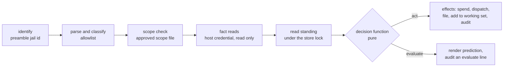

# Ask before you act: the jail reads its own access, and a dry run answers with the broker's own decision

**Status:** 2026-11-12 — partly built. The plan's Tasks 1 to 3 are in main: GitHub act and
evaluate decisions, status and pre-ask (`4a2fafb3e`), and Git ref-update prediction and pre-ask
(`af8d5e976`), behind `yolo access`. Task 4 (the own-jail readout and grant snapshot) and Task 5
(the prediction-divergence tripwire) are not built; see the
[plan](access-introspection-plan.md). The design was written from evidence read at `3ccc28def` on
2026-11-04.

> **In short.** A prediction is only worth having if it cannot disagree with the decision it
> predicts. So the prediction is not a second implementation: it is the broker's own pipeline run in
> **evaluate mode**, which reaches the same pure decision function and then stops before the first
> effect.

**Why it matters.** Today an agent learns what it may do by doing it: it pushes, reads the
refusal, relays a menu, waits. It cannot ask "would this merge run?" or "what does this workspace
already hold?", so it guesses, and its guesses about approvals are the ones the owner has had to
correct.

**The shape.** One broker pipeline with an **act** and an **evaluate** mode; a readout and a
prediction request every broker answers over its own loophole transport; one in-jail verb,
`yolo access`, that asks them and renders JSON for an agent or text for a person. Plain prediction
files nothing; explicit `--ask` files the approval request before executing the proposed call.

**Cost.** The git and GitHub brokers' decisions must be split out of their effectful code into a
pure function, which is real refactoring in `internal/ghbroker` and `internal/gitbroker`. One new
verb, one new request kind per broker, one host-written snapshot file per launch.

**Start at [§5](#5-one-pipeline-two-modes)**; the rest falls out of it.

**Needs your ruling:** None. The design is settled; implementation remains pending.

**Reads with:** [`pack-brokers.md`](pack-brokers.md) (the extension point that lets a pack's broker
answer the same two requests; its decision function is this doc's),
[`access-introspection-plan.md`](access-introspection-plan.md) (the completed build hand-off),
[`jail-history.md`](jail-history.md) (what already happened; this doc is what
holds now and what would happen next).

---

## 1. The problem, in the owner's words

The owner, 2026-11-04, dictated:

> *"I want the agent from inside the jail to be able to poke at and understand its approvals and
> grants and how things are going to work at the finest grain possible. Like I want it to be able
> to prepare, pose a command, know if it's going to ask the user, be rejected, allowed, whatever it
> is, and understand its full security posture from inside so there's no hemming and hawing of what
> has been approved already or whatever."*

Two asks are in it:

1. **A readout.** Everything that decides what a call from this jail will do, at the grain the
   brokers decide at: per repository, per cell, per working-set item, per timed grant, with expiry.
2. **A prediction.** Given a proposed command or call, the outcome it would meet now, the reason,
   and the next step.

### 1.1 Requirements

| # | Requirement | From |
| :--- | :--- | :--- |
| R1 | Predict, for any brokered call, one of **runs**, **asks**, **refused**, with the rule that decided it | *"know if it's going to ask the user, be rejected, allowed"* |
| R2 | A prediction never disagrees with the real decision on the same inputs | the coordinator's brief: a prediction that can diverge is a defect |
| R3 | The readout lists grants, cells, the working set, timed grants and their expiry, Allow-once grants waiting to be spent, pending and recently answered requests, the repository scope, and each loophole's standing | *"its approvals and grants … at the finest grain possible"* |
| R4 | Every stop in the readout or a prediction names its next step | [`happy-path-principle.md`](../reference/happy-path-principle.md) |
| R5 | JSON for an agent, text for a person, from one result | the agent and the owner both read it |
| R6 | It covers the git and GitHub brokers today and any pack broker built on [`pack-brokers.md`](pack-brokers.md) | the owner's item 2 asks that the extension point be covered too |
| R7 | It never files, spends, extends or widens anything, and it shows the jail nothing about another workspace | a dry run that acts is not a dry run |

## 2. Terms

Every term here is *(coined here)* unless it links elsewhere.

| Term | Meaning | What it is not |
| :--- | :--- | :--- |
| **access readout** | The jail's own view of everything a broker or loophole would read to decide its calls, as of one moment ([§6](#6-the-access-readout)). The owner calls it the "security posture" | Not the `observe`/`assert` posture of `yolo host apply`, an unrelated use of that word in `internal/cli/apply.go`, which is why this doc does not use it |
| **prediction** | A broker's answer to "what would this call meet now", produced in evaluate mode ([§7](#7-the-prediction)) | Not a reservation: it holds nothing, and the real call decides again |
| **act mode**, **evaluate mode** | The two modes of one broker pipeline. Act is today's behavior; evaluate runs the same steps up to the decision and performs none of the effects | Not two code paths that each decide: they share every step before the effects |
| **decision function** | The pure function from a classified call, its facts and the standing to an outcome ([§5.2](#52-the-decision-function)) | Not the classifier, which turns a call into a kind and a resource; not the effects |
| **fact read** | A read the broker makes with the host's credential before deciding, such as a PR's state or a remote's refs. It is a read under the read grant, so it runs in both modes | Not a write, and never an input the jail supplies |
| **standing** | What the store and the launch's grant and scope files say for this workspace when the decision reads them: grants, cells, working set, timed grants, Allow-once grants, pending requests, limits. [`loophole-grants.md`](../reference/loophole-grants.md#46-how-a-grant-reaches-the-machinery) uses the word for one kind's state (`granted`, `requestable`, `pending`, `not_allowed`); this doc's use contains that one | Not the config files: only what the gate approved reaches it |
| **outcome** | One of **runs** (yolo forwards the call unasked, naming what covered it), **asks** (a request is filed and the call refused until a human answers), **refused** (yolo never forwards it, whatever anyone answers now) | Not the upstream's verdict: a merge yolo forwards can still be refused by GitHub's branch protection |
| **inputs digest** | A hash of everything the decision function read: the classified call, the facts and the standing | Not the command digest the store already uses to bind an Allow once, which hashes the call alone |

Existing terms used as defined elsewhere: **broker**, **request**, **grant**, **working set**,
**timed grant**, **Allow once** ([`boundary-broker.md` §1.3](boundary-broker.md#13-terms)),
**cell**, **ceiling**, **ask** ([`github-write-scopes.md`](github-write-scopes.md#1-the-cells)),
**grant kind**, **grant-declaring loophole** ([`loophole-grants.md` §1](../reference/loophole-grants.md#1-the-verdict-in-four-words)).

## 3. What exists today

| Fact | Where it is |
| :--- | :--- |
| A jail reads a request's answer from `<workspace>/.yolo/approvals/<id>.json`, a record the host writes and never reads back | `internal/approvalwait` (`record.go`) |
| `yolo wait` with no argument lists this workspace's requests that are pending or answered and not acted on | `internal/cli/wait.go` |
| `yolo history` reads what already happened to this workspace's requests (its first slice) | `internal/cli/history.go`, [`jail-history.md`](jail-history.md) |
| A grant-declaring loophole's standing per kind reaches the daemon in a launch-written grant file that is never mounted into the jail; the client learns it only from a refusal | [`loophole-grants.md` §4.6](../reference/loophole-grants.md#46-how-a-grant-reaches-the-machinery) |
| The briefing and the launch disclosure state each loophole's standing in one line | [`loophole-grants.md` §5](../reference/loophole-grants.md#5-every-stop-and-its-next-step) |
| The store, the working set and every grant live in a host directory no jail mounts | `internal/brokerstore` |
| The GitHub broker's decision is interleaved with its effects: `Authority.Classify` re-reads the scope file and the host's sets inside the call, and `coveredWrite` reads an item's state with the host's `gh` on the way to dispatching | `internal/ghbroker` (`authority.go`, `workingset.go`) |
| The git broker decides a push per ref inside the push stream, through its `coverFor` | `internal/gitbroker` (`policy.go`) |
| The store already refuses on two limits a prediction must also see: too many pending requests, and a cooldown after a denial | `internal/brokerstore` (`PendingLimitError`, `DenialCooldownError` in `limits.go`) |

**The gap.** Nothing in a jail can ask a broker anything except to act. The facts that would make
a readout are on the host, in the store and the grant files; the decision that would make a
prediction exists only inside the act path, interleaved with the effects.

## 4. Principles

- <a id="AX-P1"></a>**AX-P1. One decision, two modes.** A prediction is the broker's own pipeline
  stopped before its effects. There is no second decider, in the jail or on the host.
- <a id="AX-P2"></a>**AX-P2. The broker answers for itself.** The readout and the prediction come
  from the broker that would decide the call, over the loophole transport it already has, keyed on
  the host-asserted jail identity in the connection preamble
  ([`loophole-transport.md`](../reference/loophole-transport.md#the-connection-preamble)). A jail-side
  copy of the standing is never consulted for a broker's answer.
- <a id="AX-P3"></a>**AX-P3. Evaluate never acts.** It files nothing, spends nothing, extends no
  window, adds nothing to a working set, and forwards nothing but fact reads.
- <a id="AX-P4"></a>**AX-P4. Own workspace only.** A readout names this workspace's standing and
  nothing of another's, nor any host path beyond the workspace's own, nor the user's `on_request`
  command (which may carry a webhook secret).
- <a id="AX-P5"></a>**AX-P5. A prediction carries its own shelf life.** It names what it relied on
  and when the earliest of those expires, so an agent never treats a stale answer as current.

## 5. One pipeline, two modes

### 5.1 The steps

Every broker, git, GitHub or a pack's, runs one pipeline per call. The mode is a field of the
request frame; the jail cannot make act mode skip a step, since the steps are the same code.



| Step | Act | Evaluate |
| :--- | :--- | :--- |
| Identify | Host-asserted jail, workspace and launch from the preamble and the scope file | Same |
| Parse and classify | Allowlist; an unknown flag or word is refused ([BB-P2](boundary-broker.md#BB-P2)) | Same |
| Scope check | Against the live scope file | Same |
| Fact reads | Host credential, read grant required | Same reads; a failed read is a fact, so the decision sees it in both modes |
| Read standing | Under the store's lock, one transaction | Same transaction shape, read only |
| Decide | The decision function | The same function, the same inputs |
| Effects | Spend an Allow once, dispatch, file a request, add a created item to the working set, audit | None, except one audit line of event `evaluate` ([§8](#8-keeping-it-truthful)) |

### 5.2 The decision function

**Input:** the classified call (source, kind or cell, resource, repository, canonical call,
command digest), the facts (each read's value or its failure), the standing, and the time.

**Output:** an outcome and its explanation:

| Field | Meaning |
| :--- | :--- |
| `verdict` | `runs`, `asks` or `refused` |
| `rule` | The one line that decided it, in the user's own spelling: `all.merge_prs = "ask" (yolo-jail.toml:12)`, `refs/heads/agent/x is in the working set (w-3f9, by create-branch)`, `gh auth token is never brokered` |
| `covered_by` | For `runs`: the grant, working-set entry, timed grant, Allow once or standing read that covers it, with its id and expiry |
| `next` | For `asks` and `refused`: each next step, alone on its line, with who runs it (agent, here; human, on the host) |
| `relies_on_until` | The earliest expiry among everything `covered_by` and `rule` rest on; empty when nothing expires |

The function holds every rule a broker applies after classification, in this order, and the
first that answers wins:

1. **Refused classes** ([`boundary-broker.md` §5.4](boundary-broker.md#54-never-brokered)) and out
   of scope.
2. **No read grant** for the repository: refused, naming the grant line.
3. **A standing read**: runs.
4. **A cell set to `false`** in the ask: refused, naming the line.
5. **An Allow once** whose command digest equals this call's: runs, spending it (act only).
6. **A working-set entry or a timed grant** covering this kind on this resource: runs.
7. **A user grant** (a creation kind, a dispatch, an approve-run) covering it: runs.
8. **The cell's value** in the ask, then the ceiling's `always`: `true` runs, `"ask"` asks.
9. **The store's limits**: a pending-request limit or a denial cooldown turns an `asks` into
   `refused`, naming the request to answer or the time to retry.
10. Otherwise **asks**.

This order is the GitHub source's ([`github-write-scopes.md` §4](github-write-scopes.md#4-how-one-call-resolves))
written once for every source; git's per-ref push decision is the same function applied to each
ref the push would change, and a push asks when any ref asks.

> [!WARNING]
> **The decision function may not read the world.** A broker that reads an item's state inside the
> function, rather than as a fact read before it, makes evaluate mode either skip that read (and
> diverge) or perform it in a place the inputs digest does not cover. Every host read happens in
> the fact-read step; the function reads only its arguments.

### 5.3 What evaluate does at each kind of call

| Call | What evaluate needs that act already had |
| :--- | :--- |
| `gh …` | Nothing: the argv is the whole call. Fact reads (an item's state, the default branch) run as in act |
| `git push …` | The ref updates, which act reads from git's push stream. The in-jail client asks local git for them, through git's own dry run, which reads the remote's advertisement through the broker as a read and sends no commands; then it sends the ref updates to the broker's evaluate request. The broker reads the remote's refs itself as a fact read and never trusts the jail's copy |
| `git fetch`, `pull`, `ls-remote` | The remote URL alone |
| A pack broker's CLI or HTTP call | Defined by [`pack-brokers.md`](pack-brokers.md#6-the-decision-is-cores); the pack's classifier runs in both modes |

## 6. The access readout

### 6.1 What it holds

Per brokered source:

- **State:** running, inert (with the inert reason), or unreachable (with why and the next step).
- **Repository scope:** each repository, and what put it there (a remote's name, a
  `[repos.<name>]` table).
- **Read:** granted or not, and from which line (`allow.github.always`, a project request the gate
  approved).
- **Cells and kinds:** for each, its value in the ask with its file and line, whether the ceiling
  allows it `always`, `on_request` or not at all, and for anything not held the one command that
  would ask for it.
- **Working set:** each entry, its resource, how it entered (`create-pr`, a grant id, a hand-over),
  and its expiry when it has one.
- **Timed grants** with their resource, cell and end time.
- **Allow-once grants** answered and not yet spent, with the exact command and their expiry.
- **Requests:** pending, with expiry and its `yolo wait` line; answered in the last 24 hours, with
  the answer and whether it was used. This is what the approval records already carry; the full
  history is `yolo history`'s.
- **Limits:** how many requests are pending against the cap, and any denial cooldown with its end.
- **Never brokered:** the refused classes, in one line each, so an agent stops trying them.

Per host daemon that holds a credential but brokers no call, such as the MCP sign-in broker: the
answer it gives the framework's readout request, `{"op":"status"}`, live, over its own endpoint
(for the MCP sign-in broker, the `yolo.mcp-auth.status/1` object `yolo mcp-auth status` prints:
each composed server, shared or kept, its generation and expiry, and any dead record with its next
step; never a token). On Apple Container that line is the unreachable one until the MCP sign-in
plan's phase C admits the `mcp-auth-broker` daemon there. Its records are sign-in records, not
requests, so `yolo approve`, `yolo wait` and `yolo history` never list them. [`pack-brokers.md` §13](pack-brokers.md#13-coherence-with-the-mcp-sign-in-broker) lists
the touch points.

Per loophole that is not a broker: its standing per grant kind, its granted values, and the next
step for each kind not held, which is what its own client's refusal would say.

### 6.2 Where each part comes from

| Part | Source | Why there |
| :--- | :--- | :--- |
| Everything per broker | The broker, live, over its own transport, in one read-only store transaction | [AX-P2](#AX-P2): the decider is the authority; a copy would drift |
| A credential daemon's line (the MCP sign-in broker) | The daemon, live, over its own endpoint | Its records change on every refresh |
| A non-broker loophole's standing | The **access snapshot** *(coined here)*: a file the launch writes beside the grant file, in the same step and from the same in-memory result, at `<workspace>/.yolo/access/<launch-id>.json`, rewritten by `yolo config apply`'s live apply | These daemons answer one protocol each and decide nothing finer than a kind and its values; the snapshot carries exactly that |

The snapshot holds the standing columns and the values of valued kinds, never a setting, since a
setting may name a host profile or a path. The jail can write that directory, so a forged snapshot
misleads only the agent that forged it; nothing on the host reads it.

### 6.3 Failure paths

| Failure | What the readout says |
| :--- | :--- |
| A broker's endpoint is missing | `git-broker: not running in this jail (no endpoint).` then the host step `yolo check`, run by the human in this workspace |
| A broker is too old to answer a readout | `github-broker: this jail's broker predates yolo access; relaunch the jail to get one that answers.` The rest of the readout still renders |
| A broker answers slowly | Each broker has a 5 s budget for a readout; past it the source is shown unreachable and the others render |
| No snapshot (a launch from before this) | The loophole section says the standing is in the briefing, and that a relaunch writes the file |
| No brokered pack selected | `No broker is selected for this jail, so no call reaches the host's logins.` then `yolo pack add github` as the human's host step |

## 7. The prediction

### 7.1 What a caller gives

The proposed call, exactly as the agent would run it: `gh pr merge 40 --squash`,
`git push origin agent/x`, a pack's CLI argv, or an HTTP method and URL for a pack's HTTP front.
Anything that is not a brokered call is answered without a broker: `ls` reads **local**, *it runs
in the jail and reaches no host login*.

### 7.2 What it returns

The decision function's output ([§5.2](#52-the-decision-function)) plus the classified call, the
facts it read, and the inputs digest. For `asks`, the menu the real refusal would print, with
`r-<id>` left as a placeholder since nothing is filed.

### 7.3 Filing before execution

`yolo access --ask -- <command>` evaluates the proposed call through the same broker pipeline.
When the outcome is `asks`, it uses the real call's request-filing path and prints the resulting
request's approval menu with its actual id. The same command and input digest bind the request
and any resulting Allow once to the later real call. Existing pending-request limits, denial
cooldowns and duplicate-request handling apply unchanged.

This explicit filing runs no proposed write, spends no grant and adds nothing to a working set.
For `runs` or `refused`, it reports that outcome without filing or dispatching. The agent can
collect a batch's requests before acting; the human answers them in one sitting, and each later
call still passes the normal decision pipeline. A plain prediction remains read-only apart from
its existing audit and prediction record.

### 7.4 Limits, said in the output

- **It is yolo's decision, not the upstream's.** `runs` means yolo forwards it; the forge may still
  refuse.
- **It holds nothing.** Between the prediction and the call a grant can expire or a human revoke
  it; `relies_on_until` says when the answer goes stale at the latest, and the real call decides
  again.
- **A fact read that fails is a fact.** If the PR's state could not be read, the prediction says
  `asks` because the real call would, and names the read that failed.

## 8. Keeping it truthful

The brief's rule, that a prediction able to diverge from the real decision is a defect, holds by
construction and is checked at run time.

1. **One function.** Both modes call the same decision function with inputs built by the same steps
   ([§5](#5-one-pipeline-two-modes)). No step before the decision branches on the mode.
2. **Inputs, not hopes.** Each prediction records its inputs digest. At act, the broker computes
   the digest of its own inputs.
3. **The tripwire.** The broker keeps each workspace's predictions for 15 minutes, keyed by command
   digest. When an act's inputs digest equals a kept prediction's and its verdict differs, the
   broker writes an audit event `prediction-diverged` carrying both, and `yolo check` reports it as
   a yolo defect (or the pack's, for a pack source), naming `yolo audit --event prediction-diverged`
   to read both lines. It never blocks the call: the act's decision is the one that counts. Equal
   digests with equal verdicts write nothing; different digests are a legitimate change and write
   nothing either.
4. **Tests that fail on a fork.** Every broker's decision tests run each fixture through both modes
   and assert the same outcome; a test that only exercises evaluate is not one. For a pack broker
   the same run is the conformance kit ([`pack-brokers.md`](pack-brokers.md#19-what-done-looks-like)).
5. **Audit.** Every evaluate request is audited as event `evaluate`, with the verdict, since its
   fact reads used the host's credential ([BB-P7](boundary-broker.md#BB-P7)). `yolo audit` gains
   an `--event` filter beside its `--service` and `--jail` filters, so both new events can be read
   alone.

## 9. The verb

The verb is `yolo access`: one command for the readout, prediction and explicit request filing.

```console
$ yolo access                          # the readout, every source
$ yolo access github                   # one source
$ yolo access -- gh pr merge 40        # predict a call
$ yolo access -- git push origin agent/x
$ yolo access --ask -- gh pr merge 40 --squash  # file approval without merging
$ yolo access --json …                 # any of the above, for an agent
```

It runs in a jail and at the host notch alike; on the host with no jail it says no broker serves
this shell and names `yolo approve --json` for the host's view of every workspace.

**Exit status:** 0 when it produced a readout, prediction or request-filing answer, whatever the
verdict; 69 when it could not (no broker answered the call's source); 64 for a usage error.
`--ask` requires a proposed call. The verdict is in the
output, never only in the status, so an agent cannot read "refused" as "the tool failed".

**Text form**, one prediction:

```text
gh pr merge 40 --squash  →  asks
  github-broker: merging PR acme/app#40 (opened by kurt) asks here:
  yolo-jail.toml:12 sets requests.github.all.merge_prs = "ask", and #40 is not in the working set.
  File approval without merging, then wait in the background:
    yolo access --ask -- gh pr merge 40 --squash
    yolo wait r-<id>
  The human answers on the host:
    yolo approve r-<id>
```

**JSON form**, the same prediction:

```json
{
  "schema": "yolo.access.prediction/1",
  "call": {"source": "github", "canonical": ["gh", "pr", "merge", "40", "--squash"], "digest": "c0ffee…"},
  "classified": {"cell": "merge_prs", "table": "all", "resource": "github.com/acme/app#40"},
  "facts": [{"read": "pr-state", "resource": "github.com/acme/app#40", "value": "open", "in_working_set": false}],
  "verdict": "asks",
  "rule": {"text": "requests.github.all.merge_prs = \"ask\"", "file": "yolo-jail.toml", "line": 12},
  "covered_by": null,
  "next": [
    {"who": "agent", "where": "jail", "run": "yolo access --ask -- gh pr merge 40 --squash"},
    {"who": "agent", "where": "jail", "run": "yolo wait r-<id>", "background": true},
    {"who": "human", "where": "host", "run": "yolo approve r-<id>"}
  ],
  "relies_on_until": null,
  "inputs_digest": "9e1f…"
}
```

The readout's JSON is `yolo.access/1`: one object per source with the parts of
[§6.1](#61-what-it-holds) as arrays, every entry carrying its id and expiry. Field names are the
implementer's beyond the ones shown; the schema name, `verdict`, `rule`, `covered_by`, `next` and
`relies_on_until` are fixed, since the briefing teaches them.

**The briefing** gains one line in each broker pack's section: *before a write, `yolo access --json
-- <command>` says whether it will run, ask or be refused, and what to do next.*

## 10. Non-goals

- **No prediction for non-broker loopholes.** Their grain is a kind and its values, which the
  readout shows whole, and their clients' refusals already name the exact step. A per-call
  evaluate request in four daemons would buy nothing the readout lacks.
- **No upstream prediction.** Branch protection, a required check, a CircleCI plan limit: those are
  the upstream's, and a prediction says so rather than guess.
- **No host-side view of other workspaces from a jail.** `yolo approve --json` on the host stays
  the cross-workspace view.
- **No change to what any call decides.** This design moves where decisions are computed; it
  changes no rule.

## 11. Alternatives considered

| Alternative | Verdict |
| :--- | :--- |
| **A jail-side predictor reading a mounted copy of the store** | Rejected: a second decider, and it mounts host state [`boundary-broker.md`](boundary-broker.md#BB-P9) keeps out of every jail |
| **`--dry-run` flags on `gh` and `git` themselves** | Rejected as the only surface: `gh` has no dry run, and git's own does not reach the broker's decision. Git's dry run is used underneath, to compute ref updates ([§5.3](#53-what-evaluate-does-at-each-kind-of-call)) |
| **A single core posture daemon** reading every source's store for the jail | Rejected: every loophole is a pack's and there is no other channel ([OQ-A10](../reference/loophole-system.md#oq-a10)); and it would be a second reader of each source's rules |
| **The snapshot for brokers too**, refreshed on every store write | Rejected: the store changes on every answer and every spend; a copy is stale by construction, and [AX-P2](#AX-P2) says the decider answers |
| **Exit statuses that mirror the real call's** (75 for asks) | Rejected: 64 already means both "refused" and "usage", so the status could not say which; the verdict lives in the output |

## 12. Risks

| Risk | Mitigation |
| :--- | :--- |
| The refactor of the GitHub broker's decision changes a real decision | The decision tests run in both modes against today's fixtures before and after; any changed outcome is a defect, not a migration |
| An agent spams predictions, and their fact reads spend the host's API quota | Predictions are audited; a fact read is cached for the life of one request only, so the cost is one real call's reads. A per-workspace rate cap is the implementer's to add if a quota bites |
| A prediction of `runs` makes an agent skip telling the human about a consequential write | The prediction changes nothing a human approved; it only reads it. The readout shows what was granted, by whom, and when |
| The readout reveals the user's ceiling, so an agent learns what it could ask for | Intended: the refusals already disclose it per call ([`loophole-grants.md` §5](../reference/loophole-grants.md#5-every-stop-and-its-next-step)) |

## 13. What I would build, in order

1. **Split the decision out of the GitHub broker**, behind its existing tests, with both-mode
   tests. No behavior change, no new verb.
2. **The evaluate request and the readout request (`{"op":"status"}`, the framework's) on the GitHub broker**, and `yolo access` with
   the readout, `gh` predictions and explicit `--ask` request filing.
3. **The same for the git broker**, including the ref-update computation for a push.
4. **The access snapshot** and the loophole section of the readout.
5. **The tripwire**, and the briefing line.
6. **Pack brokers**, which get both requests by construction from
   [`pack-brokers.md`](pack-brokers.md).

## 14. What done looks like

- In a jail with the github pack, `yolo access --json -- gh pr merge 40` prints `asks` with the
  line that decided it, and running the command then files a request whose menu matches the
  prediction's `next`.
- `yolo access --ask -- gh pr merge 40` files that approval request without merging, prints the
  actual request id and menu, and leaves every grant unspent. Plain prediction files nothing.
- After the human runs `yolo approve r-<id>`, the same prediction prints `runs`, `covered_by` names
  the Allow once with its expiry, and the command runs.
- `yolo access` lists the working set, the timed grants with end times and the pending requests,
  and every item not held has the command that asks for it.
- `yolo audit --event evaluate` on the host shows each prediction; a forced divergence in a test
  build shows a `prediction-diverged` line and a `yolo check` finding.

## Decision Ledger

The owner rulings and the designer's implementation-independent decisions are recorded below;
none is evidence that the behavior is built.

| ID | Ruling / Decision | Date | Settled in | Built |
| :--- | :--- | :--- | :--- | :--- |
| OQ-AX1 | Explicit `yolo access --ask -- <command>` files the real call's approval request before execution, so a batch can be approved together; plain prediction files nothing | 2026-11-04 | [§7.3](#73-filing-before-execution) | — |
| OQ-AX2 | The readout, prediction and request-filing verb is `yolo access` | 2026-11-04 | [§9](#9-the-verb) | — |
| AX-D1 | A prediction is the broker's pipeline in evaluate mode; there is no jail-side predictor | 2026-11-04 | [§5](#5-one-pipeline-two-modes) | — |
| AX-D2 | The readout comes from each broker live; only non-broker loopholes are read from a launch-written snapshot | 2026-11-04 | [§6.2](#62-where-each-part-comes-from) | — |
| AX-D3 | A divergence on equal inputs digests is audited and reported by `yolo check`, never blocking | 2026-11-04 | [§8](#8-keeping-it-truthful) | — |
| AX-D4 | `yolo access` exits 0 whenever it produced an answer; the verdict is in the output | 2026-11-04 | [§9](#9-the-verb) | — |
| AX-D5 | The readout never shows the `on_request` command, another workspace, or a setting's value | 2026-11-04 | [§4](#4-principles) | — |
| AX-D6 | No per-call prediction for non-broker loopholes | 2026-11-04 | [§10](#10-non-goals) | — |
| AX-D7 | The readout request every broker and credential daemon answers is the framework's `{"op":"status"}`; the MCP sign-in broker's line is its `yolo.mcp-auth.status/1` object, unreachable on Apple Container until the MCP plan's phase C, and its records never appear in `yolo approve`, `yolo wait` or `yolo history` | 2026-11-04 | [§6.1](#61-what-it-holds) | — |
