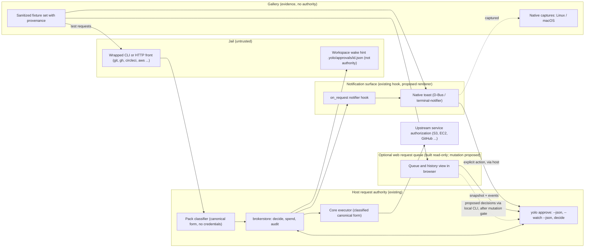

# Make approvals understandable and broad without creating a second authority

**Status:** Delivery claims checked against source at `62b8bbda3`. The first-slice commits below
are ancestors of the supplied last-verified remote commit `77df9ca0d`; this is ancestry evidence,
not a fresh server or release check.

This is the spine of a growing constellation of designs with delivered first slices, not a
shipped-system reference or a claim that every acceptance outcome is met. The fixture gallery and
authentic Linux captures, the experimental host-only read-only queue, and bounded S3 CLI mediation
are built. Native Mac evidence, browser mutation, comprehensive history and proof of a repeatable
second adapter remain outstanding.

**Thesis.** Keep `brokerstore` as the sole approval authority while improving how people see requests and expanding the services that can be mediated. Coordinate three workstreams—authentic native-notification evidence, an optional CLI-backed browser queue, and a repeatable service-mediation recipe beginning with a bounded AWS S3 vertical—under shared trust and evidence boundaries.

**Needs your ruling:** None in this umbrella. The owner intent in [1.1](#11-settled-owner-intent)
is settled. The mutation-only choice stays open in the browser sibling as
[OQ-BT1](browser-trust-boundary.md#OQ-BT1); the host-history extension is filed with its owning
authority as [OQ-BB24](../boundary-broker.md#OQ-BB24), not here. This document itself authorizes no service account, credential
access, capture run, configuration edit, implementation or publication.

## 1. Recommendation and scope

Develop three workstreams under one set of rules:

1. **Native notification gallery (W1).** A web page of varied representative approval requests, each shown beside its genuine OS notification capture, used to improve wording, information, appearance and actionability.
2. **Optional browser request queue (W2).** Outstanding requests and past requests and approvals, rich detail before any decision, live updates; shipped separately over generic yolo interfaces and started in development by one command against the real host machinery.
3. **Repeatable service mediation (W3).** One bounded AWS/S3 vertical that proves a recipe (classification table, scope vocabulary, account-free fixture service, test checklist) which later services follow mostly by filling in tables.

**The delivered first slice** comprises three independent deliverables: a fixture gallery with
native Linux baseline captures, a host-only read-only queue over `yolo approve --json` and
`--watch --json`, and an S3 pack exercised end to end by a local fixture service. Their code landed
in `8170793c4`, `5ed824bb9`, `e88886990` (gallery), `304d61f13`, `5f919bd0b`, `831047237` (queue)
and `2e9dc7f70`, `81a7bc2ec` (S3). Their limits and the remaining acceptance work are in
[10](#10-observable-success-and-next-investigations). A missing Mac capture does not block Linux
notifier or S3 engineering; an unsettled browser mutation boundary does not block the gallery.

**Terms used here.** *Storybook* means an example gallery, not the JavaScript Storybook product, a frontend framework or a packaging format. *Request authority* is the host `brokerstore` plus `yolo approve`, the only thing that turns a request into a grant. *Fixture set* is the shared collection of sanitized representative requests with provenance labels. *Native capture* is a screenshot of a real OS notification server rendering a fixture, with environment provenance; anything else is a *preview*. *Live state channel* carries queue updates from host to browser and is distinct from *development asset reload*, which refreshes code. *Mediation* is brokered classify–decide–execute of a service operation as in [pack-brokers.md](../pack-brokers.md); *credential delegation* hands a jail credentials it then uses directly.

### 1.1 Settled owner intent

The rulings below are settled owner intent. Mechanisms in later sections are proposals except where the delivery evidence identifies a built slice. **Built** refers to the new work requested here, not the existing broker foundation.

| ID | Ruling | Date | Settled in | Built |
| --- | --- | --- | --- | --- |
| AE-R1 | Start with one overarching document that a constellation of approval improvements hangs from. | 2026-11-05 | This document; [7](#7-proposed-sibling-map) | This document |
| AE-R2 | Show varied real approval examples beside authentic Linux/macOS notifications, including Git and CircleCI. HTML replicas are not native evidence; this task owes no captures. | 2026-11-05 | [4](#4-workstream-1-native-notifications-and-the-example-gallery) | Fixture gallery and native Linux baseline; no Mac captures |
| AE-R3 | Optional queue for outstanding and past requests, rich detail and live updates; preferably separately shipped over generic yolo interfaces, with a development command as a valid first slice. Arrival/navigation is unresolved; WebSocket is a suggestion, and live updates differ from asset reload. | 2026-11-05 | [5](#5-workstream-2-an-optional-browser-request-queue) | Experimental read-only queue in yolo; observed-only memory history, no mutation or comprehensive history |
| AE-R4 | Fine-grained service permissions and wrapping starting with AWS S3, perhaps EC2 and a justified third AWS service, with repeatable permission/classification/scope/testing machinery so many integrations can ship. No broad authorization inferred from product names. | 2026-11-05 | [6](#6-workstream-3-service-mediation-that-scales-beyond-one-adapter) | Bounded S3 CLI mediation and account-free fixture; broader services and second-adapter proof outstanding |
| AE-R5 | The complete generic service wishlist is preserved in the umbrella, grouped, with gaps and uncertainty explicit. The private dashboard integration is an internal pack never published to the public repository. | 2026-11-05 | [6.3](#63-complete-coverage-inventory) | Inventory preserved here; private implementation not claimed |
| AE-R6 | Public documents use generic product names and generalized engineer workflows. This task performs no credential, configuration, host, capture, implementation or publication actions. | 2026-11-05 | [1.2](#12-non-goals-and-privacy) | Public fixture sanitization; no private runtime or publication claim |

### 1.2 Non-goals and privacy

This umbrella is not an implementation plan, ticket list, schema or supersession of [boundary-broker.md](../boundary-broker.md), [pack-brokers.md](../pack-brokers.md) or [herdr-approvals.md](../herdr-approvals.md), which remain authorities for their own machinery; changes to their contracts must be made there under a named question.

It does not propose remote or multi-user approval, an approval quorum, automatic consent, a replacement grant store, or any widening of grants. It does not choose operation scope for any listed service, change the existing AWS credential route, or promise that wrapping a CLI confines every use of the credentials behind it.

Public examples use generalized engineering workflows and sanitized data: no employer identity, private endpoints, personal application inventory, credentials, or internal dashboard topology. The private internal dashboard pack stays private code; private packaging is confidentiality and provenance, not proof of an enforcement boundary, because yolo does not enforce its official-pack safety contract on packs it does not ship.

## 2. What already exists, and what is missing

The remedies proposed here were checked against the existing machinery below; none of them needs a second authorization system. File references are where to verify, not proof the prose has not lagged.

| Existing machinery | What it already handles | Gap this constellation addresses |
| --- | --- | --- |
| [`internal/brokerstore/store.go`](../../../internal/brokerstore/store.go): request/grant storage, `Decide`, `SpendExactOrFileContext` | Binding a request to launch, jail, broker lifetime, workspace, source, repository, set, canonical argv and stdin digest (generic pack writes also bind original argv and resource chains); serialized decisions; expiry; grant spend; audit. | Human comprehension and more classified operations, not replacement authority. |
| [`internal/cli/approve.go`](../../../internal/cli/approve.go): `yolo approve --json`, `--watch --json`, decisions | Host-side listing of pending requests, live grants and working sets; decision, denial and revocation with distinct exit codes; the declared seam for a UI built outside yolo. | Optional browser presentation, safe browser access, and a usable historical view. |
| [`internal/cli/approvesources.go`](../../../internal/cli/approvesources.go) | Discovery and revalidation of official Git/GitHub and selected generic callbroker adapters; removed or unknown sources stay visible but deny/revoke-only; incomplete selection fails closed. | New adapter coverage, not a missing generic-source approval mechanism. |
| [`internal/brokerstore/watch.go`](../../../internal/brokerstore/watch.go) | Polling snapshots and diffs (CLI default one second) behind `--watch --json` schema 1. | Reconciliation, explicit freshness, and history beyond observed events. |
| [`internal/paths/paths.go`](../../../internal/paths/paths.go) | Private host broker directory and `audit.jsonl` locations. The workspace `.yolo/approvals/<id>.json` is a jail-editable wake hint, never authority. | Nothing; surfaces must simply never read the hint as a decision source. |
| [boundary-broker.md](../boundary-broker.md) | Approval rules and the existing toast design: freedesktop D-Bus actions on Linux, `terminal-notifier` ≥ 3 and an eventual signed helper on macOS. External `on_request` notifier hooks exist; their output is never consent. | Native presentation *evidence* and the implementation gap; not permission to revisit settled behavior by accident. |
| [herdr-approvals.md](../herdr-approvals.md) | An adjacent, unbuilt pane/toast/picker design over the `yolo approve` CLI. | A browser experience; mock herdr/store fixtures prove command wiring, not native rendering. |
| [pack-brokers.md](../pack-brokers.md) | Core/classifier/executor contracts, resource types/roots/cells, dry-run and access prediction, store/approvals/wait/audit/on_request, and the requirement for local fixture services. The HTTP front slice is partially built. | Efficient, repeatable application of those contracts across many services. |
| [`packs/git`](../../../packs/git/pack.toml), [`packs/github`](../../../packs/github/pack.toml) | Real call brokers with host-held credentials and audited calls. | Representative fixtures for the gallery and queue; extend only from verified gaps. |
| [`packs/circleci`](../../../packs/circleci/pack.toml) with [`internal/circleciclassify/classifier.go`](../../../internal/circleciclassify/classifier.go) | Explicit project-scoped approved-root `run list` only; a fake host CLI integration fixture uses the real classifier. | No write path (rerun, run approve, pipeline create) and no live Cloud/Server auth proof; write toasts are synthetic. |
| [`packs/aws-auth`](../../../packs/aws-auth/pack.toml) | Minting and narrowing AWS SSO credentials before they reach a jail. | A credential broker, not command-by-command approval; the built [`aws-s3` pack](../../../packs/aws-s3/pack.toml) is a distinct mediated route and does not change it. |

### 2.1 The gaps the owner feels

1. **Presentation.** The gallery now has a shared fixture/capture harness and genuine Linux captures from a headless sway/swaync stack, not the owner's desktop pixels. The [gallery sibling](native-notification-gallery.md) identifies and measures the external notifier baseline. A shipped yolo-native actionable renderer and native Mac capture evidence are still missing; screenshots do not establish every action or lifecycle behavior.
2. **Overview.** The current CLI does not provide a comprehensive history view. Its watch stream is not a durable event log: it can miss transient states, pruning emits no event, and working-set changes emit no events. Audit details are adapter-provided, so there is no universal history API to lean on.
3. **Coverage.** Verified paths include Git and GitHub brokers, a narrow CircleCI read-only classifier, AWS SSO credential delegation and bounded S3 CLI mediation. This is not broad wishlist coverage. The S3 fixture walks the first service recipe; the conformance kit and second-adapter proof remain outstanding in [service mediation](service-mediation.md).
4. **Stale prose.** Some text in [pack-brokers.md](../pack-brokers.md) says `approve` knows only two sources; current code revalidates selected generic callbroker adapters too. Siblings must not copy that gap.

### 2.2 Authority facts every surface must preserve

- A request binds its operation; a decision cannot independently choose a holder, set or command. Decisions revalidate current policy under the store lock and can narrow, never widen, the filed ceiling.
- Pending requests currently expire after one hour. Exact Allow-once is one use and at most fifteen minutes, bounded further by policy.
- Grants are held by **workspace**, not isolated to the originating jail or session. Every surface must make that reach visible before confirmation.
- Concurrent approvers compete for one transition; the loser sees "already decided". This is a local lock, not a quorum.
- Spend is persisted before dispatch: a failed or crashed call may consume a use with no refund or replay. Approval is not proof of execution or success.
- Duplicate pending filing is deduplicated per jail, lifetime, set and digest. Reattempt is independently authorized by the host broker, never by the workspace hint.
- The CLI's exit codes 0 through 6 map, in order, to success, I/O, usage, already decided, unknown id, policy refusal and no longer confirmable. Codes 3, 5 and 6 are expected outcomes, not errors.

## 3. Architecture: shared authority, separate surfaces



The diagram expresses ownership, not completeness: the HTTP mediation front and the native renderer keep their current evidence labels (partially built; designed, not shipped).

### 3.1 Five rules that bind every sibling

1. **One authority.** Only `brokerstore` decides, spends and audits. Toasts, the queue and the gallery produce *intent* or *evidence*; a decision reaches the store only through `yolo approve` on the host, revalidated per action.
2. **Jail reachability grants no approval authority.** A jailed client may be able to reach a host listener; the listener must not give it approval capability or credentials. The browser boundary must authenticate the host user for mutation without relying on loopback binding alone. Host approval credentials and sessions must not leak to jailed processes through the workspace, URLs, browser history or untrusted content. Render request text as untrusted data, never execute it or interpolate it into a shell.
3. **No UX path broadens a grant.** Body click never grants; user dismissal is Deny; expiry is not consent; ignored or unknown notifier output is not approval. A decision made anywhere withdraws stale actionable notifications elsewhere. Stale or changed scope refreshes and explains a refusal; it never converts into a broader grant.
4. **Successful transport is not successful authorization.** Every surface honors the CLI exit code and re-reads state; "allowed" is kept distinct from "executed successfully".
5. **Shared fixtures, honest provenance.** One sanitized fixture set feeds the gallery, the queue and service tests, and every artifact says whether it is a currently supported real request or a synthetic future-service example, a native capture or a preview, a missing capture or a tested pass.

### 3.2 Shared seams without a new prerequisite schema

Reuse current request IDs, host-derived operation detail, source capabilities and CLI outcomes first. No universal request schema may block the first slice. The surfaces need consistent answers to four questions: what operation, resources and workspace this affects; what each available action authorizes, for how long, and for whom; whether the request is current and confirmable and what changed since display; and what is known about the decision and subsequent execution and what is not. Normalization must not erase Git refs, object versions, multi-resource writes or differences between source grant semantics.

| Seam | Used by | Owner |
| --- | --- | --- |
| Fixture set with provenance labels | W1, W2, W3 tests | Gallery sibling defines format; service siblings contribute entries |
| `yolo approve --json` and `--watch --json` schema 1 | W2, herdr design | Existing CLI; changes need a named question in [boundary-broker.md](../boundary-broker.md) |
| Notification withdrawal on decision elsewhere | W1, W2 | [boundary-broker.md](../boundary-broker.md) (existing) |
| Classification table and scope vocabulary | W3 and every later service | Service mediation machinery sibling |
| Local fixture services without external accounts | W3, CircleCI, future services | [pack-brokers.md](../pack-brokers.md) requirement (existing) |

## 4. Workstream 1: native notifications and the example gallery

**Reader question.** What do approval requests actually look like as OS notifications, and what should change so they look good, say enough, and can be acted on safely?

### 4.1 Evidence first, not an HTML imitation

The gallery is a static page generated from the fixture set. Each entry shows the canonical request detail, the notification text and actions the design would send, and a native capture per platform where one exists. Every entry states whether it is a representative request for a currently supported operation or a synthetic future-service scenario; an actual OS capture, a preview, or a missing capture (shown as missing, never as a green placeholder); and a visual observation only or an action/lifecycle behavior that was also tested. Sanitized replay of a supported request is not evidence that a live account was used. An HTML replica may help iterate layout but never stands in for an OS screenshot.

**Baseline before cosmetics.** The first investigation identifies the renderer and `on_request` configuration behind the toasts the owner sees today and captures *those* into the gallery, so improvement is measured against reality and the failure is located: wording, truncation, OS presentation, action discovery, or notifier lifecycle.

### 4.2 Native constraints are part of the design

Preserve the Linux and macOS notification behavior settled in [boundary-broker.md](../boundary-broker.md) unless a focused sibling explicitly reopens a rule under a named question.

Linux needs the launch's own `DBUS_SESSION_BUS_ADDRESS`, a chosen notification daemon and a resident notifier connection; there is no fallback to an unattended desktop bus. A headless Wayland/Sway stack is useful only with those components, because Sway alone renders nothing. Button and menu behavior varies by server (GNOME buttons, KDE connection lifetime, dunst/mako menu actions, swaync buttons) and Do Not Disturb may remove actions. That legacy table is source-backed context, not a fresh runtime measurement; the gallery is where new measurements are recorded.

macOS retains `terminal-notifier` ≥ 3 and an eventual signed helper app. Multiple actions may collapse into Options; Alerts style and per-app permission are user settings. Native proof needs a real GUI session, notification authorization and a capture runner; withdrawal and action handling still need real measurement. Modal AppleScript dialogs are not toasts, and a Linux-rendered facsimile never counts as Mac proof.

### 4.3 Representative gallery coverage

| Example family | Required variation | Evidence boundary |
| --- | --- | --- |
| Git | Single and multiple refs, old/new targets, push options, long names, partially covered scope. | Supported broker requests supply representative fixtures. |
| GitHub | Resource-specific writes, long content, exact versus broader available actions. | Broker support does not establish native renderer support. |
| CircleCI | Project-scoped `run list` (current); rerun, run-approval and pipeline-creation stories (synthetic, marked). | `run list` is the narrow implemented path; do not fabricate a prompt where policy needs none. |
| S3 and later services | Multiple resources, sensitive paths, destructive-looking operations, changed scope. | The supported S3 operation table is built; multi-object delete and unimplemented later-service stories stay synthetic. |
| Cross-cutting states | Denial, expiry, stale action, decision elsewhere, unavailable actions, truncation, sensitive-data redaction. | Screenshots alone do not prove decision or withdrawal behavior. |

Capture provenance, OS and notification-server versions, theme, scaling and redaction rules belong to the gallery and capture siblings, not this umbrella. Success means a reader identifies the operation and consequence without mistaking an abbreviated toast for complete scope; when detail cannot fit, the toast offers a safe route to fuller detail rather than concealing the limit or broadening the action.

## 5. Workstream 2: an optional browser request queue

**Reader question.** Can an engineer see outstanding and past requests with enough detail to decide well, watch them update live, and eventually decide safely, without yolo growing a second authority?

### 5.1 Prove the queue before settling how people arrive

The optional service was proposed as separately shipped; the experimental read-only implementation is part of yolo and starts with `yolo approve --web` or `just dev-approvals`. It reads `yolo approve --json` for the snapshot and `yolo approve --watch --json` for events, and reconciles by periodic re-snapshot because the watch stream is lossy by design: reconnects, pruning and working-set changes cannot be reconstructed from events. The built view shows every field the CLI JSON provides, including argv, repository, set, source revalidation status, workspace-wide grant reach, grant use limits and time remaining. The desired resource chains, policy ceiling and answer duration are not all exposed by that interface; the [history/privacy field map](request-history-and-privacy.md#41-the-json-surface) records its limits.

How the engineer reaches the page (toast link, terminal hint, menu item, automatic browser launch) is deliberately unresolved by owner ruling for the general case; the read-only experiment of [5.4](#54-the-read-only-queue-as-built-yolo-approve---web) prints a link and opens the browser from its own terminal. WebSocket is a reasonable live state channel; server-sent events or polling are acceptable and the sibling chooses against real interaction needs. The live channel is separate from development asset reload, and neither carries authority.

### 5.2 Read-only first; mutation only behind a tested host-user boundary

**Decision (derived, not a new owner ruling).** The first queue slice is read-only: it shows and watches; decisions stay in the terminal or toast until the browser trust boundary sibling has settled and *tested* the boundary. This follows from the existing contract in [`internal/cli/approve.go`](../../../internal/cli/approve.go), which says a UI built outside yolo must never accept approvals from the jails it approves because a jail can reach a host port, and from the owner's instruction to prove the experience first. The alternative, mutation in the first slice behind a boundary proven at the same time, is recorded in [9](#9-alternatives-costs-and-risks); it delays the first slice rather than lowering the bar.

Before the queue offers Allow or Deny, even in development, the trust boundary sibling must settle and demonstrate by test, not argument:

- host-user authentication and a trusted bootstrap that gives jailed processes no approval capability;
- origin validation, cross-site request protections, and authentication of the chosen live channel;
- credential storage and lifecycle outside jailed workspaces, URLs, history and browser-delivered content;
- safe rendering of request text, with no shell execution or active content derived from it;
- per-action request binding, source-aware available actions, stale-state handling, and faithful CLI exit-code interpretation.

Read-only access also needs a privacy boundary: "no approve button" does not make request details public to anything that can reach the listener. The built host-connected view uses the authentication in [the browser sibling](browser-trust-boundary.md#8-the-read-only-slice-requirements) and the display/retention rules in [history and privacy](request-history-and-privacy.md); its outstanding real-host and browser checks are listed in [5.4](#54-the-read-only-queue-as-built-yolo-approve---web). The sidecar invokes the CLI with structured arguments, never exposes raw store paths, and never invents a remote approval protocol for convenience.

### 5.3 Honest history and decision outcomes

The current JSON listing contains pending requests, live grants and live working sets, not comprehensive past requests. History is assembled from what the host exposes (adapter-provided audit and snapshot data) and from the queue's own observed record, and the view states which. An initial "observed since this service started" history is useful if plainly labeled with restart and disconnection gaps; it is not completion of the owner's history requirement. The history and privacy sibling chooses how a host-side projection combines available evidence, what retention applies, which generic interface extensions are necessary, and what is redacted.

Never infer denial, expiry or execution from disappearance. Keep past requests and approvals distinct from currently usable grants. Display spend-before-dispatch honestly: a queue-driven Allow followed by a crashed call has consumed its use, and the queue must not offer a retry that silently re-approves.

### 5.4 The read-only queue as built: `yolo approve --web`

**Status: experimental, read-only, host only.** [`internal/approvalqueue/`](../../../internal/approvalqueue/) holds it, as part of yolo and standard library only. It has no route that allows, denies or revokes, and no code path runs `yolo approve` with a request id: it runs the current executable as `approve --json` (a snapshot every `--reconcile`, 15 seconds by default, and after any watch trouble) and `approve --watch --json` (events, which only refresh the page between two snapshots and never outlive the next one). Inside a jail `yolo approve --web` refuses like every other form of `yolo approve` and says to run it on the host.

**Run it** (on the host, in a terminal):

```sh
yolo approve --web        # or, from a checkout: just dev-approvals
```

| Flag | Default | Meaning |
| :--- | :--- | :--- |
| `--listen` | `127.0.0.1:0` | Address to listen on; only `127.0.0.1` is accepted. Port 0 picks a free port. |
| `--reconcile` | `15s` | How often to take a full snapshot. |
| `--assets` | embedded | Serve the page's files from this directory, so an edit shows on reload (development). |
| `--no-open` | off | Do not open a browser; use the link printed on the terminal. |

**How the key reaches the browser.** The owner ruled on 2026-11-09 that a host command launches a URL to a browser with a preshared key. The queue prints a link holding a one-time code (128-bit, single use, 120 seconds) and opens the browser on a launcher file, so the opener's argv carries a path and never the code. It starts only when standard output is a terminal. `--no-open` skips the browser and leaves the printed link; Enter makes a new one. The flow, the launcher file's lifetime and the boundary are in [`browser-trust-boundary.md` §4.2](browser-trust-boundary.md#42-the-flow), and the design of the queue itself is in [`web-request-queue.md`](web-request-queue.md).

**The race alarm.** A spent code presented again revokes every session and warns once per code on the terminal. It makes no new link and opens no browser; the person presses Enter once the cause is found. Why it opens nothing is in [`browser-trust-boundary.md` §4.2](browser-trust-boundary.md#42-the-flow).

**What the page shows.** Pending requests with every field yolo reports, in full; the agent's own text in a box labeled agent-supplied; values after `--body`, `--body-file`, `--field`, `-F`, `--raw-field`, `-f`, `--header`, `-H` and `--input` masked as `[hidden: N characters, sha256 xxxxxxxx]` with a Show button that re-masks when the page is hidden or reloads (this defends against eyes, not against the tab's own script); control, bidirectional and zero-width characters as markers such as `⟨U+202E⟩`; live grants, working-set entries, sources and diagnostics; and history. Freshness is stated: **Live**, **Stale** (with yolo's message, and an empty list is then not "nothing pending"), **Never loaded** and, browser side, **Disconnected**. History is only what this queue observed since it started, in memory, newest 200, with every watch restart or discarded line named; a request that leaves the pending list with no event seen reads "no longer pending; outcome not observed", never denied or expired. The Host and Origin checks, CSP, `X-Frame-Options` and the other response headers apply to every response.

**Child processes.** Each child runs in its own process group; on SIGINT, SIGTERM or SIGHUP the queue kills each group and waits. Linux also sets a parent-death signal; elsewhere a SIGKILL of the queue can orphan the watch until its next write.

**Tests.** `just check-ci` runs them under `go test -short`, which is the landing gate. The race detector is not part of it: run `go test -race -count=1 ./internal/approvalqueue/...` for that. A fake `yolo` is the test binary itself, re-executed with `FAKE_YOLO_SCRIPT` to replay the recorded files in `internal/approvalqueue/testdata`; the real supervisor runs against it. Waits are on channels, injected clocks and model conditions with a 60 second failure guard, never elapsed time. The CLI side is pinned by `TestApproveWebIsWiredIntoYoloApprove`, which fails if the dispatch is deleted.

Trust-boundary test plan, read-only rows (the `T` and `L` numbers are those of [`browser-trust-boundary.md` §7](browser-trust-boundary.md#7-test-plan)):

| Test | Status |
| :--- | :--- |
| T3 Host mismatch is 421 | runs in CI |
| T4 Origin, `Sec-Fetch-Site`, `OPTIONS`, no CORS headers | runs in CI |
| T6 CSP and `X-Frame-Options` on every response | header half runs in CI; framing from another origin needs a browser, **not run** |
| T7 no inline script or `on*` attribute, CSP exact | runs in CI |
| T8 hostile fixture in a real browser (sentinel global, no dialog) | server and static halves run in CI; the in-browser execution check is **not run** |
| T9 code reuse, 120 s expiry with an injected clock, warning after five failures with no burn and no throttle, 8-token cap | runs in CI; "token survives reload" is covered over HTTP, not in a browser. Reuse of a spent code is now the race alarm below. |
| T10 no fragment left in the address bar | `app.js` is checked to call `history.replaceState` before the exchange; the address-bar check in a browser is **not run** |
| T11 code and token absent from argv and environment of the queue, its children and now the opener | runs for the children, the queue's own argv and the injected opener's argv; a search of the home directory, state directories and the temporary directory for a stray copy is **not run** (the launcher file is the one deliberate copy and its deletion is tested) |
| T12 refuses when standard output is not a terminal | runs in CI; the `yolo host-run` case is **not run** (needs a real host) |
| T13 log holds no code, token or `Authorization` value | runs in CI |
| L1 launcher file mode 0600 in a 0700 directory, opener argv is the path only | runs in CI |
| L2 launcher file deleted after the exchange, at expiry (injected clock) and on exit | runs in CI |
| L3 race alarm: a spent code gives 409, revokes every token and warns once per code; 14 replays give one warning, no new link and no opener call | runs in CI (auth and end to end) |
| L5 the terminal check in `Main` on a real piped standard output, `systemOpen`'s real argv, and the production runtime-directory choice | runs in CI |
| L4 a real `xdg-open` or `open` opening a real browser on the launcher | **not run**: needs a desktop session |
| T1 forged `Host`/`Origin` from a real jail to every route | **not run**: needs a real jail on a rootless host; a nested jail cannot test it |
| T2 peer address and uid the queue sees from a jail | **not run**: same |
| T5 another origin's page fetching state and stream | **not run**: needs a browser |

Also checked: no route other than `POST /api/session` accepts a POST, no cookie is ever set, and masking agrees with a verbatim copy of yolo's `summaryArgv` argument by argument. The mutation rows (T14 to T21) remain a plan: no mutation route or corresponding tests are implemented. Not measured: the queue has not been run against a live host store with real jails filing requests.

**Fixtures.** `internal/approvalqueue/testdata/` holds output recorded from yolo built at commit `04f300a9e`, run against a throwaway home directory and sanitized (paths rewritten to `/home/example/code/app`, repositories to `example/app`, jail ids derived from fake container names), in the host-like environment `env -i HOME=<throwaway> PATH=/usr/bin:/bin` that makes `yolo approve` run outside a jail:

- `approve-json-populated.json`, `approve-json-final.json`, `empty-home-approve-json.json`: `yolo approve --json` snapshots, including hostile text (HTML tags, escape sequences, a right-to-left override, zero-width characters, a 5000-character ref, `--body` secrets).
- `watch-1.jsonl`: a watch transcript with every event kind. `watch-2-after-gap.jsonl`: the opening line of a second watch after a stretch in which a request was filed, allowed and used with no watcher running. `empty-home-watch.jsonl`: an empty watch.
- `injail-approve-refusal.*`: the exit code (2) and message of `yolo approve` run inside a jail.

The queue mirrors yolo's schema 1 JSON by shape (it does not import the CLI), ignores unknown fields and refuses any other schema number.

## 6. Workstream 3: service mediation that scales beyond one adapter

**Reader question.** What does it take to add one fine-grained mediated service, and can the same path be walked again cheaply for the next ten?

### 6.1 Reuse the pack contract; produce a recipe

[pack-brokers.md](../pack-brokers.md) already assigns the core the decision and execution authority: a pack declares resource types, roots and cells (operation permission categories); the classifier has no credentials and produces a canonical form; unknown calls, flags and routes are denied; read-only lookups are audited through the host; the core executes only the classified form. Upstream service authorization is separate and varies in how far credentials can be narrowed. Build beside none of this. The repeatable machinery this workstream must produce is the *recipe*:

1. Inventory operations and fronts, including alternate flags, endpoints, SDK access, pagination and compound effects.
2. Define resource types, roots and cells with explicit read/write and multi-resource treatment, as a classification table with a shared scope vocabulary.
3. Define canonicalization, scope prediction, denied unknowns, and executor/credential requirements.
4. Exercise the full local broker path (front, transport, classifier, approval, executor) with a fixture service and no external account, including approval, refusal, changed resources and replay attempts.
5. Record live API/auth compatibility separately from fixture proof, and both separately from native presentation evidence.

CLI interception is not comprehensive confinement if a jailed process holds credentials that bypass the wrapper; every adapter documents both the broker policy and the upstream authorization constraint. Confirm the current state of the HTTP front slice before scheduling any HTTP-fronted service. Private and third-party packs may reuse the framework, but yolo does not enforce its official-pack safety contract on them.

### 6.2 AWS: S3 first, EC2 selectively, a third service only for a reason

[`packs/aws-auth`](../../../packs/aws-auth/pack.toml) mints and narrows SSO credentials; it is not a command-by-command approval broker, and this proposal does not silently change its route. Credential delegation and mediated operations are different trust models, and the AWS sibling must say which operations use which.

**S3 first** because object storage has natural resource roots (bucket, prefix, object version). The [S3 sibling](aws-s3.md) now owns the built bounded operation table, host-CLI execution/signing, endpoint/account/region selection and direct-access bypass analysis. Its [plan](aws-s3-plan.md) owns the remaining backlog, including broader operation shapes. This fixture vertical demonstrates the first classification/execution recipe, not live AWS compatibility. S3 as a product name grants nothing.

**EC2 selectively**: only operations a generalized workflow needs, each classified individually, with secondary effects represented honestly. A tag or instance ID is not proof that every related operation is bounded. No "all AWS": each service is its own classification table.

**Third service**: CloudWatch Logs is a candidate because bounded, query-shaped diagnostic retrieval may exercise a recipe shape (query text, time ranges, sensitive reads) that S3 and EC2 leave untested. SQS/SNS (a potentially bounded consequential write set) and STS/IAM read-only (identity inspection overlapping `aws-auth`) are alternatives. The AWS sibling may recommend one after comparing it with gaps exposed by the S3 recipe; that research is not an owner selection.

### 6.3 Complete coverage inventory

Listing is not support, chosen scope, or authorization to use any account. **Current** summarizes the paths inspected for this proposal, not an exhaustive product-wide survey; “Not found in inspected paths” is not proof of absence elsewhere.

| Group | Service | Current | Notes and open gaps |
| --- | --- | --- | --- |
| Source control and CI | Git | Yes (real broker) | Example service for the gallery |
| | GitHub | Yes (real broker) | Representative write fixtures; native presentation unproven |
| | GitLab, including privately hosted deployments | Not found in inspected paths | Deployment identity, base URL and token model are classification questions, not a product name |
| | CircleCI | Narrow (project-scoped `run list`) | Writes (rerun, run approve, pipeline create) are synthetic gallery stories only; no live Cloud/Server auth proof |
| AWS | S3 | Bounded CLI mediation ([`packs/aws-s3`](../../../packs/aws-s3/pack.toml)) | Account-free fixture vertical built; not live AWS/real CLI compatibility or broad AWS coverage; [scope and bypass limits](aws-s3.md) |
| | EC2 | Not found in inspected paths | Selective operations only |
| | Third AWS service | Not found in inspected paths | CloudWatch Logs candidate; AWS sibling recommends after research |
| Observability and incident response | Grafana | Not found in inspected paths | Dashboards and alert rules; separate viewing/querying from configuration |
| | Prometheus, Thanos | Not found in inspected paths | Investigate whether mediating Grafana suffices or the underlying query layer needs its own classification |
| | Sentry | Not found in inspected paths | Issue triage and resolve are writes |
| | Opsgenie | Not found in inspected paths | Paging and acknowledgement are high-consequence writes |
| Collaboration and knowledge | Slack | Not found in inspected paths | Posting as the user is a write with audience scope |
| | Jira | Not found in inspected paths | Issue create/transition writes; project as root |
| | Confluence | Not found in inspected paths | Page writes with space as root |
| | Document360 | Not found in inspected paths | Similar shape to Confluence |
| | Google Workspace, including Drive and Calendar | Not found in inspected paths | OAuth scope narrowing differs sharply per API; Calendar writes affect other people; sharing effects need care |
| Design, meetings and customer workflows | Figma | Not found in inspected paths | File read versus comment/write |
| | Miro | Not found in inspected paths | Board writes |
| | Zoom | Not found in inspected paths | Meeting create/join; likely low priority |
| | Gong | Not found in inspected paths | Mostly read; data sensitivity high |
| Data | Snowflake | Not found in inspected paths | Query classification is hard; do not assume query syntax means read-only; roles may be the realistic cell |
| Identity and uncertain need | Okta | Not found in inspected paths | Relevance uncertain; may be an authentication dependency rather than a mediated service |
| | Claude Teams | Not found in inspected paths | Probably no integration needed; validate the need before proposing an adapter |
| Private | Private internal dashboard pack | Not found in inspected paths | Internal pack, never in the public repository; no topology, URLs or board details here; inherits no official-pack enforcement |

**Prioritization rationale.** S3 first for the reasons above; EC2 second and selective because its operations are consequential and few are needed; no arbitrary "all AWS". After AWS, order by how many *recipe shapes* a service adds (REST with per-resource roots, query languages, chat posting, OAuth scope narrowing) and by a concrete generalized workflow, not by wishlist order; the mediation machinery sibling proposes that order. Defer speculative breadth rather than treating the wishlist as twenty independent commitments.

## 7. Proposed sibling map

A linked label is an existing sibling; an unlinked one is still a proposed name. Each sibling
owns one reader question and states its delivery evidence and remaining acceptance outcomes.
A sibling that extends existing machinery links the authority it extends.

| Proposed sibling | Reader question it owns | Must settle before dependent implementation |
| --- | --- | --- |
| [Native notification gallery](native-notification-gallery.md) (fixtures in [`internal/approvalfixtures/fixtures/`](../../../internal/approvalfixtures/fixtures/), page at [`gallery/index.html`](gallery/index.html), served by `just dev-storybook`) | What do requests look like natively, and what should change? | Existing fixture format and Linux baseline; remaining native Mac and action/lifecycle evidence |
| [Linux notification capture](linux-notification-capture.md) | How is a headless session bus plus daemon stack built and captured reproducibly? | Daemon matrix, screen metadata, theme and scaling provenance; capture outputs use the gallery fixture format |
| [Mac capture runner](mac-capture-runner.md) | How are macOS notifications rendered, authorized and captured, and how do action collapse and withdrawal behave? | GUI session logistics; `terminal-notifier` measurements; capture outputs use the gallery fixture format |
| [Web request queue experiment](web-request-queue.md) | Can one command show a live, detailed, read-only queue against the real store? | Existing read-only reconciliation and live stream; remaining live-host and browser proof |
| [Browser trust boundary](browser-trust-boundary.md) | How does the queue prove a decision came from the host user and never from a jail or untrusted content? | Read-only bootstrap, auth and hardening built; open mutation choice and trust tests before any decision route |
| [Request history and privacy](request-history-and-privacy.md) | What past-request data exists, what is retained, redacted or shown, including in read-only views? | Observed memory history, pending display and last-seen history detail built; the full history interface waits on [OQ-BB24](../boundary-broker.md#OQ-BB24) |
| [Service mediation machinery](service-mediation.md) | What is the repeatable recipe: classification table, scope vocabulary, fixture service, test checklist? | Format and checklist before the second service starts; HTTP front slice status |
| [AWS S3 vertical](aws-s3.md) ([plan](aws-s3-plan.md)) | Which S3 operations, roots and cells ship first, executed and signed how? | Existing bounded CLI slice; preserve credential bypass limits and separate live compatibility from fixture proof |
| AWS EC2 and third service | Which further AWS operations are justified, and what does the third service teach the recipe? | Follows the S3 recipe |
| Service adapters (one per scheduled service) | What does this service's classification table look like? | Follows the machinery sibling |
| Private internal dashboard pack (internal repository) | How does the private pack use the public extension contract, and what boundary does it actually have? | Lives outside the public repository entirely |

The umbrella owns intent, boundaries, inventory and ordering. Routing of this document and its siblings into delivery order happens through [the roadmap](../../plans/roadmap.md).

## 8. Dependencies and order

1. **Continue in parallel:** Linux notifier correctness and capture expansion; native Mac capture; remaining queue runtime checks; history interface investigation; and service recipe work. The shared fixtures, Linux baseline, read-only queue and first S3 vertical already exist; none needs rebuilding merely because another workstream is gated.
2. **Fixture-dependent outputs:** new native captures and gallery comparisons consume the existing shared fixture format and preserve its provenance labels.
3. **Queue and trust:** queue experience, host privacy/history, and browser trust investigations can proceed in parallel. Mutation remains gated on a tested host-user boundary; comprehensive history claims remain gated on provenance and privacy findings.
4. **After the S3 recipe is walked once:** use its observed gaps to inform a nonbinding AWS third-service recommendation and EC2 scope; schedule other adapters in recipe-shape order.
5. **Any time, outside the public repository:** the private internal dashboard pack, once the extension contract it relies on is confirmed stable.

Settle before claiming: the browser trust boundary before host-connected mutation; history provenance and gaps before claiming complete history; credential bypass and selected fronts before claiming AWS confinement; actual platform captures before calling presentation native. The existing CLI JSON seam and pack framework are enough to start; no invented schema gates the first slice.

## 9. Alternatives, costs and risks

| Alternative | Benefit | Why not preferred |
| --- | --- | --- |
| Build a native renderer into yolo now instead of a gallery | Visible improvement sooner | Designed blind without captures; [boundary-broker.md](../boundary-broker.md) already specifies the renderer and the gallery produces the evidence it needs |
| Give the browser UI its own store or HTTP decision authority | Fewer apparent components; simpler prototype | A second authority reopens the jail-reachability problem the CLI help warns about. The built queue lives in yolo but reads through the CLI seam and owns no decisions. |
| Mutation in the first queue slice behind a boundary proven at the same time | One slice instead of two | Delays the first slice until the trust sibling settles; visibility and detail are what the owner asked to prove first |
| Treat watch events as the history database | Simple | Missed transitions, pruning and absent working-set events make completeness claims false |
| Use only screenshots or HTML previews | Cheap visual iteration | Neither proves safe actions; HTML does not prove native rendering; keep them as labeled partial evidence |
| One bespoke broker per service | Fast local specialization | Repeats approval and lifecycle machinery the pack framework already owns |
| Wrap `aws` while preserving unrestricted delegated credentials | Convenient command UX | Delegation bypasses the wrapper; cannot be represented as mediation |
| Use the Storybook product | Familiar tooling | A static page from fixtures is cheaper and avoids a front-end toolchain for evidence |
| A remote or multi-user approval protocol or quorum | Shared approvals | Not proposed; none exists and the owner has not asked; recorded so it is not introduced silently |

**Costs.** Mac capture needs real hardware or a hosted Mac runner with GUI authorization. Headless Linux capture needs a maintained daemon matrix. Every service adapter needs a fixture service, the price of testing without accounts. The lossy watch stream means the queue carries reconciliation logic. Browser security review and history privacy analysis are real work before any mutation or completeness claim.

**Risks and mitigations.**

- A UX surface accidentally broadens a grant (body click, timeout, misread output): rule 3 in [3.1](#31-five-rules-that-bind-every-sibling) and gallery fixtures for denial, expiry and stale states.
- The queue ships mutation before the boundary is settled: read-only default and a tested boundary as an explicit prerequisite.
- Previews are mistaken for native evidence, or missing captures for passes: mandatory provenance labels and "missing" rather than placeholders.
- Spend-before-dispatch is misread as a retry opportunity: the queue displays consumed uses honestly.
- Stale prose about source counts could be copied into siblings: state coverage only to the limits of the inspected evidence, as in [2.1](#21-the-gaps-the-owner-feels).
- The private pack is assumed to inherit official-pack enforcement: it does not, and its internal document must say so.
- "AWS support" is read as confinement: every adapter records both broker policy and upstream credential reach.

## 10. Observable success and next investigations

| ID | Observable result | Evidence and remaining acceptance work | Owner |
| --- | --- | --- | --- |
| AE-E1 | The owner opens the gallery and sees their real current toast beside the proposed one on both platforms, every Git and CircleCI example carrying truthful support and capture labels, with a written list of presentation changes justified by captures. | **Partial:** fixture gallery and native Linux baseline exist. No native Mac captures; Linux baseline is headless, not desktop pixels. Notifier correctness and expanded action/lifecycle evidence remain. | Native notification gallery; capture siblings |
| AE-E2 | One command starts the queue against a real host store with fixture requests filed; the page shows pending requests with full detail and live updates; reconnect restores current state; historical coverage and gaps are visible rather than guessed. | **Partial:** host-only read-only queue, reconciliation, full pending JSON detail and observed-only memory history are built and fixture-tested. A live host store with real jails has not been exercised; browser/runtime checks remain. History's eviction count and full last-seen request detail, masked as pending detail is, are built. | Web request queue experiment; request history and privacy |
| AE-E3 | Browser and CLI races produce one authoritative decision; stale actions cannot widen scope; a jail cannot approve through the service, shown by test. | **Not implemented:** no browser decision route or mutation tests. Read-only bootstrap/auth/race alarm exist, but do not prove mutation. [OQ-BT1](browser-trust-boundary.md#OQ-BT1) and mutation gates remain. | Browser trust boundary |
| AE-E4 | A selected S3 operation traverses real local mediation, classification, approval and execution fixtures without external accounts, with the classifier denying everything not in its table. | **Built fixture vertical:** [`TestS3ShippedPackThroughRealMediation`](../../../internal/callbroker/s3_e2e_test.go) and [`TestAWSS3BrokerMediatesReadsAndAsksForWrites`](../../../integration/aws_s3_broker_test.go) exist. No new test run is claimed here; live AWS/real CLI compatibility and native Mac green are not established by this evidence. | AWS S3 vertical |
| AE-E5 | A second service adapter is written mostly by filling in a table, while its unknown operations, credentials and unsupported paths stay explicitly bounded. | **Not demonstrated:** the first S3 example exists; a conformance kit and second-adapter proof do not. | Service mediation machinery |
| AE-E6 | Public artifacts contain sanitized generic examples; private pack code and topology remain outside the repository. | **Public evidence:** committed fixtures and queue recordings are sanitized. This is not a private-pack implementation or publication claim. | Every sibling |

**Remaining work (routed to siblings):**

- Correct the notifier behaviors already identified by the [gallery](native-notification-gallery.md), then expand Linux pointer and second-daemon visual evidence; neither waits on a Mac.
- Measure native notification rendering, action collapse and withdrawal on real macOS ([Mac capture runner](mac-capture-runner.md)).
- Complete the real-host/rootless, real-browser and desktop-opener checks listed in [5.4](#54-the-read-only-queue-as-built-yolo-approve---web); source or nested-jail checks cannot substitute for them.
- Preserve the built read-only bootstrap ruling; resolve only [OQ-BT1](browser-trust-boundary.md#OQ-BT1) before mutation engineering, then implement and pass the mutation tests.
- Comprehensive history waits on [OQ-BB24](../boundary-broker.md#OQ-BB24), the host-interface question routed from [the history sibling](request-history-and-privacy.md#83-routed-to-boundary-brokermd); last-seen detail is built and its real-browser check joins [5.4](#54-the-read-only-queue-as-built-yolo-approve---web)'s.
- Continue the accepted [S3 backlog](aws-s3-plan.md#tasks) and [service recipe](service-mediation.md) work; confirm HTTP-front readiness before scheduling an HTTP-fronted service. EC2 scope and a third AWS service remain selective, not an inferred commitment.

The delivered slices are not completion of the entire constellation. Native Mac and real-host/browser
proof need their appropriate runtime environments; mutation needs the outstanding owner choice as
well as tests; comprehensive history needs an agreed host interface. Independent Linux, queue and
service engineering remains possible alongside those waits.
