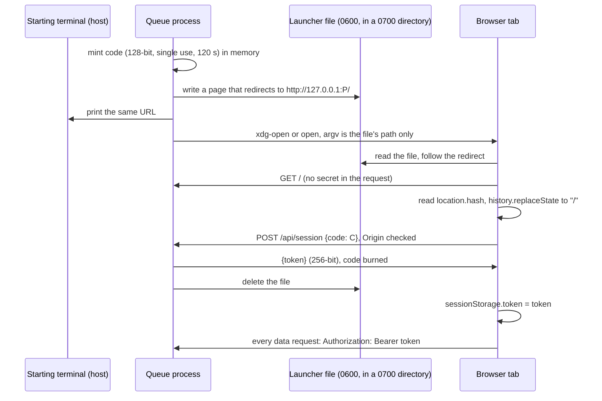

# Who may talk to the approval queue: a terminal-delivered secret, never an ambient one

**Status:** 2026-11-09. Nothing built. Evidence checked against yolo `04f300a9e`. UNMEASURED: no
connection from a jail to a host listener has been observed from the host side; the source-address
claim in [§3](#3-why-loopback-binding-and-peer-checks-are-not-a-boundary) is inferred from the
forwarding mechanism and is test T2's to measure.

> **In short.** Anything a jail can do on the host's loopback, it can do to the queue, so the
> queue trusts only a secret the jail never sees: a per-launch token minted in the queue's memory,
> handed to the browser through a one-time code printed on the starting terminal, and carried as a
> request header rather than a cookie, because a cookie follows the browser to any port on the
> same host, including one a jail listens on.

**Why it matters.** [`approve.go`](../../../internal/cli/approve.go#L98) already warns that a UI
built outside yolo must never accept approvals from the jails it approves. Read-only is not exempt:
request text, argv and workspaces are private, and a page anyone on the loopback can fetch publishes
them to every jail.

**The shape.** Five layers, each covering what the previous cannot: a loopback-only listener; exact
`Host` and `Origin` checks; a header-carried session token on every data route; a page that renders
request text as inert text under a strict Content Security Policy; and, for the later mutation slice
only, per-action binding to what the user saw, revalidated through `yolo approve --json` before
`yolo approve` runs.

**Cost.** No cookie means the page cannot use the browser's `EventSource`: the live stream is read
with `fetch`. Every new browser tab needs a fresh one-time code from the terminal. Starting the queue
under a pipe, a redirect or `yolo host-run` is refused.

**Start at [§3](#3-why-loopback-binding-and-peer-checks-are-not-a-boundary)**; the token design in
[§4](#4-authentication-a-one-time-code-for-a-header-token) follows from it.

**Needs your ruling:** [OQ-BT1](#OQ-BT1).

**Reads with:** [`README.md`](README.md) (the umbrella: rulings AE-R1 to AE-R6 and the five rules
this doc implements), [`web-request-queue.md`](web-request-queue.md) (the queue this boundary
protects; its live channel moves from `EventSource` to `fetch` under this doc), and [`request-history-and-privacy.md`](request-history-and-privacy.md), which
decides *what* a view may show while this doc decides *who* may connect and act.

---

## 1. Scope and verdict

This doc owns the "Browser trust boundary" row of [the sibling map](README.md#7-proposed-sibling-map)
and the five obligations [§5.2](README.md#52-read-only-first-mutation-only-behind-a-tested-host-user-boundary)
of the umbrella places on it. It designs the boundary for both slices and a test plan; it does not
authorize building any mutation route.

**Verdict.**

1. The read-only experiment adopts [§8](#8-the-read-only-slice-requirements) now, in full. It is a
   hardened version of the plan of a URL-carried token swapped for a cookie: the code rides in the
   URL *fragment*, and the cookie is replaced by a header token.
2. A mutation route may exist only after every test marked *mutation gate* in
   [§7](#7-test-plan) passes, including the ones that need a real jail on a rootless host.
3. No CLI change is needed for either slice ([§6.1](#61-provenance-a-browser-decision-is-a-host-decision)).

### Non-goals

- **Same-user processes.** Any process running as the host user can read the queue's memory, the
  browser profile or the terminal, or run `yolo approve` itself. That is the same-user boundary
  [boundary-broker §9.6](../boundary-broker.md#96-what-this-is-not-a-control-against) states; this
  doc adds no defense against it and claims none.
- **`yolo host`.** There the agent *is* the host user, so it is a same-user process: it can run
  `yolo approve` directly, and the broker is not offered there at all
  ([BB-D17](../boundary-broker.md#BB-D17)). The queue may run as a viewer; the boundary protects
  nothing at that notch.
- **Remote, phone or multi-user approval.** Not proposed ([README §1.2](README.md#12-non-goals-and-privacy)).
- **What a view may display.** [`request-history-and-privacy.md`](request-history-and-privacy.md) rules it; this doc only
  guarantees that nobody without the token sees anything.
- **Availability against a jail.** A jail that floods the port can deny the view; it can never read
  or decide through it. Connection caps are hygiene, not a guarantee.

## 2. Threat model

**Defined terms.** **Bootstrap code** *(coined here)*: a single-use, short-lived random string that
the queue prints to its starting terminal and that the page trades once for a session token; it
authorizes nothing else. **Session token** *(coined here)*: the per-launch random secret that
authenticates one browser tab to one queue process; not a cookie, not a yolo credential, and dead
when the process exits. **View digest** *(coined here)*: a hash the queue computes over the bound
fields of one request as it last showed them, so a later action can prove which version the user
saw; it is not a store digest and the store never sees it.

| Attacker | What it can do | What it must never get |
| :--- | :--- | :--- |
| A jailed process, rootless podman bridge with host-loopback forwarding | Dial `host.containers.internal:<port>`, which the runtime forwards to the host's `127.0.0.1` ([reachability modes](../../reference/loopback-tls-reachability.md#the-networking-modes)); forge any header | Any data route's response, any decision |
| A jailed process with `network.mode` host, or a nested jail | Dial `127.0.0.1:<port>` directly; bind its own listener on the host's loopback | The same, plus the token via a listener the user's browser visits |
| A `macos-user` agent account | A separate uid on the shared loopback ([boundary-broker §9.4](../boundary-broker.md#94-macos-user-and-shared-network-jails)); read every process's argv with `ps`; bind listeners | The same; nothing in argv may be secret |
| A jail on Apple Container | Today no route to the host's loopback (the gateway reaches the Mac, not `127.0.0.1`); Apple's `--localhost` route is unmeasured | Assumed reachable anyway: the token requirement does not depend on the gap |
| A jail publishing ports (`network.ports`) | Serves pages the host user opens at `127.0.0.1:<its port>`, which the browser treats as the same *site* as the queue | Ambient credentials sent by the browser, and same-site request forgery |
| Untrusted request content (titles, descriptions, refs, argv, hook output) | Script, markup, `javascript:` URLs, ANSI and bidirectional controls, megabyte fields, persuasion | Execution, navigation, shell interpolation, a hidden real command |
| Another web origin in the user's browser | Cross-site requests, DNS rebinding to `127.0.0.1`, framing, port probing | Readable responses, authorized requests, a framed page to click on |
| Another local user | Connect to the port; read argv | Everything above |

**The `mounts` fact that shapes storage.** On rootless podman, container root is the host user, so a
`0600` file is readable from any jail that mounts its directory, and a `mounts` entry can expose any
host directory read-only. User-scope mounts are the user's authority, and the broker-directory fence
([BB-D26](../boundary-broker.md#BB-D26)) covers workspace scope only. This workspace's own config
mounts `~/.local/share/yolo-jail/logs`, as [boundary-broker §8](../boundary-broker.md#8-audit)
notes. **So no host path is guaranteed unmountable, and the secret lives on no disk.**

## 3. Why loopback binding and peer checks are not a boundary

Binding `127.0.0.1` stops the LAN and, on a rootful netavark bridge, the jail (which reaches only
a `0.0.0.0` listener there, per the reachability doc's measurements). It does nothing against a jail
that the runtime *forwards to* the host's loopback, which is exactly what yolo arranges on purpose:
[`hostloopback.go`](../../../internal/cli/run/hostloopback.go) adds pasta's `--map-host-loopback`,
or slirp4netns's `allow_host_loopback`, so every jail-facing yolo daemon is reachable. This jail
reports `YOLO_HOST_LOOPBACK=requested`.

**Peer address checks distinguish nothing.**

- **pasta and slirp4netns** forward by opening a socket on the host side from their own userspace
  process, which runs as the host user in the host's network namespace. The connection a host
  listener accepts therefore comes from `127.0.0.1`, owned by the host user's uid. INFERRED from the
  mechanism; UNMEASURED, and test T2 records it.
- **`--net=host` and nested jails** dial `127.0.0.1` directly; on rootless podman the dialing uid
  maps to the host user as well ([boundary-broker §8](../boundary-broker.md#8-audit)).
- **`macos-user`** dials `127.0.0.1` from another uid. A uid lookup could tell that one apart, but
  it is per-platform, absent for TCP in the standard library, and useless on every other backend.

So the queue may *log* the peer address for diagnosis but never decides on it. Likewise `Host`,
`Origin` and `Sec-Fetch-Site` are forgeable by any non-browser client: they defend against *browsers*
([§5](#5-browser-hardening-and-safe-rendering)), and only the token defends against jails.

## 4. Authentication: a one-time code for a header token

### 4.1 Why not the cookie

The plan under review swapped the URL token for an `HttpOnly; SameSite=Strict` cookie. It fails in a
way specific to this product:

- **Cookies are not isolated by port** ([RFC 6265 §8.5](https://www.rfc-editor.org/rfc/rfc6265#section-8.5)).
  A cookie set by `127.0.0.1:<queue port>` is sent to `127.0.0.1:3000` too. Any listener a jail
  runs on the host's loopback (a published port, `network.mode` host, a nested jail, `macos-user`)
  receives it the moment the user opens that jail's development server, which agents routinely ask
  for. `HttpOnly` stops scripts, not the server receiving the header.
- **`SameSite` ignores ports.** A page served by that jail is the *same site*, so `Strict` still
  attaches the cookie to its forged requests.

A **header token** has neither problem: the browser never attaches it on its own, so there is no
ambient credential, no cross-site or same-site request forgery, and nothing for another port to
receive. Origin-scoped storage (`sessionStorage`) is keyed by scheme, host *and port*.

### 4.2 The flow

The owner ruled the shape on 2026-11-09: *"a host command ... launches a URL to a browser with a
preshared key"*. A browser opened on a URL puts that URL in the opener's argv, and a separate macOS
agent account can read every process's argv. So the queue opens the browser on a small launcher
file and puts only the file's path in argv.

| Property | Decision |
| :--- | :--- |
| Minting | `crypto/rand`; code 16 bytes, token 32 bytes, both base64url; held in the process's memory |
| Code delivery | Two routes, one code. The URL is printed once to the starting terminal, and the same URL sits in a launcher file the queue opens in the browser. Either way the code is in the URL **fragment**, which browsers never send to a server or put in a `Referer` |
| Launcher file | A page with a meta refresh to the URL, mode `0600`, in a fresh `0700` directory under `$XDG_RUNTIME_DIR` when it is an absolute path on Linux, else the system temporary directory. The opener is `xdg-open` on Linux and `open` on macOS, and its argv is that opener and the file's path, never the code. This is the one deliberate on-disk copy of a code |
| Launcher file lifetime | Deleted after the exchange succeeds, after 120 s, when Enter makes a new link, and on exit. It is written and recorded before its code can be exchanged, so an exchange always finds the file it must delete |
| Code lifetime | Single use; expires 120 s after printing; one live code at a time. Pressing Enter in the queue's terminal mints a new one and burns the old |
| `--no-open` | No launcher file and no browser; the printed URL is the only way in |
| Guessing | A 128-bit code cannot be guessed, so failures never burn it: burning would let a jail that found the port destroy every fresh code. Nor are failures throttled, which a jail could hog the same way. Every exchange is checked in constant time and a correct live code always succeeds; after the fifth failure the terminal warns once that something on this machine is guessing |
| Race alarm | A code that was already traded and is presented again: every session token is revoked, the exchange answers 409, and the terminal prints one warning for that code. See below |
| Token lifetime | Until the process exits; at most 8 live tokens, oldest dropped |
| Comparison | Constant time |
| Server limits | Read-header, read and idle timeouts, and a cap on header size, so a stalled or idle client cannot hold the listener |
| Storage in the browser | `sessionStorage` of the queue's exact origin; survives reload, not a new tab |
| Never | In argv, in environment passed to children, in a log line, in a URL the server receives, in a cookie, or on disk beyond the launcher file's lifetime above |

**Refuse a non-terminal start.** The code is printed, and a launcher file written, only when standard
output is a terminal. Otherwise the queue exits naming the fix (run it directly in a terminal). This
is what keeps the code out of `yolo host-run`, whose output is a pipe delivered to the jail
([`hostrun.go`](../../../internal/cli/hostrun.go#L43)), and out of any redirect or tee into a
mountable log.

**The race alarm, and why it opens nothing.** The launcher file and the terminal both hold the code,
so another process of the same user could read it before the person's browser does. When that
happens the person's tab arrives second and presents a spent code. That is a detected event, not a
silent session: every token is revoked and the terminal warns, once per spent code, that something
else on the machine read the link. It deliberately makes no new link and opens no browser. Whoever
replays a spent code could otherwise keep the person locked out and open tabs without limit, so
the person presses Enter for a new link once they have found the cause. Later replays of an
alarmed code answer 409 and change nothing.

### 4.3 Residue of the URL, checked

| Where the code could linger | Outcome |
| :--- | :--- |
| Browser history | The entry is rewritten by `replaceState` before the exchange; any copy the history database kept is a burned code |
| `Referer` | Fragments are never sent; `Referrer-Policy: no-referrer` regardless |
| Server and proxy logs | The server never receives the fragment |
| Terminal scrollback | Host-user only; burned after one use or 120 s |
| The launcher file | Host-user only, `0600` in a `0700` directory; deleted after the exchange, after 120 s, on a new link and on exit. A same-user process that reads it first is the race alarm above |
| The opener's argv | The file's path only, so `ps` shows no code to other users or to a `macos-user` agent |
| A jail | Reaches none of the above |

### 4.4 Alternatives

| Alternative | Verdict |
| :--- | :--- |
| `HttpOnly; SameSite=Strict` cookie | Rejected: leaks across ports to jail listeners ([§4.1](#41-why-not-the-cookie)) |
| Cookie scoped to a secret path prefix | Rejected: the secret then sits permanently in the address bar and every history entry |
| Token in the URL query for the whole session | Rejected: sent to the server, logged, kept in history |
| No automatic browser launch, the URL only on the terminal | Superseded by the owner's 2026-11-09 ruling. Passing the URL to the opener would put the code in argv; the launcher file keeps argv to a path |
| Code in a `0600` file under the host state directory | Rejected: mountable ([§2](#2-threat-model)). The launcher file differs: a fresh `0700` directory under the runtime or temporary directory, not the state directory, deleted within 120 s |
| Unix socket plus a browser extension | Rejected for now: peer credentials would be real, but an extension is per-browser install and its own review |
| TLS client certificate | Rejected: certificate enrollment and per-browser stores for a localhost tool |
| OS keychain | Rejected: the browser cannot read it, so it only moves the delivery problem |
| WebAuthn or passkey per decision | Not a bootstrap; a candidate *add-on* for mutation, see [OQ-BT1](#OQ-BT1). Needs a domain relying-party id, so `localhost`, not `127.0.0.1`; browser support UNMEASURED |
| Random `*.localhost` subdomain per launch | Deferred: host-scoped storage without a token in a header, but Safari's `*.localhost` resolution is UNMEASURED |

## 5. Browser hardening and safe rendering

**Listener.** Bind `127.0.0.1` only, port 0 by default (no squatting a fixed port); never `0.0.0.0`
or `::`. A non-loopback `--listen` is refused.

**Every request**, before routing:

| Check | Rule | Defends against |
| :--- | :--- | :--- |
| `Host` | Exactly `127.0.0.1:<bound port>`, else 421 | DNS rebinding |
| `Origin` | If present, exactly `http://127.0.0.1:<bound port>`, else 403; required on every `POST` | Cross-origin browsers |
| `Sec-Fetch-Site` | If present on a data route, `same-origin`, else 403 | Cross-site browsers |
| `OPTIONS` | 405, and no `Access-Control-*` header is ever sent | CORS preflight for the `Authorization` header |
| `Authorization` | `Bearer <live token>` on every route but the public set, else 401 with no body detail | Jails, other users, other origins |

**The public set** is exactly the page shell and its static assets (`/`, `/app.js`, `/app.css`), which
contain no request data, plus `POST /api/session`. Everything else, the snapshot and the live stream
included, needs the token.

**Response headers on every route:** `Content-Security-Policy: default-src 'none'; script-src 'self';
style-src 'self'; connect-src 'self'; img-src 'self'; base-uri 'none'; form-action 'none';
frame-ancestors 'none'`, `X-Frame-Options: DENY`, `X-Content-Type-Options: nosniff`,
`Referrer-Policy: no-referrer`, `Cross-Origin-Opener-Policy: same-origin`,
`Cross-Origin-Resource-Policy: same-origin`, and `Cache-Control: no-store` on data routes.

**The live channel** is the same text/event-stream format the queue doc chose, read with
`fetch(..., {headers: {Authorization}})` and a stream reader instead of `EventSource`, which cannot
send a header. It reconnects with the same token; a 401 sends the page to the "get a new link" state.

**Rendering request text** ([README rule 2](README.md#31-five-rules-that-bind-every-sibling)):

- DOM nodes built with `textContent` only; no `innerHTML`, `insertAdjacentHTML`, `document.write`
  or template interpolation; no request field ever becomes an `href`, `src`, attribute, class,
  style or URL, so nothing request-derived is clickable.
- Controls made visible, not stripped: C0 and C1 controls other than newline and tab, ESC sequences,
  bidirectional overrides and isolates (U+202A to U+202E, U+2066 to U+2069) and zero-width characters
  render as a visible code point marker, as yolo's terminal sanitizer does for the CLI.
- The agent's words are labeled as such, below yolo's own fields, the way
  [boundary-broker §9.1](../boundary-broker.md#91-the-notification-is-a-social-engineering-channel)
  orders a toast. Nothing is elided; secret-bearing argv values are masked behind a per-value Show
  ([`web-request-queue.md` §7](web-request-queue.md#7-rendering-request-text)).
- The server passes yolo's JSON through as data, `Content-Type: application/json`, and interpolates
  it into no HTML or shell.

## 6. The mutation slice: per-action binding

Designed now so the read-only slice does not foreclose it; **built only after the mutation gate in
[§7](#7-test-plan) passes.** Nothing below adds a CLI surface.

**Offered actions, by source.** The listing's per-source `authority` field
([`watch.go`](../../../internal/brokerstore/watch.go#L257)) is `core` or `deny-only`.

| Request | Offered | Not offered, and why |
| :--- | :--- | :--- |
| `core` authority, any source | Allow once; Deny with an optional note | Allow for a time: the listing does not say which sources accept `--for` (GitHub writes refuse it), so it stays a terminal action; offering it needs a listing field, a [boundary-broker](../boundary-broker.md) question |
| `deny-only` authority | Deny with an optional note | Allow: the CLI answers 6 |
| Any state but `pending` | Nothing; shows the state | Revoke, add: not in this slice |

**The decision route**, `POST /api/decision` with `{id, action, note?, view_digest, nonce}`:

1. **Authenticate** as [§5](#5-browser-hardening-and-safe-rendering), `Origin` required.
2. **Validate shape.** `id` matches `^r-[0-9a-f]{32}$` exactly, the shape the store mints
   ([`store.go`](../../../internal/brokerstore/store.go#L741)). This is the only guard against an id
   read as a flag: `yolo approve` has no `--` and refuses any argument beginning with `-`
   ([`approve.go`](../../../internal/cli/approve.go#L288)), so `--deny` or `--for=session` as an id
   would otherwise be parsed as an option. `action` is `allow-once` or `deny`; `note` is non-empty
   valid UTF-8 of at most 500 characters.
3. **Deduplicate.** `nonce` is single-use, issued with each rendered request view; a repeat returns
   the first result without running anything. One decision runs at a time.
4. **Revalidate.** Run `yolo approve --json` now, find the id, recompute the view digest over
   `state`, `source`, the source's `authority`, `workspace`, `jail`, `set`, `argv`, `repo`,
   `command_digest`, `stdin_digest`, `needs_approval` and `expires`. Absent, not `pending`, or a
   different digest: answer 409 with the fresh view, run nothing.
5. **Invoke** with an argv, never a shell: `yolo approve <id>` or `yolo approve <id> --deny
   [--note=<text>]` (the `=` form, so a note starting with a dash stays a value). Working directory
   is the user's home, never a workspace. The child's environment omits `YOLO_REQUEST_ID`. Timeout
   30 s, then the process group is killed.
6. **Report the exit code faithfully, never retry**, then re-snapshot.

| Exit | Page shows |
| :--- | :--- |
| 0 | Allowed once, or Denied, with "allowed is not executed": the use may be spent with no result ([README §2.2](README.md#22-authority-facts-every-surface-must-preserve)) |
| 1 | "The store could not be read or written", the CLI's message as text; outcome re-read, not assumed |
| 2 | A queue defect: "the queue built a command yolo refused", with the message |
| 3 | Already decided, with the state the re-read finds |
| 4 | No longer listed |
| 5 | Refused by policy, the CLI's next step as text |
| 6 | No longer confirmable; Deny remains offered |
| Timeout or signal | "Outcome unknown", then whatever the re-read shows |

**Why the residual race is safe.** Between step 4 and step 5 the request can change state, but not
what it authorizes: its binding is fixed at filing, and the store revalidates under its lock, so a
lost race comes back as 3 or 6, never as a broader grant. The re-read guards what the user saw; the
store's lock guards the decision (AE-E3 in [README §10](README.md#10-observable-success-and-next-investigations)).

### 6.1 Provenance: a browser decision is a host decision

`yolo approve` records `via: on_request` when its environment's `YOLO_REQUEST_ID` names the request,
and `via: host` otherwise ([`approveVia`](../../../internal/cli/approve.go#L178),
[JH-D11](../jail-history.md#JH-D11)). The queue runs `yolo approve` as a host process on the host
user's click, so `host` is true. Clearing `YOLO_REQUEST_ID` from the child keeps it from ever being
mislabeled as the hook.

**Decision: no CLI change.** A distinct `via: browser` would need a new flag or variable, which any
same-user process could set as easily as the queue, so it would add a label rather than evidence. The
queue prints each decision (id, action, exit) on its own terminal. If a browser-specific audit label
is wanted later, it is a named question in [boundary-broker.md](../boundary-broker.md) under
[README §3.2](README.md#32-shared-seams-without-a-new-prerequisite-schema), not this doc's.

## 7. Test plan

**Where they run.** *Unit*: Go `httptest` with a fake `yolo` that records argv and environment and
returns chosen exit codes. *Browser*: a headless browser in CI against the real binary. *Real jail*:
a real jail on a rootless podman host, reported with `podman info --format
'{{.Host.RootlessNetworkCmd}}'`; once on pasta with `--map-host-loopback`, once on the slirp4netns
fallback, once with `network.mode` host. **A nested jail cannot run these**: podman-in-podman forces
`--net=host`, so it is
[structurally blind to reachability](../../reference/loopback-tls-reachability.md#a-nested-jail-is-structurally-blind-to-this).
*Mac*: `macos-user` on a real Mac, UNMEASURED until run. All tests wait on events (a readiness
line, a closed connection, an injected clock), never on elapsed time.

| ID | Test | Pass condition | Where | Gate |
| :--- | :--- | :--- | :--- | :--- |
| T1 | From a jail, `curl http://host.containers.internal:<port>` on every route, with forged `Host` and `Origin` | Every data route 401; public set returns no request data | Real jail; Mac | Read-only |
| T2 | Record the peer address and uid the queue sees for T1's connections | Recorded in the test log, whatever it is; confirms [§3](#3-why-loopback-binding-and-peer-checks-are-not-a-boundary) or reopens it | Real jail; Mac | Read-only |
| T3 | `Host: evil.example:<port>` and `Host: localhost:<port>` | 421, no body | Unit | Read-only |
| T4 | Mismatched `Origin`; `Sec-Fetch-Site: cross-site`; `OPTIONS` | 403, 403, 405; no `Access-Control-*` header anywhere | Unit | Read-only |
| T5 | A page on another `127.0.0.1` port fetches the snapshot and stream | 401; its own `sessionStorage` holds no token | Browser | Read-only |
| T6 | Frame the page from another origin | Blocked; CSP and `X-Frame-Options` on every response | Browser; unit | Read-only |
| T7 | Served HTML has no inline script or `on*` attribute; CSP exact | Parse finds none | Unit | Read-only |
| T8 | Hostile fixture: `<script>`, ``, `javascript:` and `data:` URLs, `ESC[31m`, U+202E, zero-width, NUL, a 1 MiB field | No script runs (a sentinel global stays unset), no dialog, no request off-origin, zero links from data, controls shown as markers, the whole field present | Browser | Read-only |
| T9 | Bootstrap: reuse a code; use after 120 s (injected clock); six bad codes, then the right one; reload | Reuse is the race alarm (409, tokens revoked, see L3); 401; one terminal warning, and the right code still succeeds; token survives reload | Unit; browser | Read-only |
| T10 | After load, the address bar and current history entry | No fragment; the exchange is a `POST` body, never a URL the server logs | Browser | Read-only |
| T11 | Search the workspace, `~/.local/share/yolo-jail` (logs included), `~/.config/yolo-jail`, `/tmp`, the queue's `/proc/<pid>/cmdline` and `environ`, and its children's, for the code and token | Absent, except the launcher file while it lives (L2) | Unit (Linux); real jail for the mounted view | Read-only |
| T12 | Start with standard output a pipe, and under `yolo host-run` | Refuses, prints no code, names the fix | Unit; real host | Read-only |
| T13 | Server log after T1 to T12 | Contains no code, token or `Authorization` value | Unit | Read-only |
| L1 | Start with the opener injected | Launcher file mode `0600` in a `0700` directory; the opener's argv is the file's path only, with no code | Unit | Read-only |
| L2 | Exchange the code; separately, advance an injected clock past 120 s; separately, press Enter; separately, exit | The launcher file is gone after each; an exchange cannot run before the file is recorded | Unit | Read-only |
| L3 | Replay a spent code 14 times | 409 each time; every token revoked; one terminal warning; no new link; no opener call | Unit; end to end | Read-only |
| L4 | A real `xdg-open` or `open` on the launcher file | A real browser lands on the page and trades the code | Real desktop session; Mac | Read-only |
| L5 | `Main` with a piped standard output; `systemOpen`'s argv; the runtime-directory choice | Refuses and writes no file; argv is opener and path; `$XDG_RUNTIME_DIR` used on Linux when absolute, else the temporary directory | Unit | Read-only |
| T14 | Browser Allow and terminal `yolo approve` race on one request against a real temporary store | Exactly one decision in the store and audit; the loser is shown "already decided" | Unit with real store | Mutation |
| T15 | Request changes between display and click (state, digest, refs, expiry) | 409 with the fresh view; fake `yolo` saw no decision call | Unit | Mutation |
| T16 | `deny-only` source | No Allow rendered; a forged Allow is 409 and runs nothing | Unit; browser | Mutation |
| T17 | Ids `--deny`, `--for=session`, `r-` with 31, 33 or uppercase hex, path characters | 400; no invocation | Unit | Mutation |
| T18 | Fake `yolo` exits 0 to 6, then hangs past the timeout | Each mapped per [§6](#6-the-mutation-slice-per-action-binding); exactly one invocation each; hang shows "outcome unknown" | Unit | Mutation |
| T19 | Child environment and recorded provenance | No `YOLO_REQUEST_ID`; store records `via: host` | Unit with real store | Mutation |
| T20 | Same nonce posted twice | One invocation, same answer | Unit | Mutation |
| T21 | From a jail, `POST /api/decision` with every forged header | 401; no invocation | Real jail; Mac | Mutation |

## 8. The read-only slice requirements

The read-only experiment implements exactly this, and has no mutation route at all: no handler for
`/api/decision`, no code path that runs `yolo approve` with an id.

1. **Listener:** `127.0.0.1`, port 0 by default; a non-loopback `--listen` refused.
2. **Start:** refuse unless standard output is a terminal, naming the fix. Open the browser on a
   launcher file ([§4.2](#42-the-flow)), never on the URL; `--no-open` skips it.
3. **Secrets:** bootstrap code 16 bytes and session token 32 bytes from `crypto/rand`, base64url, in
   memory only; never written to disk except the launcher file's code (item 4), never in argv, child
   environment or any log.
4. **Code delivery:** print `http://127.0.0.1:<port>/#code=<code>` once and write it into the launcher
   file; single use; 120 s; one live code; Enter in the terminal mints a fresh one; after five
   failed exchanges, one terminal warning; failures never burn the code and are never throttled.
   A spent code presented again revokes every token and warns once per code, with no new link and no
   browser opened.
5. **Exchange:** the page reads `location.hash`, calls `history.replaceState(null, "", "/")` first,
   then `POST /api/session` with the code in a JSON body; stores the returned token in
   `sessionStorage`; on 401 shows "This link was used or expired: press Enter in the queue's
   terminal for a new one."
6. **Authentication:** `Authorization: Bearer <token>` on every route but `/`, `/app.js`, `/app.css`
   and `POST /api/session`; constant-time compare; at most 8 tokens; no cookies set or read.
7. **Live stream:** text/event-stream read with `fetch` and a stream reader, carrying the header;
   reconnect with the same token; 401 leads to the step-5 message.
8. **Request checks:** `Host` exact, `Origin` exact when present and required on `POST`,
   `Sec-Fetch-Site` `same-origin` when present on data routes, `OPTIONS` 405, no CORS headers.
9. **Response headers:** the CSP and companions in [§5](#5-browser-hardening-and-safe-rendering) on
   every response; `no-store` on data routes.
10. **Rendering:** `textContent` only; no request-derived link, attribute, style or URL; controls and
    bidirectional characters shown as markers; agent words labeled; nothing elided; secret-bearing
    argv values masked behind a per-value Show, as
    [`request-history-and-privacy.md` §6](request-history-and-privacy.md#6-what-a-read-only-view-may-show) rules.
11. **Logging:** peer address may be logged; code, token and `Authorization` never.
12. **Tests:** T1 to T13 and L1 to L5. T3 to T13 and L1 to L3 and L5 run in CI; T1, T2 and T12's `yolo host-run` case need a real
    host and a real jail on a rootless host, and the slice's first report says which have run.

## 9. Risks

| Risk | Mitigation |
| :--- | :--- |
| A same-user process, or the agent under `yolo host`, acts through the queue | Out of scope by the same-user boundary; stated, not mitigated |
| A rendering bug turns request text into script, which can read `sessionStorage` | `textContent`-only rendering, CSP without inline script, T7 and T8; `connect-src 'self'` limits where a stolen token can be sent |
| A port reused after the queue exits serves a fake page to an open tab | The tab's token died with the process; the fake page can phish but not decide |
| The user pastes the bootstrap link into a jail's chat | One use, 120 s; the page says a used link is dead. Same-user-level mistake, not preventable |
| A user-scope `mounts` exposes the browser profile | Same-user authority ([BB-D26](../boundary-broker.md#BB-D26)); `sessionStorage` is per tab and the token dies with the process |
| Social engineering through request text | Labeled agent words, full argv, the workspace reach rule; the page cannot make a human read |

## 10. Open questions

1. 💬 **OQ-BT1: Should approving in the browser need one more proof that a person is there, beyond the open tab?**

   Dana has the queue open in a browser tab while two jails work. A request arrives to push a branch,
   and she clicks Allow once. With the design as written that click is enough: the tab holds the
   session token, so anything that could run script in that tab could click too. The rendering rules
   are meant to make that impossible, but a single rendering bug would turn the tab into an approval
   button for whoever wrote the request text.

   - **A — The open tab is enough.** One click approves, as a toast's button does. A rendering bug
     is the failure, and the hostile-text tests are the defense.
   - **B — Each Allow asks the device.** Each Allow shows the browser's passkey or fingerprint prompt
     (WebAuthn user verification); Deny stays one click. A script in the tab cannot answer the
     prompt. Costs a prompt per Allow, a one-time passkey registration per queue launch, a
     `localhost` address instead of `127.0.0.1`, and browser support that has not been measured.

   <!-- vantage: question id=OQ-BT1 leaning="A — the toast already approves with one click, and B's localhost and WebAuthn support are unmeasured; revisit if the hostile-text tests ever find a hole." -->

   _Leaning:_ A — the toast already approves with one click, and B's localhost and WebAuthn support are unmeasured; revisit if the hostile-text tests ever find a hole.

   **Answer:**
   > _(empty — fill in when decided)_
