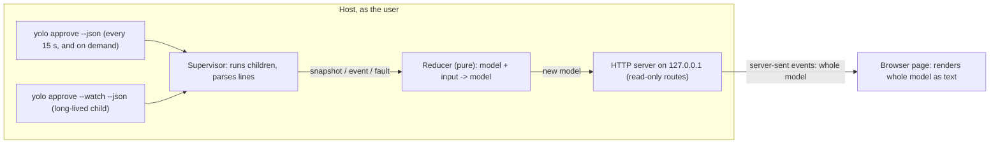

# A read-only browser queue over a lossy watch stream: snapshot is truth, events are hints

**Status:** 2026-11-09. Checked against yolo `04f300a9e`. The read-only experiment is built in yolo as
`yolo approve --web` ([`internal/approvalqueue/`](../../../internal/approvalqueue/), run from a checkout
with `just dev-approvals`), tested against a fake `yolo` replaying recorded output. UNMEASURED: it has not been run against a live host store with real jails filing
requests.

> **In short.** The queue never trusts the watch stream to be complete. A full `yolo approve --json`
> snapshot replaces its state wholesale, on a timer and after every watch restart; events only
> refresh the page between two snapshots. The browser always receives the whole current state, so
> reconnecting is the same as loading.

**Why it matters.** The watch stream is lossy by design ([§2](#2-what-the-cli-gives-a-front-end)):
pruning, working-set changes and anything that happens while the watcher is down emit no event. A
queue built on events alone shows a wrong pending list with confidence.

**The shape.** One host process: a CLI supervisor (two `yolo` child commands), a pure state reducer,
a localhost HTTP server, and a static page fed by server-sent events.

**Cost.** One `yolo approve --json` run every 15 seconds while the queue runs, and one long-lived
`--watch --json` child.

**Start at [§4](#4-the-reconcile-rule)**, the reconcile rule; the rest falls out of it.

**Needs your ruling:** None.

**Reads with:** [`README.md`](README.md) (the umbrella: rulings AE-R1 to AE-R6 and the five rules
this obeys), [`browser-trust-boundary.md`](browser-trust-boundary.md) (who may connect; this doc
implements its read-only slice requirements), [`request-history-and-privacy.md`](request-history-and-privacy.md)
(what the page may show, and which history claims are honest).

---

## 1. Scope

**Goal.** One command starts a page on the host that shows every pending request with full
host-derived detail, updates live, survives reconnects with correct state, and says how fresh it is
(acceptance outcome AE-E2 in [`README.md`](README.md#10-observable-success-and-next-investigations)).

**Non-goals.**

- **No decisions.** No Allow, Deny or Revoke route exists in this slice, not even disabled. Mutation
  waits on the tested boundary in [`browser-trust-boundary.md`](browser-trust-boundary.md).
- **No store access.** The queue never opens the broker directory, the store files, `audit.jsonl` or
  the workspace `.yolo/approvals` wake hints. The CLI is the only interface
  ([boundary-broker §6.6](../boundary-broker.md#66-one-store-several-front-ends-and-a-stable-surface-for-the-ones-yolo-does-not-ship)).
- **No CLI change.** Everything here uses the schema 1 surface as built; no named question in
  [`boundary-broker.md`](../boundary-broker.md) is needed.
- **No arrival design.** How the engineer reaches the page stays open by owner ruling AE-R3; the
  command prints a URL and nothing else.
- **No complete history.** Only what [`request-history-and-privacy.md`](request-history-and-privacy.md)
  allows, labeled with its gaps.

**Terms.**

- *Snapshot* (yolo's): one `StateView` object, either `yolo approve --json`'s output or the
  `"event": "state"` line that opens `--watch --json`. It holds pending requests, live grants, live
  working-set entries, sources and diagnostics.
- *Model* *(coined here)*: the queue's in-memory copy of the current state plus its freshness and
  observed history. It is not the store and decides nothing.
- *Reconcile* *(coined here)*: replacing the model's current state with a snapshot. Not a merge.
- *Fetch start*: the host time the queue recorded immediately before starting the child that
  produced a snapshot.

## 2. What the CLI gives a front end

Verified against [`internal/brokerstore/watch.go`](../../../internal/brokerstore/watch.go) and
[`internal/cli/approve.go`](../../../internal/cli/approve.go) on 2026-11-09.

| Fact | Consequence for the queue |
| :--- | :--- |
| The watch polls each store once per second and emits the diff between two reads (`WatchFrom`). | A state that is born and dies between two reads produces no event, except a grant issued and spent in one tick, which `Diff` still reports. |
| A record that disappears (pruned after 7 days) produces no event (`Diff`'s doc comment). | Disappearance is not a decision; only a snapshot shows it. |
| Working-set entries produce no events (`Snapshot.Working`'s comment). | Working-set display comes only from snapshots. |
| Config-declared branches (`"by": "config"`) appear only in snapshots (`withConfigBranches`). | Same. |
| A failed later read is reported once on stderr (`reading the store failed`), and the watch continues silently. | Watch liveness proves nothing about store reads; the process can be up and blind. |
| The watch emits no heartbeat. | Silence is ambiguous: no change, or a stuck reader. Freshness must come from snapshots. |
| `request-filed` carries the request as filed (`"state": "pending"`) even when it was decided in the same tick; the `request-decided` event follows in the same batch. | Apply events in order; never treat a filed event as proof the request is still pending. |
| Every object carries `"schema": 1`; fields are only added within a schema number. | Decode tolerantly (unknown fields ignored); refuse any other schema number. |
| `--json` exit codes: 0 ok, 1 store unreadable, 2 usage. | Exit 1 makes the model stale with the CLI's message, never empty. |

## 3. Architecture



**One writer.** The reducer is the only writer of the model; every input reaches it through one
channel and is applied in arrival order, so no two inputs interleave. The supervisor and the HTTP
server only read published copies.

**Pure decision, effectful shell.** The reducer is a pure function `(model, input, now) -> model`,
tested without processes or clocks. Running children, timers and HTTP are the shell.

## 4. The reconcile rule

**A snapshot replaces; an event amends; nothing an event adds outlives the next snapshot.**

1. **On a snapshot** (from `--json` or the watch's opening line): replace pending requests, grants,
   working set, sources and diagnostics wholesale. Set `as_of` to the snapshot's fetch start.
   Compare with the previous model: any pending request now absent and not explained by an applied
   event is recorded in observed history as **"no longer pending; outcome not observed"**, never as
   denied, expired or allowed.
2. **On an event**: always record it in observed history; history is keyed by request or grant id,
   and an observed outcome replaces an earlier "outcome not observed" whenever it arrives. Skip its
   effect on current state if its `time` is earlier than the last snapshot's fetch start, because
   the snapshot already reflects that read or a later one. Otherwise apply it idempotently:

   | Event | Effect on current state | Observed history |
   | :--- | :--- | :--- |
   | `request-filed` | Add or replace the pending request by id | "filed" |
   | `request-decided` | Remove the request from pending | its `state`: allowed, denied or refused |
   | `request-expired` | Remove the request from pending | "expired" |
   | `grant-used` | Replace the grant by id | "used", with `used_by` |
   | `grant-ended`, `grant-revoked` | Remove the grant | its `end_reason` |

   An event for an unknown grant or a missing request is applied anyway (a grant is added; a removal
   is a no-op), so order between streams cannot raise an error.
3. **Bounded divergence.** An event stamped after a fetch start can still come from a watch read
   that preceded the snapshot's read, so a stale `request-filed` can briefly re-add a request the
   snapshot had already dropped. The divergence is bounded: it lasts until the watch's next tick
   emits the decision, or until the next snapshot erases it, whichever is first. The page never
   shows a decision it did not see.
4. **Triggers for a snapshot**: at startup; every 15 seconds (`--reconcile`, default 15 s); after the
   watch child exits or restarts; after any unparseable watch line; on a browser's explicit refresh
   request is **not** offered in this slice (it would be a state-changing route).
5. **Snapshot overlap**: at most one `--json` child runs at a time; a trigger that arrives while one
   runs is coalesced into one follow-up run.

## 5. Freshness is a computed state, shown

The model carries `as_of` (fetch start of the last good snapshot), the watch child's status, the
last snapshot error and the count of malformed lines. The page shows exactly one of:

| State | Condition | What the page says |
| :--- | :--- | :--- |
| **Live** | Last snapshot younger than 2 × reconcile interval (30 s) and the watch child running without a store-read warning | "Live; checked Ns ago" |
| **Stale** | Last snapshot older than that, or the last `--json` failed, or the watch reported a read failure, or the watch is restarting | "STALE: showing state from HH:MM:SS; <reason>" with the CLI's message as text |
| **Disconnected** | The browser received nothing for 15 s (the server sends the model at least every 5 s) | "Disconnected from the queue; reconnecting" over the last state, greyed |
| **Never loaded** | No snapshot has ever succeeded | The CLI's error and the next step it named; no empty list that could read as "nothing pending" |

An empty pending list is shown as empty only in the **Live** state.

## 6. The live channel: server-sent events carrying whole state

**Decision: server-sent events (SSE), and every message carries the whole model.**

- **One direction is all the read-only slice needs.** SSE is host to browser only; a WebSocket's
  browser-to-host channel would be an unused path through the trust boundary.
- **Standard library only.** SSE is a long-lived HTTP response in the `text/event-stream` format.
  A WebSocket needs a library or a hand-rolled framing implementation.
- **Read with `fetch`, not `EventSource`.** The stream is authenticated by an `Authorization`
  header ([`browser-trust-boundary.md` §4](browser-trust-boundary.md#4-authentication-a-one-time-code-for-a-header-token)),
  which `EventSource` cannot send. The page reads the stream with `fetch` and a stream reader, and
  reconnects itself with the same token after a delay of 1 s, doubling to at most 15 s.
- **Whole state, not deltas.** The model is small (pending requests are typically a handful, and
  history is capped at 200 entries), so each message is the full model. A reconnect therefore
  restores current state exactly, with no replay, sequence numbers or client-side merge, and the
  client cannot drift from the server.
- **Liveness.** The server sends the model on every change and at least every 5 seconds, so the
  client can detect a dead server ([§5](#5-freshness-is-a-computed-state-shown)).
- **Authentication** follows [`browser-trust-boundary.md`](browser-trust-boundary.md): the stream is
  a route like any other and refuses an unauthenticated connection.

The live channel carries state only. *Development asset reload* is separate: the page's files are
embedded in the binary, and `--assets <dir>` serves them from disk so an edit shows on browser
reload. Neither carries authority.

## 7. Rendering request text

Every request field is untrusted: titles, descriptions, refs, argv values and hook output are the
agent's words or derived from them. The page builds DOM nodes and sets `textContent`; it never
uses `innerHTML`, never turns a request field into a link, an attribute, a class name or a URL, and
loads no script but its own (a strict Content-Security-Policy with no inline script). The server
passes yolo's JSON through as data and never interpolates it into a shell or HTML template.

**Full detail** means every field `RequestView` carries, shown as labeled text: id, source and its
authority (`core` or `deny-only`), jail, the holding workspace (with the reach rule from
[`README.md` §2.2](README.md#22-authority-facts-every-surface-must-preserve): every jail of that
workspace may use a grant), set, the complete argv one value per line, repository, command and stdin
digests, filed and expiry times with time remaining, refs needing approval, headline, title,
description, refs, and hook failure. Long values wrap; nothing is elided, because an elided value is
what the page exists to show in full. **One exception, masking:** a value following a flag on yolo's
summary redaction list (`--body`, `--header`, `--field` and the rest, in every spelling) shows as
its length and a short hash with a Show button that reveals that one value, re-masked when the page
is hidden or reloaded; the command and stdin digests stay visible. The masking and the rest of what
a read-only view may expose are
[`request-history-and-privacy.md` §6](request-history-and-privacy.md#6-what-a-read-only-view-may-show)'s
rulings.

## 8. Failure handling

| Failure | Handling |
| :--- | :--- |
| This `yolo` executable cannot be found | Startup fails saying so and naming `yolo approve --json` as the next step to see whether yolo itself works. |
| `--json` exits non-zero or times out (60 s) | Model goes **Stale** with the exit code and the first 4 KiB of stderr as text; retried at the next interval. |
| `--json` prints invalid JSON or a schema other than 1 | Stale, reason "unsupported output"; for schema ≠ 1 the reason names the schema seen and says to update the queue. |
| Watch child exits | Restart after 1 s, doubling to at most 30 s, reset after 60 s of running; each restart triggers a snapshot. Model is **Stale** until the restarted watch's opening line arrives. |
| Watch line unparseable or over 16 MiB | Count it, show the count, discard the line, trigger a snapshot. |
| Watch stderr reports a store read failure | Stale until the next successful snapshot. |
| Browser disconnects | Nothing server-side; the page reconnects with its token and gets the whole model. A 401 shows the trust boundary's "link used or expired" message. |
| Queue process stopped | Children run in their own process group, which the queue kills on SIGINT, SIGTERM and SIGHUP (a closed terminal); on Linux a parent-death signal also covers a SIGKILL of the queue. Elsewhere a SIGKILL can orphan the watch child until its next write fails. Observed history is lost by design (it is labeled "since this queue started"). |

## 9. One command

```sh
yolo approve --web [--listen 127.0.0.1:0] [--reconcile 15s] [--assets <dir>] [--no-open]
```

It checks that `yolo` runs, takes the first snapshot, starts the watch, binds the listener (a random
free port by default), and prints the one-time bootstrap URL that
[`browser-trust-boundary.md` §8](browser-trust-boundary.md#8-the-read-only-slice-requirements)
prescribes, and opens the browser on a launcher file unless `--no-open` is given; pressing Enter prints a
fresh one. It refuses a listen address that is not a loopback
address, and refuses to start when its standard output is not a terminal, because the bootstrap
code must reach only the person at that terminal. It runs on the host; inside a jail `yolo approve` refuses
(the store is host-only), and the queue reports that refusal as its startup error.

## 10. Alternatives

| Alternative | Verdict |
| :--- | :--- |
| Events only, no periodic snapshot | Rejected: pruning, working-set changes and watcher downtime are invisible, so the list goes silently wrong. |
| Snapshot polling only, no watch | Rejected as the only mechanism: 15 s latency for a new request. Kept as the fallback the model degrades to. |
| Poll `--json` every second instead of watching | Rejected: a process start per second for the same information the watch already reads. |
| WebSocket | Rejected for this slice: bidirectional channel unused; needs a dependency or hand-rolled framing. Revisit only if the mutation slice needs push-and-reply on one connection. |
| Browser polling of `/api/state` | Acceptable but slower and chattier than one long response; the stream delivers a change within the watch's one-second tick. |
| Deltas over the live channel with sequence numbers | Rejected: replay and merge logic on the client for a model this small. |
| Read store files directly | Rejected: a second reader of private host state and a coupling to an internal format; the CLI is the contract. |
| A front-end toolchain | Rejected: one HTML page, one script, one stylesheet, embedded; nothing to build. |

## 11. Risks

| Risk | Mitigation |
| :--- | :--- |
| Page reads as authoritative when stale | Computed freshness state, stale banner with reason, empty list only when **Live**. |
| Disappearance read as denial | History says "outcome not observed" unless an event said otherwise. |
| Request text injects markup or script | `textContent` only, strict CSP, no request-derived URLs; tested with hostile fixtures. |
| A jail reads the page through host-loopback forwarding | [`browser-trust-boundary.md`](browser-trust-boundary.md)'s read-only requirements apply to every route, the stream included. |
| A schema change breaks parsing silently | Schema number checked on every object; unknown fields ignored, a new number refused visibly. |

## 12. What done looks like

- With the queue running and a request filed, the page shows it within about one second with every
  field in [§7](#7-rendering-request-text), and "Live".
- Killing the watch child, deciding a request in a terminal, and letting the watch restart leaves
  the page correct, with the request in history as "no longer pending; outcome not observed" if no
  event saw the decision.
- Closing and reopening the browser tab shows the same state as before, without a reload of history
  from anywhere but the server.
- Making the store unreadable turns the page **Stale** with yolo's message, never empty.
- A request whose title is `<script>` shows those characters as text.
