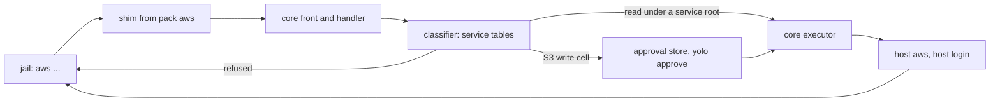

# One AWS broker: per-service tables behind the jail's `aws`, admitted by declared roots

**Disposition:** IMPLEMENT

**Status:** 2026-11-17. Implemented on main at `bde502e4a`. MEASURED: synthetic Linux mediation and nested gate interaction; UNMEASURED: installed AWS CLI/provider/native Mac behavior. Combined landing gates remain pending. The bounded review repair covers planned-edit allowance parity and root spelling/provenance diagnostics; the original Task 5 launcher receipt is pre-final, so acceptance requires fresh matched-source evidence. Focused classifier/CLI/config/manifest/core-fixture tests and the three reached nested AWS tests pass; production dispatch and full-check callsite deletion controls turn the permanent tests red and restoration turns them green. The companion plan records evidence limits. Planning source facts were checked at `b5a5fe32a326109371656162623b690a3c790427`; the [fact packet](../research/aws-operation-broker-grounding.md#aws-documentation-check) checks published CLI v1/v2 spellings. No real AWS request, live credential read or native Mac proof.

> **In short.** Widening S3 mediation to "AWS operations" needs no new authority machinery;
> one generic config-format bridge ([AWS-D13](#AWS-D13)) lets TOML declare call roots.
> Each service owns its own root scheme and the workspace must declare a root in it.

**Why it matters.** The read grant is one literal `read` per pack. If admission rested on it alone, every service added later would be authorized by grants given for S3.

**The shape.** Pack `aws`, source `aws`, one classifier with a table per service (`s3`, `s3api`, `ce`), core's CLI executor running the host `aws` under the host's own login. `aws-auth` is not touched.

**Cost.** Pack `aws-s3`, its source dispatch and its config namespace stop being active, with no alias; old approval records remain inert and are never consulted by `aws`. Generic `yolo approve --json` may display them as removed-source, deny-only history; that inventory is not executable authority, migration or compatibility. A user cannot allow S3 while refusing Cost Explorer at user scope; that choice is per workspace, at the config-change gate.

**Start at [§5](#5-service-admission-and-scope)** — admission by root scheme is the design; the tables fill it in.

**Needs your ruling:** None.

**Reads with:** [`pack-brokers.md`](pack-brokers.md) (the call-broker contract; it wins on any conflict), [`service-mediation.md`](approval-experience/service-mediation.md) (the recipe a later service follows), [`aws-s3.md`](approval-experience/aws-s3.md) (the built S3 slice this replaces; its S3 table is carried here unchanged). The [companion plan](aws-operation-broker-plan.md) maps the build; the [fact packet](../research/aws-operation-broker-grounding.md) bounds the source and documentation evidence.

---

## 1. Goal and non-goals

**Goal.** An agent in the jail runs `aws` and reaches exactly the admitted operations of the AWS services its workspace was approved for. S3 behaves as it does today. Cost Explorer answers four read-only queries. The host's `aws` signs with the host's configured login, as host Git does. No credential, profile, region or endpoint comes from the jail or reaches it.

**What this does not do:**

- **Change `aws-auth`.** It stays the credential service for agents. Its settings, Bedrock environment gating and narrowing are untouched.
- **Promise account-wide read-only security.** A jail that holds AWS credentials by another route calls AWS directly ([§8](#8-trust-boundary-and-bypass)).
- **Pin an account, role or billing scope.** Cost visibility is whatever the host login's IAM policy allows.
- **Carry `aws-s3` forward.** No alias, no `formerly`, no migration, no wrapper.
- **Admit other services or wider Cost Explorer.** Refused: every other service; hourly granularity; resource-level cost; usage forecasts; reservation, Savings Plans, anomaly, budget and cost-category operations; every Cost Explorer write.
- **Build a service plugin interface.** A later service is another table in the same classifier ([§11](#11-adding-a-service-later)).
- **Cache responses or meter spend.**
- **Need new IAM, SSO or live permission setup,** or any real AWS request in tests.

## 2. Terms

Call-broker terms — **front**, **classifier**, **canonical form**, **scope root**, **resource type**, **cell**, **executor** — are defined in [`pack-brokers.md` §2](pack-brokers.md#2-terms). **Classification table**, **refusal table**, **root grammar** and **local proof service** are defined in [`service-mediation.md` §2](approval-experience/service-mediation.md#2-terms).

| Term | Meaning | What it is not |
| :--- | :--- | :--- |
| **service table** *(coined here)* | The classification table for one AWS service, selected by the first argv word | Not a plugin; tables are compiled into the one classifier |
| **root scheme** *(coined here)* | The prefix before `://` that marks a declared root as belonging to one service table: `s3` or `ce` | Not a URL scheme the host ever dereferences |
| **service root** *(coined here)* | A declared root whose scheme belongs to a service and which that service's root grammar accepts | Not a grant; the read grant is still required |
| **label** *(coined here)* | A jail-supplied free-text value (tag key, search string) within the alphabet in [§6.4](#64-cost-explorer-value-grammar) | Not an arbitrary AWS string; the alphabet is deliberately narrower |

## 3. What exists today, and the one gap

Evidence, read at `b5a5fe32a`:

| Fact | Where |
| :--- | :--- |
| Pack `aws-s3` intercepts the whole jail command `aws` and forwards it to one call-broker loophole; intercepts are exclusive by name | [successor `pack.toml`](../../packs/aws/pack.toml), [`aws-s3.md` §8](approval-experience/aws-s3.md#8-handoff-to-ec2-and-a-third-service) |
| The manifest declares source `aws-s3`, a `read` grant, declared roots, resource types `location`, `prefix`, `object`, and write cells `put_objects`, `delete_objects` | [successor `loophole.toml`](../../packs/aws/loopholes/aws-broker/loophole.toml) |
| Read admission is the literal grant kind `read`, per pack. No other grant kind is consulted | `currentAuthority` in [`authority.go`](../../internal/callbroker/authority.go) |
| A call with no writes is a standing read; cell policy is applied to writes only | `decideCall` in [`decision.go`](../../internal/callbroker/decision.go) |
| Core refuses any classification whose chain does not end in a parentless resource whose id equals a gate-approved root, verbatim | `validateChain` in [`classifier.go`](../../internal/callbroker/classifier.go) |
| Roots are workspace config under the source's name, any identifier matching core's root pattern, shown at the config-change gate | [`brokered.go`](../../internal/config/brokered.go), [`callbroker.go`](../../internal/config/callbroker.go) |
| The classifier sees argv, a stdin hash, roots and lookup facts. It never sees host environment, credentials or stdin bytes | `CLIInput` in [`classifier.go`](../../internal/callbroker/classifier.go) |
| The executor runs the pinned host program with `PATH`, `HOME` and the declared host variables. It redacts every non-empty declared variable value from output and caps output at 32 MiB | `pinCLI` and `run` in [`executor.go`](../../internal/callbroker/executor.go) |

**The gap.** The S3 classifier has one table and one root grammar. Nothing dispatches by service and there is no Cost Explorer grammar.

**What is not a gap.** Per-service admission needs no new grant machinery. Core already forces every admitted call under an approved root, and the root grammar belongs to the classifier.

## 4. Architecture



| Component | Responsibility | Changes |
| :--- | :--- | :--- |
| Pack `aws` | Intercepts `aws`; declares loophole `aws-broker`, source `aws`, classifier argv `yolo internal call-broker-classify aws` | Replaces pack `aws-s3` |
| Classifier | Pure function of argv, stdin hash and roots. Picks a service table by the first word and answers one canonical call or one refusal | Gains dispatch and the `ce` table; S3 logic unchanged |
| Core call broker | Authority, decision, approval store, executor, audit | **None** |
| Config reader | Lowers TOML `call_roots.<source>` to canonical `brokered.<source>.roots` | Generic bridge, [AWS-D13](#AWS-D13) |
| `aws-auth` | Agent credentials | **None** |

The manifest uses only existing keys. It differs from today's in four ways:

- name, description and access text;
- the classifier's source word;
- the read grant's text, which names both services;
- one more resource type, `cost_query`, with parent `location`.

`location` stays the only parentless type and is every service's root type. The host variable list, credential path fence and both write cells are unchanged.

## 5. Service admission and scope

### 5.1 The rule

A call runs only when all three hold:

1. the pack's `read` grant is standing (core, unchanged);
2. a declared root in **that service's own scheme** covers the call (classifier, then core's chain check);
3. the call matches a row in that service's table ([§6](#6-classification-tables)).

**P1. Each service owns exactly one root scheme, and reads only roots in it.** The S3 tables read `s3://` roots; the Cost Explorer table reads `ce://` roots. A root in another scheme is invisible to a table: it is neither parsed nor widened.

**P2. The top of a chain always carries the scheme of the service the first argv word named.** An S3 root can therefore never stand under a Cost Explorer call, and the reverse.

**P3. A new service ships with a new scheme.** No workspace has declared a root in a scheme that did not exist, so no existing grant or root admits the new service. It needs a fresh entry, approved by a human at the config-change gate.

### 5.2 Roots

Roots are declared per workspace: TOML `[call_roots] aws = [...]`, or legacy JSONC
`brokered.aws.roots`. Both produce the same canonical list, gate key and root record.
`[brokered.aws]` in TOML, `call_roots` in legacy JSONC and `requests.aws.roots` are not spellings.

```toml
[call_roots]
aws = ["s3://bkt/team/", "ce://host-login"]
```

Legacy JSONC:

```json
{"brokered":{"aws":{"roots":["s3://bkt/team/","ce://host-login"]}}}
```

The gate separately binds each root's declaring filename: converting JSONC to TOML changes
that binding and requires fresh approval, not an equal provenance record. Format migration
therefore safely refuses roots before touching originals, naming `call_roots.<source>`;
it never silently drops context. No source-identity migration is provided.

Validate with `yolo config check`, then approve on the host with `yolo config apply`. This example does not grant the user allowance or bypass the config-change gate.

| Service | Root grammar | Covers |
| :--- | :--- | :--- |
| S3 | `s3://B` or `s3://B/R/`, with the names, coverage and longest-root choice below | Objects and listings under that bucket or prefix |
| Cost Explorer | The single literal `ce://host-login` | The four queries in [§6.3](#63-cost-explorer-rows), for whatever accounts the host login's IAM policy shows |

`ce://host-login` names the real boundary: the broker adds no account filter, so the root admits "Cost Explorer as the host login sees it". Any other `ce://` string covers nothing.

| Declared roots | S3 call | Cost Explorer call |
| :--- | :--- | :--- |
| None | `scope` refusal | `scope` refusal |
| Only `s3://` roots | Runs if covered | `scope` refusal naming `ce://host-login` |
| Only `ce://host-login` | `scope` refusal | Runs |
| Both | Runs if covered | Runs |
| A root no grammar accepts (`ce://other`, `ec2://x`) | Ignored | Ignored |
| The same root twice | Refused by core config validation, as today | Same |

A `scope` refusal names the key and the step: add the root to `call_roots.aws` (TOML) or
`brokered.aws.roots` (JSONC), then run `yolo config apply` on the host.

**S3 names and coverage (unchanged):**

- Bucket: `^[a-z0-9][a-z0-9.-]{1,61}[a-z0-9]$`, no `..`, no dotted quad or ARN.
- Object key: 1–1024 bytes of `[A-Za-z0-9._=/-]`, no leading/trailing slash, empty segment, `.` or `..` segment. Spaces, `+`, `%` and non-ASCII refuse.
- Listing prefix: the same alphabet and 1024-byte bound; may be empty or end in one slash, otherwise the same segment restrictions.
- `s3://B` is a bucket root. A prefix root has a nonempty valid listing prefix ending in `/`. `s3://B/`, an invalid bucket or a prefix without the trailing slash covers nothing. No malformed root is repaired.
- A root covers only its own bucket and keys/listing prefixes starting with its prefix (empty for a bucket root). The longest covering root string is the chain's `location`, verbatim. Thus `s3://B/p/` does not cover listing `s3://B/p`.
- Timed write answers cover the entire chain. Adding a longer root changes the chain and causes the write to ask again rather than reuse a shorter-root answer.

### 5.3 Grants and cells

| Authority | Applies to | Default |
| :--- | :--- | :--- |
| `read` grant, requestable by default as today | Every read row, both services | Not granted until the human allows it |
| Service root | One service | Absent |
| Cell `put_objects`: tables `working_set` and `all`, timed answer at most 1 hour | S3 row W1 | Asks |
| Cell `delete_objects`: table `all` only, timed answer at most 15 minutes (core's default cap) | S3 row W2 | Asks |

- Cost Explorer has no write row and no cell. Its queries are standing reads once grant and root are in place.
- A cell belongs to the service whose rows name it. A later service's writes get new cell names, so an existing `[allow.aws]` ceiling on `put_objects` never covers them.
- Cell tokens move to `[allow.aws]`. Approval answers, timed caps, stdin binding and Allow once behave as in [`aws-s3.md` §4.3](approval-experience/aws-s3.md#43-cells-and-grants).

## 6. Classification tables

### 6.1 Rules common to every row

- **Dispatch.** The first argv word selects the table: `s3`, `s3api` or `ce`. Any other first word is refused. No `local` answer exists; `aws --version` is refused as today.
- **No raw jail word is forwarded.** S3 words are forwarded only after matching the S3 name grammar, as today. Every Cost Explorer value is parsed, checked and re-emitted by the classifier in one fixed spelling.
- **No global option is accepted from the jail,** including harmless-looking ones (`--output`, `--query`, `--no-paginate`).
- **Guards are at argv boundaries, not recursive.** Every raw option operand word refuses `unsupported` if it begins with `-` or a URI scheme (letters, digits, `+`, `.`, `-`, then `://`); this includes the part after `=` and every operand of a list option. Every emitted host value word satisfies the same guard. Nested filter Values, Tags/CostCategories Keys and group-by Keys are data: `-x` and `file://x` are accepted under their own grammars. For filter/group-by, the host receives only canonical JSON starting `{`/`[`. Word form `Type=TAG,Key=file://x` is safe only because it is re-emitted as JSON. Direct tag/search/token values remain guarded. S3's `-` stdin/stdout sentinel is unchanged.
- **The boundary rule is source-verified.** Published AWS CLI 1.42.0 and 2.31.0 sources confirm whole-argument parameter-file/URL prefix processing before JSON/shorthand, no recursive loading of parsed strings, and `{`/`[` selecting JSON. See [V-1 evidence](../research/aws-operation-broker-grounding.md#parameter-file-loading-and-request-counts). The conditional recursive fallback is not activated; no implementer choice remains.
- **One admitted jail call starts at most one host AWS CLI process.** The classifier never asks for a lookup and the broker never retries. The number of AWS HTTP requests that process makes is not bounded by the broker: the host CLI may retry at transport level under host configuration, and `s3 ls` (notably `--recursive`) pages inside its one process, as today.
- **Safety does not depend on AWS spellings.** If a flag name or enum value below is misspelled, the host `aws` rejects the call and its error is returned. Nothing wider is admitted.

### 6.2 S3 rows (unchanged behavior)

`B` is a bucket, `K` a key, `P` a listing prefix, `ROOT` the longest covering S3 root.

| Row | Jail argv | Canonical argv | Verdict | Chain |
| :--- | :--- | :--- | :--- | :--- |
| R1 | `s3 ls s3://B[/P]`, optional `--recursive` | `s3 ls s3://B/P`, then `--recursive` if given | read | `prefix s3://B/P` < `location ROOT` |
| R2 | `s3 cp s3://B/K -` | same | read | `object s3://B/K` < `location ROOT` |
| R3 | `s3api head-object --bucket B --key K`, either order, `--x v` or `--x=v`, each once | `s3api head-object --bucket B --key K` | read | `object s3://B/K` < `location ROOT` |
| W1 | `s3 cp - s3://B/K` | same; stdin digest bound | write `put_objects` | `object s3://B/K` < `location ROOT` |
| W2 | `s3 rm s3://B/K` | same | write `delete_objects` | `object s3://B/K` < `location ROOT` |

The name grammar is [§5.2](#52-roots). R1 accepts `--recursive` before or after its one URL, and `s3://B` canonicalizes to `s3://B/`. W1's description is `create or replace object s3://B/K from standard input`; W2's is `delete object s3://B/K`. Core binds W1's stdin digest and keeps its 3 MiB stdin limit. No S3 pagination or host retry behavior is changed.

### 6.3 Cost Explorer rows

Every row is a read with chain `cost_query ce://host-login/<operation>` < `location ce://host-login`.

| Row | Operation | Required flags | Optional flags |
| :--- | :--- | :--- | :--- |
| R4 | `ce get-cost-and-usage` | `--time-period`, `--granularity`, `--metrics` | `--group-by`, `--filter`, `--next-page-token` |
| R5 | `ce get-cost-forecast` | `--time-period`, `--granularity`, `--metric` | `--filter`, `--prediction-interval-level` |
| R6 | `ce get-dimension-values` | `--time-period`, `--dimension` | `--search-string`, `--filter`, `--max-results`, `--next-page-token`, `--context` |
| R7 | `ce get-tags` | `--time-period` | `--tag-key`, `--search-string`, `--filter`, `--max-results`, `--next-page-token` |

**Jail form.** Flags may come in any order, as `--x v` or `--x=v`. Each flag appears at most once. `--metrics` and `--group-by` take one or more following words. No positional word is accepted.

**Canonical form.** `ce <operation>`, then the flags present in the column order above, each as a separate flag word and value word in the spelling [§6.4](#64-cost-explorer-value-grammar) fixes. Then:

- R6 always carries `--context COST_AND_USAGE`;
- every row ends with `--output json --no-paginate`.

Those two trailing options make the result independent of the host's configured output format and stop the CLI from traversing Cost Explorer pages automatically: one call asks for one page. They do not disable the host CLI's transport retries. Both exist in AWS CLI versions 1 and 2.

**Deliberately left out:** `--billing-view-arn` (it selects whose billing data is read, so it stays host-side), `--sort-by` (sort in the jail), `--dimension-key`, `PRODUCT_ATTRIBUTE` grouping/filtering, `HOURLY` granularity, and every `--context` other than `COST_AND_USAGE`.

AWS documents `--max-results` on R6 and R7 as used only when `SortBy` is provided. It is admitted syntax here, not a promised page-size cap; the broker never injects `SortBy`.

### 6.4 Cost Explorer value grammar

| Value | Accepted from the jail | Canonical spelling |
| :--- | :--- | :--- |
| `--time-period` | `Start=D,End=D` in either order, or a JSON object with exactly `Start` and `End`. `D` is `YYYY-MM-DD`, a real calendar date, year 2000–2099, `Start` earlier than `End` | `Start=D,End=D` |
| `--granularity` | `DAILY` or `MONTHLY` | same |
| `--metrics` (R4) | One to seven distinct names from `AmortizedCost`, `BlendedCost`, `NetAmortizedCost`, `NetUnblendedCost`, `NormalizedUsageAmount`, `UnblendedCost`, `UsageQuantity` | The names in that list order |
| `--metric` (R5) | One of `AMORTIZED_COST`, `BLENDED_COST`, `NET_AMORTIZED_COST`, `NET_UNBLENDED_COST`, `UNBLENDED_COST` | same |
| `--group-by` | One or two entries: words of the form `Type=T,Key=K`, or one JSON array of objects with exactly `Type` and `Key`. `T` is `DIMENSION`, `TAG` or `COST_CATEGORY`. `K` is a dimension name for `DIMENSION`, otherwise a label. The word form needs a `K` without `,` or `=` | One JSON array word, entries in the given order |
| `--dimension` | Dimension name: an upper-case letter, then up to 63 upper-case letters, digits or `_` | same |
| `--filter` | One JSON object in the filter grammar below | Compact JSON, fixed key order |
| `--search-string`, `--tag-key` | A label | same |
| `--max-results` | Decimal integer 1–1000, no leading zero | same |
| `--prediction-interval-level` | Decimal integer 51–99 | same |
| `--next-page-token` | 1–8192 bytes of printable ASCII without spaces | same |
| `--context` | `COST_AND_USAGE` only | same |

**Label.** 1–256 bytes of ASCII letters, digits, space and `_ . : / = + @ -`. Non-ASCII tag keys are refused rather than encoded, for the reason S3 keys are: a value that needs encoding can differ between its jail and canonical forms.

**Filter grammar.** A node is a JSON object with exactly one key:

- `And` or `Or`: an array of two or more nodes;
- `Not`: one node;
- `Dimensions`, `Tags` or `CostCategories`: an object with `Key`, `Values` and optional `MatchOptions`.

`Key` is a dimension name under `Dimensions`, otherwise a label. `Values` holds 1–100 strings of 0–256 bytes each, valid UTF-8 with no control characters; the empty string is accepted and byte-identical duplicates are refused. Given value order is preserved. `MatchOptions` holds 1–8 distinct names from `EQUALS`, `ABSENT`, `STARTS_WITH`, `ENDS_WITH`, `CONTAINS`, `CASE_SENSITIVE`, `CASE_INSENSITIVE`, `GREATER_THAN_OR_EQUAL`.

**Strict JSON.** Key names are case-sensitive; wrong JSON types, unknown keys, duplicate keys at any object level and trailing data refuse `unsupported`. Leaf inner keys are accepted in any order and emitted as `Key`, `Values`, then `MatchOptions`. Absent `MatchOptions` stays omitted; present empty arrays, duplicate names and unknown names refuse. Accepted names are sorted into the enum-list order above. Their operation-specific legality stays AWS's. `And` and `Or` preserve child order and accept structurally identical children; `Not` takes one node object, never an array.

**Exact bounds.** The received `--filter` word is measured before parsing: 8192 bytes is accepted, 8193 refuses. Depth counts logical nodes: root depth 1, each child under `And`, `Or` or `Not` one deeper; leaf inner objects/arrays add nothing. A leaf at depth 5 is accepted and any node at depth 6 refuses. Count leaf nodes across the whole tree, not Values members: 50 is accepted, 51 refuses.

**Group-by forms.** Word form is `Type=T,Key=K` in that order only. JSON form is one array word with one or two objects, their keys accepted in either order. Mixed word/JSON forms, a second JSON word and duplicate `(Type, Key)` entries refuse. Canonical JSON preserves entry order and emits each object's keys as `Type`, `Key`.

**Canonical JSON escaping** is delegated to the implementer only: deterministic, no insignificant whitespace, and decoding to identical strings. No acceptance choice is delegated.

**Empty Values stays refused.** The published [Expression reference](https://docs.aws.amazon.com/aws-cost-management/latest/APIReference/API_Expression.html) does not confirm explicitly empty Values with `ABSENT`; the linked TagValues reference describes omitted Values instead. The conditional empty-array widening is not activated; the 1–100 member bound stands.

**Left to AWS.** Date-range limits, data retention, forecast start rules and which flag combinations are legal are not re-implemented. The AWS error is returned verbatim with the host program's exit code.

### 6.5 Refusals and check order

| Class | Trigger | Next step named |
| :--- | :--- | :--- |
| `credential` | Any `--` word outside the selected service's flag vocabulary: `--profile`, `--region`, `--endpoint-url`, `--debug`, `--no-verify-ssl`, `--ca-bundle`, `--no-sign-request`, `--cli-input-json`, `--cli-input-yaml`, `--generate-cli-skeleton`, `--query`, `--output`, `--no-paginate`, and any other | Set it in the host's AWS configuration; output is always JSON, so filter it in the jail |
| `unsupported` | Another service or operation; a flag the row does not take; a repeated or missing flag; a positional word; a value outside [§6.4](#64-cost-explorer-value-grammar), including any scheme-prefixed value | The supported forms for that service, or run it on the host |
| `scope` | No root in the service's scheme covers the call | The root to add and `yolo config apply` on the host |

- **Vocabulary.** For a first word of `ce`, the vocabulary is the union of flags in R4–R7. For any other first word it is today's S3 set, so S3 and unknown-service refusals keep their present class.
- **Order.** `credential`, then shape, then values, then `scope`. One argv yields one class.
- **Refusals run nothing.** No host process starts.
- **Refusal text** never echoes a jail value other than a plain option name, as today. The exact wording is the implementer's.

## 7. Execution, credentials and output

- **Who runs.** Core's executor runs the pinned host `aws` with the canonical argv, working directory `/`, and an environment of `PATH`, `HOME` and the ten declared host variables. That list is unchanged from the S3 pack; no Cost Explorer variable is added. Account, profile, region and endpoint are whatever the host's configuration resolves.
- **Endpoint.** A host-wide endpoint override applies to Cost Explorer calls exactly as it would to `aws ce` typed on the host. That is host configuration and is trusted.
- **Output.** Standard output, standard error and the exit code pass through. Cost Explorer output is the CLI's JSON document; the broker neither filters nor reshapes it. The 32 MiB cap applies.
- **Pagination.** The agent pages by passing the returned token back in `--next-page-token`. Each page is a separate brokered call.
- **Stdin.** Cost Explorer rows do not use stdin. No rule is added for it; it is treated as on S3 reads today.

> [!WARNING]
> Core redacts every non-empty declared host variable value from output, not only secrets.
> On a host that exports `AWS_REGION=us-east-1`, a query grouped by region returns
> `[redacted]` where `us-east-1` stood. The same applies to a profile name that occurs in a
> tag value. The result is visibly marked, never silently wrong, and this design does not
> change core redaction ([R3](#13-risks)).

## 8. Trust boundary and bypass

**The claim.** The broker governs calls made through the jail's `aws` command. It confines a service only when no other credential with reach to that service is in the jail. Nothing else is claimed.

| Route | Status |
| :--- | :--- |
| Jail-supplied profile, region, endpoint, signing, debug or input-file option | **Closed.** Refused as `credential` |
| A value that names a host file or URL | **Closed through the broker.** Raw scheme-prefixed operand words are refused; nested JSON strings are data and filters/group-bys are re-serialized |
| An unlisted service or operation | **Closed.** Deny by default |
| `aws-auth` credentials, or any credential the user deliberately places in the jail | **Open, by the user's choice.** An SDK, or an `aws` binary reached by absolute path, uses them directly |
| Host AWS configuration | **Trusted.** Host-owned |
| Credentials in output | **Bounded.** Declared variable values are redacted; the admitted operations do not print credentials |

**Diagnostic.** The existing full-`yolo check` warning stays, retargeted: it fires for pack `aws` selected together with `aws-auth` explicitly un-narrowed with a profile, and its text names S3 and Cost Explorer. It still reads configuration only. No launch-time line is added, and no other disclosure changes.

**Financial data.** Cost data is sensitive, and AWS bills Cost Explorer by the API requests it actually receives, which can exceed the number of brokered calls when the host CLI retries. No price is stated here; the [fact packet](../research/aws-operation-broker-grounding.md#parameter-file-loading-and-request-counts) records the dated published pricing observation. The pack description, access line and grant text say both, so the human reads them at the gate where `ce://host-login` is approved.

## 9. Direct replacement of `aws-s3`

| Existing state | On the day this ships |
| :--- | :--- |
| A config selecting pack `aws-s3` | Unknown pack; the existing unknown-pack error. Select `aws` |
| `brokered.aws-s3.roots` | Existing error: no selected pack declares this source. Re-declare under `call_roots.aws` (TOML) or `brokered.aws.roots` (JSONC) and pass the gate again |
| `[allow.aws-s3]` cell tokens and the `aws-s3` read grant | Not read for pack `aws`. Grant again |
| Pending requests, Allow once and timed answers stored under source `aws-s3` | Never consulted. Nothing is carried over and nothing is approved retroactively |
| Classifier word `aws-s3` | Removed from the built-in dispatch |
| Current documents and tests naming `aws-s3` | Updated or retired as current guidance. Historical release notes remain untouched; a historical fixture may keep the old name only as inert test data that no production path reads |

> [!WARNING]
> [`aws-s3.md` §8](approval-experience/aws-s3.md#8-handoff-to-ec2-and-a-third-service) notes
> that pack renames have a `formerly` path. It is deliberately not used here: accepting the
> old name would carry grants given for S3 alone into a pack that also serves cost data.

## 10. Failures, concurrency, observability, no cache

| Situation | Behavior | Who finds out |
| :--- | :--- | :--- |
| Host `aws` missing or changed since launch | Existing refusal; relaunch | Agent, via the refusal |
| Host login expired, or IAM denies the call | The host program's error and exit code are returned | Agent |
| AWS rejects a parameter or date range | Same | Agent |
| Output over 32 MiB | Existing refusal after the call ran | Agent; audit records it ran |
| Classifier error or timeout | Existing refusal as a pack bug | Agent; audit |
| Read grant or root withdrawn mid-session | The next call is refused by the existing live-authority check | Agent |

- **No retry by the broker.** The trusted host CLI can retry AWS transport requests according to its own configuration; the broker never restarts the host process.
- **Concurrency.** Reads share no state and may run in parallel. S3 writes keep the approval store's existing transaction.
- **No cache.** Every call is a fresh host invocation. A cache would be a second store of financial data and would serve stale figures.
- **Audit.** One existing `call` event per call: source `aws`, read or write, outcome, reason, command digest. The event does not name the AWS service or operation; this design does not extend it ([R4](#13-risks)).

## 11. Adding a service later

A later service follows [the recipe](approval-experience/service-mediation.md) and adds, in this pack:

1. a first-word entry and a service table;
2. its own root scheme and root grammar ([P3](#51-the-rule));
3. resource types under `location`, and new cell names for any write;
4. rows in the local proof service and the checklist.

It needs no core change and no new pack. A service that cannot be expressed as exact rows is not added by widening a table.

## 12. Alternatives considered

| Alternative | Verdict |
| :--- | :--- |
| One pack per service, each intercepting `aws` | Impossible: intercepts are exclusive by name |
| One pack, one call-broker source per service, each with its own read grant | Rejected: one intercept forwards to one loophole, and the read grant is per pack. It needs a new core router |
| A service-specific grant kind (`read_ce`) checked by core | Rejected for now: it changes core authority, launch input and grant snapshots, and declared roots already give gate-approved per-service admission. Revisit if a user-scope ceiling per service is wanted |
| Make Cost Explorer a cell so each query asks | Rejected: cells govern writes only, and ordinary queries are meant to be standing reads |
| Pass any `aws` argv through with a denylist | Rejected: deny by default is the contract |
| Accept `--output`, `--query` or `--no-paginate` from the jail | Rejected: nothing from the jail shapes the host invocation |
| Require an account or role pin for cost queries | Rejected: visibility follows the host login |
| Keep `aws-s3` as an alias or `formerly` name | Rejected: nobody uses it, and an alias would carry S3-only grants into a wider pack |
| Cache responses, or meter spend in the broker | Rejected: new state and new machinery; see [R2](#13-risks) |
| Split secret from non-secret host variables for redaction | Not in this design: a pack-broker contract change with its own trust review |

## 13. Risks

| Risk | Consequence and mitigation |
| :--- | :--- |
| **R1. Documentation is not CLI execution evidence** | Published AWS CLI v1/v2 references confirm the admitted spellings; neither CLI has been executed. AWS validates operation-specific combinations; errors do not widen admission |
| **R2. Unmetered billable reads** | An agent in a loop can issue many billed requests, and host CLI retries add to them. The charge basis is disclosed at the gate; removing the root stops it at the next call |
| **R3. Redaction alters results** | Region or profile names in results become `[redacted]` on hosts that export those variables. Visible, documented in the pack's help text, not fixed here |
| **R4. Audit does not name the service** | An operator cannot count Cost Explorer calls from the audit log alone. Accepted; extending the event is a core change for all brokers |
| **R5. Token alphabet guess** | If AWS issues a page token outside printable ASCII or beginning with `-`, that page is refused `unsupported`. Narrow the time period or raise it as a table fix |
| **R6. Old and new CLI differences** | Canonical forms use only options present in AWS CLI 1 and 2; neither real CLI was run against them |
| **R7. One-directional root bridge** | Canonical storage stays `brokered.<source>.roots`; a full readable-native root model is not built. Declaring-file bindings remain literal, so format migration refuses roots safely pending a renewed approval rather than rewriting provenance |

## 14. Acceptance evidence

The design is built as intended when all of the following are observed with no AWS account, real credential or real endpoint. Each uses the production path: emitted shim, authenticated front, handler, the built classifier as a subprocess, approval store, host `yolo approve`, the executor, a fake host `aws`, and a local proof service with a request log.

1. **S3 unchanged.** Every case in [`aws-s3.md` §7](approval-experience/aws-s3.md#7-evidence-and-acceptance) passes under pack `aws`, including write asks, Allow once spent, changed stdin asking again, and the 1-hour and 15-minute timed caps.
2. **Cost Explorer reads.** With grant and `ce://host-login`, each of R4–R7 returns the fixture's JSON. The fake host `aws` was started exactly once per jail call with exactly the canonical argv, and the proof service's log shows one request from that controlled fake. This proves one broker invocation; it is not a bound on production HTTP requests.
3. **Service isolation.** With only S3 roots, every Cost Explorer row refuses `scope`. With only `ce://host-login`, an S3 read refuses `scope`. With the read grant withdrawn, both refuse. In each case the request log is empty.
4. **Root-scheme property.** For every admitted row, the chain's top id has the scheme of the first argv word.
5. **Unknown is denied.** `ec2 describe-instances`, `sts get-caller-identity`, `configure export-credentials`, `ce get-cost-and-usage-with-resources` and a Cost Explorer write refuse `unsupported`, and nothing runs.
6. **Escapes refused.** Each global option listed in [§6.5](#65-refusals-and-check-order) refuses `credential`. `--filter file:///etc/passwd`, `--filter fileb://x`, `--search-string file://x`, `--tag-key https://x` and `--next-page-token file://x` refuse `unsupported`. The fake host `aws` never receives such a word.
7. **Value grammar.** Bad dates, `HOURLY`, a duplicate filter key, over-deep or over-large filters, three group-bys and repeated flags refuse. The word and JSON forms of one query produce the same canonical argv. Also cover empty/duplicate/unknown MatchOptions, duplicate Values, duplicate/mixed group-by forms, depth 5/6, 50/51 leaves, 8192/8193 received bytes, and equivalent leaf key/MatchOptions orders. Empty/omitted Values refuses even with `ABSENT`. Accepted nested cases include Tags Key `file://x` with Values `-x`, `file://x`, `https://x`; word group `Type=TAG,Key=file://x`; JSON group Key `-x`. Raw filter/list operands and direct tag/search/token values with those prefixes refuse, including equals forms. Record exact canonical argv and ensure host values pass the boundary guard.
8. **No credential leak.** The synthetic secret appears in no jail-visible output and in no classifier input.
9. **Old names are gone.** Resolving/selecting the shipped pack `aws-s3`, declaring `brokered.aws-s3.roots` with only `aws` selected, and dispatching classifier word `aws-s3` each fail. Generic removed-source inventory may display historical records as `removed`, `deny-only`; they are never active `aws` requests. An old request cannot be approved to execute; old Allow-once and timed records authorize nothing and are not spent by `aws`. This is inert history, not a live alias or transition. The actual caller regression is `TestAWSNeverConsultsRetiredSourceRequestsOrAnswers`.
10. **Nested jail.** One Cost Explorer read, one Cost Explorer `scope` refusal, and the S3 nested cases pass.
11. **TOML root bridge.** Real workspace/gate readers retain canonical roots and declaring files;
    config check/edit admit `call_roots`; raw `brokered` TOML, user/outside authorship,
    invalid/duplicate/unselected/remote-mode roots refuse. Empty/reset and readable union
    semantics hold; valued `requests.*.roots` remains a grant. JSONC/TOML root and declaration
    records match, with distinct literal filename bindings preserved. Migration safely refuses
    before touching originals. A matched emitted launcher and a live nested gate prove TOML
    CE own-root read/refusal/withdrawal without weakening read authority.

**Test conditions.**

- Event-driven; no timed waits and no live provider call.
- Manual and nested-launch scratch lives under repository-local Git-ignored durable storage and is removed afterwards. Go unit fixtures use the existing isolated test helpers; no literal `/tmp` or private Go build cache is introduced.
- No agent, installer or automatic capture runs. Every emitted-launcher probe sets both `YOLO_NO_PROGRAM_READINESS=1` and `YOLO_NO_AUTO_CAPTURE=1` and disables update checks. The run verifies cleanup and the absence of capture or install markers.

**Not evidence of:** real AWS behavior, real `aws` CLI acceptance of the canonical Cost Explorer argv, or native macOS operation. Those remain unverified and are recorded as such when built.

## Decision Ledger

| ID | Ruling / Decision | Date | Settled in | Built |
| :--- | :--- | :--- | :--- | :--- |
| <a id="AWS-R1"></a>AWS-R1 | **Owner:** widen S3 mediation into one AWS operations broker using the host's configured login; `aws-auth` stays the agents' credential service, untouched | 2026-11-16 | [§1](#1-goal-and-non-goals) | — |
| <a id="AWS-R2"></a>AWS-R2 | **Owner:** no transition for `aws-s3` — direct replacement, no alias, migration or wrapper; nobody uses it | 2026-11-16 | [§9](#9-direct-replacement-of-aws-s3) | — |
| <a id="AWS-R3"></a>AWS-R3 | **Owner:** first services are S3 as it is and read-only Cost Explorer; ordinary queries may be standing reads; S3 writes keep their approvals and caps; no account or role pin | 2026-11-16 | [§5.3](#53-grants-and-cells) | — |
| <a id="AWS-D1"></a>AWS-D1 | Pack `aws`, loophole `aws-broker`, source `aws`; one classifier with a table per service; no core authority change; see [AWS-D13](#AWS-D13) | 2026-11-16 | [§4](#4-architecture) | — |
| <a id="AWS-D2"></a>AWS-D2 | Service admission is a declared root in the service's own scheme, on top of the pack read grant; a new service always needs a new scheme | 2026-11-16 | [§5.1](#51-the-rule) | — |
| <a id="AWS-D3"></a>AWS-D3 | Cost Explorer's only root is `ce://host-login`; `location` is the shared root type; `cost_query` is the leaf type | 2026-11-16 | [§5.2](#52-roots) | — |
| <a id="AWS-D4"></a>AWS-D4 | Four Cost Explorer reads only: cost and usage, cost forecast, dimension values, tags; daily and monthly only; no billing view, sort, hourly or resource-level data | 2026-11-16 | [§6.3](#63-cost-explorer-rows) | — |
| <a id="AWS-D5"></a>AWS-D5 | Every Cost Explorer value is parsed and re-emitted; scheme-prefixed and dash-leading argv operand values are refused; nested JSON strings remain data; canonical calls end `--output json --no-paginate` (one CE page, not one HTTP request) | 2026-11-16 | [§6.1](#61-rules-common-to-every-row) | — |
| <a id="AWS-D6"></a>AWS-D6 | Host variable list unchanged; no response cache; no spend meter; no broker retry; host CLI retries untouched | 2026-11-16 | [§7](#7-execution-credentials-and-output) | — |
| <a id="AWS-D7"></a>AWS-D7 | Core redaction and the audit event are left as they are; both limits are stated rather than fixed | 2026-11-16 | [§13](#13-risks) | — |
| <a id="AWS-D8"></a>AWS-D8 | The full-check bypass warning is retargeted to pack `aws` and names both services; no launch-time warning is added | 2026-11-16 | [§8](#8-trust-boundary-and-bypass) | — |
| <a id="AWS-D9"></a>AWS-D9 | Write cells belong to the service whose rows name them; a later service's writes get new cell names | 2026-11-16 | [§5.3](#53-grants-and-cells) | — |
| <a id="AWS-D10"></a>AWS-D10 | One host AWS CLI process per admitted call, no lookups or broker retries; AWS HTTP request count is unbounded by the broker and billing follows actual requests | 2026-11-16 | [§6.1](#61-rules-common-to-every-row) | — |
| <a id="AWS-D11"></a>AWS-D11 | Exact filter/group-by grammar: empty MatchOptions and duplicates refused, fixed orders, logical-node depth/leaf counts; empty Values remains refused after official reference check | 2026-11-16 | [§6.4](#64-cost-explorer-value-grammar) | — |
| <a id="AWS-D12"></a>AWS-D12 | Historical changelog/release evidence untouched; old-name tests prove rejection/isolation or are inert historical data, never compatibility | 2026-11-16 | [§9](#9-direct-replacement-of-aws-s3) | — |
| <a id="AWS-D13"></a>AWS-D13 | Generic workspace-only TOML `call_roots.<source>` lowers to canonical `brokered.<source>.roots`; no new authority; `requests.*.roots` not taken | 2026-11-17 | [§5.2](#52-roots) | Candidate; focused callers and synthetic nested proof pass |
| <a id="NV-1"></a>NV-1 | Dash/scheme guards are argv-boundary-only; nested filter/group-by strings are data. Both-major published-source V-1 check passed, so recursive fallback is not activated | 2026-11-16 | [§6.1](#61-rules-common-to-every-row) | — |
