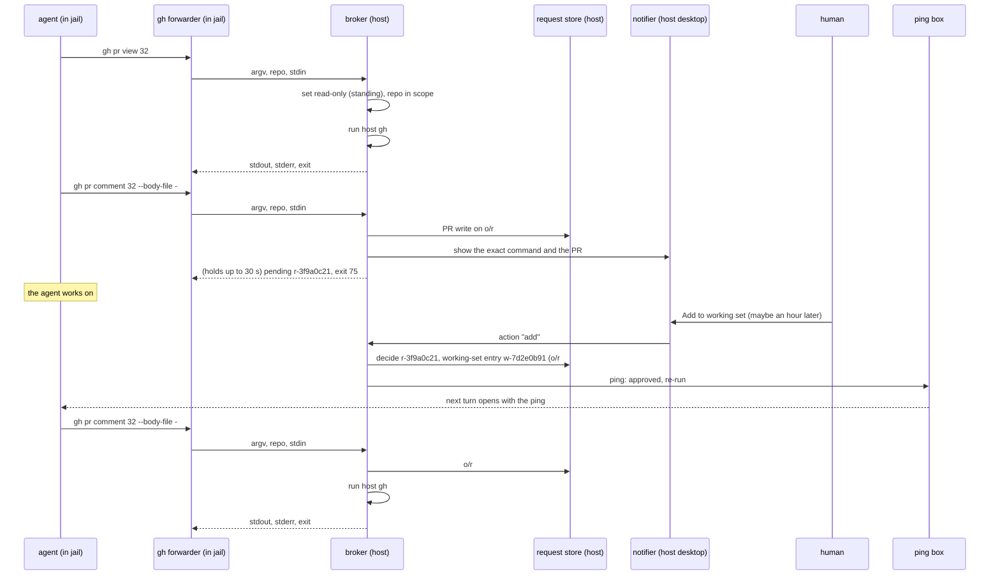
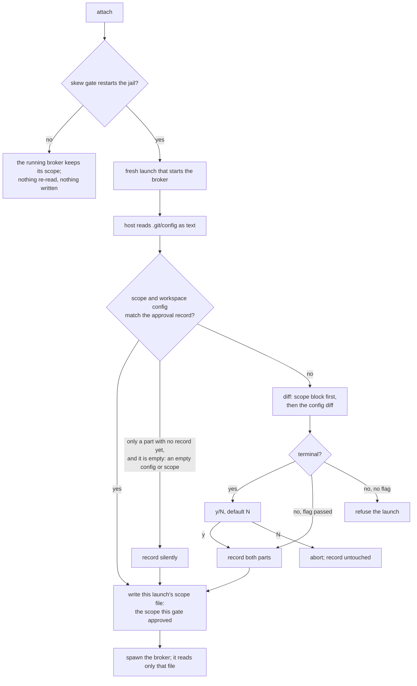

# Reads run, writes ring the doorbell: GitHub access across the jail boundary, one resource at a time

**Status:** 2026-09-28; **re-planned 2026-10-23** around the maintainer's five-step path
([§1.5](#15-the-maintainers-path-2026-10-23), [§11](#11-the-build-in-the-maintainers-five-steps)),
and **re-modeled the same day around resource-scoped grants**
([§1.6](#16-the-grant-model-2026-10-23), [BB-D76](#BB-D76)), which the body now follows;
the built store still holds the earlier set grants ([§7](#7-grants-and-the-request-store)). The
git source is split out to [`git-broker.md`](git-broker.md) and evidence for the new
sections verified against `f9fcd599a`; **the GitHub read path, step 1's first source, built 2026-09-29** (the read path, the repository scope, the audit log, the mount fence),
**the widening entry built 2026-10-01** ([BB-D33](#BB-D33), [BB-D52](#BB-D52); the
`brokered` key in `internal/config/brokered.go`, run end to end against a fake host `gh` by
`integration/githubbroker_test.go`), and **the user-scope sets and host store/`yolo approve` slice built 2026-10-13**.
The bounded GitHub exact-Allow-once slice is implemented in the private Stage2 candidate: production
writes file a request, the host log exposes its id and `yolo approve`, and the handler spends only a
digest-bound one-use grant before dispatch. A configured `on_request` hook is optional, and its
output alone is not consent. This does not implement BB-D76/79's timed-resource grants or working-set
Add, and the broader resource model remains the next design step. See [§7](#7-grants-and-the-request-store).
Notifications, explicit admission rules, macOS and the git source are not built. Revised
around the maintainer's brief of that day; first sketched
2026-08-05. [OQ-BB1](#15-decision-ledger), [OQ-BB2](#15-decision-ledger), [OQ-BB3](#15-decision-ledger), [OQ-BB4](#15-decision-ledger),
[OQ-BB6](#15-decision-ledger), [OQ-BB7](#15-decision-ledger), [OQ-BB8](#15-decision-ledger), [OQ-BB9](#15-decision-ledger) and OQ-C were ruled on
2026-09-29, and the body now follows those rulings ([§1.2](#12-what-it-rules));
[OQ-BB10](#OQ-BB10) was ruled 2026-10-23 ([BB-D98](#BB-D98)). **On 2026-10-05 the maintainer re-ruled [OQ-BB6](#15-decision-ledger) to
its option (d):** the widening entry moves into the workspace config, is approved at the
config-change gate like a remote, and the user-scope form is deleted. That design is
[`workspace-widening.md`](workspace-widening.md), built 2026-10-05; the body below describes the
workspace entry, and the user-scope form survives only as history in [§9.7](#97-the-delivery-copy-and-other-workspaces-widening-entries)
and the ledger. The re-ruling makes [OQ-BB11](#15-decision-ledger) moot ([WW-D7](workspace-widening.md#WW-D7)).
[OQ-BB12](#15-decision-ledger) and [OQ-BB13](#15-decision-ledger), filed and ruled 2026-10-01, put the broker's switch
in a per-workspace file beside the user config, for one project at a time, built as
[BB-D53](#BB-D53) to [BB-D57](#BB-D57). **On 2026-10-24 the maintainer removed that switch for
brokers** ([BB-D104](#BB-D104), [BB-D105](#BB-D105)): selecting the pack starts the broker and grants
nothing, and read access is an explicit grant in the user config that each workspace's approval
shows, built as [BB-D106](#BB-D106) to [BB-D110](#BB-D110). Step 1 lives in
`internal/ghbroker` (the classifier, the executor, the daemon and the `yolo gh` forwarder),
`internal/brokerscope`, `internal/brokeraudit`, `packs/github` and the `intercept` contribution
kind; its implementation decisions are
[BB-D37](#BB-D37) to [BB-D45](#BB-D45), and the fixes a review of it found are
[BB-D46](#BB-D46) to [BB-D51](#BB-D51). [BB-D58](#BB-D58) to [BB-D62](#BB-D62) answer an
agent's field report of 2026-10-03: encoded endpoints, organization flags on writes, words that
climb out of a path, GraphQL advice, and fuzz targets for the scope decision. The first in-jail
use's report (2026-10-03) brought
[BB-D64](#BB-D64) to [BB-D68](#BB-D68): `--jq` and `--template` run, the broker answers
`gh auth status`, a write says at once that nothing waits, the forwarder's shim says what it is,
and the github pack briefs every agent. Still unbuilt: production delivery readiness, explicit admission rules, the
notifiers, the ping, and every production write. (`internal/broker` and the `yolo broker` verb mean the
Claude OAuth singleton; see **broker** in [§1.3](#13-terms).) The research behind
[§5](#5-which-set-the-classifier) and [§6](#6-the-doorbell-a-persistent-desktop-notification) is
dated 2026-09-28 and marked MEASURED, SOURCED or INFERRED throughout
([Appendix B](#appendix-b--the-research-evidence)).

> **In short.** The GitHub credential never crosses the boundary; the command does. A host daemon
> runs the host's own `gh` for the jail, and only against the workspace's own repositories. Reads
> run at once. A write is granted on a resource, never on a command or a session: what the user's
> own config lets the workspace create joins its working set and stays writable, and anything else
> waits for a human, who allows it once, for 15 minutes, or for good from a desktop notification.
> The answer reaches the agent later. Commands that could print the credential or reach the host
> are refused, whatever is granted.

**Why it matters.** Today a jail either has no GitHub access or holds a token, which makes the
boundary a fiction for that token's whole life: every use is unaudited and nothing can be revoked
per action. The maintainer put this on the plate for the week of 2026-09-28.

**The shape.** A jail-side `gh` forwarder, a host **broker** daemon that names each write's
**resource** and runs `gh`, a host **request store** holding requests, grants and each
workspace's **working set**, a **notifier** per OS, the `yolo approve` fallback, and the
**audit log** ([§1.3](#13-terms)).

**Cost.** One new loophole in a new `github` pack, one vendored D-Bus library, two host verbs
(`yolo approve`, `yolo audit`), a user-side key for the grants a workspace holds, a workspace-scope
one for the repositories a workspace asks for, a second part to the config-change gate's approval
record (the repository scope, [§5.6](#56-the-repository-scope)), and `terminal-notifier` as a macOS dependency of the
Homebrew formula on Apple silicon running macOS 14 or later ([§6.2](#62-macos)). The write path's answer rides the `yolo notify`
ping box, which is designed and not built; until it is, writes ship on the agent's own
background wait ([OQ-BB17](#OQ-BB17)).

**Start at [§3](#3-the-flow)**, the flow. Everything else is what one step of it needs.

**Needs your ruling:** [OQ-BB23](#OQ-BB23), whether the user config may grant a write kind to
every workspace (leaning: not now).
[OQ-BB10](#OQ-BB10), [OQ-BB14](#OQ-BB14) (no for now), [OQ-BB15](#OQ-BB15), [OQ-BB16](#OQ-BB16), [OQ-BB19](#OQ-BB19) (four grants), [OQ-BB20](#OQ-BB20), [OQ-BB21](#OQ-BB21), [OQ-BB22](#OQ-BB22), [OQ-BB17](#OQ-BB17), [OQ-BB18](#OQ-BB18), the grant model
([BB-D76](#BB-D76) to [BB-D78](#BB-D78)), and the git source's
[OQ-GB1](git-broker.md#OQ-GB1) and [OQ-GB2](git-broker.md#OQ-GB2), were ruled 2026-10-23.
[OQ-BB3](#15-decision-ledger), [OQ-BB4](#15-decision-ledger), [OQ-BB6](#15-decision-ledger),
[OQ-BB7](#15-decision-ledger), [OQ-BB8](#15-decision-ledger), [OQ-BB9](#15-decision-ledger) and OQ-C were ruled 2026-09-29,
[OQ-BB12](#15-decision-ledger) and [OQ-BB13](#15-decision-ledger) on 2026-10-01, and [OQ-BB6](#15-decision-ledger) re-ruled on
2026-10-05, which makes [OQ-BB11](#15-decision-ledger) moot.

**Reads with:** [`git-broker.md`](git-broker.md) (step 1's factoring of the broker core, and git
as its second source), [`agent-event-watchers.md`](agent-event-watchers.md) (the `yolo notify` doorbell
the answer rides back on), [`live-config-apply.md`](live-config-apply.md) (applying a scope
to a running jail), [`loophole-system.md`](../reference/loophole-system.md) and
[`loophole-transport.md`](../reference/loophole-transport.md) (what the broker is and how a jail
reaches it), [`config-safety.md`](../reference/config-safety.md) (the config-change gate the
scope is approved through), [`providers.md`'s credential gate](../reference/providers.md#the-credential-gate)
(delivery as specific as possible), [`agent-credentials.md`](../reference/agent-credentials.md#sso-backed-bedrock-credentials-aws-auth) (the second consumer waiting for a
request shape), [`host-run-mailbox.md`](host-run-mailbox.md) (the paste-to-host stopgap
for everything this design does not yet cover, planned to become one more front-end of its
store: its [§8](host-run-mailbox.md#8-how-the-gateway-absorbs-it)). The bounded host-store slice is recorded in [§7](#7-grants-and-the-request-store).

---

## 1. The brief, and what it rules

### 1.1 The brief

The maintainer, 2026-09-28, verbatim:

> *"I want to bring back up something we talked about a while ago and put it on the plate for the
> week, which is basically the thing like on YOLO, some boundary where we can hand out credentials
> for some time period, as well as it would be nice to be able to audit the use of those
> credentials if that's even possible. … I want to be able to have the agent say to us, like, I
> want to use GitHub for this across the YOLO boundary. And then YOLO will say, oh, well, let me get
> the user. And then we'll show a toast notification to the user. This will work on Mac and Linux
> through whatever persistent toast notifications we can use. And then the button will be like
> allow or deny for some time period or whatever. You can say, yes, you can use GitHub for 15
> minutes. This could be rather delayed. So we need a mechanism where the agent can wait for that.
> I think it might be something where they fire it off. We fire a notification and then it may come
> back at any time. So I don't know if a single time watcher of them running it would work or we
> could use this notification channel for the background watcher we're talking about to relay this
> information back. GitHub is the first target I want to work on. So I want to ideally be able to
> have the full credentials on the host for GitHub, just GitHub logged in like normal or whatever.
> Using the CLI would be preferable or a direct API if that's something that we have to do. And
> then I want to be able to say by default the agent can run a set of read-only commands. If they
> need a write command, then … they have to ring the doorbell and ask the human. And the human gets
> to make an appropriate decision for that."*

The doc's original thesis, 2026-08-05, which the brief sharpens rather than replaces: *"I want to
put some sort of service in between the contained area and the host, just like loopholes, but
positioned in a place where it can hold tasks that are waiting for a human for approval or have
other state associated with it… the agent inside can ask to use my GitHub credentials to post a
comment to a PR, and then it will go to a queue and I can say yes or no."*

### 1.2 What it rules

| The brief says | Rules | Where it lands |
| :--- | :--- | :--- |
| *"This could be rather delayed … it may come back at any time"* | **[OQ-A](#15-decision-ledger): the synchronous version is not enough.** A request outlives its connection | [§3](#3-the-flow), [§7](#7-grants-and-the-request-store) |
| *"a toast notification … on Mac and Linux … persistent … allow or deny for some time period"* | **[OQ-E](#15-decision-ledger): the human answers in a persistent desktop notification**, with Allow, Deny and a duration. `yolo approve` survives as the fallback | [§6](#6-the-doorbell-a-persistent-desktop-notification) |
| *"GitHub is the first target … just GitHub logged in like normal … Using the CLI would be preferable or a direct API"* | The first broker is GitHub's, over the host's own `gh` login, with `gh api` as the direct-API route | [§4](#4-execution-a-host-daemon-runs-the-hosts-gh) |
| *"by default the agent can run a set of read-only commands. If they need a write command … ring the doorbell"* | The read-only set runs without asking; **every other command the broker accepts needs a grant** | [§5](#5-which-set-the-classifier) |
| *"you can use GitHub for 15 minutes"* | Grants are time-boxed | [§7](#7-grants-and-the-request-store) |
| *"audit the use of those credentials if that's even possible"* | Every brokered call is logged on the host | [§8](#8-audit) |
| *"use this notification channel for the background watcher … to relay this information back"* | The answer reaches the agent as a `yolo notify` ping | [§3.3](#33-the-answer-comes-back-through-the-doorbell) |

**Two questions the brief does not rule by name:**

- **[OQ-C](#15-decision-ledger), does the jail see the result or only success?** Settled by the
  brief, **by my reading**: *"the agent can run a set of read-only commands"* means nothing unless
  the agent sees what they print. So stdout, stderr and the exit code cross, and "no credential
  crosses" becomes a property of the refusal list, which holds every command that prints one and
  which no set or grant lifts ([§4.2](#42-what-crosses-back)). Recorded in the ledger as a reading, not a ruling; say so if
  it is wrong.
- **[OQ-B1b](#15-decision-ledger), vendor unYOLO's policy engine or re-derive it?** Not touched by the brief.
  Decided 2026-09-29 as an implementation choice, [BB-D25](#BB-D25): re-derive, since it adds no
  outside code ([§5.1](#51-the-rule)).

**What the 2026-09-29 rulings changed.** Six of the questions this doc left open were ruled the
next day, and the body is written to them:

- **[OQ-BB1](#15-decision-ledger): the repository scope.** Free reads reach only the workspace's own GitHub
  remotes. This doc bounds every other command by the same scope. The ruled option's text also
  said reads elsewhere and account-wide reads ring and are grantable for a time. This doc read
  the maintainer's *"only have visibility into the repository that is for that workspace"* as a
  hard fence instead: an out-of-scope command does not run and rings nobody
  ([§5.6](#56-the-repository-scope)). [OQ-BB6](#15-decision-ledger)'s ruling confirmed that reading.
- **[OQ-BB2](#15-decision-ledger): permission sets, against my leaning.** Grants hand over a named
  **permission set** for a window, not a class of writes with an always-ask list beside it.
  GitHub's default sets are **read-only**, always held, and **read-write**, handed over whole for
  15 minutes by default. The model allows any number of sets per source, and a source's sets and
  windows are configurable ([§5.7](#57-permission-sets)). The earlier leaning's always-ask list,
  which covered deletes, settings, `pr merge` and every `gh api` write, is gone from the default.
  **Superseded in part 2026-10-23** ([BB-D79](#BB-D79)): a grant no longer hands over a set for
  a window but covers one resource ([§1.6](#16-the-grant-model-2026-10-23)); sets survive as the
  vocabulary of what a grant admits.
- **[OQ-BB3](#15-decision-ledger): the three buttons**, as leaned: **Allow once**, **Allow read-write 15
  min** and **Deny**. Dismissing denies too, and longer grants go through `yolo approve`
  ([§6.4](#64-choosing-a-duration)). **Superseded 2026-10-23** ([BB-D80](#BB-D80)): the answers
  are Allow once, Allow for 15 minutes, Add to the working set and Deny, each on the request's
  resource, and the user chooses which the notification shows.
- **[OQ-BB4](#15-decision-ledger): the macOS notifier**, ruled by delegation for the easy default path.
  `terminal-notifier` 3.x becomes a dependency of the Homebrew formula yolo publishes, on Apple
  silicon running macOS 14 or later, where Homebrew has a prebuilt bottle, so an install from the
  tap brings the notifier with it. It stays optional on Intel and on older macOS, with a
  `yolo check` row, and with no notifier a request waits for `yolo approve`. yolo's
  own signed helper app replaces it once the macOS release signs ([§6.2](#62-macos)).
- **[OQ-BB6](#15-decision-ledger): widening one workspace.** A user-scope entry keyed by workspace widens that
  workspace alone. *Re-ruled 2026-10-05 to option (d)*: the workspace's own config lists the
  repositories, approved at the config-change gate ([`workspace-widening.md`](workspace-widening.md)). An out-of-scope command keeps refusing and never rings, so a notification can
  never widen the scope ([§5.6](#56-the-repository-scope)). What that entry may admit is
  [OQ-BB9](#15-decision-ledger), ruled the same day: whole repositories, for every set, and no account-wide
  command.
- **[OQ-BB7](#15-decision-ledger): when the scope is read.** At every fresh launch, from the workspace's
  remotes, and approved like a config change. The scope becomes part of the config-change gate's
  host-side approval record, and a scope that differs from the approved one appears in that
  launch's diff. It takes effect only once approved, by a y or, with no terminal, by
  `--accept-config-changes`; an N aborts the launch. An attach never re-reads it, unless the
  attach's skew gate restarts the jail, which makes it a fresh launch
  ([§5.6](#56-the-repository-scope)). This replaced the doc's earlier leaning, which pinned the
  scope once at the workspace's first broker launch.
- **Unchanged by any of them:** the refusals in [§5.4](#54-never-brokered). They are about the
  credential and the host, not about what the agent may do on GitHub, so no set holds them and no
  grant runs them.

### 1.3 Terms

Every term here is coined in this doc unless it says otherwise.

| Term | Meaning | What it is not |
| :--- | :--- | :--- |
| **broker** | The host daemon that receives a jail's `gh` argv, assigns it to a permission set, runs the host's `gh` when the jail holds that set, and files a request otherwise. One per jail, a loophole's host daemon ([`loophole-system.md`](../reference/loophole-system.md)). Written **github-broker** wherever it could be confused | Not a proxy: it never forwards the jail's bytes to GitHub, and never hands the jail a token. Not `internal/broker` or `yolo broker`, which already name the Claude OAuth singleton (`claude-oauth-broker`); the build needs names that do not collide |
| **brokered call** | One argv the jail sent the broker, whatever became of it | Not a crossing in [`crossings.log`](../reference/loophole-protocol.md)'s sense, which is a connection |
| **source** | The maintainer's word (2026-09-29) for a service a broker fronts with a host credential. GitHub is the first; each source has its own classifier, sets and store | Not a pack: one pack could ship several sources |
| **permission set** | A named group of commands a source defines, such as GitHub's **read-only** and **read-write**. Since [BB-D79](#BB-D79) a set is the vocabulary a grant's coverage is written in, not the thing a grant hands over ([§5.7](#57-permission-sets)) | Not a scope: which repositories a command may touch is the repository scope's question, and no set widens it |
| **standing set** | Coined here: a permission set every jail always holds, such as read-only. Its commands run with no human | Not a grant: nothing is recorded, and it cannot be revoked per jail |
| **windowed set** | Coined here, 2026-09-29: a permission set a human handed over whole for a window and a use count. **Retired** by [BB-D79](#BB-D79); the built store still holds such grants until the resource model replaces them | Not a term for new design text: write **resource grant** instead |
| **resource** | Coined here: the one thing a write acts on, as the broker names it from its own parse: a pull request (`o/r#32`), an issue, a branch or tag ref, or a repository's ability to create something, such as PRs in `o/r` ([§5.7](#57-permission-sets)). A repository-level write, such as a release, has no resource the working set can hold ([BB-D95](#BB-D95)) | Not a command: a grant on PR `o/r#32` covers every write of its kind to that PR, not one argv |
| **write kind** | Coined here: the class a write falls in, which fixes its resource: a PR write, a PR merge, an issue write, a branch push, and so on ([§5.7](#57-permission-sets)) | Not a grant: it says what a write is, not whether it may run |
| **user grant** | Coined here: a named permission a workspace holds, such as creating PRs, in two layers: the user's own config allows its kind (`brokered.<source>.grant_kinds`), and the workspace config holds the grant itself, naming its resource (`brokered.<source>.grants`), which joins only at the config-change approval ([BB-D96](#BB-D96)). There are four kinds: `read`, `create-branch`, `create-pr` and `create-issue` ([OQ-BB19](#OQ-BB19), [§5.8](#58-long-lived-access-and-temporary-access)) | Not something a workspace config can hold beyond the kinds the user's config allows, and not something an agent or a notification can give: a workspace grant holds only once a human approves it ([BB-D74](#BB-D74), [BB-D96](#BB-D96)) |
| **working set** | Coined in [`git-broker.md`](git-broker.md#51-the-working-set-of-pushable-branches) for branches, and widened here to every resource: the resources a workspace may write to with no further asking, because the agent created them under a user grant or a human added them. Kept per workspace until the resource is gone or the entry is revoked ([OQ-BB21](#OQ-BB21)) | Not per launch or per session, and not in any config file: it lives in the source's store ([BB-D85](#BB-D85)) |
| **repository scope** | Coined here: the GitHub repositories a jail's calls may touch. It is the approved scope, the workspace's remotes and its `brokered.github.repos` entry as a human approved them, fixed for the life of the fresh launch that approved it, in a scope file keyed by that launch ([§5.6](#56-the-repository-scope), [BB-D32](#BB-D32), [OQ-BB1](#15-decision-ledger)) | Not the set of repositories the host login can see, which is every repository the user can reach |
| **fresh launch**, **attach** | Not coined here: a fresh launch creates the container, and an attach joins one already running. Only a fresh launch runs the config-change gate ([`config-safety.md`](../reference/config-safety.md#where-it-runs-and-where-it-deliberately-does-not)) | An attach is not a launch that re-reads anything. One exception: an attach whose skew gate restarts the jail continues as a fresh launch, and re-reads like one |
| **approval record** | Not coined here: the config-change gate's host-side record of the workspace config a human last approved, `paths.ApprovalsDir()/<container-name>.json`, written only on a y, `--accept-config-changes`, a host `yolo check --accept-config-changes`, or silently when there is no record yet and nothing to approve (an empty config, and under this doc an empty scope) ([`config-safety.md`](../reference/config-safety.md)). This doc adds a scope part to it ([BB-D30](#BB-D30)) | Not mounted into any jail, and not the broker's request store |
| **approved scope** | Coined here: the `owner/repo` list a human last approved for a workspace, read from its remotes and its widening entry, and held in the approval record's scope part | Not the remotes or the entry as they are now: one added since is not in it until the next fresh launch's prompt is approved |
| **scope block** | Coined here: the labeled block the config-change diff opens with when the scope changed, naming each repository added or removed ([BB-D31](#BB-D31)) | Not a line of the config JSON diff |
| **widening entry** | Coined here, and redefined 2026-10-05 by [`workspace-widening.md`](workspace-widening.md#14-terms): a workspace's own `brokered.<source>.repos` list, the repositories it asks for beyond its remotes, for every set ([OQ-BB9](#15-decision-ledger)). A design-doc term only: text an agent or user reads names the key ([WW-D13](workspace-widening.md#WW-D13)). The user-scope form keyed by a workspace's host path ([BB-D33](#BB-D33)) is retired | Not in force until approved: it joins the scope part of the gate, as rows of the scope block, never JSON lines. Not a way in for an account-wide command, and not a limit on which sets a repository is used under: [OQ-BB9](#15-decision-ledger) ruled both out |
| **out of scope** | A command whose repository is outside the repository scope, or that names no repository the broker can check (account-wide) | Not a request: it is refused with exit 64 and never rings, since [OQ-BB6](#15-decision-ledger) ruled that no notification widens the scope. A `brokered.github.repos` entry, once approved, can add a repository; none admits an account-wide command ([OQ-BB9](#15-decision-ledger)) |
| **free read** | A command in a standing set whose repository is in scope. Runs with no human | Not "any GET": the classifier decides, not the HTTP verb alone |
| **write** | Shorthand for a command in no standing set: with GitHub's defaults, one not in read-only. It runs if a user grant, a working-set entry, a live timed grant or an Allow once covers it | Not a command the classifier cannot fully parse: an unknown flag or command word is refused, not a write ([§5.1](#51-the-rule)) |
| **request** | A write nothing covers, held in the store until a human answers or it expires. It has an id (`r-` plus 8 hex), the jail, the exact parsed command, its resource and write kind, and a state | Not a connection: it outlives the call that filed it |
| **grant** | What a human's positive answer creates ([§7](#7-grants-and-the-request-store)): an **Allow once** (one exact command, one use), a **timed grant** *(coined here: the request's resource for a duration, 15 minutes by default)*, or a **working-set entry** (the resource, until it is gone or revoked). A write a live grant covers runs with no new request | Not a token: nothing leaves the host. Not scoped to a session: a timed grant ends by the clock and a working-set entry with its resource; only an Allow once, as built, also dies with the broker that recorded it ([BB-D77](#BB-D77)) |
| **refused** | A command the broker never runs, whatever set the jail holds and whatever a human answers ([§5.4](#54-never-brokered)) | Not a request awaiting approval, and not a set a configuration can define |
| **request store** | The host directory holding requests and grants, written only under its lock | Not the audit log, which records what happened and decides nothing |
| **notifier** | The per-OS piece that shows a request to the human and returns the button pressed | Not the ping box, which carries answers to the agent |
| **audit log** | The append-only host file recording every brokered call and every decision | Not jail-writable, and not `crossings.log` |

**The old letters.** Three sibling docs cite work here by this doc's 2026-08 numbering: **B1b**
is the credential-injecting proxy for git ([§13](#13-what-this-does-not-cover-and-the-other-two-tiers)),
**B2** the approval queue, which is now this whole design, and **B3** auth-mode modeling, split out
to `agent-auth-modes.md` (deleted 2026-10-16; its result is [`providers.md`](../reference/providers.md)). The roadmap never carried them; cite an OQ id.

### 1.4 Principles

Numbered so later sections and sibling docs can cite them.

- <a id="BB-P1"></a>**BB-P1. The credential never crosses; the command does.** The broker runs
  the command on the host with the host's login and returns its output. It never hands the jail
  a token, not scoped, not short-lived. The moment a token crosses, every later use is
  unaudited and unrevocable.
- <a id="BB-P2"></a>**BB-P2. An allowlist, never a denylist.** A command is in a standing set
  only if that set's allowlist names it with the flags it carries. Nothing the classifier does not
  recognize is in any set: an unknown flag or an unknown command word, including every new `gh`
  subcommand or flag a `gh` upgrade adds, is refused.
- <a id="BB-P3"></a>**BB-P3. Approval comes only from the host.** An answer counts only if it
  came from the notifier the broker itself started, or from `yolo approve` over a socket no jail
  can reach. Nothing a jail sends is ever read as a decision.
- <a id="BB-P4"></a>**BB-P4. The human is shown the command, not the agent's story.** Every
  notification is rendered from the broker's own parse of the argv. Agent-written text is never
  the title and is labeled as unverified wherever it appears.
- <a id="BB-P5"></a>**BB-P5. Silence denies.** A request no one answers expires as denied. A
  notifier that cannot show buttons is treated as no notifier. Nothing defaults to yes.
- <a id="BB-P6"></a>**BB-P6. This must not become a general RPC.** The broker runs one program,
  `gh`, with an argv it parsed and rebuilt, in a cwd and environment it owns. No request names a
  program, a cwd, an environment variable or a host file.
- <a id="BB-P7"></a>**BB-P7. Every brokered call is audited.** Refused ones included, since a
  refusal is the most interesting line in an audit log.
- <a id="BB-P8"></a>**BB-P8. Sets decide what, never where, and never the refusals.** A permission
  set names commands. It cannot widen the repository scope, and it cannot hold a refused command.
  Those two fences are the broker's code, not configuration, so no grant, no set definition and no
  human answer moves them.
- <a id="BB-P9"></a>**BB-P9. A workspace never widens its own reach through the broker without a
  human's y.** *Restated 2026-10-05* ([`workspace-widening.md` §1.3](workspace-widening.md#13-what-it-changes-in-standing-records)).
  The agent can edit the workspace, so the broker's own configuration is user-scope only: nothing
  the workspace says can add a command to a set. The workspace has two inputs to its scope, its
  remotes, which the host reads, and its `brokered.github.repos` entry, and a change to either takes
  effect only once a human approves it in the launch's config-change prompt
  ([§5.6](#56-the-repository-scope)). Its write grants are a third input, gated the same way and only
  within the kinds the user's config allows ([BB-D96](#BB-D96)). This is the maintainer's
  reasoning in [OQ-BB1](#15-decision-ledger)'s and [OQ-BB7](#15-decision-ledger)'s rulings. **Its limit:** a
  workspace-scope `mounts` entry accepts any host path, so without a fence it could mount the
  broker's store or the host `gh` login into the next launch once a human approves the config
  diff. [BB-D26](#BB-D26) refuses that. No mount can write the approval record's directory,
  where the approved scope lives, since every `mounts` entry is a read-only bind
  ([BB-D34](#BB-D34)); other workspace keys that reach the host are gated by the config-change
  diff, not by this principle.

### 1.5 The maintainer's path, 2026-10-23

The maintainer pasted a Slack thread with a colleague who built his own approval flow: a local
web dashboard of pending requests, read-only access standing and writes approved one by one, a
git broker for fetch and push with per-branch push grants, and a two-minute window after which
an unanswered request is denied and the agent must ask again. The maintainer, of his own
comments there, *"I think my comments here lay out a clear path"*. The path, verbatim:

> *"1. add support for whatever loopholes you need/want with rw and ro support, maybe factoring
> out the CLI wrapping/proxy stuff*
> *2. add generic support for yolo-jail sending (actionable) toasts on linux/mac*
> *3. add some host-side machinery as a CLI that can view/approve these access requests*
> *4. build your proposed web UI out of tree, and plug into the CLI or whatever generic surface
> gets exposed for this.*
> *5. talk about merging the web UI at this point, so it'll be much more clear"*

| He says (2026-10-23) | Rules | Lands |
| :--- | :--- | :--- |
| The five steps above | **The build order.** Sources first, then toasts, then the CLI, then an out-of-tree UI on the CLI's surface | [§11](#11-the-build-in-the-maintainers-five-steps) |
| *"maybe factoring out the CLI wrapping/proxy stuff"*; *"proxying the git CLI … maybe even worth making this a generic mechanism"* | The source-neutral broker core is factored out of the github-broker, and git is the second source on it | [`git-broker.md`](git-broker.md) |
| *"generic support for yolo-jail sending (actionable) toasts"* | The notifier is yolo's, not the github-broker's: one front-end of the store that any source's requests reach | [§6](#6-the-doorbell-a-persistent-desktop-notification) |
| *"plug into the CLI or whatever generic surface gets exposed"*; *"the CLI/hook would let you build this as well"* | The CLI's output is a stable, machine-readable surface, and the UI is not yolo's to build yet | [§6.6](#66-one-store-several-front-ends-and-a-stable-surface-for-the-ones-yolo-does-not-ship) |
| *"we should also distinguish long lived access, which probably belongs in the workspace's yolo config, from temp access like pushing"* | Long-lived and temporary access are distinct; a grant is the temporary kind. **Where long-lived access lives was partly superseded** by his [OQ-BB16](#OQ-BB16) ruling the same day (only the user's own config, scoped to workspaces), **then refined by [BB-D96](#BB-D96)**: the user's config allows the kinds of grant, and the workspace config holds the specific grants behind the config-change approval | [§5.8](#58-long-lived-access-and-temporary-access) |
| *"seeing an audit trail of what the agent did after the fact, as in, what commands exactly were used with your token/access, would be a nice touch"* | Already the design, and built for reads: every call audited with its canonical argv and the grant it ran under | [§8](#8-audit) |
| *"it's a little annoying as a user experience because then you gotta kick it to continue … maybe you can auto kick the agent session when a response comes in, through that agent messaging protocol, although you may need to be a child proc"* | **The answer wakes the agent session**; an auto-deny the agent must be kicked past is the thing to avoid | [§3.3](#33-the-answer-comes-back-through-the-doorbell) |

**What it does not change.** The credential still never crosses ([BB-P1](#BB-P1)), and the
host runs every command. On the colleague's remote case, a Slack link that opens a dashboard
served from his own machine, the maintainer's answer was not to build a UI in yet (*"who knows
what it should be"*), which is why step 4 is out of tree.

### 1.6 The grant model, 2026-10-23

Asked about four cases (a one-off `gh pr create`; about ten writes while answering a review; a
long unattended run; a push to a branch the agent did not create), the maintainer ruled, dictated
and lightly cleaned:

> *"A one-off write creating a PR: just like read-only and read-write, PR creation should be a
> user-level granted write. But if it is granted, just like an agent can create a branch and work
> with it, they can create a PR and work with it. The burst of writes on review: I think just the
> first request is to widen the scope permanently to that PR, and then it can write whenever it
> wants. For the long unattended runs, I think one and two cover it now. Pushing to a branch it
> didn't create, I think is the same thing: it asks for access to that branch, and if it gets
> that access, it has that access. These should be able to be time-limited as well, I guess. I
> don't know how many buttons we have the potential to do, but I guess it should be up to the
> user. It would be nice if there's a [allow] for 15 minutes and an added-to-the-working-set
> option for these things. I don't think we want anything scoped to a session. Sessions aren't
> helpful. Sessions aren't well-defined."*

Three follow-ups the same day:

> *"Read-only mode is read-only mode. It cannot create branches push... well, it can create
> branches in the local git repo. It cannot push them, that's for sure."*

> *"Maybe we don't want to have read-only versus read-write. We just want to have these specific
> grants. You can tell me how many there are."*

> *"allow once should add it to some queue somewhere … the GitHub broker or the Git broker will
> queue this acceptance and when the exact request fires again after the agent wakes up, then it
> uses its one thing. It already knows what we're approving here."*

And ruling [OQ-BB19](#OQ-BB19) the same day:

> *"46, I think those grants are right, but it's not just create. Because yes, you can keep pushing to the branches made, but you should also be able to widen your working set for a branch that somebody else made, and at that point it's not creating."*

| He says | Rules | Lands |
| :--- | :--- | :--- |
| *"PR creation should be a user-level granted write"* | **Creating is a user grant** ([BB-D76](#BB-D76)). Where it is held was first the user's own config for that workspace, **superseded by [BB-D96](#BB-D96)**: the user's config allows the kind, and the workspace config holds the grant naming its repository, approved at the config-change gate | [§5.8](#58-long-lived-access-and-temporary-access) |
| *"they can create a PR and work with it"* | What the agent creates under a user grant **joins the workspace's working set**, and the agent writes to it freely, as [OQ-GB2](git-broker.md#OQ-GB2) ruled for a created branch | [§5.8](#58-long-lived-access-and-temporary-access) |
| *"widen the scope permanently to that PR"*; *"it asks for access to that branch"* | **A grant covers a resource**, not a command: anything outside the working set is asked for per resource | [§5.7](#57-permission-sets), [§7](#7-grants-and-the-request-store) |
| *"[allow] for 15 minutes and an added-to-the-working-set option"*; *"it should be up to the user"* | The human answers **Allow for 15 minutes**, **Add to the working set** or **Deny**, and the user chooses which the notification shows ([BB-D80](#BB-D80), [BB-D84](#BB-D84)) | [§6.4](#64-choosing-a-duration) |
| *"allow once should add it to some queue"* | **Allow once survives as built** ([BB-D77](#BB-D77)): one exact command, one use | [§7](#7-grants-and-the-request-store) |
| *"I don't think we want anything scoped to a session"* | **No grant is scoped to a session**: `--for session` and the `session` ceiling are gone ([BB-D83](#BB-D83)) | [§7](#7-grants-and-the-request-store) |
| *"Read-only mode is read-only mode … It cannot push them"* | **Git read-only allows no push of any kind**; the agent pushes its own branches only under a grant that allows it ([BB-D78](#BB-D78), [GB-D7](git-broker.md#GB-D7)) | [`git-broker.md` §5](git-broker.md#5-the-git-sources-sets) |
| *"We just want to have these specific grants. You can tell me how many there are."* | **Four user grants**: `read`, `create-branch`, `create-pr`, `create-issue`; `read-only` and `read-write` go away as names ([OQ-BB19](#OQ-BB19)) | [§5.7](#57-permission-sets) |
| *"you should also be able to widen your working set for a branch that somebody else made, and at that point it's not creating"* | **A working set takes a resource someone else made** at a human's Add, and the agent then works it as one it created ([BB-D92](#BB-D92)) | [§5.8](#58-long-lived-access-and-temporary-access) |

**My reading, an interpretation and not his words:** a resource is a PR, an issue, a branch or
ref, or a repository's ability to create PRs; a working-set entry is persisted as a property of
the workspace and kept until the resource is gone or the entry is revoked, as for the created
branch in [OQ-GB2](git-broker.md#OQ-GB2); and this supersedes, in part or whole,
[OQ-BB2](#15-decision-ledger), [OQ-BB3](#15-decision-ledger), [BB-D9](#BB-D9),
[BB-D24](#BB-D24) and [BB-D29](#BB-D29), each recorded in the ledger
([BB-D79](#BB-D79) to [BB-D83](#BB-D83)).

## 2. What exists today

Verified against `f9fcd599a` on 2026-10-23. Line numbers are left out on purpose: the symbols
are stable and the lines are not.

| Piece | Where | State |
| :--- | :--- | :--- |
| A framed request/response protocol across the boundary | `internal/frameproto`, [`loophole-protocol.md`](../reference/loophole-protocol.md) | **shipped**, versioned |
| A host daemon framework with host-asserted jail identity | `internal/hostservice`: the jail id comes *"in descending order of trust"* from the connection preamble, then the request, then `"unknown"`; the preamble is written host to daemon, once, and *"a client cannot forge, suppress, or even observe it"* (`internal/svcendpoint/preamble.go`) | **shipped** |
| A jail-to-host transport that authenticates the jail | loopback TLS with a per-(jail, service) endpoint-file token; *"The adversary is a SIBLING JAIL. It is not the jail's own agent, and it is not a same-user host process"* ([`loophole-transport.md`](../reference/loophole-transport.md)) | **shipped** |
| Argv safety for host-side execution | `Session.ExecAllowlisted`: argv positions checked against a server-owned set, stdout and stderr streamed back as frames, rc 124 on timeout | **shipped**, but too coarse for `gh`: it checks words, not a subcommand's flag grammar |
| A connection audit | `internal/crossaudit`: one line per jail-to-host connection, accepted or rejected, to `GLOBAL_STORAGE/logs/crossings.log`, `0600`, 4 MiB plus one archive | **shipped** 2026-08-15. It records that a connection happened, never what it asked |
| Jail-side interception of a command name | the `intercept` contribution kind (`packdecl.KindIntercept`), which `packs/github` uses to put `yolo gh --` in front of `gh` | **shipped** ([OQ-BB8](#15-decision-ledger)) |
| The GitHub source: classifier, executor, daemon, forwarder | `internal/ghbroker`, `internal/brokerscope`, `packs/github`; `yolo gh status` and `yolo gh wait` in the forwarder | **shipped** for reads. One package holds both the source-neutral machinery and the gh-specific part, which [`git-broker.md` §3](git-broker.md#3-the-broker-core-what-step-1-factors-out) factors apart |
| A request that outlives its connection, and grants | `internal/brokerstore`, one directory per source (`paths.BrokerSourceDir`) | **built**; production GitHub files requests and the exact-consume path ignores legacy empty-digest set grants |
| A human in the answer path | `yolo approve` (`internal/cli/approve.go`): list, allow once, `--for` (other sources only), deny, revoke, JSON and watch | **built**; GitHub writes accept Allow once only, and deny remains available |
| The audit log and its viewer | `internal/brokeraudit`, whose events carry a `service`; `yolo audit` with `--since`, `--jail`, `--workspace`, `--set`, `--grant` and `--json` | **shipped**, with `--service` |
| A running jail's scope widened without a restart | `yolo config apply` ([`live-config-apply.md`](live-config-apply.md)) | **shipped** |
| An agent-agnostic doorbell into the session | `yolo notify` and the per-launch ping box ([`agent-event-watchers.md`](agent-event-watchers.md)) | **designed, not built**: no `notify` verb in `internal/cli` or `cmd/` |
| Desktop notifications | — | **missing**: no D-Bus, `notify-send`, terminal-notifier or UserNotifications code in the tree; the `osascript` lines in `internal/macosuser` are not notifications |
| Anything for git | — | **missing** ([`git-broker.md`](git-broker.md)) |

**What the loophole protocol's posture decides here.** The transport defends against a sibling
jail, not against the jail's own agent or a same-user host process. So this design protects
against **accident and unaudited action** by a confined agent. It is not a control against a
hostile process running as the user on the host, and the user-facing docs must say so
([§9.6](#96-what-this-is-not-a-control-against)).

## 3. The flow



### 3.1 A read

1. The agent runs `gh <args>` in the jail. The jail's `gh` is the forwarder
   ([§4.3](#43-the-jail-side)), which sends the argv, the repository it resolved, and stdin.
2. The broker parses the argv, checks its repository against the jail's repository scope, and
   assigns it to a permission set ([§5](#5-which-set-the-classifier)). A command in a standing set
   (read-only, by default) runs at once, as [§4.1](#41-how-the-broker-runs-gh) describes.
3. stdout, stderr and the exit code return to the forwarder, which prints them and exits with
   that code. The audit log gets one line.

A read never touches the request store and never notifies anyone.

### 3.2 A write, and the bounded wait

1. The broker parses a write: a command in scope in no standing set. It names the write's kind
   and resource ([§5.7](#57-permission-sets)), such as a PR write on `o/r#32`. The write runs as a
   read does if a user grant covers it, if its resource is in the workspace's working set, if a
   live timed grant covers that resource, or if an Allow once matches this exact command, which
   it then spends ([§5.8](#58-long-lived-access-and-temporary-access),
   [§7](#7-grants-and-the-request-store)).
2. Otherwise the broker files a request naming the resource, and shows it to the human
   ([§6](#6-the-doorbell-a-persistent-desktop-notification)).
3. **The forwarder waits up to 30 seconds** for the answer, so a human at the desk answers
   inside the agent's own tool call. If Allow arrives in that window, the broker runs the
   command then and returns its output as for a read.
4. **Past 30 seconds the forwarder returns** with exit code **75** and one stderr paragraph:
   the request id, that a human has been asked, that the answer will arrive as a `yolo notify`
   ping, and that the agent should carry on and re-run the command once approved. Nothing ran.
5. A Deny inside the window returns exit **77** with the same shape of message. A command the
   broker refuses outright ([§5.4](#54-never-brokered)), or one out of scope
   ([§5.6](#56-the-repository-scope)), returns exit **64** naming why, files no request and rings
   nobody.

The codes are `sysexits.h`'s (`EX_TEMPFAIL`, `EX_NOPERM`, `EX_USAGE`, and `EX_UNAVAILABLE` in
[§3.5](#35-failure-paths)), so a script can tell "wait" from "no" from "never". None collides with
`gh`'s own: 0, 1, 2 (cancelled) and 4 (authentication required) (MEASURED, `gh help exit-codes`),
and 8 for `pr checks` pending (MEASURED, `gh pr checks --help`). The wording of each message is the implementer's; the facts in
it are not.

### 3.3 The answer comes back through the doorbell

When the human answers after the wait, the broker writes one ping into that launch's ping box,
through the box's own writer, `yolo notify`
([`agent-event-watchers.md` §3.3](agent-event-watchers.md#33-yolo-notify-and-the-ping-box)). The
box is a host directory the launch owns and mounts into the jail, so a host daemon the launch
started writes it directly; the broker is not a host-side sidecar and does not wait on that doc's
host-side sidecar work ([BB-D14](#BB-D14)). It carries facts only, per that doc's rule for pings ([§5.1 there](agent-event-watchers.md#51-pinged-text-is-a-prompt-injection-channel)):

```text
[yolo notify · github-broker · 14:07Z] An automated notice from a background process yolo runs for
this workspace. It is not from the user and grants nothing.
r-3f9a0c21 approved: gh pr comment on mschulkind-oss/yolo-jail#32, added to this workspace's
working set as w-7d2e0b91: writes to that PR run with no further asking until the entry ends.
Nothing has run; re-run the command if it is still wanted.
```

A timed grant's ping names the resource and the time it ends (`for 15 minutes, until 14:22Z`),
and an Allow once's names the one command it covers.

- The ping names the command by its subcommand path and repository, never by its arguments, so
  no agent-written body and no third-party text rides into the model's context.
- A Deny pings `r-… denied`; an expiry pings `r-… expired unanswered, treated as denied`.
- The ping's `from` label is `github-broker`, so the box's rate limit (six delivered per 60
  seconds per label) applies per broker.
- **Why a ping, not a watcher the agent runs.** The brief asked whether *"a single time watcher"*
  would do. A one-shot wait the agent starts (`yolo gh wait <id>`, which exists for scripts)
  works only for an agent with background tasks, dies with the session, and must be started
  again every time. The ping box is agent-agnostic, survives the session, and reaches every
  agent through its own pack's deliverer.
- **Until `yolo notify` is built**, the pending message names `yolo gh status <id>` instead.
  Nothing else changes.

**The answer must wake the session** (the maintainer, 2026-10-23, [§1.5](#15-the-maintainers-path-2026-10-23)):
an answer the agent has to be kicked to notice is the experience he called *"a little
annoying"*. That rules out polling as the design and makes the 30-second wait plus a
60-minute request life, rather than a short auto-deny, the right shape: an answer that arrives
an hour later still reaches the agent. Two things can wake a session:

| Waker | How | Reaches | Waits on |
| :--- | :--- | :--- | :--- |
| **The ping** | the broker writes the ping box; the agent pack's deliverer wakes the session | every agent with a deliverer, whether or not it started anything | `yolo notify`, and [OQ-EW11](agent-event-watchers.md#OQ-EW11) to [OQ-EW13](agent-event-watchers.md#OQ-EW13), which hold that build |
| **The agent's own wait** | the pending message tells the agent to run `yolo gh wait <id>` as a background task; the agent's harness wakes the session when that child exits with the answer | agents whose harness runs background tasks and reports their exit, Claude Code among them (INFERRED from the CI watcher, which relies on it; no agent session was started for this doc) | nothing: `yolo gh wait` is built |

The second is what the maintainer meant by *"you may need to be a child proc"*: the waker is a
child of the session, so no messaging protocol is needed. It dies with the session, which is the
right answer for a session that ended. Whether writes may ship on it before the ping exists is
[OQ-BB17](#OQ-BB17).

### 3.4 The agent re-issues under the grant

**An approval after the wait runs nothing.** It creates a grant; the agent re-runs its command,
and the grant covers it. The alternative, running the approved command at approval time and
pinging its output back, was weighed and rejected:

| | Run at approval time | Re-issue under the grant (chosen) |
| :--- | :--- | :--- |
| Staleness | Runs an argv composed up to an hour ago, against a PR that may since have merged or a branch that moved | The agent decides, with current context, whether the command is still wanted |
| Idempotency | An agent that gave up and ran the command another way, or asked twice, posts twice | Nothing runs twice: the approval itself does nothing |
| Where the output goes | Into a 1 KB, 8-line ping, or a result store the agent must fetch from | Into the agent's own tool call, as for any command |
| A session that ended | The command runs for nobody | Nothing runs, which is the right answer |
| Cost | None to the agent | One more turn |

The one exception is the bounded wait in [§3.2](#32-a-write-and-the-bounded-wait): there the
argv is at most 30 seconds old and its caller is still waiting, so running it then has neither
problem.

### 3.5 Failure paths

| Step | What fails | What happens, and who finds out |
| :--- | :--- | :--- |
| Launch | The scope read from the remotes differs from the approved scope, and the human answers N | The launch aborts, as for any config change, and the approval record is untouched ([§5.6](#56-the-repository-scope)) |
| Launch | The same, with no terminal and no `--accept-config-changes` | The launch refuses, printing the scope block and naming the git config file it came from ([BB-D31](#BB-D31)) |
| Launch | `.git/config` is unreadable, or a worktree's `.git` file has the wrong shape | The scope reads as empty and the launch says why; against a non-empty approved scope that is a change, shown in the diff as every repository removed |
| Forward | The broker is not running or unreachable | The forwarder exits 69 (`EX_UNAVAILABLE`) naming the loophole and `yolo check`. It never falls back to a `gh` of its own |
| Classify | The argv does not parse, or names a refused command | Exit 64 naming the rule; one audit line, set `refused` |
| Classify | The repository is outside the scope, or the command names none | Exit 64 naming the scope's repositories. For a repository outside the scope, it tells the agent to add it to the workspace's `brokered.github.repos` and ask for a restart; for an account-wide command, it says that no such entry can add one ([OQ-BB9](#15-decision-ledger), [§5.6](#56-the-repository-scope)). One audit line, set `out-of-scope`; no request and no notification |
| Run | The host `gh` is missing or has no login | Exit 69, naming `gh auth status` on the host. The broker never starts a login |
| Run | The call exceeds 300 seconds | Killed; exit 124, as `ExecAllowlisted` does; audited |
| Run | Output exceeds 16 MiB | Cut, with a last stderr line saying so; audited with the byte count |
| Request | Three requests from this jail already wait | Exit 75 with no new request, naming the three ids |
| Request | A write of the same kind on the same resource is already pending from this jail | The call joins that request: same id, no second notification; the notification gains the command ([BB-D87](#BB-D87)) |
| Request | A write of the same kind on the same resource was denied in the last 10 minutes | Exit 77 with no new notification, naming the earlier denial |
| Notify | No notifier ([§6.5](#65-when-there-is-no-notifier-or-nobody-answers)) | The request is filed anyway; the pending message and the launch terminal name `yolo approve` |
| Answer | Nobody answers in 60 minutes | Expired as denied; the notification is withdrawn; a ping says so |
| Answer | The broker restarts with requests pending | It re-reads the store and re-shows each live request. An answer to a notification the old process showed is lost, and the re-shown one replaces it |
| Answer | Two answers race (a button and `yolo approve`) | The first decision written wins; the second is told the request is already decided |
| Deliver | The ping box is missing, or the agent's pack has no deliverer | The decision stands and is in the store; `yolo gh status <id>` reports it |

## 4. Execution: a host daemon runs the host's `gh`

### 4.1 How the broker runs `gh`

The broker never runs `gh` the way the argv arrived. It rebuilds a canonical argv from its own
parse and runs it under conditions it owns, because `gh` is a program with many ways to run other
programs ([§9.5](#95-host-code-execution-through-gh)):

| Condition | Value | Why |
| :--- | :--- | :--- |
| Program | The host's `gh`, resolved once at daemon start to an absolute path and disclosed | [BB-P6](#BB-P6) |
| cwd | An empty directory the broker owns under its state dir | `gh` reads the git repository in its cwd (`pr status`, a bare `pr view`, `{owner}/{repo}` placeholders), and git in a jail-writable checkout can run code through its config (MEASURED for `gh`'s reads; the git half is standard git behavior) |
| Repository | Always explicit: `-R <owner>/<repo>`, two segments, from the argv or the forwarder | No cwd inference. A three-segment `-R HOST/o/r` is refused (H1 in [Appendix B](#b2-gh-probes)) |
| `GH_CONFIG_DIR` | A broker-owned directory holding a copy of the host's `hosts.yml` and no `config.yml` | No aliases, and no `browser`, `pager`, `editor` or `http_unix_socket` keys. The token stays wherever `gh` keeps it: the OS keyring by default since `gh` 2.26.0, `hosts.yml` otherwise (SOURCED). Whether a copied `hosts.yml` still finds a keyring entry is INFERRED and is the first thing the build checks |
| `XDG_DATA_HOME`, `XDG_CACHE_HOME`, `XDG_STATE_HOME` | Empty broker-owned directories | No extensions can resolve (they live under the data dir, MEASURED) |
| Environment | Built from nothing: `PATH` of the `gh` binary's directory plus `/usr/bin:/bin`, `HOME`, `GH_HOST=github.com`, `GH_PROMPT_DISABLED=1`, `GH_NO_UPDATE_NOTIFIER=1`, `GH_PAGER=cat`, `NO_COLOR=1`, and `gh`'s telemetry dial off | No `GH_TOKEN`, `GH_ENTERPRISE_TOKEN`, `GITHUB_TOKEN`, `GH_REPO`, `BROWSER`, `GH_BROWSER`, `EDITOR`, `VISUAL`, `GH_EDITOR` or any `GIT_*`. `GH_BROWSER` and `GH_PAGER` are exec paths `gh` runs (MEASURED) |
| stdin | The bytes the forwarder sent, capped at 1 MiB, only for a flag that reads `-` | [§5.5](#55-argv-hazards) |
| Timeout | 300 seconds per call, `watch` forms included | A `run watch` is useful and must still end |

### 4.2 What crosses back

- **stdout, stderr and the exit code cross, verbatim**, up to 16 MiB. This is
  [OQ-C](#15-decision-ledger) as the brief settles it ([§1.2](#12-what-it-rules)). One command
  is answered rather than run: `gh auth status`, whose answer is the broker's own, since what
  `gh` would say describes the host's login and not the jail's ([BB-D65](#BB-D65)).
- **No credential crosses because no command that prints one is brokered**, under any set or
  grant. `auth token`,
  `auth git-credential`, `auth status -t` and `config get … oauth_token` are refused outright,
  MEASURED as printing a token in this jail with fake credentials ([Appendix B](#b2-gh-probes)).
  `--jq` was refused with them while a filter could read a token from `gh`'s environment. The
  environment is now built from nothing ([§4.1](#41-how-the-broker-runs-gh)), so `--jq` and the
  formatting `--template` run ([BB-D64](#BB-D64)).
- **Defense in depth:** at start the broker reads the host token once, host-side, and replaces
  any occurrence of it in output with `[redacted by yolo]`, counting it in the audit line. That
  count should always be zero; a non-zero one is a classifier bug.
- **What still crosses by design** is anything the user's login can read. The read-only set does
  not stop a confined agent reading a private repository and carrying it out of the jail through
  its own network. [OQ-BB1](#15-decision-ledger)'s ruling bounds that to the workspace's own repositories
  ([§5.6](#56-the-repository-scope)).

### 4.3 The jail side

- **The jail's `gh` is a forwarder**, a pack-shipped script that execs a `yolo` subcommand
  (`yolo gh -- <args>`), since daemons and clients dispatch on `args[0]`
  ([`AGENTS.md`](../../AGENTS.md)). It must precede the real `gh` on the jail's `PATH`, and **no
  existing pack mechanism can do that**: the image bakes `gh` at `/bin/gh` (`coreFloorNames` in
  [`flake.nix`](../../flake.nix)), and `launchercollision.go` writes no pack launcher for a name
  `/bin` or `/usr/bin` already provides. The only earlier directory, `~/.yolo/bin/block`, holds
  blockers that refuse. How the forwarder wins is [OQ-BB8](#15-decision-ledger).
- **The forwarder resolves the repository in the jail**: from `-R`, then from the workspace's
  `origin` remote read by the jail's own git, and sends it as a field. Running git there is safe;
  the jail is the confined side. The field is a convenience, never an authority: the broker checks
  it against the repository scope the launch approved ([§5.6](#56-the-repository-scope)). So a
  jail that edits its remotes changes only which in-scope repository a bare command means. A
  remote it adds reaches the scope only if a human approves it in the next fresh launch's diff.
- **It sends stdin** when the argv reads `-`, and forwards the exit code it gets back.
- **`yolo gh status <id>`** reports a request's state; **`yolo gh wait <id>`** blocks until it
  is decided, for scripts. Both are reads of the store through the broker; neither decides
  anything.
- **A token the user delivers to the jail anyway** bypasses the broker for any process that uses
  it. It arrives either through the environment (a `GH_TOKEN` in `env_sources`) or as a file in
  the workspace that an agent reads by hand, as this workspace's own `.env` does today (its
  `env_sources` block is commented out, and no `GH_TOKEN` is in this jail's environment). The
  launch discloses the environment case: *"GH_TOKEN reaches this jail, so a gh or git that reads
  it does not go through github-broker."* **It cannot see the file case**: a token sitting in the
  workspace tree is invisible to environment inspection. yolo removes neither; both are the
  user's ([BB-D18](#BB-D18)).

#### Forwarder alternatives not taken

Two other ways to make an agent's bare `gh` reach the forwarder were weighed for
[OQ-BB8](#15-decision-ledger), whose ruling is the generic `intercept` kind above. **Dropping `gh`
from the image's core floor**, so the forwarder is an ordinary launcher, costs every jail
without the pack its `gh` unless the user lists it in `packages`, and moves the image for
everyone. **A different name** (`yolo gh`, or an alias) leaves agents typing `gh` from habit,
getting the real one with no login and exit 4, and the briefing teaching the new name.

### 4.4 Per notch and backend

| Where the agent runs | The broker | How the jail reaches it | Notes |
| :--- | :--- | :--- | :--- |
| Container jail, podman, bridge network | yes | loopback TLS; endpoint-file token per (jail, service); jail id from the preamble | The case the slice builds |
| Container jail, `network.mode: host` | yes | the same; the port sits on the host's loopback | A sibling jail or host process can reach the port but needs the endpoint token, and grants are keyed on the preamble's jail id ([§9.4](#94-macos-user-and-shared-network-jails)) |
| Nested jail | no login to broker | the outer jail is its host | The outer jail has no host GitHub login, so the broker reports `gh` unauthenticated (INFERRED) |
| Apple Container | **inert** | — | Every pack loophole is inert on that backend, which carries no container-to-host connection ([`loophole-system.md`](../reference/loophole-system.md#where-a-loophole-does-nothing)); the launch says so |
| macos-user | yes, UNMEASURED on a Mac | the endpoint file granted across uids (`macosuser.EndpointGrantCommands`) | The sandbox is a different account, so it cannot read the user's keychain, store or audit log |
| `yolo host -- <agent>` | **not offered** | — | The agent runs as the user, so it can run the real `gh`, read the store and press the notification's button itself. A broker there would audit only what the agent chose to route through it. `yolo host apply` leaves the pack's briefing, which describes the jail's forwarder, out of the home ([BB-D69](#BB-D69)) |

### 4.5 The alternative: mint a narrow token

The research priced the other shape the brief allowed for, a short-lived token:

| | Host `gh` login, command crosses (chosen) | GitHub App installation token handed to the jail | GitHub App token held by the broker |
| :--- | :--- | :--- | :--- |
| Setup | None beyond `gh auth login` | Register an App, install it on each org or repo, keep its private key on the host | The same |
| Lifetime | The host login's | *"Installation tokens expire one hour from the time you create them"* (SOURCED); revocable early | The same, never crossing |
| Server-side scope | The login's: a classic `gh` token carries `repo`, full read and write to every private repo (SOURCED) | Exactly the repos and permission map requested (`contents: read`, `pull_requests: write`) | The same |
| Per-action control | Yes: every call is classified | **None**: inside the hour, anything the permission map allows, unaudited | Yes |
| Can it say "comment, not merge"? | Yes, by subcommand | No: `pull_requests: write` covers both | Yes, by subcommand |
| GitHub-side attribution | The user, through the GitHub CLI's OAuth app, indistinguishable from the user's own `gh` (INFERRED) | The App | The App |
| [BB-P1](#BB-P1) | holds | **broken** | holds |

**Verdict:** a token handed to the jail is rejected, because it gives up per-action control for the
hour, which is the whole feature. A broker-held App token is a better *credential source* than the
user's login, since GitHub then enforces the scope server-side and attributes the actions to the
App, but its setup cost is exactly what the brief asked to avoid (*"just GitHub logged in like
normal"*). It stays a later option behind the same broker, which is why the broker's credential
source is one seam, not a design choice spread through it.

## 5. Which set: the classifier

The classifier answers one question per call: **which permission set does this command belong
to, and is its repository in scope?** It returns one of four outcomes, checked in this order:

1. **refused**: a command no set may hold ([§5.4](#54-never-brokered));
2. **out of scope**: its repository is outside the jail's repository scope, or it names none the
   broker can check ([§5.6](#56-the-repository-scope));
3. **a standing set**: read-only by default. It runs at once;
4. **a write**, with its write kind and resource ([§5.7](#57-permission-sets)). It runs when a
   user grant, a working-set entry, a live timed grant or an Allow once covers it
   ([§5.8](#58-long-lived-access-and-temporary-access)), or files a request.

Refusal comes first, so no set definition and no grant can reach a refused command
([BB-P8](#BB-P8)). This is unYOLO's deny-before-grant, re-derived
([§A.6](#a6-recommendation--build-b1b-vendor-the-policy-engine-do-not-adopt-gh-broker)).

### 5.1 The rule

1. **Parse as `gh` does**: flags anywhere, including before the subcommand (`gh -R o/r pr view
   1` parses, MEASURED), long and short forms, `=` and separate values, and bundled short flags.
   The classifier carries every command's flag grammar as measured from `gh` (which flags take
   a value), so a flag's value is never mistaken for a flag or a positional argument.
2. **Match the command path exactly**: `pr view`, not a prefix. Aliases and extensions never
   resolve, because the broker's `gh` has none ([§4.1](#41-how-the-broker-runs-gh)), and the
   classifier refuses any word that is not a built-in path.
3. **Check every flag** against that command's grammar. **An unknown flag, or an argv that does not
   parse, is refused**, not placed in a set. Before the 2026-09-29 ruling an unknown flag made a
   command a write, which put it in front of a human every time. A grant now runs a write with
   nobody looking, so a flag the classifier cannot name is refused instead: it could be one a
   later `gh` added that prints a token or runs a program.
4. **Check the refusals** ([§5.4](#54-never-brokered)), then **the repository** against the scope
   ([§5.6](#56-the-repository-scope)).
5. **Find its set, then its kind and resource**: a command [§5.2](#52-the-read-only-set)'s table
   admits is read-only and runs. Every other command that reached this step is a write; the
   classifier names its write kind and its resource from the parsed argv
   ([§5.7](#57-permission-sets)), and the write runs only if something covers that resource
   ([§5.8](#58-long-lived-access-and-temporary-access)).
6. **Any host `gh` version is served with the reviewed grammar as it stands.** At daemon start the
   broker reads the host `gh`'s version and records it in every audit line (`gh_version`), so a
   break can be traced to a release; it does not judge the version. A `gh` release can add a
   subcommand, a flag or a side effect: a word or flag the grammar cannot name is still refused by
   rules 2 and 3, and a release that breaks the grammar is fixed when it breaks.
   *Revised 2026-10-09 by the maintainer's ruling* ([BB-D70](#BB-D70)): this rule used to key the
   classifier to a tested range, 2.101.x, outside which no set applied and step 1 answered every
   command 77, so the host's first `gh` update, to 2.102.0, stopped the broker. The ruling:
   *"Why do we block, blocking untested versions by design is dumb. We're never going to keep up. I don't want to keep up with external tools like this. We will fix when things break. We can do version ranges if like it matters to us ever, but until we have a reason, let's not do something that's dumb."*

### 5.2 The read-only set

GitHub's default standing set. MEASURED against `gh` 2.101.0 in this jail. The flag notes are the
refusals that keep each entry a read; `-w/--web` is refused everywhere, because it runs the host's
browser. **Scope** says what the repository check reads: *repository* means the command names one
repository, which must be in scope; *none* means it reads nothing the user's login makes private;
*account-wide* means it reads across the account, so it is out of scope and refused with exit 64
([§5.6](#56-the-repository-scope)).

| Command path | Scope | Flag notes |
| :--- | :--- | :--- |
| `pr view`, `pr list`, `pr diff`, `pr status` | repository | `pr status` only with an explicit `-R`. `pr list`'s `-S/--search` and its filters are a search's query text, under the search rule below ([BB-D46](#BB-D46)) |
| `pr checks` | repository | `--watch` and `--interval` allowed, bounded by the call timeout |
| `issue view`, `issue list`, `issue status` | repository | `issue list`'s `-S/--search` and its filters are a search's query text, under the search rule below ([BB-D46](#BB-D46)) |
| `issue develop --list` | repository | only with `--list`; without it the command creates a branch |
| `run view`, `run list`, `run watch` | repository | `--log`, `--log-failed` allowed |
| `workflow view`, `workflow list` | repository | `--yaml` allowed |
| `repo view`, `repo read-dir` | repository | `repo view` with no argument means the forwarder's repository |
| `repo read-file` | repository | `-o/--output` and `--clobber` refused: they write host files |
| `repo autolink list/view`, `repo deploy-key list` | repository | |
| `repo gitignore list/view`, `repo license list/view` | none | GitHub's public templates |
| `release view`, `release list`, `release verify` | repository | |
| `label list`, `cache list` | repository | |
| `secret list`, `variable list`, `variable get` | repository | `--org` and `--user` make them account-wide. `-e/--env` names an Actions environment, which belongs to one repository, so it stays repository-scoped. `secret list -a/--app` picks the secret store (actions, agents, codespaces, dependabot) and stays repository-scoped. `secret list` returns names (INFERRED); Actions variables are not secret by GitHub's own model |
| `ruleset list/view/check`, `discussion list/view` | repository | `ruleset --org` makes it account-wide. `discussion list`'s `-S/--search` and its filters are a search's query text, under the search rule below ([BB-D46](#BB-D46)) |
| `search code`, `search commits`, `search issues`, `search prs` | repository, only when the search's **complete qualifier set**, from its flags and its query text together, names in-scope repositories alone: `--repo` naming in-scope repositories, no `--owner` flag (MEASURED in `gh search code --help`), and no `repo:`, `org:`, `user:` or `owner:` qualifier, no parenthesis and no `OR` or `NOT` in the query text or any flag value ([BB-D46](#BB-D46)) | otherwise account-wide. Several `repo:` qualifiers are ORed, which is why the query text is checked too (INFERRED). gh puts the jail's text beside the `repo:` it adds, not under it (MEASURED, [BB-D46](#BB-D46)), so a parenthesis or an operator can lift a term out of the scoped part. Any other qualifier-adding flag a command's grammar carries counts the same way |
| `search repos`, `repo list`, `gist view`, `gist list`, `org list`, `status`, `agent-task list/view`, `project list/view/field-list/item-list` | account-wide | in the set, but refused as out of scope with exit 64 and no notification: [OQ-BB6](#15-decision-ledger) ruled that no ring admits them, and [OQ-BB9](#15-decision-ledger) that no widening entry does; `agent-task --follow` bounded by the call timeout; `project` needs a scope a default login lacks (INFERRED) |
| `auth status` | none | **only** without `-t/--show-token`, which prints the token (MEASURED). The broker answers it itself: the host `gh`'s active login, the broker it comes through, and this jail's repository scope, never the host's token source, token prefix or scopes. `--jq` and `--template` are refused on it, naming `--json hosts` piped to `jq` ([BB-D65](#BB-D65)) |
| `api` | by path | only under [§5.3](#53-gh-api)'s rule |

`--jq`/`-q` and the formatting `-t/--template` (*"Format JSON output using a Go template"*) run
on every command that carries them, in the set the command is in ([BB-D64](#BB-D64)). A jq filter
can read `gh`'s environment (`env`, `$ENV`; `gh` turns on the environment access its jq library
disables by default, SOURCED), and that environment is the one [§4.1](#41-how-the-broker-runs-gh)
builds from nothing, with no token in it. Nothing else is in a filter's reach: no file, module,
input stream, program or network (MEASURED and SOURCED, [BB-D64](#BB-D64)). They were refused
until 2026-10-03, when `--jq 'env.GH_TOKEN'` had printed a token from an environment that carried
one. A filter is never search query text, so the search rule below does not read it.
`--json <fields>` is allowed. **The same spelling means something else
on `issue create` and `pr create`**, where `-T/--template` names a GitHub issue or PR template
(MEASURED in `gh issue create --help`); it is an ordinary flag there. Which one a flag is comes
from the command's grammar ([§5.1](#51-the-rule) rule 1), never from its spelling alone.

**Every other command that is parsed, in scope and not refused is a write**, of the kind and on
the resource [§5.7](#57-permission-sets) names (the built classifier still labels it `read-write`). That includes
every `--dry-run` (`pr create --dry-run` *"May still push git changes"*, MEASURED in its help). The
look-alikes that are not reads, `pr checkout` and `co` (local git), `repo clone`, `gist clone`,
`run download`, `release download`, `attestation download` (host files), `repo set-default` without
`--view` (local git config) and `browse` (runs the browser even with no network call, MEASURED),
are not writes: they are refused ([§5.4](#54-never-brokered)).

### 5.3 `gh api`

`gh`'s own rule, from its help: *"The default HTTP request method is `GET` normally and `POST` if
any parameters were added. Override the method with `--method`."* The broker's rule, applied to its
own parse (MEASURED against a local echo server, [Appendix B](#b2-gh-probes)):

1. **Effective method:** `-X`/`--method` uppercased if given; else `POST` if any `-f`, `-F`,
   `--raw-field`, `--field` or `--input` is present; else `GET`. `GET` and `HEAD` are candidates
   for read-only. Every other method is a write.
2. **Endpoint:** a path, never a URL. Anything containing `://` is refused: `gh api http://…`
   sent the enterprise token over plain HTTP to the named host (MEASURED). `--hostname` is refused.
   **An encoded path is decoded once and checked as decoded** ([BB-D58](#BB-D58)): gh sends the
   encoding as given (MEASURED), so `repos/o/r/branches/MS%2Fmain` runs, and an encoding is refused
   only where a server's reading of it could leave the repository the broker checked: inside
   `repos/OWNER/REPO`, a dot or empty segment or a backslash once decoded, an escape left after one
   decoding, an invalid escape, a control character, bytes that are not UTF-8, and a `#`. Each
   refusal names what to write instead.
3. **Headers:** `-H` refused except an allowlisted `Accept:` value. `X-HTTP-Method-Override`
   passes through `gh` untouched (MEASURED), which is why an arbitrary header is refused rather
   than trusted: a `GET` carrying it would reach GitHub as a `DELETE`.
4. **Host files:** a `-F` value beginning `@` is refused, and `--input` is allowed only as `-`
   ([§5.5](#55-argv-hazards)).
5. **Repository scope** for REST: the path's `repos/{owner}/{repo}` prefix is the repository
   the scope check reads. A path with no repository is account-wide, so out of scope and refused
   ([§5.6](#56-the-repository-scope)).
6. **GraphQL** (`graphql`, `/graphql`, `api/graphql`) is always `POST`, even for a query. It is
   read-only only if the `query` field, passed as `-f query=…`, parses as a GraphQL document in
   which **every** operation is a `query` (the anonymous `{…}` shorthand counts). `mutation`,
   `subscription`, a document that fails to parse, or a query arriving any other way is
   read-write. `operationName` is never trusted to pick one. **A GraphQL call names no repository
   the broker can check, so every one is account-wide**, and out of scope and refused, whichever
   set it falls in. A query whose every `repository(owner:, name:)` is in scope is no exception:
   an edge out of one (an issue's author's repositories, a fork's parent, a cross-reference) or a
   global node ID (`node(id:)`) lands in another. **The gh commands that use GraphQL internally
   are not raw GraphQL**: `pr view`, `pr list`, `pr status`, `pr checks`, `issue view`,
   `issue list`, `issue status`, `issue develop --list`, `repo view`, `repo read-dir`,
   `release list`, `label list`, `ruleset list` and `discussion list`/`view` each send gh's own
   query with the repository the broker checked as its variables (MEASURED), so they run as the
   read-only set says. The refusal names the one to use for what the query asks
   ([BB-D61](#BB-D61)).
7. **Harmless:** `--paginate`, `--slurp`, `-i`, `--silent`, `--preview`, `--cache`.
8. **A `gh api` write is a write like any other.** Its resource comes from its path: under
   `repos/{owner}/{repo}/pulls/{n}` or `…/issues/{n}` it is that PR or issue, since GitHub numbers
   PRs and issues from one sequence and a PR's comments live under `issues/{n}`; any other write
   path is a repository-level write ([§5.7](#57-permission-sets), [OQ-BB20](#OQ-BB20)). A path
   that names a comment by its own id, such as `issues/comments/1`, has no PR or issue number the
   broker can check, so it is a repository-level write too.

### 5.4 Never brokered

Refused whatever set the jail holds and whatever a human answers, because no answer makes them
safe to run on the host. **These are not a permission-set question.** They are about the credential
and the host, not about what the agent may do on GitHub, so they are the broker's code: a set
definition naming one is a configuration error, and nothing lifts them
([BB-P8](#BB-P8)).

| Refused | Why |
| :--- | :--- |
| `auth` (except `auth status` without `-t`), `config`, `alias`, `extension` (except `extension search`) | They print the token or change what the broker's `gh` runs |
| `copilot`, `preview`, `extension exec`, and every `codespace` form except `list` and `view` | They download and run code, or open a session or a host program (`codespace ssh/cp/logs/jupyter/ports`, and `codespace code`, which opens Visual Studio Code and takes `-R`, PLAUSIBLE rather than traced in `gh`'s source; the fake-`gh` executor measures it). The rest are account-wide changes to a codespace |
| `browse`, and every `-w/--web` and `-e/--editor` | They run a host program |
| `repo clone`, `gist clone`, `pr checkout`, `co`, `repo sync`, `repo set-default` (without `--view`) | They need or change a local checkout, which the broker does not have |
| `run download`, `release download`, `attestation download`, `repo read-file -o` | They write host files |
| `attestation verify`, `release verify-asset` | They read a host file the agent names |
| A positional argument that names a host file: `release upload <tag> <files>...`, the asset arguments of `release create`, `repo deploy-key add <key-file>`, `ssh-key add`, `gpg-key add`, and every other command whose usage takes a file, pattern or directory argument (the build sweeps them from each command's usage line in the measured grammar) | Under a live read-write grant, `gh release upload v1 /home/u/.ssh/id_ed25519 -R o/r` would put a host file on GitHub, where the jail's own network can download it. A command that reads such an argument as `-` takes it from the forwarder's stdin instead; the others are refused ([BB-D28](#BB-D28)) |
| any argv carrying a `-F …=@path`, a `--*-file <path>` other than `-`, a URL argument off `https://github.com/`, or a three-segment `-R` | [§5.5](#55-argv-hazards) |

### 5.5 Argv hazards

| # | Hazard (MEASURED unless marked) | What the broker does |
| :--- | :--- | :--- |
| H1 | `-R HOST/o/r`, a URL argument on another host, and `GH_HOST` all send the call, with a token, to the host named | Pins `GH_HOST=github.com`; refuses three-segment `-R` and off-GitHub URLs |
| H2 | `--jq` reads the environment | Environment built from nothing, holding no token ([§4.1](#41-how-the-broker-runs-gh)); its variable names are a reviewed list a test pins, so `--jq` runs ([BB-D64](#BB-D64)) |
| H3 | An alias can run shell (`gh alias set --shell`); `co` can be redefined; multi-word aliases under built-in parents work | No `config.yml`; exact command-path match; `co` refused |
| H4 | An extension resolves any unknown word to a binary | Empty data dir; unknown words refused |
| H5 | `GH_BROWSER`, `BROWSER`, `GH_PAGER`, `PAGER`, `GH_EDITOR`, `VISUAL`, `EDITOR` are exec paths | Environment built from nothing ([§4.1](#41-how-the-broker-runs-gh)) |
| H6 | Flags parse before the subcommand | The parser skips flags wherever they sit |
| H7 | The cwd's git repository leaks into `{owner}/{repo}` and `:owner/:repo`, `pr status`, a bare `pr view`, and an argument gh does not read as a repository (a github.com URL to `ruleset check`); git looks for one above an empty cwd too | Empty cwd; the broker fills every placeholder; explicit `-R`, a URL argument's repository included ([BB-D40](#BB-D40), [BB-D41](#BB-D41)) |
| H8 | Token-printing verbs | Refused, no approval path and no set |
| H9 | `-F x=@file`, `--input file`, `--body-file file` read a host file the agent names, and put it in a request (`-X GET -F q=@secret.txt` put the file in the query string). So do positional file arguments (`release upload`, `release create`, `repo deploy-key add`; MEASURED in their `--help`) | Refused; the forwarder sends the jail's file as stdin and the argv says `-`, where the command accepts `-` |
| H10 | gh sends a `gh api` endpoint's percent-encoding as the jail spelled it, and a server may decode it once or twice, read `\` as `/`, or resolve dot segments after decoding, so one spelling can name two paths | The path is decoded once and every spelling a server could read outside the checked repository is refused ([BB-D58](#BB-D58)) |
| H11 | gh path-escapes an argument or a flag value it puts into a REST path and leaves its dots, so `gh run view ../../../other/x -R o/r` sends `/repos/o/r/actions/runs/..%2F..%2F..%2Fother%2Fx`, and `repo read-file`'s path, `release view`'s tag, `run view --job`, `--env` and the `repo gitignore`/`license view` names (which name no repository) do the same | A word with a `.` or `..` segment, as typed or decoded, is refused on every command but `gh api` (H10) and the searches ([BB-D60](#BB-D60)) |

### 5.6 The repository scope

[OQ-BB1](#15-decision-ledger)'s ruling: the broker sees only the workspace's own repositories. The
**repository scope** is that list, and it bounds every set and every grant: no user grant,
working-set entry or timed grant touches a repository outside it. It is the **approved scope**: the
workspace's remotes and its **widening entry**, `brokered.github.repos` in its own config, read at
each fresh launch and approved by a human ([§1.3](#13-terms),
[`workspace-widening.md`](workspace-widening.md)).

**When it is read.** [OQ-BB7](#15-decision-ledger)'s ruling: at every **fresh launch** that starts the
broker, and never at an **attach** ([§1.3](#13-terms)). One attach is the exception: when the
attach's skew gate settles a pack, profile-daemon or contract skew by restarting the jail
(`skewRestarted` in `internal/cli/run/run.go`), `Run` continues as a fresh launch through the
config-change gate, so that invocation re-reads the remotes and may show the scope block. A launch
starts the broker whenever the github pack is selected and the backend runs it; the broker has no
switch, and it grants nothing until a read grant does ([BB-D104](#BB-D104) to [BB-D108](#BB-D108)); a workspace with
no read grant meets no scope block for it ([BB-D110](#BB-D110)) ([§4.4](#44-per-notch-and-backend)). macos-user has no attach, so every invocation there reads
the scope, and two terminals in one workspace are two concurrent sessions, each with its own
scope file ([BB-D32](#BB-D32)). Apple Container starts no broker, so it reads nothing.

**How it is read** ([BB-D19](#BB-D19)):

1. The host reads the workspace's `.git/config` **as text, with no host `git` process**, since git
   in an agent-writable checkout can run code through its config
   ([§9.5](#95-host-code-execution-through-gh)). It ignores `include` and `includeIf` directives,
   and it follows no symlink.
   **A worktree's `.git` file is agent-written**, so its `gitdir:` line is an agent-chosen host
   path, and following it blindly would let the agent point the scope at another project's
   remotes. The host accepts it only as git lays a worktree out: the `gitdir:` target `G` must
   contain a `gitdir` back-pointer naming this workspace's own `.git` file, `G/commondir` names
   the common directory `C`, and `G` must be `C/worktrees/<name>`. The config read is then
   `C/config`. Any other shape is disclosed and reads as an empty scope.
2. It takes every remote URL on `github.com`, in https, `ssh://` and `git@github.com:` forms,
   reduces each to `owner/repo`, and keeps the remote's name for the diff.
3. It adds the workspace config's `brokered.github.repos` entry, from the gate's one strict read
   of that config, each repository with the files that list it, and only from files inside the
   workspace ([WW-D17](workspace-widening.md#WW-D17)).
4. It hands that union to the config-change gate. Nothing uses it until it is approved.

**How it is approved.** The remotes are workspace state the agent can edit, which is the case the
config-change gate exists for: its principle P2 is that the gate protects against the agent
([`config-safety.md`](../reference/config-safety.md#principles)). So the scope takes that gate's
path rather than a new one. The gate runs
`CheckConfigChanges` at every fresh launch: it compares the workspace config with the **approval
record**, shows a unified diff, and asks y/N, default N. With no terminal it refuses unless the
launch passed `--accept-config-changes`. The scope joins that one decision:

- **What the record gains** ([BB-D30](#BB-D30)). The approval record is today one canonical JSON
  of the workspace config, at `ApprovalSnapshotPath`, and its serialization is a frozen contract:
  one byte of drift re-prompts every workspace on the machine. So that file stays exactly as it
  is, and the scope is a second part beside it, `approvals/<container-name>.scope.json`. It holds
  the approved list per source, such as `{"github": ["me/r-fork", "o/r"]}`, sorted and serialized
  by the same `SnapshotJSON`. **The scope part is written, and compared, only by a launch or a
  host `yolo check` that would start the broker**: the github pack selected, its loophole enabled,
  and a backend that runs it. Everywhere else only the config part is written. So a workspace
  whose launches never start a broker never gains the file and is never re-prompted, and the
  first launch that does start one compares against no scope part. Where the scope part is in
  play, both parts are written together, and only by the four paths that write the record: a y,
  `--accept-config-changes`, a host `yolo check --accept-config-changes`, which then reads the
  remotes too, and silently, for a part that has no record yet and nothing to approve (a `{}`
  config, an empty scope). An N or a refusal writes neither. Today `CheckConfigChanges` writes a
  `{}` config part in its no-record branch before it returns (`internal/config/snapshot.go`), so
  that write moves to after the scope part is decided: both parts land together, or neither does.
- **When it asks.** Whenever the scope read now differs from the approved scope, in either
  direction: a repository added or one removed. If both config and scope match, the launch
  proceeds without asking. With no scope part yet, as at the first launch that starts the broker
  in a workspace, a non-empty scope is a diff against none, so that launch asks once. That
  includes a fresh workspace whose config is `{}`, which today passes silently. With no scope
  part yet, an empty scope is nothing to approve and is recorded silently, as an empty config
  is. An unreadable `.git/config`, or a worktree `.git` file of the wrong shape, reads as an empty
  scope ([§3.5](#35-failure-paths)), so against a non-empty approved scope it asks too, with every
  repository shown as removed.
- **An exception to P3, and why it holds.**
  [`config-safety.md`](../reference/config-safety.md#principles)'s P3 is *"Adding a pack, a
  package, or a loophole at user scope applies to every workspace instantly, with no prompt
  anywhere."* `packs` is user-scope-only ([OQ-TP9](trust-paths.md#decision-ledger)), so selecting
  the github pack makes the next launch of every workspace with a GitHub remote ask once. That
  prompt is not about the user's pack edit, which P3 rightly never re-confirms. It is about the
  remotes, which the agent can edit, and P1 (the gate goes where the authority changes) and P2
  (the gate protects against the agent) place the gate there. When only the scope changed, the
  launch shows the scope block alone, with no config diff under it.
- **What the diff shows** ([BB-D31](#BB-D31)). The **scope block** comes first, above the config
  diff, whenever the scope changed:

  ```text
  ⚠  Workspace config and GitHub repository scope changed since last run:
  github-broker repository scope, read from this workspace's .git/config:
    + x/y      remote "upstream"   added
    - o/old                        removed
      o/r      remote "origin"     unchanged
  --- previous workspace config
  +++ current workspace config
  …
  Accept these workspace config and repository scope changes? [y/N]
  ```

  The header and the question are this design's, and illustrative. Today the header is
  `⚠  Workspace config changed since last run:` and the question is
  `Accept these workspace config changes? [y/N]` (`changePrompter.Prompt` in
  `internal/cli/run/preflight.go`). The non-interactive refusal's headline is *"Workspace config
  changed since the last approved launch, and this launch has no terminal to approve it on."*
  (`ChangedNonInteractiveError.Headline` in `internal/config/snapshot.go`). When only the remotes
  changed, all three would announce a config change that did not happen, above the block meant to
  be read first. So each names the scope whenever the scope changed, and names only the scope when
  the config did not ([BB-D31](#BB-D31)). The non-interactive refusal prints the same block, and
  its advice names the git config file the scope came from and the scope part's path, beside the
  workspace config files and the approved-config path it already names.
- **The trap the block answers.** [OQ-BB6](#15-decision-ledger)'s option (d) was declined in part because a
  widening written in the agent's file *"rides a diff the human may approve alongside an ordinary
  package change."* By [OQ-BB7](#15-decision-ledger)'s ruling the scope rides that same diff, so the same trap
  is open: in one session an agent asks for a package and adds a remote, and the human reads the
  package line and presses y. The answer is where and how the block is drawn. It always comes
  first, it is labeled as the scope, and it names each repository added or removed with the remote
  it came from. It is never rendered as JSON lines inside the config diff, where a new `owner/repo`
  string reads like any other value. One y still approves the whole bundle, as ruled. What the
  block cannot do is make the human read it, the limit [§9.1](#91-the-notification-is-a-social-engineering-channel)
  states for the notification.

**How the broker gets it** ([BB-D32](#BB-D32)). Once the gate passes, the fresh launch writes the
scope that gate approved, from its in-memory result ([WW-P2](workspace-widening.md#WW-P2)), to the store as that launch's scope file,
`scope/<launch-id>.json`, and only then spawns the broker, handing it the file's name in the spawn
arguments a restart reuses. The launch id is a random value the fresh launch draws. The file is
keyed by it, not by the workspace or the container name, because on macos-user two terminals in
one workspace are two concurrent sessions that share the container name and the preamble's jail
id, the per-container-name collision [OQ-HD10](host-daemon-ownership.md#11-decision-ledger) measured for
endpoint files. Keyed by workspace, the second session's approval would replace the scope under
the first session's broker. On the container path the key changes nothing visible: one jail runs
per container name, and a second terminal attaches to it. The broker reads that file alone:
never the remotes, and never the approval record. A broker restarted mid-session reads the same
file, so neither a host `yolo check --accept-config-changes` nor another session's launch, run
while the jail is up, changes a running jail's scope. The launch's teardown removes the file, and
one left by a launch that died is collected once that launch is known gone, never by age. The
launch discloses what the broker starts with, each repository and its sources: *"github-broker:
scope for this workspace: me/r-fork (remote "fork"), o/r (remote "origin")."* **An attach** joins the running jail's broker with the scope its fresh launch
approved. It reads no remotes and writes nothing, so a remote added mid-session changes nothing
until the next fresh launch shows it in the diff. An attach whose skew gate restarts the jail is
that next fresh launch.



**Widening one workspace** ([OQ-BB6](#15-decision-ledger), re-ruled 2026-10-05). The workspace lists a
repository it has no remote for in its own config, and the gate approves it exactly as it approves
a remote. Built 2026-10-05, documented by `yolo config-ref`; the design and every rule are
[`workspace-widening.md` §3](workspace-widening.md#3-the-design):

```jsonc
"brokered": { "github": { "repos": ["org/lib"] } }
```

- **In the workspace config**, `yolo-jail.jsonc` or the local file beside it, and only from files
  inside the workspace. A user-config `repos` list is refused, since it would widen every
  workspace, and the old user-scope form keyed by a workspace's host path ([BB-D33](#BB-D33)) is
  retired, its refusal naming the edit to make.
- **In the scope block, never the config diff.** Each repository is a row naming the files that
  list it, the config part leaves `brokered` out, and a sources record makes a change of source a
  row and a prompt.
- **What it admits** is whole repositories, which join the scope for every set as a remote's
  do: their reads run, and their writes need the same grant. [OQ-BB9](#15-decision-ledger) ruled out the
  rest, an account-wide command and a repository limited to some sets; *extended 2026-10-16 by
  [WW-D31](workspace-widening.md#WW-D31)*: an entry may be a whole-segment wildcard (`*/*`,
  `OWNER/*`, `*/REPO`), so it admits every repository it covers. A wildcard widens which
  repositories run and nothing about what a command may do: an account-wide command stays out of
  scope however wide the scope is, and only a workspace entry takes one — a remote, and any
  repository a jail names on a command line, cannot be a wildcard.
- **Read at the fresh launch** that runs the gate, like the remotes; an attach reads no config,
  so an edit takes effect at the next fresh launch, once approved.
- **Readable in the jail: this workspace's own entry alone.** The delivery copy carries only this
  workspace's entry, which the jail can already read, so [OQ-BB11](#15-decision-ledger) is moot
  ([WW-D7](workspace-widening.md#WW-D7)).

**Out of scope means it does not run.** A command whose repository is outside the scope, or that
names none the broker can check, exits 64. The message names the scope's repositories, and then
splits by case. For a repository outside the scope, it tells the agent to add it to the `repos`
list under `brokered.github` in the workspace config files the scope file names, to run
`yolo check --no-build`, and to ask the user to restart the jail and approve it
([`workspace-widening.md` §3.4](workspace-widening.md#34-what-the-agent-is-told)). For an
account-wide command, it says that no `brokered.github.repos` entry can add one
([OQ-BB9](#15-decision-ledger)). It files no request and rings nobody. An Allow button for it
would let a request the agent composed widen the scope, and "read my other private repository" is
what a prompt-injected agent would ask for. The ruled [OQ-BB1](#15-decision-ledger) option's text said such
reads ring and are grantable for a time. This doc read the maintainer's *"only have visibility into
the repository that is for that workspace"* as the stricter fence, and [OQ-BB6](#15-decision-ledger)'s ruling
confirmed it by declining its option (e), the ring. For a repository, an approved
`brokered.github.repos` entry, or a remote, is the only way in; for an account-wide command there
is none today.

**Account-wide commands** are out of scope in every set: searches without an in-scope `--repo`,
every GraphQL call, `gh api` paths with no repository, gists, orgs, `status`, `repo list`, and
writes that create something outside a repository (`repo create`, `repo fork`, `gist create`),
or that act on an organization's or a user's secret or variable (`secret set --org`,
`secret delete --user`, `variable set --org`: [BB-D59](#BB-D59)). A flag whose value is a
repository, `issue develop --branch-repo`, is checked against the scope like `-R`. A
workspace with no GitHub remote has an empty scope, and the launch says so. Only the commands
[§5.2](#52-the-read-only-set) marks with scope *none* run there, unless an approved
`brokered.github.repos` entry adds a repository.

#### Scope alternatives not taken

- **Every repository the login can see** ([OQ-BB1](#15-decision-ledger)): a free read of all of
  them lets a confined, possibly prompt-injected agent read any private repository the user
  belongs to, and carry it out through the jail's own network.
- **Account-wide reads free** (the same question): GraphQL names repositories the broker
  cannot check, so it would be a hole in the scope's fence.
- **An out-of-scope read rings, and Allow runs that one command** ([OQ-BB6](#15-decision-ledger)'s
  option (e), declined twice): the notification would become a widening channel a
  prompt-injected agent can ring, so an out-of-scope command refuses ([BB-D20](#BB-D20)).
- **A user-scope entry keyed by workspace** ([OQ-BB6](#15-decision-ledger)'s first ruling, (a)):
  built 2026-10-01 and retired by the 2026-10-05 re-ruling as unworkable, since an agent given a
  repository could not ask for it. **A host-side grant record per workspace** ((b), (c)) waits
  until a trust record is needed.
- **Pinning the scope at the first broker launch** ([OQ-BB7](#15-decision-ledger)'s option B, trust on
  first use): the ruling re-reads the remotes at every fresh launch and puts a changed scope
  through the config-change gate instead.
- **A per-entry switch admitting account-wide commands, or repositories limited to some sets**
  ([OQ-BB9](#15-decision-ledger)'s options B and C): not adopted, and either can layer on later
  without changing an entry written today. The cost of what was adopted: a user grant written as
  a wildcard, such as creating PRs on `*`, covers a listed `org/lib` as it covers `o/r`, which the launch line names
  ([§5.8](#58-long-lived-access-and-temporary-access)).

### 5.7 Permission sets

**A grant covers a resource, not a set and not a command** (the maintainer, 2026-10-23,
[§1.6](#16-the-grant-model-2026-10-23), [BB-D76](#BB-D76)). [OQ-BB2](#15-decision-ledger)'s
sets were handed over whole for a window; that half is superseded ([BB-D79](#BB-D79)). Sets
survive as vocabulary: the standing set still names what runs with no human, and the classifier
still decides which commands are writes. What a grant now covers is a **write kind** on one
**resource** ([§1.3](#13-terms)).

#### Write kinds and their resources

The classifier names each write's kind and resource from its own parse:

| Write kind | Commands | Resource |
| :--- | :--- | :--- |
| PR write | `pr comment`, `pr edit`, `pr review`, `pr ready`, `pr close`, `pr reopen`; a `gh api` write under `pulls/{n}`, or under `issues/{n}` when `n` is a PR | The PR, `o/r#32` |
| PR merge | `pr merge` | The PR; a merge also writes the PR's base branch |
| issue write | `issue comment`, `issue edit`, `issue close`, `issue reopen`; a `gh api` write under `issues/{n}` when `n` is an issue | The issue |
| PR creation | `pr create`; `gh api -X POST repos/{owner}/{repo}/pulls` | The repository's ability to create PRs |
| issue creation | `issue create`; `gh api -X POST repos/{owner}/{repo}/issues` | The repository's ability to create issues |
| branch creation | a git push creating a branch under `refs/heads/` ([`git-broker.md` §5](git-broker.md#5-the-git-sources-sets)) | The repository's ability to create branches |
| branch push | a git push updating, force-updating or deleting an existing branch | The branch, `o/r` `refs/heads/x` |
| tag push | a git push creating, moving or deleting a tag | The tag |
| repository-level write | every other write the classifier admits: releases, labels, workflow runs, repository settings, any other `gh api` write | The repository; never a working-set entry ([BB-D95](#BB-D95)) |

- **A command the table does not name is a repository-level write.** The lists above are the
  design's; completing them against the measured grammar ([BB-D39](#BB-D39)) is the
  implementer's, and a command left out can only ask, never run unasked.
- **PR or issue, for `issues/{n}`.** The broker tells them apart with one host read of
  `repos/{owner}/{repo}/issues/{n}`, whose `pull_request` field marks a PR. If that read fails,
  the write is a repository-level write, which asks.
- **No user grant, working-set entry or answer reaches a refused command or a repository out of
  scope** ([BB-P8](#BB-P8)). The kinds sort what may be asked for; they move neither fence.

#### The user grants a workspace can hold

The maintainer asked for **specific grants instead of read-only and read-write** (*"You can tell
me how many there are"*). The full candidate list, each naming what it admits:

| User grant | Admits | What it creates joins the working set |
| :--- | :--- | :--- |
| `read` | the read-only set ([§5.2](#52-the-read-only-set)); git fetch, `ls-remote` and `pull`'s fetch | — |
| `create-branch` | branch creation | the new branch |
| `push-branch` | branch push on a working-set branch | — |
| `create-pr` | PR creation | the new PR |
| `work-pr` | PR write on a working-set PR | — |
| `merge-pr` | PR merge on a working-set PR | — |
| `create-issue` | issue creation | the new issue |
| `work-issue` | issue write on a working-set issue | — |

**Ruled ([OQ-BB19](#OQ-BB19)): four of these exist, `read`, `create-branch`, `create-pr` and
`create-issue`.** Creating implies working, so the `push-`, `work-` and `merge-` rows fold away:
what the agent creates under a grant it then pushes to, comments on and edits freely, and a merge
asks per resource. `read-only` and `read-write` go away as names, and users define no grants of
their own. Creating is a user grant ([BB-D76](#BB-D76)), and git read-only allows no push of any
kind ([BB-D78](#BB-D78)). **Every write no user grant and no
working-set entry covers is asked for per resource**: tags, releases, workflow runs, settings, and
any PR, issue or branch outside the working set.

**For git, extended on 2026-10-24** ([GB-D12](git-broker.md#GB-D12)): git also defines `branch`,
a branch in the working set, declared in config, granted exactly as `create-branch` is. It adds no
push concept (the `push-branch` row above stays folded away): a branch the workspace config
declares is a working-set entry like one the agent created.

#### How the built sets and `admit` collapse into this

The built `brokered.<source>.sets` key declares standing and windowed sets, with `window`,
`max_window` and `uses` ([§7](#7-grants-and-the-request-store)):

- **A standing set stays, reads only.** It is what runs with no human. A write is never added
  to it; a write is its own grant naming its resource ([BB-D94](#BB-D94)).
- **Windowed sets, and their `window`, `max_window` and `uses`, are retired** ([BB-D79](#BB-D79),
  [BB-D83](#BB-D83), [BB-D89](#BB-D89)). Once the resource model is built, `yolo check` refuses
  them, naming the user-grant key that replaces them. Nothing has shipped in a release that a
  migration would have to carry, so none is written.
- **A custom set such as a `review` set** has no successor, and the `admit` key is retired: a
  write is its own grant naming its resource, never an addition to a set ([BB-D94](#BB-D94)).

**Configuration has two layers** ([BB-D96](#BB-D96)). The user's own config says which kinds of
grant may be held; the workspace config holds the specific grants, each naming its resource, and a
grant joins only at the config-change approval and within the user's kinds
([§5.8](#58-long-lived-access-and-temporary-access)); the buttons a
notification shows live in the user config ([§6.4](#64-choosing-a-duration)). The spellings below
are illustrative; the implementer picks them, and `yolo config-ref` is their authority once built.
They must not be `broker`, which `yolo broker` already means for the Claude OAuth singleton:

```jsonc
// ~/.config/yolo-jail/config.jsonc: the kinds any workspace may hold, and the buttons
"brokered": {
  "github": { "grant_kinds": ["create-pr"] },
  "git": { "grant_kinds": ["create-branch"] }
},
"approvals": { "buttons": ["15m", "add", "deny"] }

// The workspace's yolo-jail.jsonc: the grants, each naming its repository ("*" is the
// written-out wildcard), joining only at the config-change approval
"brokered": {
  "github": { "grants": [{ "kind": "create-pr", "repo": "o/r" }] },
  "git": { "grants": [{ "kind": "create-branch", "repo": "github.com/o/r" }] }
}
```

The git source itself is still included only on the user's side, by the per-workspace file
([`git-broker.md` §5](git-broker.md#5-the-git-sources-sets)).

- A rule is written in the classifier's own vocabulary: command paths with the flag conditions
  [§5.2](#52-the-read-only-set) uses, and for `gh api` a method and a path pattern under
  `repos/{owner}/{repo}`.
- **What is not definable:** a set cannot name repositories, and a grant's repository narrows
  it within the scope but never adds one (the scope is [§5.6](#56-the-repository-scope)'s, and a workspace's `brokered.github.repos` adds repositories
  to the scope for every grant, since [OQ-BB9](#15-decision-ledger) did not adopt its option C, a
  repository limited to some sets), and one that admits a refused command is a configuration
  error `yolo check` reports ([BB-P8](#BB-P8)).
- **The `brokered` key splits by child** ([WW-D14](workspace-widening.md#WW-D14)): `<source>.repos`
  is workspace scope, the widening entry of [§5.6](#56-the-repository-scope), built 2026-10-05;
  `<source>.grants` is workspace scope too, approved at the config-change gate and refused at
  user scope; `<source>.grant_kinds` and `<source>.sets` are user scope, refused at workspace
  scope ([BB-P9](#BB-P9), [BB-D74](#BB-D74), [BB-D96](#BB-D96),
  [`git-broker-plan.md` task 8](git-broker-plan.md#task-8--grants-in-two-layers)). The `sets` validation and launch disclosure are built;
  effective rule classification and delivery to the broker remain an integration step.

#### Grant alternatives not taken

- **A fixed ask-every-time list** ([OQ-BB2](#15-decision-ledger) as filed): every delete,
  repository settings, secrets, deploy keys, `pr merge` and every `gh api` write asked every time,
  whatever was granted. Not adopted; the resource model asks for each of those per resource
  unless the working set or a user grant covers it.
- **A whole set for a window** ([OQ-BB2](#15-decision-ledger)'s 2026-09-29 ruling): a 15-minute
  read-write grant covered merges and deletes on every repository in scope, unseen. Superseded by
  the resource model ([BB-D79](#BB-D79)).
- **A grant for the session or the jail's life** (`--for session`, [BB-D29](#BB-D29)): rejected by
  ruling, *"Sessions aren't well-defined"* ([BB-D83](#BB-D83)).

### 5.8 Long-lived access and temporary access

The maintainer, 2026-10-23, first: *"we should also distinguish long lived access, which
probably belongs in the workspace's yolo config, from temp access like pushing"*. Then, ruling
[OQ-BB16](#OQ-BB16) in review the same day: *"there is no way that the workspace should be able
to override that scoping. It can't widen."* Then the grant model ([§1.6](#16-the-grant-model-2026-10-23)).
Together, as [BB-D96](#BB-D96) refined them: the user's side sets the ceiling, the kinds of
grant any workspace may hold; the workspace config holds the specific grants within it, behind
the human's y; and a write runs under one of four things.

| | User grant | Working-set entry | Timed grant | Allow once |
| :--- | :--- | :--- | :--- | :--- |
| Covers | Its write kind ([§5.7](#57-permission-sets)): creation on every repository in scope, or a kind of write on working-set resources | Every write of its resource's kinds, on that one resource; never a merge, which asks per resource ([OQ-BB19](#OQ-BB19)) | The request's write kind on the request's resource | Each exact command the request holds, by digest |
| Where it lives | **Two layers** ([BB-D96](#BB-D96)): its kind is allowed in the user's own config (`brokered.<source>.grant_kinds`); the grant itself, naming its repository, is in the workspace config (`brokered.<source>.grants`) | The source's request store, keyed by workspace ([BB-D85](#BB-D85)) | The request store, keyed by workspace | The request store, keyed by workspace ([BB-D99](#BB-D99)) |
| Who writes it | The user allows the kind, on the host. Anyone who can edit the workspace config, the agent included, writes the grant, and it holds only once a human approves it at the config-change gate | The broker, when a creation under a user grant succeeds upstream; or a human's **Add to the working set**, for a resource someone else made too ([BB-D92](#BB-D92)) | A human's **Allow for 15 minutes**, or `yolo approve --for` | A human's **Allow once** |
| Takes effect | At the next fresh launch or `yolo config apply`, once the human approves it in the config-change diff ([`git-broker-plan.md`](git-broker-plan.md#implementation-decisions), ID-10) | At once | At once | At once |
| Ends | Removed from the workspace config, or its kind removed from the user config | When its resource is gone (a PR on merge, [BB-D97](#BB-D97); a branch, deleted, [OQ-GB2](git-broker.md#OQ-GB2)) or it is revoked | At its expiry, by the clock, or revoked | One use per command, 15 minutes, or revoked; never the broker stopping ([BB-D99](#BB-D99)) |
| Audited as | `held: <grant>` | its id, `w-…` | its id, `g-…` | its id, `g-…` |

- **Off by default.** No workspace holds a user grant until the user allows its kind and a
  human approves the workspace's grant, and the git
  source does not run at all until the user includes it
  ([`git-broker.md` §5](git-broker.md#5-the-git-sources-sets)).
- **Nothing is scoped to a session** ([BB-D83](#BB-D83)). A timed grant and a working-set entry
  are keyed by the workspace, so a jail that restarts inside a 15-minute grant keeps it, and one
  that restarts a month later keeps its working set ([BB-D88](#BB-D88)). Only Allow once, as built,
  dies with its broker ([BB-D77](#BB-D77)).
- **A creation the user has not granted rings like any write** ([BB-D90](#BB-D90)). Its resource
  is the repository's ability to create; the notification offers Allow once and Allow for
  15 minutes, and each PR or branch created under either joins the working set. It never offers
  Add: a lasting right to create is a user grant, which the workspace config holds only within the
  kinds the user's config allows and once a human approves it ([BB-D96](#BB-D96)), and the
  notification names the host command that adds one.
- **Git read-only is read-only** ([BB-D78](#BB-D78)): it allows no push of any kind, so an agent
  pushes even its own branches only under a grant that allows it.
- **Working-set membership comes from creation under a user grant, or from a human's Add**
  ([OQ-BB19](#OQ-BB19), [BB-D92](#BB-D92)). A branch, PR or issue someone else made joins the
  working set when the agent asks for that resource and a human presses **Add to the working
  set**; the agent then works it as one it created, a merge still asking. *Lead's reading, not
  the maintainer's words:* the agent may file that widening request directly, naming the
  resource, and need not first attempt a write and be refused.
- **A workspace config never widens past the user's kinds** ([BB-D74](#BB-D74),
  [BB-D96](#BB-D96)): a workspace grant of a kind the user's config does not allow is refused by
  `yolo check`, naming the user-config key, `brokered.<source>.grant_kinds`, that would allow it;
  a grant within the kinds holds only once a human approves it in the config-change diff. A
  workspace likewise asks for repositories and branches, which the human's y admits
  ([OQ-BB18](#OQ-BB18)).
- **A user grant never defines anything.** Which commands a kind admits stays the source's
  ([§5.7](#57-permission-sets)); a grant name the source does not define is a `yolo check` error,
  and the launch refuses it naming the source's grants.
- **It never widens the scope or lifts a refusal** ([BB-P8](#BB-P8)).
- **Every launch discloses it**:
  `github-broker: this workspace holds create-pr on o/r; working set: 2 PRs`.

## 6. The doorbell: a persistent desktop notification

**The notifier is yolo's, not a broker's** ([BB-D71](#BB-D71)). Step 2 of the maintainer's path
is *"generic support for yolo-jail sending (actionable) toasts"*, so the notifier is one host
process per user, the **toast notifier** *(coined here: the host daemon that shows a pending
request from any source's store as a desktop notification and writes the human's button press
back as a decision; not the ping box, which carries answers to the agent)*. It is a front-end of
the request store like `yolo approve` ([§6.6](#66-one-store-several-front-ends-and-a-stable-surface-for-the-ones-yolo-does-not-ship)):

- **Brokers only file requests.** The toast notifier watches every source's store, shows each
  new pending request, and withdraws the notification when the request is decided by any
  front-end or expires.
- **One per user, started by the first launch whose broker can file requests**, and kept alive
  while any such broker runs, under a lock like the Claude OAuth singleton's. A second launch
  finds it running and starts nothing. It takes the session bus, and on macOS the GUI session, of
  the launch that started it; a launch with neither starts none, and the next launch that has
  one starts it then.
- **A decision it writes goes through the store's one writer**, under the store's lock, like
  every other front-end; the first decision written wins ([§7](#7-grants-and-the-request-store)).
- **A broker restart no longer loses a shown notification**, since the notifier outlives it. A
  notifier restart re-shows every pending request, as [§3.5](#35-failure-paths) says of a
  broker restart.
- **Its text comes from the source's own classifier rendering**, stored with the request, so a
  second source needs no change to the notifier ([`git-broker.md` §3](git-broker.md#3-the-broker-core-what-step-1-factors-out)).

The rest of this section was written for GitHub's requests with the notifier inside the broker.
It holds for every source; wherever it says the broker shows, re-shows or withdraws a
notification, or drives the notifier child, read the toast notifier.

### 6.1 Linux

The broker speaks the freedesktop Notifications D-Bus interface (spec 1.3, 2024-08-18, SOURCED)
directly, through one vendored library, `godbus/dbus` v5 (BSD-2-Clause, pure Go, builds with
`CGO_ENABLED=0` for Linux and darwin; MEASURED).

| Spec feature | What the broker sends or reads |
| :--- | :--- |
| `actions` | Three key/label pairs ([§6.4](#64-choosing-a-duration)). No `"default"` key: the body click must never mean Allow |
| `urgency` hint | `2`, critical: *"Critical notifications should not automatically expire … only be closed when the user dismisses them"* |
| `resident` hint | `true`, so a button press does not remove the notification before the broker withdraws it |
| `expire_timeout` | `0`, never expire |
| `GetCapabilities` | Checked before every notification: no `actions` means no notifier ([§6.5](#65-when-there-is-no-notifier-or-nobody-answers)) |
| `ActionInvoked(id, key)` | The answer. Accepted only when the signal's sender is the current owner of `org.freedesktop.Notifications` and the id is one this broker showed |
| `NotificationClosed(id, reason)` | Reason 2, dismissed by the user, is a Deny. Reason 1, expired, is ignored: the request's own 60-minute expiry governs |
| `CloseNotification(id)` | Sent when the request is decided elsewhere (`yolo approve`, expiry), so no stale button survives |
| `replaces_id` | Used when the broker re-shows a request after a restart |

How the desktops behave (MEASURED from their source unless marked):

| Server | Buttons | Persistence | Consequence |
| :--- | :--- | :--- | :--- |
| GNOME Shell | yes, **at most 3** (`MAX_NOTIFICATION_BUTTONS`); a fourth is silently dropped | honors `resident`; critical stays on screen; a notification kept in the message list keeps its buttons | The whole button budget is three ([§6.4](#64-choosing-a-duration)). On `main` since a 2026-09-10 commit, signals go only to the connection that called `Notify`; which release first ships that is unchecked |
| KDE Plasma | yes, drawn in a row | critical forces timeout 0; **actions are stripped once the notification expires or its sender leaves the bus** | The broker must keep its connection for the request's life |
| xfce4-notifyd | yes | no `persistence`; **drops the `actions` capability under Do Not Disturb** | Do Not Disturb reads as no notifier |
| dunst, mako | no buttons: a context menu (`dunstctl`, `makoctl menu`) | configurable | They advertise `actions`, so the broker posts; the body text names `yolo approve` for anyone who cannot find the menu (SOURCED) |
| swaync | yes, plus keys 1 to 9 | — | SOURCED only |

**Two rules follow from that table.** The process that calls `Notify` must hold that same D-Bus
connection until the request is decided, which is why the toast notifier is a resident daemon
and not a helper that exits. And the broker connects only to the session bus named by the launch's own
`DBUS_SESSION_BUS_ADDRESS`, never falling back to `/run/user/<uid>/bus` or `dbus-launch`: a launch
over SSH would otherwise pop an Allow button on an unattended desktop (godbus does both fallbacks,
SOURCED from its source; the connection must be opened with auto-start off).

`notify-send -A … --wait` (libnotify **0.7.10**, 2022-04-27, not 0.7.9; SOURCED) prints the chosen
action key and would need no library, and was rejected: an Ubuntu 22.04-era libnotify lacks it
(INFERRED), a timeout and a dismissal exit alike, and the broker could neither withdraw nor
replace the notification it did not own.

### 6.2 macOS

A posting process must be an app bundle to use `UNUserNotificationCenter`; a bare binary throws
`bundleProxyForCurrentProcess is nil` (SOURCED). What that leaves:

| Option | Buttons and answer | Persistence | State (SOURCED unless marked) |
| :--- | :--- | :--- | :--- |
| **terminal-notifier ≥ 3.0** | `-action` buttons (more than one collapses into an **Options** menu); prints the action; `@CLOSED`, `@TIMEOUT`; exit 3 not authorized, 4 no GUI session | "Alerts" style, a per-app user setting in System Settings | **Chosen** ([OQ-BB4](#15-decision-ledger)). Rebuilt on UserNotifications, 3.0.0 on 2026-08-23 and 3.1.0 on 2026-08-30 (MEASURED against the GitHub API). Homebrew's formula (3.1.0) pours a prebuilt bottle on Apple silicon (macOS 14 and later), and Homebrew does not quarantine a bottle, so Gatekeeper does not block it. Where no bottle exists, on Intel or on Apple silicon before macOS 14, it builds from source, which needs full Xcode (`depends_on xcode: :build`), not just the Command Line Tools (SOURCED from the formula). **Not** the "actions removed, unmaintained" 2.x that older advice describes |
| A yolo-shipped helper `.app` | The same API, our own categories and a `.customDismissAction` so a dismissal is reported | as above | Later, once the release signs ([OQ-BB4](#15-decision-ledger)). Ad-hoc signing is enough for a locally built bundle; a downloaded one needs Developer ID signing and notarization to avoid Gatekeeper (INFERRED) |
| alerter 26.5 | `--actions` dropdown, `--timeout`, `--json` | as above | Rejected: still the deprecated `NSUserNotification` plus private keys and a bundle-id swizzle (MEASURED in its source), fragile on macOS 26 |
| `osascript` `display notification` | none | banner | No buttons, no answer |
| `osascript` `display dialog`, `choose from list` | 1 to 3 buttons, or any number of list items; `giving up after N` | modal window | Works with nothing installed, but it is a modal window that takes focus, not the toast the brief asked for |

Two facts shape all of them. The answer comes to a process that must still be running, so the
broker keeps the notifier child alive for the request's life, as on Linux. And the "Alerts"
style that keeps a notification on screen is the user's setting, not the app's: yolo must tell
the user to switch it, and a banner that auto-hides still keeps its buttons in Notification
Center. `timeSensitive` needs a capability an ad-hoc build lacks (INFERRED); it is not relied on.

**What yolo uses** ([OQ-BB4](#15-decision-ledger), ruled by delegation): terminal-notifier now, as the default
path, and yolo's own helper app later. Never a modal dialog.

- **The Homebrew formula brings it** ([BB-D35](#BB-D35)). The formula that
  [`release.yml`](../../.github/workflows/release.yml) generates for the tap gains
  `depends_on "terminal-notifier"` only where terminal-notifier's bottle exists: inside
  Homebrew's macOS, Apple-silicon and macOS-version conditions, such as `on_macos`, `on_arm` and
  `on_sonoma :or_newer` nested in that order. Whether Homebrew accepts that nesting, or wants the
  conditions spelled another way, is UNVERIFIED and is checked with the formula change. So
  `brew install mschulkind-oss/tap/yolo-jail` on an Apple-silicon Mac running macOS 14 or later
  pours the notifier's bottle, while yolo itself builds from source as it always does: the
  formula has no `bottle do` block, and its `install` runs `go build` under
  `depends_on "go" => :build`. Linux Homebrew, Intel Macs and Apple-silicon Macs before macOS 14
  never get the dependency. There it would build from source with full Xcode, so a hard
  dependency would make yolo itself fail to install on such a Mac without Xcode, and yolo
  supports those Macs with podman
  ([getting started](../../userguide/getting-started.md)).
- **Optional elsewhere, with a `yolo check` row.** On macOS, with the github pack selected and no
  terminal-notifier 3.0 or later on `PATH`, `yolo check` shows a warning row. It names
  `brew install terminal-notifier`, says that an Intel Mac, or an Apple-silicon Mac before
  macOS 14, builds it from source with full Xcode, and says that requests wait for `yolo approve`
  until then. The row fires on an Apple-silicon Mac running macOS 14 or later too, for a yolo
  that did not come from the tap. Without the github pack there is no row.
- **How the broker drives it** ([BB-D36](#BB-D36)). The broker resolves it once at daemon start,
  on the launch's `PATH`, to an absolute path, reads its version and discloses both, as it does
  for `gh` ([§4.1](#41-how-the-broker-runs-gh)). A 2.x is no notifier. Each request gets one child
  carrying [§6.4](#64-choosing-a-duration)'s three choices as `-action` values, which macOS shows
  in the **Options** menu, and no `-timeout`, so the notification never times out on its own and
  the request's own 60-minute expiry governs. The action the child prints is the answer.
  `@CLOSED` is a Deny, as a dismissal is on Linux.
- **Every other outcome of the child re-shows, and never allows.** A child that prints
  `@TIMEOUT` anyway has exited, and its notification is gone. So has one that prints anything
  other than a known action key or `@CLOSED`, such as a body click (`@CONTENTCLICKED` in the
  terminal-notifier and alerter lineage, unverified for 3.x), and one that exits with no output
  other than exit 3 or 4. Each leaves the request pending with nothing on screen, so the broker
  re-shows it once. A second such outcome for the same request falls back to the no-notifier path
  of [§6.5](#65-when-there-is-no-notifier-or-nobody-answers): the request stays filed, is
  written to the broker's log, and `yolo approve` answers ([BB-D98](#BB-D98)).
- **Withdrawing.** When a request is decided elsewhere, the broker ends the child and withdraws
  the notification. How 3.x withdraws one is the first thing the macOS build measures.
- **The first notification asks for Alerts.** The first notification the broker posts through a
  given notifier carries one extra body line: set this app's notification style to Alerts in
  System Settings, so a request stays on screen. A marker under `GLOBAL_STORAGE/broker/`, keyed by
  the notifier's bundle identifier, records that the line was shown. So the helper app that later
  replaces terminal-notifier asks once more, since the style is set per app.
- **Later, the helper app.** Once yolo's macOS release has a signing step, a yolo-shipped helper
  `.app` replaces the dependency: the same API, with a dismissal reported through its own
  `.customDismissAction`.

### 6.3 What the notification shows

Rendered by the broker from its own parse ([BB-P4](#BB-P4)), never from a string the jail sent:

- **Title, fixed by yolo:** `yolo: GitHub write to PR o/r#32 requested`, naming the write kind
  and the resource.
- **Body, in order:**
  1. the canonical command, with each value longer than 60 characters elided to its first 40,
     its length and a short hash, and stdin shown as `stdin: 412 bytes`; a request that other
     commands joined lists each ([BB-D87](#BB-D87));
  2. the repository;
  3. **what each button hands over**, from the write kind, never the command: for this request,
     `Allow once: these commands, once each · 15 min: every PR write to o/r#32 until 14:22Z ·
     Add: every PR write to o/r#32 from now on`. The longer answers grant the resource, not
     the command shown above them, and the human must be told so in the notification itself;
  4. the jail's workspace path as the host sees it, and the agent if the forwarder reported one,
     marked as reported by the jail;
  5. the request id, the time it expires, and `yolo approve r-3f9a0c21` as the alternative;
  6. the agent's note if it passed `--reason`, at most 140 characters, labeled
     `agent's note (unverified):`, always last.
- **Cleaned:** control characters and terminal escapes removed from every field, and bidirectional
  override characters too, so no field can visually reorder another.

### 6.4 Choosing a duration

A request has four answers, each on the request's resource ([BB-D76](#BB-D76),
[BB-D77](#BB-D77), [BB-D80](#BB-D80)):

| Answer | Config value | What it grants |
| :--- | :--- | :--- |
| **Allow once** | `once` | Each exact command the request holds, one use each, valid 15 minutes, held by the broker that recorded it: today's request-digest grant, as built |
| **Allow for 15 minutes** | a duration, `15m` by default; `1h` and the like are valid | Every write of the request's kind on its resource, until the clock passes the duration |
| **Add to the working set** | `add` | Every write of the request's kind on its resource, from now until the resource is gone (a PR on merge) or the entry is revoked ([BB-D97](#BB-D97)) |
| **Deny** | `deny` | Nothing; writes of that kind on that resource are refused silently for 10 minutes |

**The user chooses which buttons show** (*"it should be up to the user"*), in the user config
([§5.7](#57-permission-sets)); the decisions are [BB-D84](#BB-D84):

- **At most three.** GNOME draws three and silently drops a fourth ([§6.1](#61-linux)), so a list
  of four or more is a `yolo check` error naming that limit. macOS gets the same list in its
  Options menu, so the layout is one on both systems.
- **The default is Allow for 15 minutes, Add to the working set and Deny**, the two the
  maintainer asked for plus an explicit no. Allow once is one `yolo approve` away, or a user
  swaps it in.
- **At least one positive answer.** A list with none is a `yolo check` error.
- **A creation request shows the list without `add`** ([BB-D90](#BB-D90)), since a lasting right
  to create is a user grant.
- **Dismissing the notification is always a Deny** ([BB-P5](#BB-P5)), whatever the list, so a
  list without `deny` still has a no.

`yolo approve` offers every answer, whatever the buttons show ([§6.5](#65-when-there-is-no-notifier-or-nobody-answers)).
No answer covers a different resource or kind than the one requested, and none is scoped to a
session ([BB-D83](#BB-D83)).

### 6.5 When there is no notifier, or nobody answers

**No notifier** means any of: no session bus in the launch's environment, no owner of
`org.freedesktop.Notifications`, no `actions` capability, xfce's Do Not Disturb, terminal-notifier's
exit 3 or 4, or no terminal-notifier 3.0 or later on a Mac, where `yolo check` names the install
([§6.2](#62-macos)). Then:

1. **The request is filed anyway.** It waits for `yolo approve` exactly as for a button.
2. **Nothing is printed at the launch's terminal** ([BB-D98](#BB-D98)): the request is written
   to the broker's background log, and the agent's own pending status and wait timeout tell it to
   ask the user to run `yolo approve`. A user with no notifier wires an `on_request` hook
   ([§6.6](#66-one-store-several-front-ends-and-a-stable-surface-for-the-ones-yolo-does-not-ship))
   or does not turn writes on. The terminal is **never** an answer channel either: the agent owns
   its keystrokes and its screen, and a prompt drawn into its TUI could be answered by the agent's
   own output.
3. **`yolo approve`** on the host, from any terminal including one over SSH:

   ```console
   $ yolo approve                       # pending requests, live grants, each workspace's working set
   $ yolo approve r-3f9a0c21            # allow once
   $ yolo approve r-3f9a0c21 --for 15m  # the request's resource for 15 minutes; any duration
   $ yolo approve r-3f9a0c21 --add      # add the request's resource to the working set
   $ yolo approve r-3f9a0c21 --deny
   $ yolo approve --revoke g-7d2e0b91   # a grant or Allow once; w-… for a working-set entry
   $ yolo approve --revoke all          # every live grant and Allow once, every workspace
   $ yolo approve --revoke all --workspace ~/code/app   # that workspace's grants and working set
   ```

   The spelling is [BB-D86](#BB-D86). `--for` and `--add` exclude each other and `--deny`; a
   duration that does not parse, or is not positive, is refused naming an example. `--add` on a
   creation request is refused, naming the host command that gives the user grant
   ([BB-D90](#BB-D90)). In a jail, `yolo approve` refuses, naming the host spelling: the store is
   not mounted there.
4. **Nobody answers in 60 minutes:** the request expires as denied, the notification is
   withdrawn, and the agent gets a ping.

#### A daemon's line at the launching terminal

[OQ-BB10](#OQ-BB10) was raised building step 1. The design has the launching `yolo`
print a line only the broker knows: [§6.5](#65-when-there-is-no-notifier-or-nobody-answers)'s
notice line, `github-broker: r-… waits for approval: yolo approve r-…`, when there is no
notifier. But the broker is a spawned per-jail daemon whose output goes to its log, nothing
carries a line from it back to the launching process, and core cannot run `gh --version`
itself without naming the tool. This decides whether the no-notifier path, which turning writes on needs, says anything
at the terminal. (It also used to decide where step 1's untested-version case was said; that case
is gone since [BB-D70](#BB-D70).)

- **A — A notice file beside the daemon's socket,** which the launch prints once the daemon
  is ready and then tails for the jail's life, so later lines (the request notices) reach
  the terminal too. Generic: any daemon may write one. The cost is a new host-to-daemon
  contract and a reader in the launching process, and the line lands above the agent's
  screen, which [§6.5](#65-when-there-is-no-notifier-or-nobody-answers) already accepts.
- **B — The launch runs the loophole's `doctor_cmd` before the spawn and prints its first
  line.** Cheap, generic, and good for facts known at start; nothing for a later notice, and a
  slow doctor slows every launch.
- **C — Only where the broker already speaks:** the refusal text, `yolo check` and the log.
  [§6.5](#65-when-there-is-no-notifier-or-nobody-answers)'s terminal line becomes `yolo approve`'s own listing.

### 6.6 One store, several front-ends, and a stable surface for the ones yolo does not ship

The toast notifier, `yolo approve`, and any later TUI or footer segment are all clients of one
request store, and they decide nothing themselves: **the store is the authority and the
front-ends are dumb.** Authority stays with host processes that can open the store, never with
an HTTP port yolo serves.

**The CLI is the surface** ([BB-D72](#BB-D72)). Step 3 of the maintainer's path is *"host-side
machinery as a CLI that can view/approve these access requests"*, and step 4 builds a web UI out
of tree that *"plug[s] into the CLI or whatever generic surface gets exposed"*. So `yolo approve`
becomes that surface, for every source, and its machine-readable output is a contract:

| Spelling (the implementer's to finalize) | Does | Output |
| :--- | :--- | :--- |
| `yolo approve --json` | Lists pending requests, live grants and working sets, every source and jail | One JSON document: each request's id, source, jail, workspace, write kind and resource, the classifier's rendering, filed and expiry times, state; each grant's id, holder, kind and resource, expiry; each working-set entry's id, workspace, kind and resource, and how it joined |
| `yolo approve --watch [--json]` | Follows the store until interrupted: the long-running view the colleague asked about | One line, or one JSON object, per event: request filed, decided, expired; grant used, ended, revoked; working-set entry joined, ended, revoked. Opens with the current state, so a client that starts late misses nothing |
| `yolo approve <id> [--for …] [--add] [--deny]`, `--revoke` | Decides, as [§6.5](#65-when-there-is-no-notifier-or-nobody-answers) spells it | Exit 0 on success; a stable non-zero code for "already decided", "unknown id" and "refused by policy", each with the next step in its message |

**As built** (the first two rows and the codes, 2026-10-23; `yolo approve --help` is the
reference). The spellings above stand. The fields are the ones the store holds:

- **A request** has `id`, `source`, `jail`, `workspace`, `set`, `argv` (the classifier's
  rebuilt command, after the program), `command` (the same, quoted for reading), `repo`,
  `filed`, `expires`, `decided` once decided, and `state`: `pending`, `allowed`, `denied`,
  `expired`, or `refused` when its jail stopped first.
- **A grant** has `id`, `source`, `request`, `jail` (the jail whose request it answered),
  `workspace` (the holder, [BB-D101](#BB-D101)), `used_by` (the jail that spent its latest use,
  once one is spent), `set`, `coverage` (`command` for an Allow once, `set` for the whole set),
  `uses_left`, `expires`, `ended` and `end_reason` (`expired`, `used` or `revoked`; `stopped`
  only on a record an older yolo ended) once it ends, and `state`.
- **`--json`** prints one object, `requests` and `grants`. **`--watch --json`** opens with that
  object carrying `"event": "state"`, then one object per event: `event` (`request-filed`,
  `request-decided`, `request-expired`, `grant-used`, `grant-ended`, `grant-revoked`),
  `source`, `time`, a one-line `summary`, the `request` (a grant event's parent), and the
  `grant` (a grant event's, or the one an allowed decision issued).
- **The watch polls**, once a second. The store has no change signal of its own, and a
  pending request expires only inside the next transaction, so each poll is one read
  transaction and the events are what changed since the last.
- **The codes** are 1 for a store that cannot be read or written, 2 for usage, 3 already
  decided, 4 unknown id, 5 refused by policy (beyond the set's ceiling), and 6 for a pending
  request the host can no longer confirm: its jail's launch is gone without having ended it, or
  its scope changed, so no decision can allow it. A request whose jail stopped normally was
  already `refused` when it stopped, so deciding it is 3.
- **A grant first seen already used** still reports `grant-used`: a grant records the uses it
  was issued with, so an Allow once issued and spent between two polls, the common flow, is not
  lost.

- **Every JSON object carries `"schema": 1`**, the nested request and grant objects included.
  A field is only ever added within a schema number; a removal or a change of meaning bumps
  it, and the release notes say so.
- **A hook follows the watch, in stages** ([BB-D75](#BB-D75)). The watch ships first: a UI or a
  Slack relay runs `yolo approve --watch --json` and acts on each line. Then a user-scope key
  names a command yolo runs for each event, the event's JSON object on its stdin, so a relay
  need not be kept running by hand. It is off unless the user sets it, and only the user's own
  config can set it: a workspace config naming it is refused, as for long-lived access
  ([§5.8](#58-long-lived-access-and-temporary-access)).

  **As built** (2026-10-28; `yolo config-ref` is the reference): the key is `on_request`, and
  one line in the user config can be the whole notification front end:

  ```jsonc
  "on_request": "a=$(notify-send -A once=\"Allow once\" -A deny=Deny \"$YOLO_REQUEST_SUMMARY\"); case \"$a\" in once) yolo approve \"$YOLO_REQUEST_ID\";; deny) yolo approve \"$YOLO_REQUEST_ID\" --deny;; esac"
  ```

  GitHub writes accept Allow once or Deny only; the on_request example is a notification front end,
  and `--for`/`--add` are refused for these writes. The broader resource-scoped model remains
  unfinished, including timed-resource grants and working-set Add.

  It is a **request hook**: each jail's host broker runs it once per request that jail files,
  and for no other event, since a notifier that ran per event would show one toast per change
  of a single request and only the first one's buttons would do anything. A tool that wants
  every event reads `yolo approve --watch --json`. The broker runs it with `sh -c` from the
  user's home, the request-filed event's JSON on stdin and its fields in `YOLO_REQUEST_*`
  variables (`_ID`, `_SUMMARY`, `_EXPIRES`, `_WORKSPACE`, `_JAIL`, `_SET`, `_REPO`), since a
  notifier such as `notify-send` takes its text as arguments. `YOLO_REQUEST_SUMMARY`
  leads with the request id, the set, the repository and the jail, then the command with each
  value over 60 characters elided as in [§6.3](#63-what-the-notification-shows), and is cut at
  2048 bytes. A plain `yolo` works in it: the broker puts first on its `PATH` a private
  directory holding exactly one entry, a link named `yolo` to the running yolo, and
  `YOLO_BIN` names the same binary absolutely. **Its failures are visible**: a command that
  exits non-zero, or runs into its timeout, has its exit and the last 4 KiB of its output
  recorded on its request, which `yolo approve` lists (`hook exited 127: sh: notify-send: not
  found`) and `--json` carries as `hook_failure` and `hook_output`; a refusing `yolo approve`
  the command ran is part of that output. The agent's pending message adds that the user's
  notifier failed. **The hook's output is not consent**: yolo reads nothing back from it. A trusted
  configured command may call the host `yolo approve` CLI, but only the CLI's stored decision is
  consent; the request remains answerable manually without configuring a hook. A run may last until
  its request stops waiting and is killed with its process group, a child it left running after its
  shell exited included. The GitHub exact-Allow-once path now files pending requests; an approved
  exact grant can be used on the same action when the agent retries. [BB-D75](#BB-D75) records who
  runs the optional hook and why.
- **`yolo audit --json` is the audit half of the surface**, unchanged, with the `--service`
  filter the second source needs (built 2026-10-23).

> [!WARNING]
> **An out-of-tree web UI must not accept approvals from the jails it approves.** In bridge
> mode a jail reaches the host's loopback at `host.containers.internal`, so a UI listening on
> `127.0.0.1` without its own operator credential lets the agent press its own Allow. yolo cannot
> enforce this for a program it does not ship; the CLI's documentation says it in as many words.
> A phone or remote approval is the UI's own design, for the same reason.

What step 5 then decides is whether any such UI comes into the tree, with the surface already
fixed by the CLI it was built on.

## 7. Grants and the request store

**Host-store slice built 2026-10-13:** `internal/brokerstore` and the registered `yolo approve`
command implement filing, duplicate joining, serialized decisions, bounded grants, consumption,
revocation, lifetime ending and seven-day retention. A broker ending its lifetime refuses the
requests its jails left pending and ends no grant: every grant is held by its workspace and
outlives the broker ([BB-D99](#BB-D99)). Scope write/remove/sweep and store mutations share one
source-directory transaction lock. Approve and consume require in-transaction current-authority
callbacks; missing gates fail closed. Host adapters now re-read strict user-only policy,
current approved scope and the live host lifetime at approval and actual consumption. A fresh
random start is bound into the launch scope under that same transaction and holds a private
process-lifetime lease; PID reuse cannot resurrect it. The real broker handler files, joins,
waits, checks status, consumes and dispatches only when its required-delivery dependency is
ready. Production supplies no such dependency: it still files nothing, consumes no grant and
runs no write. Fake delivery and executor tests exercise the actual forwarder/front/handler,
not a second approval implementation.

**What is built predates the resource model.** The store holds set grants: the requested windowed
set, whole, for its window and use cap, held by the workspace that filed its request
([BB-D99](#BB-D99)). The rest of this section
designs the resource model ([BB-D76](#BB-D76)) that replaces them; Allow once is kept as built
([BB-D77](#BB-D77)). Every fact in this paragraph and the next four describes the code as it
stands.

**Built policy boundary:** the default named sets without explicit `admit`, including configured
mode/window/ceiling/use bounds, which [BB-D79](#BB-D79) and [BB-D83](#BB-D83) retire. Every
explicit `admit` (even empty), custom set and unsupported rule refuses the policy as a whole.
[OQ-BB15](#OQ-BB15) retired `admit` in favor of grants naming their resource ([BB-D94](#BB-D94)); flag-condition and
API-pattern syntax is not invented here.

**Implementation interpretation, as built:** Allow once lasts `min(15m, max_window)`, one use, so a
user-defined shorter ceiling is never exceeded. Its confirmation prints the effective expiry.
Current narrowing conservatively invalidates an existing grant; refile and reapprove. With
`max_window` retired, Allow once lasts 15 minutes.

**Bounded handler:** authorization, filing and the in-call wait have a 30-second caller deadline
([§3.2](#32-a-write-and-the-bounded-wait)); status/wait reveal only that authenticated jail's
current start. Lock acquisition honors cancellation, including while another scope/store
transaction is held. Disconnect or broker stop cancels the wait, never an already-pending
request; a later decision dispatches nothing. A reissued command rechecks its actual canonical
argv/repositories/stdin digest and spends one grant use durably before required audit and
executor dispatch. Audit failure after spending loses the use and runs nothing; no refund can
make a duplicate run. **Authorization linearizes under the shared source transaction, held
through bounded dispatch on both standing and windowed paths.** A cooperating scope removal,
lifetime close or revocation that acquires it first prevents a subsequent dispatch; one that
comes later waits for dispatch to return. The real executor observes the caller deadline and
cancellation, and the host connection's write sinks carry that deadline. No execute-then-save
ordering exists. User policy is sampled at authorization: ordinary out-of-band user config edits
do not acquire this broker lock, and serialization with those edits is not promised. Callbacks must never nest a same-source lock-taking operation.

**Production fence:** request delivery (the toast notifier or an `on_request` hook; with neither,
the broker log alone, [BB-D98](#BB-D98)) and later answer delivery must be ready, with no
environment/config bypass. Answer ping remains `yolo notify` work; status
and wait are already wired as its interim inspection path ([§3.3](#33-the-answer-comes-back-through-the-doorbell)).
Notification withdrawal/expiry delivery remains unbuilt. Pending limits, denial cooldown and
known inert lifetime-lease collection are built; see [§9.2](#92-prompt-fatigue).

**A request** is the parsed canonical command, its repository, the stdin digest, its write kind and
resource ([§5.7](#57-permission-sets)), the jail id from the preamble, the workspace, the time
filed and its state: `pending`, then one of `allowed`, `denied`, `expired` or `refused`. **A
request is identified by its jail, write kind and resource** ([BB-D87](#BB-D87)), so a second
write of the same kind to the same PR while the first waits joins it, and the burst of writes
answering a review rings once. Each command that joins is recorded with its own digest, a
SHA-256 over the canonical argv, the repository and the stdin digest, which is what **Allow once**
binds to: unYOLO's content-addressed plan, re-derived
([§A.1](#a1-the-six-claims-from-the-website-pass-checked-against-code)).

**A grant covers one resource, or one exact command.** Its fields:

| Field | Allow once | Timed grant | Working-set entry |
| :--- | :--- | :--- | :--- |
| Covers | Each command digest the request holds | Every write of the request's kind on its resource | Every write of its resource's kinds on that resource, a merge excepted, which asks per resource ([OQ-BB19](#OQ-BB19)) |
| Holder | The workspace ([BB-D99](#BB-D99)) | The workspace ([BB-D88](#BB-D88), [BB-D99](#BB-D99)) | The workspace, and the source ([BB-D85](#BB-D85)) |
| Expiry | 15 minutes, by the clock | The duration the human chose, 15 minutes by default, by the clock | None by the clock: it ends when its resource is gone, a PR on merge ([BB-D97](#BB-D97)) |
| Uses | 1 per command | Unlimited within the window ([BB-D89](#BB-D89)) | Unlimited |
| Narrowing | Never another command | Never another resource or kind, never another workspace | Never another resource or kind, never another workspace |

Every grant is a narrowing of its request ([OQ-B](#15-decision-ledger)'s ceiling ≥ request ≥
grant, with the request as the ceiling): a human chooses only how long it lasts, never what it
covers. **There is no duration ceiling** ([BB-D83](#BB-D83)): `--for` takes any positive
duration, since `--add` already outlasts every one, and nothing lasts for a session.

Rules:

- **Expiry is checked at use**, against the clock, never by a sweeper. A grant that expired is
  kept for the audit and matches nothing.
- **A jail or broker stopping ends no grant** ([BB-D99](#BB-D99)). Every grant, an Allow once
  included, and every working-set entry is keyed by the host workspace path, the identity the
  working set already used, and outlives the launch that made it: a broker restart, a jail
  restart, a relaunch, or a second jail of the workspace all find it, until it expires, its uses
  run out, or it is revoked. A broker stopping refuses only the requests still pending from its
  jails, since the call waiting on each is gone. A grant left by a killed broker matches the next
  launch only until its clock runs out, which is what the human granted.
- **A working-set entry joins** when the broker forwards a creation under a user grant, or under
  an Allow once or timed grant on a creation request, and the upstream reports it accepted: the
  new PR's or issue's number from `gh`'s output, or the branch from git's report. A creation
  that failed, or whose result the broker could not read, records nothing, and the next write to
  that resource asks. It also joins on a human's Add.
- **Several grants at once:** a workspace may hold several live grants and entries. A write runs
  under the first that covers it, checked in this order: user grant, working-set entry, timed
  grant, Allow once, so an Allow once is spent only when nothing lasting covers the write.
- **Revocation** is `yolo approve --revoke <id>`, `--revoke all` (every live grant and Allow once)
  or `--revoke all --workspace <path>` (the grants that workspace holds, and its working set),
  effective at the next call ([BB-D86](#BB-D86), [BB-D102](#BB-D102)). No revoke names a jail.
- **Several jails at once:** a request belongs to one jail; every grant and working-set entry to
  one workspace, shared by every jail of it (two macos-user sessions included). `yolo approve`
  lists them all with their workspace. Nothing spans workspaces, even two on one repository. The
  audit's `grant-used` event names the jail that spent the use ([BB-D99](#BB-D99)).
- **The store** lives at `GLOBAL_STORAGE/broker/<source>/` (under `~/.local/share/yolo-jail`),
  `0700`, one JSON file per request, grant and working-set entry, in its own directory so that no
  sweep of another store ever reaps a pending human decision or a working set. Each fresh
  launch's scope, the scope its gate approved, is a file under `scope/` there, keyed by a launch
  id rather than by the workspace, written by the fresh launch that approved it and read by that
  launch's broker ([§5.6](#56-the-repository-scope), [BB-D32](#BB-D32)). The approved scope
  itself lives in the config-change gate's approval record, not here ([BB-D30](#BB-D30)). yolo
  mounts neither into any jail. A `mounts` entry reaching the store is refused at workspace scope
  and disclosed at user scope ([BB-D26](#BB-D26)). One reaching the approval record can only read
  it, since every `mounts` bind is read-only ([BB-D34](#BB-D34)).
- **One writer, serialized.** Every mutation, from any broker, `yolo approve`, the toast notifier
  or the launch writing a scope file, goes through one function under an `flock` on the store. A
  decision names the request state it saw; the first decision written wins, and a later one is
  told the request is already decided (unYOLO's `expected_revision`, re-derived, since two
  front-ends now exist).
- **Retention:** decided requests and ended grants stay 7 days for `yolo approve` to show, then go.
  A working-set entry is never aged out ([OQ-GB2](git-broker.md#OQ-GB2) ruled no age cap); an
  ended one is kept 7 days like a grant. The audit log keeps the record. A launch's scope file is
  removed by that launch's teardown, or collected once the launch is known gone, and is never
  aged out. The approved scope it came from is part of the config-change gate's approval record
  ([`config-safety.md`](../reference/config-safety.md#file-locations)), which nothing ages out
  either.

## 8. Audit

Answering the brief's *"if that's even possible"*: yes, on the host, and only there. GitHub's own
records attribute a call made with the user's `gh` login to the user through the GitHub CLI's
OAuth app, indistinguishable from the user's own use (INFERRED), so the broker's log is the only
per-agent record.

- **Where:** `GLOBAL_STORAGE/broker/audit.jsonl`, `0600`, beside the store rather than in `logs/`.
  yolo mounts `logs/` into no jail by itself, **but a `mounts` entry can**, at either scope, and
  this workspace's own config does (`~/.local/share/yolo-jail/logs:/ctx/host-yolo-logs`); from
  inside such a jail the host's `0600` `crossings.log` is readable, because on rootless Podman
  container root is the host user. An audit line carries argv values in full, from every
  workspace on the machine, so the log sits under the broker's own directory, where
  [BB-D26](#BB-D26)'s mount fence covers it with the store.
- **One JSON line per event.** Events are `call`, `request`, `decision`, `grant-used`,
  `grant-ended`, `working-set-joined`, `working-set-ended` and `revoke`. A `call` line carries:

  | Field | Value |
  | :--- | :--- |
  | `time` | RFC 3339, UTC |
  | `service` | `github` |
  | `jail`, `workspace` | host-asserted |
  | `agent` | as the forwarder reported it, marked `reported` |
  | `argv` | the canonical argv, values in full |
  | `stdin` | byte count and SHA-256, never the bytes |
  | `set` | the set the classifier assigned (`read-only` or `read-write` as built; `read-only` or `write` once the resource model is built), or `refused` or `out-of-scope` |
  | `outcome` | `ran`, `pending`, `denied`, `refused` |
  | `kind`, `resource` | a write's kind and resource ([§5.7](#57-permission-sets)) |
  | `request`, `grant` | ids, when any; `grant` is a `g-…` or `w-…` id, or `held: <user grant>` |
  | `exit`, `bytes_out`, `elapsed_ms`, `redactions` | as run |
  | `gh_version` | the host `gh`'s |

- **Bounded, not pruned:** rotated at 8 MiB, four archives kept, so at most 40 MiB. `yolo prune`
  never touches it. Standing-read call audit remains best-effort and warns once on failure
  ([BB-D15](#BB-D15)). The 2026-10-13 implementation direction requires synced request,
  decision and authorization/use audit for the gated write path: failure refuses dispatch.
  This narrows BB-D15's earlier never-blocks implementation choice for write authorization,
  not for standing reads. A use already durably spent when its audit fails is never refunded.
- **Viewing:** `yolo audit` on the host, with `--since`, `--jail`, `--workspace`, `--set`,
  `--grant` and `--json`; it refuses in a jail. `yolo stores` lists the file under the state
  directory, reclaimed by rotation only.
- **Payload rule:** the 2026-08 draft's tension, a connection audit that is payload-free by rule
  against an approval that needs the payload, resolves by separation. `crossings.log` stays
  payload-free per connection, and this log carries the argv because the argv is what was
  authorized.

## 9. Security

### 9.1 The notification is a social-engineering channel

Everything the agent controls, it can use to talk the human into a yes. So:

- the title is yolo's, fixed ([§6.3](#63-what-the-notification-shows));
- the command shown is the broker's canonical parse, the same bytes it would run, so the agent
  cannot describe one action and request another;
- long values are elided with a hash, so a 4 KB body cannot push the real command off screen;
- escapes, control and bidirectional characters are stripped;
- the agent's note is optional, short, last and labeled unverified.

What remains: a human can still be persuaded by a plausible command. The notification makes the
real command legible; it cannot make the human read it.

**The launch's config diff is a second such channel.** The agent writes the remotes the scope is
read from, and a scope change is approved in the same diff as a package change
([OQ-BB7](#15-decision-ledger)). So the scope never appears as a JSON line inside that diff. It is the
labeled scope block at the diff's head, naming each repository added or removed and the remote it
came from ([§5.6](#56-the-repository-scope)). The same limit applies: the block makes a new
repository legible, and it cannot make the human read it.

### 9.2 Prompt fatigue

A doorbell that rings too often trains a reflexive yes, which is worse than no doorbell because
it manufactures the appearance of oversight. The design's defenses: reads never ring; what the
agent creates under a user grant joins the working set and never rings again; one Add covers
every later write to that resource; a write of the same kind to a resource already asked about
joins the pending request; a denied resource stays quiet for 10 minutes; a jail may have at most
three requests pending. The cap is per host-asserted jail,
across sets and broker starts, counting persisted unexpired pending requests; a duplicate in its
own lifetime joins before the cap check. The failure names the existing request ids (exit 75),
without filing or notifying. Denial cooldown is the same canonical argv/repository/stdin digest
from that jail, across sets and starts; other jails and different digests are independent.
An unanswered expiry is treated as denied ([§6.5](#65-when-there-is-no-notifier-or-nobody-answers)).
At exactly ten minutes the cooldown ends; inside it exit 77 names the earlier denial and no new
request/notification is filed. Both checks use the shared transaction, so concurrency or broker
restart cannot manufacture another slot or reset the quiet period.

A process-lifetime lease has known versioned source/start/launch metadata. The next real broker
start collects a lease only after it obtains the exclusive nonblocking lease lock and validates
that metadata and file identity under the source transaction. Creation, lease acquisition and
binding use that same transaction. Live, unknown, unreadable, malformed, old-version and symlink
lease evidence is retained; neither a PID nor age is cleanup evidence. Normal close removes
only its own lease. Abrupt process exit releases its kernel lock, allowing the next start to
collect its known inert file.

 The forcing question stays
the one the 2026-08 draft asked: **would the human ever say no?** A command they never refuse
belongs in a standing set, and a user can put it there ([§5.7](#57-permission-sets)). The audit log
is the evidence for moving it. The resource model bounds the other side: an Add rings once and
then covers every later write to one PR, issue or branch unseen, but never a second resource, and
the audit log shows which writes ran under which entry.
The scope asks rarely by construction: once, at the first broker launch of each workspace that
has a GitHub remote, and after that only at a fresh launch whose remotes, or their readability,
changed, a removal included ([§5.6](#56-the-repository-scope)). A `brokered.github.repos` entry
asks the same way, once per change, and a remote's rename asks once too
([OQ-WW1](workspace-widening.md#OQ-WW1)).

### 9.3 A jail forging an approval

Every path to a decision is host-only ([BB-P3](#BB-P3)):

- the D-Bus signal arrives on the user's session bus, which no container jail mounts (`rg` finds
  no D-Bus or `/run/user` mount in `internal/cli/run` or `internal/entrypoint`; a user's own
  `mounts` entry could add one, and the launch should say so), and is accepted only from the
  notification server's current owner;
- the macOS answer arrives on the stdout of a child the broker started;
- `yolo approve` writes a store the jail cannot see;
- the scope is approved through the config-change gate, whose record is host-side and mounted by
  yolo into no jail. A `mounts` entry can only read that record, since every `mounts` bind is
  read-only, so no mount lets a jail write an approval ([BB-D34](#BB-D34)).

The jail's only channel to the broker is the framed request, and no request field is read as a
decision, a grant, a jail identity or a duration. **What this does not stop:** any process running
as the user on the host can press the button, through `dunstctl`, `makoctl`, a direct D-Bus call,
or AppleScript UI scripting with Accessibility permission (SOURCED). That is the same-user
boundary [§9.6](#96-what-this-is-not-a-control-against) states, and it is why the broker is not
offered at `yolo host`.

### 9.4 macos-user and shared-network jails

- **Identity is the preamble's, always.** A grant is keyed on the host-asserted jail id; a
  sibling jail that reached the port would present its own endpoint token or none, and could not
  spend another jail's grant.
- **`network.mode: host` and nested jails** put the broker's port on a shared loopback. The
  endpoint-file token is per (jail, service), and a connection that fails it gets nothing, not
  even the one-byte ack ([`loophole-transport.md`](../reference/loophole-transport.md)). That is
  the rule notch-convergence states for every pack service's caller secret: refused, never
  served ([notch-convergence §2.3](../plans/notch-convergence.md#23-the-fix-every-service-authenticates-its-caller-at-every-notch)).
- **macos-user** runs the agent as a separate account. The endpoint file is granted across uids;
  the store, the audit log, the keychain and the session's notification centre are the user's and
  unreadable to the sandbox. The notifier runs in the user's own GUI session, which exists only
  when the launch came from one. UNMEASURED: nothing here has run on a Mac.

### 9.5 Host code execution through `gh`

`gh` runs other programs by design: aliases, extensions, the browser, the pager, the editor, git,
downloaded Copilot binaries. [§4.1](#41-how-the-broker-runs-gh) and [§5.4](#54-never-brokered)
close each path this research found, and [BB-P2](#BB-P2) covers the ones it did not: an
unrecognized command or flag is refused, at every `gh` version ([BB-D70](#BB-D70)).

> [!WARNING]
> **Never run the broker's `gh` in the workspace.** The workspace is agent-writable, and git
> reads its config from there, so any `gh` command that shells out to git in the workspace runs
> whatever the agent wrote into `.git/config`, on the host, as the user. The empty cwd and the
> explicit `-R` are not tidiness; they are this boundary.

### 9.6 What this is not a control against

- **A hostile process running as the user on the host.** It can read the store, press the button
  and run `gh` itself. The boundary is the jail's; the broker makes crossing it deliberate,
  audited and revocable.
- **A confined agent exfiltrating what a free read returned.** The jail has network egress; a read
  is a read. The repository scope ([§5.6](#56-the-repository-scope)) narrows what reads reach, which
  is the only lever here.
- **A user's own `mounts` of the broker's directory or the host `gh` login.** At user scope that
  is the user's authority, so the launch discloses it rather than refusing it ([BB-D26](#BB-D26)).
- **A read-only mount of the approvals directory**, at either scope. It shows every workspace's
  approved config and GitHub scope, repository names rather than a credential, and it is not
  fenced ([BB-D34](#BB-D34)). It cannot write an approval.
- **git.** `git push` and `git fetch` do not go through this broker; the jail uses its own
  credential or has none. The credential-injecting proxy for git is B1b
  ([§13](#13-what-this-does-not-cover-and-the-other-two-tiers)).

### 9.7 The delivery copy and other workspaces' widening entries

> [!NOTE]
> **Historical since 2026-10-05.** This section describes the retired user-scope form. With the
> entry in each workspace's own config, read only from files inside it, the delivery copy holds
> only the workspace's own entry, so [OQ-BB11](#15-decision-ledger) is moot
> ([WW-D7](workspace-widening.md#WW-D7)). The readers it cites have moved: `BrokeredWidening` is
> gone, and the gate reads the entry itself.

Background to [OQ-BB11](#15-decision-ledger). Raised building the widening entry
([BB-D52](#BB-D52)), filed 2026-10-01. Every fresh container launch writes the merged config,
user scope and workspace together, into the workspace as `.yolo/config-assembled.json`, so
that a jail's own config reads see what the host saw. That file is the **delivery copy**
[`config-safety.md`](../reference/config-safety.md#file-locations) defines. Nothing filters
it, so it holds the user config's whole `brokered` key: every widening entry the user has
written, each workspace's host path and the repositories added to it. Those can name private
repositories and other projects' folders. Nothing that reads the copy grants anything, and
the broker never reads it. This decides what a jail can learn about the user's other
workspaces from that file.

Where it is, at `197694c34`:

- **Written** by `config.WriteAssembledConfig` (`internal/config/assembled.go:70`), which
  serializes the config it is handed, whole. Its one caller, `writeLaunchConfigArtifacts`
  (`internal/cli/run/preflight.go:427`), runs after the approval gate on the fresh container
  launch (`internal/cli/run/run.go:1214`), with the config `loadAndValidateConfig` merged
  (`run.go:169`). The macos-user arm returns before that write (`run.go:801`), so this is
  a question about the container backends.
- **Read in the jail** by `config.LoadConfig`, which returns the copy as it is for the jail's
  own workspace (`internal/config/load.go:416`).
- **Left out of both files a jail inherits** already, the user config each launch generates
  for the jail and the one a nested launch composes from
  ([OQ-LP9](../reference/loophole-system.md#oq-lp9)), because nothing in a jail has the
  paths the key is keyed by (`internal/config/inherit.go:257`).

Every reader of `brokered` in the copy today:

- `yolo config dump` (`internal/cli/configdrift.go:135`) and `yolo describe --json`
  (`internal/cli/describe.go:54`) print it. `describe --hash`, and the hash on `describe`'s
  summary line, cover it.
- `yolo internal config-dump` (`internal/cli/internal.go:419`) prints it and validates it:
  `validateBrokered` checks each entry's shape (`internal/config/brokered.go:290`) and skips
  its warning about an unknown source inside a jail (`brokered.go:309`).

What does not read it: the scope. `config.BrokeredWidening` reads the user config file
itself (`brokered.go:71`), at the host launch that writes the scope file
(`internal/cli/run/brokeredscope.go:89`), and the broker reads only that scope file. Inside a
jail the user config file is the generated one, which leaves the key out. An in-jail
`yolo check` merges the two config files itself (`internal/cli/check/check.go:112`) and
never reads the copy.

- **A — Drop `brokered` from the delivery copy.** The write leaves the key out, as both
  inherited files already do and for their reason. A jail learns nothing about any
  workspace's widening from the file. The cost: in a jail, `yolo config dump` and
  `describe --json` no longer show the key, so they differ from the same commands at the host
  by it, and so does `describe --hash`. The jail's own widening stays visible only where the
  launch already says it: its launch line, which `.yolo/launch.log` keeps, and the
  out-of-scope refusal, which lists the whole scope. And when [§5.7](#57-permission-sets)'s sets land under the same key,
  they are dropped too, unless that build keeps them.
- **B — Keep only this workspace's entries.** The write keeps each entry whose key names this
  workspace, by the match the scope file's reader uses, and drops every other. A jail learns
  what its launch line already told it, and how the user spelled the key, which can be a link
  outside the workspace. The cost: one more filter, which must call the reader's own match or
  the copy and the scope file disagree about which entry applies; and a `brokered` in
  `yolo config dump` that looks like the user's file and is not.
- **C — Keep it as is.** No change. The cost: every container jail can read, for every
  workspace the user has widened, its host path and the repositories added to it, and can
  send them anywhere its network reaches. That holds whether or not its own launch starts a
  broker, since the copy is written at every fresh container launch and holds every user
  key. Nothing more: no reader of the copy grants anything.

Under A or B, a copy already written keeps the key until that workspace's next fresh
container launch rewrites it.

## 10. Options compared

| Option | Credential in the jail? | Per-action control | Async answer | Setup | Verdict |
| :--- | :--- | :--- | :--- | :--- | :--- |
| **A. This design:** host `gh`, permission sets, repository scope, notification, grants, ping | no | yes | yes | `gh auth login` on the host | **Recommended** |
| B. A fine-grained PAT in the jail (today's workspace `.env`) | yes | none | — | per repo | Kept as the user's choice, disclosed ([§4.3](#43-the-jail-side)); not the product |
| C. An App installation token minted per grant and handed to the jail | yes, for an hour | none inside the hour | yes | an App per org | Rejected ([§4.5](#45-the-alternative-mint-a-narrow-token)) |
| D. An App token held by the broker instead of the user's login | no | yes | yes | an App per org | A later credential source behind A, not a different design |
| E. The broker speaks REST and GraphQL itself, no `gh` | no | yes | yes | none | Rejected for now: the brief prefers the CLI, `gh api` covers the gap, and a second GitHub client is a lot of code to own |
| F. Synchronous `yolo approve`, the jail blocking with a timeout (the 2026-08 step 3) | no | yes | **no** | none | Rejected by [OQ-A](#15-decision-ledger) |
| G. Adopt unYOLO's `gh-broker` | no | yes | yes | a GitHub App, required outside development | Rejected ([Appendix A](#appendix-a--prior-art-unyolo-re-analyzed-from-source-2026-08-12)) |

### 10.1 What Appendix A changes now that the flow is asynchronous

[§A.6](#a6-recommendation--build-b1b-vendor-the-policy-engine-do-not-adopt-gh-broker) deferred four
of unYOLO's ideas behind triggers. The asynchronous ruling fires three of them:

| Idea | Its trigger | Fired? | What this design takes |
| :--- | :--- | :--- | :--- |
| Content-addressed plans | a durable queue | **yes** | The request digest, bound to **Allow once** ([§7](#7-grants-and-the-request-store)) |
| `expected_revision` | a second front-end | **yes**: the notification and `yolo approve` | First decision wins ([§7](#7-grants-and-the-request-store)) |
| The grant store | a durable queue | **yes** | A file store under `flock`, not SQLite: no new dependency, and the volume is a handful of records |
| One-time decision tokens | approvals leaving the socket | **no**: every answer arrives at a host process over a channel the jail cannot reach | Nothing yet |
| A separate operator listener | an HTTP UI | **no** | Nothing yet |

## 11. The build, in the maintainer's five steps

**Build A**, in the order the maintainer set on 2026-10-23
([§1.5](#15-the-maintainers-path-2026-10-23)). The 2026-10-23 sequence kept production writes
refused until step 3; the private Stage2 candidate now implements the bounded GitHub exact-Allow-once
path. Full resource-scoped grants and working-set Add remain future work.

| Step | His words | What yolo builds | Exists at `f9fcd599a` | New |
| :--- | :--- | :--- | :--- | :--- |
| 1 | *"support for whatever loopholes you need/want with rw and ro support, maybe factoring out the CLI wrapping/proxy stuff"* | Brokered sources with read and write sets on a shared core | The GitHub source's read path, scope, audit, mount fence, the `intercept` kind, the host store and `yolo approve`, the delivery-gated write handler | The broker-core factoring and the git source ([`git-broker.md`](git-broker.md)); write kinds, user grants and the working set ([§5.7](#57-permission-sets), [§5.8](#58-long-lived-access-and-temporary-access)) |
| 2 | *"generic support for yolo-jail sending (actionable) toasts on linux/mac"* | The toast notifier, a store front-end for every source ([§6](#6-the-doorbell-a-persistent-desktop-notification)) | Nothing: no notification code | All of it: D-Bus on Linux, terminal-notifier on macOS, the formula dependency and `yolo check` row |
| 3 | *"host-side machinery as a CLI that can view/approve these access requests"* | `yolo approve` across sources, with `--json` and `--watch` ([§6.6](#66-one-store-several-front-ends-and-a-stable-surface-for-the-ones-yolo-does-not-ship)); the answer path; then writes turned on | `yolo approve` for the github store, as text; `yolo gh status` and `wait` | The broad cross-source surface; the answer path ([OQ-BB17](#OQ-BB17)); exact Allow once is implemented for GitHub writes in the private Stage2 candidate, and for git pushes since 2026-10-29 ([GB-D16](git-broker.md#GB-D16)) |
| 4 | *"build your proposed web UI out of tree, and plug into the CLI"* | Nothing in the tree: the surface step 3 fixed, and its documentation | — | The CLI's documentation of the JSON contract and of the loopback warning |
| 5 | *"talk about merging the web UI at this point"* | A conversation, with a UI that exists | — | — |

### 11.1 Step 1: sources, read and write

**Built: the GitHub source's read path, 2026-09-29.** A `github` pack shipping the
`github-broker` loophole, off until enabled; the jail's `gh` forwarder placed by the `intercept`
kind ([OQ-BB8](#15-decision-ledger)); the broker's `gh` execution
([§4.1](#41-how-the-broker-runs-gh)); the classifier with the `read-only` set and the refusals;
the repository scope, read at every fresh launch, approved through the config-change gate and
handed to the broker in the launch's scope file ([§5.6](#56-the-repository-scope),
[BB-D30](#BB-D30) to [BB-D32](#BB-D32)); the audit log, `yolo audit`, and the mount fence
([BB-D26](#BB-D26)). Its implementation decisions are [BB-D37](#BB-D37) to [BB-D45](#BB-D45),
a same-day review's fixes [BB-D46](#BB-D46) to [BB-D51](#BB-D51), and the first in-jail use's
[BB-D64](#BB-D64) to [BB-D68](#BB-D68). Every write returns exit 77 at once, saying that nothing
waits and the next step is the host's ([BB-D66](#BB-D66)). Verified by unit tests and by
`integration/githubbroker_test.go`, a real podman jail against a fake host `gh`, on Linux only;
macos-user is unmeasured on a Mac ([§4.4](#44-per-notch-and-backend)). Not built in it: the
launch disclosure of a `GH_TOKEN` reaching the jail ([BB-D18](#BB-D18)), and the audit line's
`agent` field.

**Built: the widening entry, 2026-10-01**, rebuilt 2026-10-05 as the workspace's own
`brokered.github.repos` ([`workspace-widening.md`](workspace-widening.md)), and since applied to
a running jail by `yolo config apply` ([`live-config-apply.md`](live-config-apply.md)).

**Built: the host store, `yolo approve` and the delivery-gated handler, 2026-10-13**
([§7](#7-grants-and-the-request-store)), without production enqueue or write execution.

**Next, and the first slice of the 2026-10-23 plan**
([`git-broker.md` §9](git-broker.md#9-the-first-slice)):

1. **Factor the broker core** out of `internal/ghbroker`, with no behavior change: the github
   source's tests pass unchanged, and a fake second source files, grants and audits through the
   same core. Waits on nothing.
2. **The git source's `read` set**: `git fetch`, `pull` and `ls-remote` in the jail through the
   brokered transport [OQ-GB1](git-broker.md#OQ-GB1) ruled, upstream with the host's own SSH keys
   or credential helper, in scope, audited, for a workspace the user included.
3. **Creating a branch under a user grant**: with a `create-branch` grant the user's config
   allows and the workspace config holds ([§5.8](#58-long-lived-access-and-temporary-access)), a branch the agent creates joins the
   working set and is pushable again with no human, across launches
   ([OQ-GB2](git-broker.md#OQ-GB2)), so the agent can publish its own work before any notifier
   exists. Without the grant, git read-only pushes nothing ([BB-D78](#BB-D78)). Every other push
   was refused at once, "needs approval, which this version cannot ask for". Since 2026-10-29 it
   files an Allow-once request instead ([GB-D16](git-broker.md#GB-D16)). The grant is
   `create-branch` ([OQ-BB19](#OQ-BB19)).

[`git-broker-plan.md`](git-broker-plan.md) builds items 1 to 3, with user grants in two layers
for git, kinds in the user config and grants in the workspace config behind the config-change
approval ([§5.8](#58-long-lived-access-and-temporary-access), [BB-D96](#BB-D96)), and the
working set in the store with `yolo approve`'s listing and revocation ([BB-D85](#BB-D85),
[BB-D86](#BB-D86)). The rest of step 1 is the GitHub source's resource model, which that plan
leaves out and which needs a plan of its own: the write kinds and resources
([§5.7](#57-permission-sets)), the retirement of windowed sets and of `admit`
([OQ-BB15](#OQ-BB15)), and creating a PR under a user grant, which needs no notifier, as
creating a branch does not.

### 11.2 Step 2: the toast notifier

The toast notifier of [§6](#6-the-doorbell-a-persistent-desktop-notification): one per user,
watching every source's store, on Linux through D-Bus ([§6.1](#61-linux)) and on macOS through
terminal-notifier ([§6.2](#62-macos)), with the Homebrew formula's dependency on Apple silicon
running macOS 14 or later and the `yolo check` row ([BB-D35](#BB-D35), [BB-D36](#BB-D36)).
Linux and macOS land together, as the maintainer's *"linux/mac"* asks; macos-user's endpoint
grant is measured on a Mac in the same step. Nothing in this step turns writes on: the toast
can show a request only once one is filed. yolo's own signed helper app replaces
terminal-notifier later, once the macOS release signs ([OQ-BB4](#15-decision-ledger)).

### 11.3 Step 3: the CLI, the answer path, and writes

1. **`yolo approve` for every source**, with `--json`, `--watch` and stable exit codes
   ([§6.6](#66-one-store-several-front-ends-and-a-stable-surface-for-the-ones-yolo-does-not-ship)),
   and `yolo audit --service`. **Built** 2026-10-23, for the one source with a store (`github`).
2. **The answer path.** As [OQ-BB17](#OQ-BB17) ruled, the pending message tells the
   agent to run `yolo <source> wait <id>` as a background task, which wakes the session; the
   ping replaces it per agent as `yolo notify` and each pack's deliverer land
   ([`agent-event-watchers.md` §10](agent-event-watchers.md#10-what-i-would-build-in-order)).
3. **Writes turned on**: the production delivery dependency
   ([§7](#7-grants-and-the-request-store)) is satisfied when a request can reach a human (the
   toast notifier is running or an `on_request` hook is set; with neither, the request is only
   logged, [BB-D98](#BB-D98)) and
   its answer can reach the agent (step 2 of this list). Then every write no user grant or
   working-set entry covers, GitHub's and git's per-ref pushes alike, files a request on its
   resource instead of answering 77, answered by the buttons of [§6.4](#64-choosing-a-duration).
   **Built for git's pushes 2026-10-29, as Allow once and Deny** ([GB-D16](git-broker.md#GB-D16)
   to [GB-D23](git-broker.md#GB-D23)), and the 15-minute answer and Add on 2026-10-30
   (`yolo approve <id> --for` and `--add`, [GB-D26](git-broker.md#GB-D26)). One request per push.
   The push waits 30 seconds. A host with no notifier and no `on_request` hook logs the request
   only ([BB-D98](#BB-D98)). The 15-minute answer and Add stay unbuilt for GitHub.
4. **The event hook** ([BB-D75](#BB-D75)), after the watch and not holding writes: the
   user-scope command yolo runs per filed request with its JSON on stdin. **Built** 2026-10-23
   as `on_request`, inert until step 3 files requests; the release notes cover it once step 3 ships.

### 11.4 Steps 4 and 5

yolo ships nothing for step 4 beyond step 3's documented surface; a UI is built against it, out of
tree. Step 5 is a conversation about bringing one in.

### 11.5 What still waits on a ruling

- [OQ-BB14](#OQ-BB14) holds nothing here; it decides host-run's future.

### 11.6 Testing constraints

No test may call GitHub or start an agent. The classifier is tested on
argv alone, against a table pinned to a `gh` version; the executor against a fake `gh` that
reports the environment, cwd and argv it received, which is how the refusals in
[§5.5](#55-argv-hazards) get a test that fails when the scrub is deleted. The D-Bus notifier is
tested against a private `dbus-daemon` with a fake notification server, and the macOS notifier
against a fake `terminal-notifier` that prints a chosen action. The scope's approval is tested
through the launch's own call site, since
[`config-safety.md`](../reference/config-safety.md#where-it-runs-and-where-it-deliberately-does-not)
records a gate whose call was deleted with the unit tests still green: the test must fail if the
launch stops reading the remotes or stops handing the scope to the gate. A human measures the
three desktops by hand before [§6.1](#61-linux)'s table is claimed as yolo's behavior, and
installs from the tap on an Apple-silicon Mac running macOS 14 or later before [§6.2](#62-macos)'s
is.

## 12. What done looks like

1. With the pack enabled and no GitHub token in the jail, `gh pr view 32 -R o/r` in the jail
   prints what the host's `gh` prints, and `yolo audit` on the host shows one `read-only`, `ran`
   line.
2. `gh auth token`, `gh api http://example.com/x`,
   `gh -R x co 1` and `gh api -F q=@/etc/passwd user` each exit 64 in the jail and are audited as
   `refused`; none runs a host process but the broker's own. `gh pr view 32 --json title --jq
   'env.GH_TOKEN'` runs and prints an empty line, since the host `gh`'s environment holds no
   token ([BB-D64](#BB-D64)).
3. `gh pr comment 32 -R o/r --body-file -` with no grant shows a GNOME notification carrying the
   exact command, PR `o/r#32`, the workspace and what each button hands over, with the default
   three buttons, **Allow for 15 minutes**, **Add to the working set** and **Deny**; pressing
   **Allow for 15 minutes** within 30 seconds prints the comment URL in the jail, and a
   `gh pr edit 32` in the next 15 minutes runs with no notification while a `gh pr comment 33`
   rings.
4. The same after 30 seconds exits 75 naming the request; pressing **Add to the working set** an
   hour later rings the agent with an `approved` ping; re-running posts once, and every later
   write to `o/r#32` runs unasked, after the jail restarts too, until `yolo approve --revoke w-…`.
5. Dismissing the notification, or leaving it 60 minutes, pings `denied` or `expired`, and
   writes to that PR stay quiet for 10 minutes.
6. `yolo approve` over SSH lists the pending request and answers it; the notification disappears.
   `yolo approve` in a jail refuses.
7. With issue `o/r#5` in the working set, `gh issue edit 5 -R o/r` and
   `gh api -X POST repos/o/r/issues/5/comments -f body=x` run with no notification, the audit
   log shows each under the entry's id, and `gh issue edit 6 -R o/r` rings.
8. `gh pr view 1 -R other/private`, `gh search code foo` and `gh api graphql -f query='{viewer{login}}'`
   each exit 64 naming the scope, with or without a live grant, and ring nobody.
9. After `git remote add upstream https://github.com/x/y` in the jail, `gh pr view 1 -R x/y`
   still exits 64, and an attach that does not restart the jail changes nothing. The next fresh
   launch, an attach whose skew gate restarts the jail included, opens its diff with the
   scope block naming `x/y` added from remote `upstream`. N aborts the launch and leaves the
   approval record untouched. With no terminal the launch refuses, naming
   `--accept-config-changes` and the git config file. y admits `x/y`, and the launch after that
   asks nothing. A worktree `.git` file whose `gitdir:` points at another project reads as an
   empty scope and says why.
10. A user-scope set definition that admits `auth token` fails `yolo check`; the sources key in
    the workspace config is refused. `yolo approve r-… --for session` is refused, naming a
    duration as the example; a buttons list of four is a `yolo check` error naming GNOME's limit.
11. Stopping the jail ends its Allow onces: after a restart, or after the broker was killed with
    `SIGKILL` with the old record still in the store, the same command rings again. A timed grant
    still inside its 15 minutes, and every working-set entry, survive the restart.
12. A launch with `GH_TOKEN` reaching the jail says that token bypasses the broker.
13. `gh release upload v1 /etc/passwd -R o/r` and `gh repo deploy-key add ~/.ssh/id_ed25519.pub
    -R o/r` exit 64 whatever the workspace holds: a user grant, a working-set entry or a timed
    grant on `o/r`.
14. With the pack selected, a workspace `mounts` entry of `~/.local/share/yolo-jail`,
    `GLOBAL_STORAGE/broker` or the host `gh` config directory refuses the launch; the same entry
    at user scope is disclosed.
15. A workspace whose launches never start the broker keeps its approval record byte for byte and
    is not asked again, and a host `yolo check --accept-config-changes` there writes no scope
    part. Its first launch with the pack enabled asks once if it has a GitHub remote, with the
    scope block against none, and records an empty scope silently if it has none. A first launch
    with a `{}` config and a GitHub remote that is answered N leaves no record of either part.
16. On macos-user, two sessions in one workspace each get their own scope file. A second
    session approving a new remote leaves the first session's broker, and a restart of it, on
    the scope its own launch approved.
17. A `brokered.github.repos` entry naming `org/lib` in `~/code/app`'s config, approved at its
    next fresh launch as a row of the scope block, lets `gh pr view 1 -R org/lib` run there, named
    on the launch line with its file. The same command in any other workspace exits 64, telling
    the agent where to add it. `gh search code foo` exits 64 in every workspace, saying no
    `brokered.github.repos` entry can add an account-wide command (redefined 2026-10-05,
    [`workspace-widening.md` §4](workspace-widening.md#4-what-done-looks-like)).
18. On an Apple-silicon Mac running macOS 14 or later, `brew install mschulkind-oss/tap/yolo-jail`
    pours terminal-notifier's bottle and builds yolo from source. A request shows its three
    choices in the **Options** menu, the first notification carries the Alerts line, and closing
    the notification denies; a fake notifier that prints `@TIMEOUT`, an unknown line or nothing
    re-shows the request once and then leaves it to `yolo approve`, never allowing it. On an
    Intel Mac, or an Apple-silicon Mac before macOS 14, the tap install does not pull
    terminal-notifier; without it, `yolo check` with the github pack selected shows the row, and a
    request waits for `yolo approve`.
19. Two jails, one in each of two workspaces, each file a request: one toast notifier process
    shows both, and killing either jail's broker leaves the other's notification on screen.
20. `yolo approve --watch --json` prints the current requests, then one line as each new request
    is filed and one as it is decided, from any front-end; every object carries `"schema": 1`.
21. With `create-pr` in the user config's `brokered.github.grant_kinds`, a `create-pr` grant on
    `o/r` in the workspace config, approved at the config-change gate, lets `gh pr create` run with
    no request, audited as `held`; the new PR joins the working set, and `gh pr comment` on it runs
    unasked; the same grant with the kind absent from the user config is refused by `yolo check`,
    naming `brokered.github.grant_kinds`; removing the grant makes the next `gh pr create` ring, offering
    Allow once and Allow for 15 minutes but no Add, while the PR already created stays in the
    working set.
22. A write answered after the 30-second wait wakes a Claude Code session that ran the pending
    message's background `yolo gh wait`, with no keystroke from the user.
23. Ten writes to `o/r#32` filed while its first request waits show one notification listing
    each command; **Allow once** then lets each of those exact commands run once, and an eleventh,
    different command rings again.

## 13. What this does not cover, and the other two tiers

The 2026-08 draft found that approval is the heaviest of three tiers, and that is still true:

| Tier | Credential lives | Human in the loop | Right when |
| :--- | :--- | :--- | :--- |
| **filter** | in the jail, scoped | no | the provider can express the limit: today's read-only fine-grained PAT |
| **proxy** | host-side, injected after egress | no | it cannot, but the action is mechanically checkable: B1b for git, `claude-oauth-broker`'s shipped shape re-aimed ([§A.3](#a3-fit-against-yolo-concretely)) |
| **approve** | host-side, action gated | **yes** | the judgment is human: this design |

This design is the approve tier with the filter tier folded into it as the standing
`read-only` set. Not
covered:

- **git transport.** Designed as the second source in [`git-broker.md`](git-broker.md), where
  [OQ-GB1](git-broker.md#OQ-GB1) ruled it B1b, the proxy tier above, with the host's own SSH or
  credential helper upstream.
- **Other services.** The store, the toast notifier, `yolo approve` and the audit log are
  service-neutral by construction (`service` in every record); a further source is a new
  classifier on the broker core, not a new design. The AWS SSO case [`agent-credentials.md`](../reference/agent-credentials.md#sso-decision-ledger)
  parked here ([`OQ-SSO6`](../reference/agent-credentials.md#sso-decision-ledger)) is the likeliest second.
- **Agent-internal prompts moved to the boundary.** The 2026-08 draft's use case B, gating every
  crossing the way an agent gates its own tool calls, is the long-run generalization of this
  design, not a part of it. It only ever sees what crosses, so it is never a replacement for the
  container.
- **The host notch** ([§4.4](#44-per-notch-and-backend)), **Apple Container** (inert), and
  **revoking what a read already returned**.
- **A GitHub App credential source** ([§4.5](#45-the-alternative-mint-a-narrow-token)).

## 14. Open questions

1. ✅ <a id="OQ-BB10"></a>**[OQ-BB10](#OQ-BB10): How does a host daemon hand the launching
    terminal a line to print?** This decides whether the no-notifier path, which turning writes on needs, says anything at
    the terminal. The line
    in question, and each option's cost:
    [a daemon's line at the launching terminal](#a-daemons-line-at-the-launching-terminal).

    - **A — A notice file beside the daemon's socket,** which the launch prints once the daemon
      is ready and then tails for the jail's life.
    - **B — The launch runs the loophole's `doctor_cmd` before the spawn and prints its first
      line.**
    - **C — Only where the broker already speaks:** the refusal text, `yolo check` and the log.

    _Leaning:_ **A.** It is the only option that serves [§6.5](#65-when-there-is-no-notifier-or-nobody-answers)'s notices after the launch, which
    the no-notifier path depends on, and B's start-up case is a special case of it.

    **Answer:**
    > **Ruled in review 2026-10-23, C, narrower:** nothing new at the terminal, and no affordance
    > for a host with no notifier: the request is recorded in yolo's background log, and that is
    > all. *"we do nothing. If you don't have a way to get those notifications it's your fault. Of
    > course it should go to some background YOLO log so it's not just in the ether, but no there's
    > no affordance for the user if you don't have notify like don't turn on the feature."* So
    > [§6.5](#65-when-there-is-no-notifier-or-nobody-answers)'s terminal notice line is dropped, and
    > no daemon-to-launcher channel is built ([BB-D98](#BB-D98)).

2. ✅ <a id="OQ-BB14"></a>**[OQ-BB14](#OQ-BB14): Once the doorbell exists, may a notification
    approve an arbitrary host command filed through host-run?** Raised 2026-10-09 by
    [`host-run-mailbox.md`](host-run-mailbox.md), the paste-to-host stopgap this design is
    planned to absorb ([its §8](host-run-mailbox.md#8-how-the-gateway-absorbs-it)). This decides
    whether that tier stays paste-only for good or becomes one of this broker's services.

    - **A — Paste only, permanently.** The gateway carries its store, audit and doorbell; an
      arbitrary argv never gets a button, so [BB-P6](#BB-P6) holds.
    - **B — Allow once from a notification**: one digest, one use, 15 minutes, never a standing
      grant. Less friction; a click takes less attention than reading and pasting a line.

    _Leaning:_ A — a button that runs any command is the general RPC BB-P6 forbids, and reading the line is the only review host-run has.

    **Answer:**
    > **Ruled in review 2026-10-23, as leaned, for now:** A. No notification button runs an
    > arbitrary host command; host-run stays paste-only, and there is no generic mechanism.
    > *"we're not ready yet for that, but it's something we may consider. So the answer is no for
    > now."* The paste-back half (the command's output returning to the jail after the paste) is
    > [`host-run-mailbox.md`](host-run-mailbox.md)'s own design and is not affected.

3. ✅ <a id="OQ-BB15"></a>**[OQ-BB15](#OQ-BB15): Does explicit `admit` replace or augment a default set's rules?**
    [§5.7](#57-permission-sets) says a same-named default with no `admit` keeps its rules,
    and says the user may add a write to read-only, but does not settle the explicit-list case.
    This decides what an existing default set retains when a user writes `admit`.

    - **A — Replace:** the explicit list is the complete set; omitted default reads disappear.
    - **B — Augment:** the explicit list adds to the named default; a custom set has no base rules.

    _Leaning:_ B: augment. The launch disclosure already reads `read-only (+ pr comment)`, a user adding one write means to add, and replace would drop every default read on a short list.

    **Answer:**
    > **Ruled in review 2026-10-23, none of the options as written:** a write is never added to
    > the read grant; it is a grant of its own, and a grant names what it grants: the
    > repository, the PR, and so on. A wildcard is a special case that may still be written.
    > The grant goes through config approval. *"PR comment is not a read operation, so it's not
    > adding to the read grant, it's adding to the set of grants … by default, a grant should
    > have to specify what it's granting, the repository PR, whatever. Wildcard should be a
    > special case, but wildcard, I guess, should still be specifiable. It will be in the
    > workspace config. It will have to go through config approval."* So `admit` on `read` is
    > retired with the windowed sets ([BB-D94](#BB-D94)). Which config file holds such a grant,
    > given [OQ-BB16](#OQ-BB16)'s rule that a workspace config never widens access, is
    > [OQ-BB22](#OQ-BB22), since ruled ([BB-D96](#BB-D96)).

4. ✅ <a id="OQ-BB16"></a>**[OQ-BB16](#OQ-BB16): Which sets may a workspace hold as long-lived
    access?** An agent adds `read-write` to its workspace's `brokered.github.hold`; at the next
    launch the human sees one more row in the scope block and presses y. This decides whether
    that row can hand over merges and deletes for good
    ([§5.8](#58-long-lived-access-and-temporary-access)).

    - **A — Any set the source defines.** One rule; the y is the safeguard, as for
      `brokered.github.repos`. The row is easy to approve without reading.
    - **B — Only sets the user scope marks holdable** (`"holdable": true`). The user decides
      once which sets can ever be held; the defaults ship none holdable, so `read-write` is
      never held unless the user says so.
    - **C — None yet.** Long-lived access waits for a use; only grants exist.

    **Answer:**
    > **Ruled in review 2026-10-23, none of the options as written; closest to B:** *"we should
    > start with, I think we have default nothing for Git, and you even have to include that …
    > and then you can add read-only or read-write scoped to some workspaces or whatever we
    > support in that user config and there is no way that the workspace should be able to
    > override that scoping. It can't widen. It should not be able to widen it."* Long-lived
    > access is granted only in the user's own config, scoped to workspaces; the workspace config
    > can never widen it; temporary grants stay as designed. This partly supersedes the same
    > day's direction that long-lived access *"probably belongs in the workspace's yolo
    > config"*. Settled in [§5.8](#58-long-lived-access-and-temporary-access). *Refined later the
    > same day by [OQ-BB22](#OQ-BB22) ([BB-D96](#BB-D96)):* the user's config holds the kinds of
    > grant, and the workspace config holds the specific grants within them.

5. ✅ <a id="OQ-BB17"></a>**[OQ-BB17](#OQ-BB17): May writes ship with the agent's own
    background wait as the answer path, before `yolo notify` exists?** An agent's push waits
    past 30 seconds and gets exit 75. The ping that would wake it is held by three open
    questions in [`agent-event-watchers.md`](agent-event-watchers.md). This decides whether
    writes wait for them ([§3.3](#33-the-answer-comes-back-through-the-doorbell)).

    - **A — Wait for the ping.** One answer path, every agent with a deliverer; writes stay 77
      until it lands.
    - **B — Ship on the background wait.** The pending message names `yolo <source> wait <id>`;
      Claude Code wakes on it today, an agent with no background tasks polls `status`, and the
      ping replaces it per agent later.

    _Leaning:_ B: it is the child-process wake the maintainer suggested, it is built, and it puts writes behind the toast and the CLI he ordered first rather than behind the doorbell's open questions.

    **Answer:**
    > **Ruled in review 2026-10-23, as leaned (B):** *"yes, ship now."* Writes ship on the
    > agent's own background `yolo <source> wait <id>`; the `yolo notify` ping replaces it per
    > agent when it lands ([§11.3](#113-step-3-the-cli-the-answer-path-and-writes)).

6. ✅ <a id="OQ-BB18"></a>**[OQ-BB18](#OQ-BB18): Does "a workspace can't widen" reach the
    GitHub source's `repos` list too?** The agent, refused `acme/infra`, adds it to
    `brokered.github.repos` in `yolo-jail.jsonc`; you restart and press y, and it can read it
    ([`workspace-widening.md`](workspace-widening.md)). [OQ-BB16](#OQ-BB16) says a workspace
    config never widens access.

    - **A — Keep it.** The rule covers access levels; the y still approves repositories.
    - **B — Move the list to the user's side**, the per-workspace file. Remotes still widen
      at the y.
    - **C — B, and a new remote stops widening too.**

    _Leaning:_ A: a repository joins only on a human's y, which the agent cannot press; the 2026-10-05 ruling moved the list into the workspace because the host-side edit was unworkable, and B leaves the same widening open through `git remote add`.

    **Answer:**
    > **Ruled in review 2026-10-23, as leaned (A), with the level made explicit:** *"I was
    > thinking in terms of just access to asking for GitHub repositories, not the specific
    > repositories. A workspace should not be able to enable a read/write if read-only is set at
    > the user level. But the workspace is free to request the specific repositories and branches
    > that it wants, and it's up to the user to gate that."* The can't-widen rule covers the
    > access LEVEL a source grants: a workspace never raises it above what the user's own config
    > holds. Which repositories and branches it covers stays a workspace request, `repos` in
    > `yolo-jail.jsonc` and new remotes alike, joining only at the human's y.

7. ✅ <a id="OQ-BB19"></a>**[OQ-BB19](#OQ-BB19): How many user grants are there, and which?**
    You want `~/code/app`'s agent to open PRs and push its own branches, but never merge. You open
    its per-workspace file, where today you can write only `read-only` or `read-write`. This
    decides the names you write there instead. The eight candidates, each with the commands it
    admits, are in [§5.7](#57-permission-sets).

    - **A — Four: `read`, `create-branch`, `create-pr`, `create-issue`.** What the agent creates,
      it then pushes to, comments on and edits freely. A merge, and every other write, asks per
      resource. The names `read-only` and `read-write` go away.
    - **B — Eight**: creating and working split (`push-branch`, `work-pr`, `work-issue`), plus
      `merge-pr`. You could let it open a PR but not touch it afterward, or merge its own PRs.
    - **C — A, keeping `read-only` (`read`) and `read-write` (all four) as preset names.**
      Familiar words, but `read-write` no longer means every write unasked.

    _Leaning:_ **A**: four grants, and the two names go away. Creating implies working is the
    maintainer's own rule (*"they can create a PR and work with it"*), a split grant buys nothing
    the working set does not already bound, and a `read-write` preset would keep teaching a
    meaning the model no longer has. No user-defined grants, so [OQ-BB15](#OQ-BB15) applies to the
    standing set alone.

    **Answer:**
    > **Ruled in review 2026-10-23, A, with an addition:** *"46, I think those grants are right,
    > but it's not just create. Because yes, you can keep pushing to the branches made, but you
    > should also be able to widen your working set for a branch that somebody else made, and at
    > that point it's not creating."* Four user grants, `read`, `create-branch`, `create-pr` and
    > `create-issue`; the names `read-only` and `read-write` go away. The working set also takes
    > a branch, PR or issue someone else made: the agent asks for it and a human's **Add to the
    > working set** puts it in, after which it is worked like one it created
    > ([BB-D92](#BB-D92), [§5.8](#58-long-lived-access-and-temporary-access)).

8. ✅ <a id="OQ-BB20"></a>**[OQ-BB20](#OQ-BB20): What does Add to the working set allow for a
    write that names no PR, issue or branch?** The agent runs `gh release create v1.2 -R o/r`.
    The notification asks, and you press **Add to the working set**. This decides what runs
    unasked from then on ([§5.7](#57-permission-sets)'s repository-level writes).

    - **A — That command group on that repository**: releases on `o/r`, so `release edit` and
      `release upload` run later; a `workflow run` still asks.
    - **B — Every repository-level write on `o/r`**: one press opens releases, labels, workflow
      runs and settings.
    - **C — No Add for these writes**: the notification shows only Allow once and Allow for
      15 minutes, so every release asks.

    _Leaning:_ **A**, except that groups changing the repository itself (`repo`, `secret`,
    `variable`, `ruleset`) and raw `gh api` writes get no Add, as in C. A command group is the
    nearest thing to a resource these writes have; B makes one press a repository-wide write grant.

    **Answer:**
    > **Ruled in review 2026-10-23, against the leaning, closest to C:** a repository-level
    > write never joins the working set. Running one unasked takes an additional user grant
    > type; otherwise it asks per request, answered Allow once or Allow for 15 minutes, as
    > distinct buttons that say clearly what each does, as far as the notifier allows.
    > *"the answer is we can't add it to the working set. We also need, if we're going to
    > allow commands like that, I guess it's an additional grant type, but also will have to
    > use either the single approval model if that's appropriate or the approve for 15 minutes
    > and I guess they should be different buttons and clear when you're clicking on although
    > that's up to whoever forms the notification and we can only do so much"* ([BB-D95](#BB-D95))

9. ✅ <a id="OQ-BB21"></a>**[OQ-BB21](#OQ-BB21): When does a PR or issue leave the working
    set?** The agent opened PR #40 under your grant, and it merged last week. Today the agent runs
    `gh pr comment 40` with a follow-up. This decides whether that runs unasked. A branch already
    leaves when it is deleted ([OQ-GB2](git-broker.md#OQ-GB2)).

    - **A — When the PR is merged or closed, or the issue closed.** A reopened one asks again.
    - **B — Only when you revoke it.** PRs and issues are never deleted, so an entry lasts as long
      as the repository, and `yolo approve` lists a growing set.
    - **C — On merge only.** A PR closed unmerged stays, so the agent can reopen its own.

    _Leaning:_ **A**: it is the PR's equivalent of a deleted branch, and it keeps the working set
    to live work. The broker reads the state on the host when a write arrives and when
    `yolo approve` lists entries.

    **Answer:**
    > **Ruled in review 2026-10-23, C as the maintainer leaned:** a PR leaves the working set on
    > merge; a PR closed unmerged, and an issue, stay until revoked. No PR lifecycle is followed:
    > *"this seems so exceedingly rare and inconsequential, and I don't really want to be
    > following the life cycle of PRs … I would probably lean towards C rather than A, although
    > could be convinced otherwise."* The merge is read at the write, never tracked: the one host
    > read of `repos/{owner}/{repo}/issues/{n}` the broker already makes to tell a PR from an
    > issue carries `pull_request.merged_at`, so a write to a merged PR asks ([BB-D97](#BB-D97)).

10. ✅ <a id="OQ-BB22"></a>**[OQ-BB22](#OQ-BB22): Which config file holds a write grant?**
    You ruled that a write grant names its resource and goes through config approval
    ([OQ-BB15](#OQ-BB15)), saying *"It will be in the workspace config."* Earlier the same day
    you ruled that long-lived access lives only in the user's own config, scoped to workspaces,
    and that *"there is no way that the workspace should be able to override that scoping. It
    can't widen"* ([OQ-BB16](#OQ-BB16)). This decides whether a repository's own
    `yolo-jail.jsonc`, which the agent can edit, may carry a write grant.

    - **A — The user's per-workspace file only** (`~/.config/yolo-jail/workspaces/…`), shown
      in the launch's config-change diff. The repository's config never grants a write.
    - **B — The repository's `yolo-jail.jsonc` may request one**, which takes effect only at the
      human's y in the config-change diff, as `brokered.github.repos` does
      ([OQ-BB18](#OQ-BB18)).

    _Leaning:_ **A.** [OQ-BB16](#OQ-BB16) already ruled that a workspace never widens access, and
    a file the agent edits that asks for write grants leaves the y as the only safeguard.

    **Answer:**
    > **Ruled in review 2026-10-23, none of the options as written:** two layers. The user's
    > own config says which kinds of grant may be held at all; the workspace config holds the
    > specific grants, each naming its resource, and a grant joins only through the config-change
    > approval, and only within the kinds the user's config allows. *"I want it to be in the user
    > config level, allow the types of things that can be granted, and then I want the specific
    > grants to be in the workspace config and gated by a config apply type of mechanism."* So the
    > workspace still never widens past the user's ceiling ([OQ-BB16](#OQ-BB16)); it requests,
    > within it, and the human's y admits ([BB-D96](#BB-D96)).

11. <a id="OQ-BB23"></a>**[OQ-BB23](#OQ-BB23): May the user config grant other kinds to every workspace?**
    [BB-D105](#BB-D105) puts read access for every workspace in the user config. The same form
    could carry a write kind, such as `{"kind": "create-branch", "repo": "*"}`, letting every
    workspace create branches in its own repositories without a grant in each workspace file.
    Today the user scope accepts only the read grant ([BB-D107](#BB-D107)).

    - **A — Read only, as built.** A write grant stays per workspace ([BB-D96](#BB-D96)).
    - **B — Any kind the user's `grant_kinds` lists, with `"repo": "*"`**, still shown at each
      workspace's approval.

    _Leaning:_ **A, not now.** [OQ-BB22](#OQ-BB22) ruled that the specific write grants live in
    the workspace config, and nothing yet asks for a write in every workspace at once.

    **Answer:** open.

## 15. Decision Ledger

| ID | Ruling / Decision | Date | Settled in | Built |
| :--- | :--- | :--- | :--- | :--- |
| OQ-BB1 | **Maintainer ruling:** free reads reach only the workspace's own GitHub remotes, pinned at launch; a workspace may never widen its own reach, and a plain user-scope list would widen every workspace, so widening is [OQ-BB6](#15-decision-ledger). *"by default, let's make it only have visibility into the repository that is for that workspace"* | 2026-09-29 | [§5.6](#56-the-repository-scope) | built: `run.Options.writeScopeFiles`, pinned by `TestAFreshLaunchHandsTheApprovedScopeToTheBroker`; the widening entry since 2026-10-01 ([BB-D52](#BB-D52)) |
| OQ-BB2 | **Maintainer ruling, against the leaning:** grants are per-source named permission sets; GitHub's default two are read-only (always) and read-write (granted whole for a window, 15 min by default); no always-ask list by default; the model extends to more sets per source, and a source's sets and windows are configurable. *"There's the read-only and then there's the read-write set. And then we're just granting the read-write set for those 15 minutes. And I guess you could extend this trivially to any number of permission sets."* **Superseded in part 2026-10-23 by [BB-D79](#BB-D79):** a grant now covers one resource, not a set for a window; sets survive as vocabulary and the standing set | 2026-09-29 | [§5.7](#57-permission-sets) | partly: the two default sets classify (`ghbroker.Classify`, pinned by `TestClassify`); set grants are held by the host store and `yolo approve` (`internal/brokerstore`, `internal/cli/approve.go`); production writes still refuse ([§7](#7-grants-and-the-request-store)) |
| OQ-A | **Ruled by the brief: the synchronous version is not enough.** A request outlives its connection; the jail waits at most 30 seconds, and the answer comes back later as a ping | 2026-09-28 | [§3](#3-the-flow) | — |
| OQ-E | **Ruled by the brief: the human answers in a persistent desktop notification on Linux and macOS,** with Allow, Deny and a duration. `yolo approve` is the fallback front-end. Its security half, settled 2026-08-12, stands: authority stays with host processes, never an HTTP port | 2026-09-28 | [§6](#6-the-doorbell-a-persistent-desktop-notification) | — |
| OQ-C | **Maintainer ruling (2026-09-29), confirming the reading:** stdout, stderr and the exit code of a brokered command cross verbatim. With the rule that bounds it: *"If that access is somehow dangerous this command that we're wrapping just isn't a candidate for this"* — a command whose output would hand the agent something it must not have is refused, never brokered with a filtered result | 2026-09-29 | [§4.2](#42-what-crosses-back) | built: `ghbroker.Forward`, pinned by `TestForwardThroughTheFront` |
| OQ-B | Approvals are **per action by default**; a reusable grant is bounded by duration **and** use count; the human may only **narrow**: policy ceiling ≥ request ≥ grant. Held: an earlier draft had the human widening a grant, which unYOLO's `validApprovalConstraints` rejects and which would decay a grant into an allowlist. **Partly superseded 2026-09-29 by [OQ-BB2](#15-decision-ledger):** the default grant is now a whole windowed set, not per action. The narrowing-only half stands, with the set's ceiling as the policy ([BB-D29](#BB-D29)), and so does the use count ([BB-D21](#BB-D21)). **Superseded further 2026-10-23:** the narrowing is now to the request's resource and kind ([BB-D82](#BB-D82)), with no duration ceiling ([BB-D83](#BB-D83)) and no use count ([BB-D89](#BB-D89)) | 2026-08-12 · partly superseded 2026-09-29 | [§7](#7-grants-and-the-request-store) | — |
| OQ-D | **A pointer, not a question:** delegated to the since-deleted `agent-auth-modes.md` (its first question, ruled there 2026-08-29 as launch-time selection with failover deferred), so this broker holds no auth-mode state | 2026-08-12 · delegate ruled 2026-08-29 | [§13](#13-what-this-does-not-cover-and-the-other-two-tiers) | — |
| <a id="BB-D1"></a>[`BB-D1`](#15-decision-ledger) | *Implementation decision.* The broker is a loophole host daemon, one per jail, in a new `github` pack, off until enabled; the jail reaches it over the loopback-TLS transport, and every grant and request is keyed on the preamble's host-asserted jail id, never on a request field | 2026-09-28 | [§4.4](#44-per-notch-and-backend) | built: `ghbroker.Broker.Handle`, pinned by `TestForwardThroughTheFront`, and the pack's loophole, `packs/github/loopholes/github-broker/manifest.jsonc`, pinned by `TestGitHubBrokerRunsAReadAgainstTheHostGH` |
| <a id="BB-D2"></a>[`BB-D2`](#15-decision-ledger) | *Implementation decision.* The broker runs `gh` from a canonical argv it rebuilt, in an empty broker-owned cwd, with an environment built from nothing, a broker-owned `GH_CONFIG_DIR` holding only `hosts.yml`, empty XDG data, cache and state dirs, `GH_HOST=github.com`, an explicit two-segment `-R`, a 300-second timeout and a 16 MiB output cap | 2026-09-28 | [§4.1](#41-how-the-broker-runs-gh) | built: `ghbroker.Runner.Run`, pinned by `TestRunnerRunsGHUnderConditionsItOwns`, `TestRunnerStopsAtTheTimeout` and `TestRunnerCutsOutputAtTheCap`; the timeout holds when the broker is stopped mid-call ([BB-D51](#BB-D51), `TestAStoppedBrokerEndsItsGHAndRemovesItsCopy`) |
| <a id="BB-D3"></a>[`BB-D3`](#15-decision-ledger) | *Implementation decision.* The classifier parses flags anywhere against each command's flag grammar as measured from `gh`, matches command paths exactly, and refuses an unknown word, an unknown flag or an argv that does not parse. *Revised 2026-09-29:* an unknown flag used to make a command a write, which a human saw every time; under a read-write grant nobody sees it, so it is refused | 2026-09-28 · revised 2026-09-29 | [§5.1](#51-the-rule) | partly: the grammar and the refusals (`ghbroker.Classify`, pinned by `TestClassify`). *Amended 2026-10-09:* the grammar applies at every host `gh` version; it used to apply only inside a tested range, outside which no set applied ([BB-D70](#BB-D70)) |
| <a id="BB-D4"></a>[`BB-D4`](#15-decision-ledger) | *Implementation decision.* `gh api`: method by `gh`'s own rule; URLs, `--hostname` and non-`Accept` headers refused; GraphQL read-only only when every operation parses as a query from `-f query=`, and every GraphQL call account-wide. *Revised 2026-09-29:* a `gh api` write is read-write like any other write, where it used to ask every time | 2026-09-28 · revised 2026-09-29 | [§5.3](#53-gh-api) | built: `ghbroker.apiScope` and `ghbroker.apiPathProblem`, pinned by `TestClassify` |
| <a id="BB-D5"></a>[`BB-D5`](#15-decision-ledger) | *Implementation decision.* `--jq`, `--template`, `-w/--web`, `-e/--editor`, host-file arguments and the refused command families never run; host files cross only as the jail's stdin, capped at 1 MiB. *Revised 2026-10-03 by [BB-D64](#BB-D64):* `--jq` and the formatting `--template` run | 2026-09-28 | [§5.4](#54-never-brokered) | built: `ghbroker.globalFlagRefusal` and `ghbroker.refusedFor`, pinned by `TestClassify` and `TestClassifyStdin` |
| <a id="BB-D6"></a>[`BB-D6`](#15-decision-ledger) | *Implementation decision.* The forwarder waits up to 30 seconds; an Allow inside the window runs the command then. Exit 75 means pending, 77 denied, 64 refused, 69 broker or login unavailable; none collides with `gh`'s own codes | 2026-09-28 | [§3.2](#32-a-write-and-the-bounded-wait) | partly: 64, 69 and 77 (`TestServeRefusesAndAuditsAsRefused`, `TestServeWithNoHostGH`, `TestServeAnswersEveryWrite77AndRunsNothing`); the 30-second wait and 75 are step 2 |
| <a id="BB-D7"></a>[`BB-D7`](#15-decision-ledger) | *Implementation decision.* An approval after the wait runs nothing: it creates a grant and the agent re-issues, because an argv approved late may be stale and a command run at approval time can run twice | 2026-09-28 | [§3.4](#34-the-agent-re-issues-under-the-grant) | — |
| <a id="BB-D8"></a>[`BB-D8`](#15-decision-ledger) | *Implementation decision.* A request's identity is a SHA-256 over the canonical argv, repository and stdin digest. A duplicate joins its pending request; three pending per jail at most; a denied command is refused silently for 10 minutes; an unanswered request expires as denied after 60 minutes. **Revised in part 2026-10-23 by [BB-D87](#BB-D87):** identity is the jail, write kind and resource; each joined command keeps its digest | 2026-09-28 | [§7](#7-grants-and-the-request-store) | — |
| <a id="BB-D9"></a>[`BB-D9`](#15-decision-ledger) | *Implementation decision.* A grant is held by one jail and one broker lifetime ([BB-D27](#BB-D27)); Allow once is one use valid 15 minutes; a set grant hands over the requested set for its window and use cap (`read-write`: 15 minutes, 25 uses), or through `yolo approve` any time up to the set's ceiling ([BB-D29](#BB-D29)); expiry is checked at use; a jail stopping ends its grants; `yolo approve --revoke` ends one or all. *Revised 2026-09-29* from "a time grant" to a set grant. **Superseded 2026-10-23 by [BB-D81](#BB-D81):** a grant covers a resource (timed or working set) or an exact command (Allow once) | 2026-09-28 · revised 2026-09-29 | [§7](#7-grants-and-the-request-store) | — |
| <a id="BB-D10"></a>[`BB-D10`](#15-decision-ledger) | *Implementation decision.* The store is `GLOBAL_STORAGE/broker/github/`, `0700`, mounted into no jail by yolo and fenced from `mounts` by [BB-D26](#BB-D26), one JSON file per record, mutated only under one `flock` by one function; the first decision written wins; decided records are kept 7 days | 2026-09-28 | [§7](#7-grants-and-the-request-store) | — |
| <a id="BB-D11"></a>[`BB-D11`](#15-decision-ledger) | *Implementation decision.* The Linux notifier speaks D-Bus through vendored `godbus/dbus` v5 on a private connection with auto-start off, to the launch's own `DBUS_SESSION_BUS_ADDRESS` only; urgency critical, `resident`, timeout 0, no `"default"` action; `ActionInvoked` accepted only from the name's current owner; `CloseNotification` when decided elsewhere; the broker holds the connection for the request's life. Chosen over `notify-send --wait`, which needs libnotify 0.7.10 and cannot withdraw or replace its notification | 2026-09-28 | [§6.1](#61-linux) | — |
| <a id="BB-D12"></a>[`BB-D12`](#15-decision-ledger) | *Implementation decision.* The notification's title is fixed by yolo; its body is the broker's canonical command with long values elided and hashed, the repository, the workspace, the request id and the `yolo approve` spelling, and last an optional agent note of at most 140 characters labeled unverified; every field is stripped of control, escape and bidirectional characters | 2026-09-28 | [§6.3](#63-what-the-notification-shows) | — |
| <a id="BB-D13"></a>[`BB-D13`](#15-decision-ledger) | *Implementation decision.* With no notifier the request is filed anyway, the launch's terminal gets one notice line, and `yolo approve` answers. The terminal is never an answer channel | 2026-09-28 | [§6.5](#65-when-there-is-no-notifier-or-nobody-answers) | — |
| <a id="BB-D14"></a>[`BB-D14`](#15-decision-ledger) | *Implementation decision.* A decision after the wait reaches the agent as one facts-only ping written by the broker into the launch's ping box with `yolo notify`'s writer; the broker is not a host-side sidecar and does not wait on [OQ-EW1](agent-event-watchers.md#14-decision-ledger). The ping has `from` `github-broker`, naming the command by path and repository, never its arguments. Until `yolo notify` exists, `yolo gh status <id>` carries it. *Revised 2026-09-29:* it used to name a host-side writer, which is the sidecar path | 2026-09-28 · revised 2026-09-29 | [§3.3](#33-the-answer-comes-back-through-the-doorbell) | — |
| <a id="BB-D15"></a>[`BB-D15`](#15-decision-ledger) | *Implementation decision.* The audit log is `GLOBAL_STORAGE/broker/audit.jsonl`, `0600`, beside the store and not in `logs/`, which a `mounts` entry commonly exposes; it is fenced with the store by [BB-D26](#BB-D26); one JSON line per event with the canonical argv and a stdin digest, rotated at 8 MiB with four archives, never pruned; a write failure warns once and never blocks. `yolo audit` reads it on the host and refuses in a jail | 2026-09-28 | [§8](#8-audit) | built: `brokeraudit.Log`, pinned by `TestLogIsOwnerOnly`, `TestRotationKeepsFourArchives` and `TestWriteFailureWarnsOnce`; `yolo audit`'s refusal, by `TestAuditRefusesInAJail` |
| <a id="BB-D16"></a>[`BB-D16`](#15-decision-ledger) | *Implementation decision.* The broker reads the host token once, host-side, only to redact it from output and count redactions in the audit line | 2026-09-28 | [§4.2](#42-what-crosses-back) | built: `ghbroker.newRedactor`, pinned by `TestRunnerRedactsTheHostToken` |
| <a id="BB-D17"></a>[`BB-D17`](#15-decision-ledger) | *Implementation decision.* The broker is not offered at `yolo host`, where the agent is the user; Apple Container reports it inert; a nested jail reports its host `gh` unauthenticated | 2026-09-28 | [§4.4](#44-per-notch-and-backend) | built for Apple Container and `yolo host` (`packs/github/loopholes/github-broker/manifest.jsonc`); the nested-jail report is unmeasured |
| <a id="BB-D18"></a>[`BB-D18`](#15-decision-ledger) | *Implementation decision.* A launch with the broker enabled and a `GH_TOKEN` or `GITHUB_TOKEN` reaching the jail's environment discloses that the token bypasses the broker, and removes nothing. Its limit, stated: a token in a workspace file (this workspace's `.env`) is invisible to it | 2026-09-28 | [§4.3](#43-the-jail-side) | — |
| <a id="BB-D19"></a>[`BB-D19`](#15-decision-ledger) | *Implementation decision.* How the scope is read: the host reads the workspace's `.git/config` as text with no host `git` process and no symlink following, ignores `include` directives, and follows a worktree's `gitdir:` only when the target has git's worktree shape (a `gitdir` back-pointer naming this workspace's `.git` file, and a `commondir` whose `worktrees/` holds it), otherwise reading an empty scope with a disclosure; it takes every `github.com` remote as `owner/repo`, keeping each remote's name for the diff. *Revised 2026-09-29, twice:* **when** it is read was first recorded here as a decision, then put to [OQ-BB7](#15-decision-ledger), whose ruling sets it: at every fresh launch that starts the broker, never at an attach. The list now goes to the config-change gate ([BB-D30](#BB-D30)), not into the store keyed by the workspace's host path, which was the pin | 2026-09-29 · revised 2026-09-29 | [§5.6](#56-the-repository-scope) | built: `brokerscope.ReadRemotes`, read by the gate's `run.Options.brokeredScopeCheck`, pinned by `TestReadRemotesRefusesAWorktreePointerAtAnotherProject` and `TestTheGateReadsTheRemotesOfABrokerThatWillStart` |
| <a id="BB-D20"></a>[`BB-D20`](#15-decision-ledger) | *A reading of [OQ-BB1](#15-decision-ledger)'s ruling, confirmed 2026-09-29 by [OQ-BB6](#15-decision-ledger)'s, which declined its option (e), the ring.* The ruled option's text had out-of-scope reads ring. The scope bounds every set. A command whose repository is outside it, or that names none the broker can check (unqualified search, every GraphQL call, `gh api` paths with no repository, gists, orgs, `status`, `repo list`, `repo create`, `repo fork`), exits 64 naming the scope's repositories, is audited as `out-of-scope`, and files no request: no notification can widen the scope. The message splits by case: for a repository outside the scope it names the widening entry that would add it, and for an account-wide command it says that no widening entry admits one, since none can under the current design and whether one ever may is [OQ-BB9](#15-decision-ledger). A search is in scope only when its complete qualifier set, from flags (`--repo`, `--owner`) and query text together, names in-scope repositories alone | 2026-09-29 · confirmed 2026-09-29 | [§5.6](#56-the-repository-scope) | built: `ghbroker.isAccountWide` and `ghbroker.searchScope`, pinned by `TestClassify`; the message's two cases since 2026-10-01, `ghbroker.Scope.widenAdvice` and the account-wide reason in `ghbroker.Classify`, pinned through `ghbroker.newBroker` by `TestTheBrokerRunsAWidenedRepositoryAndNamesTheEntryForAnother` |
| <a id="BB-D21"></a>[`BB-D21`](#15-decision-ledger) | *Implementation decision.* A source's permission sets are an ordered list; each has a name, a mode (standing or windowed), rules in the classifier's vocabulary, and for a windowed set a window and a use cap. A command runs if the jail holds any set admitting it; otherwise the request names the first windowed set in order that admits it. GitHub's defaults: `read-only`, standing, [§5.2](#52-the-read-only-set)'s table; `read-write`, windowed, every command parsed, in scope and not refused, 15 minutes and 25 uses. The use cap is [OQ-B](#15-decision-ledger)'s second bound, carried over by this doc and **not** part of the maintainer's words; confirm or drop it. **Revised in part 2026-10-23:** windowed sets and the use cap are retired ([BB-D79](#BB-D79), [BB-D89](#BB-D89)); the standing set and the classification stand | 2026-09-29 | [§5.7](#57-permission-sets) | partly: the classification (`ghbroker.Classify`, pinned by `TestClassify`); windows and use caps are step 2 |
| <a id="BB-D22"></a>[`BB-D22`](#15-decision-ledger) | *Implementation decision.* Refusals are the broker's code, checked before any set, and are not a set property: a set that admits a refused command is a configuration error `yolo check` reports, and no grant or answer runs one. A set cannot name repositories | 2026-09-29 | [§5.4](#54-never-brokered), [§5.7](#57-permission-sets) | partly: refusals before any set (`ghbroker.refusedFor`, pinned by `TestClassify`); the set-definition check waits on user-scope sets |
| <a id="BB-D23"></a>[`BB-D23`](#15-decision-ledger) | *Implementation decision.* A source's sets are configured at user scope only, under one key per source, spelled so it does not collide with `yolo broker`; that key at workspace scope is refused, since the agent can edit the workspace. Every set is definable there, `read-only` included, and the launch discloses every set that differs from the default | 2026-09-29 | [§5.7](#57-permission-sets) | — |
| <a id="BB-D24"></a>[`BB-D24`](#15-decision-ledger) | *Implementation decision.* A grant hands over exactly the set the request named, or Allow once; the human may choose its time up to the set's ceiling and fewer uses, but no front-end hands over a different set, so `yolo approve` has no `--set` flag. The notification states what the set hands over, from the set's definition, and labels its duration button with the set's name and window. **Superseded 2026-10-23 by [BB-D82](#BB-D82):** a grant hands over the request's resource and kind | 2026-09-29 | [§6.3](#63-what-the-notification-shows), [§7](#7-grants-and-the-request-store) | — |
| <a id="BB-D25"></a>[`BB-D25`](#15-decision-ledger) | *Implementation decision,* answering [OQ-B1b](#15-decision-ledger): unYOLO's policy engine is re-derived, not vendored. Refusal before any set, a code-owned refusal list, and narrowing-only grants are written against `gh`'s command paths. Revisit if a second broker makes one policy file across services worth wanting | 2026-09-29 | [§5.1](#51-the-rule) | built: `ghbroker.refusedCommands` and `ghbroker.Classify`, pinned by `TestPolicyNamesOnlyRealCommands` and `TestClassify` |
| [`OQ-B1b`](#15-decision-ledger) | **Implementation choice, not a maintainer ruling:** re-derive unYOLO's policy engine rather than vendor it ([BB-D25](#BB-D25)); it adds no outside code, and the choice is one of code structure inside a ruled design. The maintainer can still overturn it | 2026-09-29 | [§5.1](#51-the-rule) | built: [BB-D25](#BB-D25) |
| <a id="BB-D26"></a>[`BB-D26`](#15-decision-ledger) | *Implementation decision.* With the github pack selected, a `mounts` entry whose host source is, contains or lies inside `GLOBAL_STORAGE/broker/` (the store, the launches' scope files and the audit log) or the host `gh` config directory is refused at workspace scope, naming the entry, and disclosed at user scope. `validateMounts` puts no limit on a host path today, and `mounts` is a workspace key | 2026-09-29 | [§7](#7-grants-and-the-request-store), [§8](#8-audit) | built: `config.validateBrokerMountFence`, pinned by `TestTheMountFenceRefusesAWorkspaceMountAndDisclosesAUserOne` and `TestValidateConfigRunsTheMountFence` |
| <a id="BB-D27"></a>[`BB-D27`](#15-decision-ledger) | *Implementation decision.* Every grant carries the broker's start id, a random value drawn when that broker starts, and a broker honors only grants carrying its own. The preamble's jail id is per workspace and survives restarts, so cleanup at exit alone would let a grant left by a killed broker match the next launch. **Revised in part 2026-10-23 by [BB-D88](#BB-D88):** only Allow once keeps the start id; timed grants and working-set entries are keyed by workspace. **Superseded 2026-10-24 by [BB-D99](#BB-D99):** no grant carries the start id as its holder; the start id still scopes a broker's pending requests and its status reads | 2026-09-29 | [§7](#7-grants-and-the-request-store) | — |
| <a id="BB-D28"></a>[`BB-D28`](#15-decision-ledger) | *Implementation decision.* A positional argument that names a host file (`release upload`, `release create` assets, `repo deploy-key add`, `ssh-key add`, `gpg-key add`, and every other command whose usage takes a file, pattern or directory argument in the measured grammar) is refused, or taken from the forwarder's stdin where the command reads `-` | 2026-09-29 | [§5.4](#54-never-brokered) | built: `ghbroker.hostFilePositionals`, pinned by `TestClassify` and `TestEveryFileShapedPositionalIsReviewed` |
| <a id="BB-D29"></a>[`BB-D29`](#15-decision-ledger) | *A reading, to be confirmed.* Every windowed set declares a ceiling, `max_window`, and no front-end grants past it; `read-write` defaults to `session` (the jail's life, capped at 12 hours). This keeps `yolo approve --for 1h` and `--for session` a narrowing under [OQ-B](#15-decision-ledger)'s policy ceiling ≥ request ≥ grant, where a set with a window alone would make them a widening. **Superseded 2026-10-23 by [BB-D83](#BB-D83):** no session grant and no duration ceiling | 2026-09-29 | [§5.7](#57-permission-sets), [§7](#7-grants-and-the-request-store) | — |
| <a id="BB-D30"></a>[`BB-D30`](#15-decision-ledger) | *Implementation decision,* carrying out [OQ-BB7](#15-decision-ledger)'s ruling. The approved scope is a second part of the config-change gate's approval record, `paths.ApprovalsDir()/<container-name>.scope.json`, holding the approved `owner/repo` list per source, sorted and serialized by `SnapshotJSON`. The ruling's *"approval snapshot"* is carried out as this second part of the same record, not inside the snapshot file, because the snapshot's serialization is a frozen contract: one byte of drift re-prompts every workspace on the machine. The workspace-config part beside it is unchanged. **The scope part is written, and compared, only by a fresh launch or a host `yolo check` that would start the broker** (the github pack selected, its loophole enabled, a backend that runs it); everywhere else only the config part is written, so a workspace whose launches never start a broker never gains the file and is never asked again. A fresh launch that starts the broker compares both parts, and any scope difference, a repository added or removed, is a change. With no scope part yet, a non-empty scope diffs against none, so the first such launch of each workspace with a GitHub remote asks once, a `{}` config included; an empty scope records silently. That first ask is an exception to [`config-safety.md`](../reference/config-safety.md#principles)'s P3, since selecting the user-scope-only github pack makes every such workspace ask once. It holds because the prompt is about the agent-editable remotes, not the user's pack edit, and P1 and P2 place the gate there. Where the scope part is in play, both parts are written together, by a y, `--accept-config-changes`, a host `yolo check --accept-config-changes`, which then reads the remotes too, or silently for a part that has no record yet and nothing to approve (a `{}` config, an empty scope); an N or a refusal writes neither. So the no-record `{}` branch of `CheckConfigChanges`, which today writes the config part before it returns, defers that write until the scope part is decided, and both parts land together or neither does. A path that deletes the record, such as the capture cleanup, deletes both; deleting either alone fails safe, since a missing part diffs against none. *Extended 2026-10-05* by [WW-D11](workspace-widening.md#WW-D11): the config part leaves `brokered` out, the scope part takes in the workspace's `brokered.<source>.repos` entry, and a third part, the sources record `<container-name>.scope-sources.json`, sits beside it under the same fail-safe rule | 2026-09-29 | [§5.6](#56-the-repository-scope) | built: `config.CheckConfigAndScopeChanges` and `config.RecordApproval`, pinned by `TestScopeFirstLaunchAsksOnceAndNLeavesNoRecord`, `TestRecordApprovalWritesBothParts` and `TestCaptureCleanupRemovesEveryApprovalPart`; the 2026-10-05 extension by `TestTheConfigPartLeavesBrokeredOut`, `TestAChangeOfSourceAsks` and `TestASourcesRecordMissingFailsSafe` |
| <a id="BB-D31"></a>[`BB-D31`](#15-decision-ledger) | *Implementation decision,* answering the trap [OQ-BB6](#15-decision-ledger)'s option (d) named, a widening riding along a routine diff. When the scope changed, the config-change diff opens with a labeled scope block, above the config diff, naming each repository added or removed and the remote it came from. The scope is never rendered as JSON lines inside the config diff. One y approves the whole bundle, as ruled. The header above the diff, the y/N question and `ChangedNonInteractiveError.Headline` name the scope whenever it changed, and only the scope when the config did not; today they read *"Workspace config changed since last run"*, *"Accept these workspace config changes?"* and *"Workspace config changed since the last approved launch…"*, which would announce a config change that did not happen when only the remotes moved. The non-interactive refusal prints the same block, and its advice names the git config file the scope was read from and the scope part's path, beside the workspace config files and the approved-config path it names today. *Extended 2026-10-05* by [WW-D19](workspace-widening.md#WW-D19) and [WW-D20](workspace-widening.md#WW-D20): entry rows naming their files, source-change rows, a count line above the question, every file label escaped, and both flag paths printing the block | 2026-09-29 | [§5.6](#56-the-repository-scope), [§9.1](#91-the-notification-is-a-social-engineering-channel) | built: `run.changePrompter.PromptReport` and `config.ChangedNonInteractiveError.Headline`, pinned by `TestAPlainPrompterSeesTheBlockFirst` and `TestScopeChangeWithNoTerminalRefusesNamingTheScope` |
| <a id="BB-D32"></a>[`BB-D32`](#15-decision-ledger) | *Implementation decision.* Once the gate passes, the fresh launch writes the approved scope plus any widening entry to the store as that launch's scope file, `scope/<launch-id>.json`, keyed by a random id the launch draws, then spawns the broker with the file's name in spawn arguments a restart reuses. The broker reads only that file: never the remotes, never the approval record. The file is keyed by launch, not by workspace or container name, because on macos-user two terminals in one workspace are two concurrent sessions sharing the container name and the preamble's jail id, the collision [OQ-HD10](host-daemon-ownership.md#OQ-HD10) measured for endpoint files, and one session's approval must not replace the scope under another's running or restarted broker. On the container path one jail runs per container name and a second terminal attaches, so the key changes nothing there. A restarted broker reads the same file, so neither a host pre-approval nor another session's launch while the jail runs changes its scope. The launch's teardown removes the file, and one left by a launch that died is collected once that launch is known gone, never by age. An attach reads no remotes and writes nothing, unless its skew gate restarts the jail, which is then a fresh launch. The file's `widened` list carries [OQ-BB9](#15-decision-ledger)'s ruling, A: the broker adds its repositories to the scope for every set; the launch writes it from the widening entry since 2026-10-01 ([BB-D52](#BB-D52)). *Extended 2026-10-05* by [WW-D12](workspace-widening.md#WW-D12) and [WW-D23](workspace-widening.md#WW-D23): the file holds the gate's in-memory result, the approved union in `repos`; `widened` is no longer written, and stays decodable; and it names the workspace's two config files for the refusal | 2026-09-29 | [§5.6](#56-the-repository-scope), [§7](#7-grants-and-the-request-store) | built: the broker's read, `ghbroker.newBroker`, pinned by `TestNewBrokerTakesTheScopeFromTheFile`, and the launch's write, `run.Options.writeScopeFiles`, pinned by `TestAFreshLaunchHandsTheApprovedScopeToTheBroker`; the attach half pinned by `integration/githubbroker_test.go` (`TestGitHubBrokerAnAttachKeepsTheRunningScope`) |
| <a id="BB-D33"></a>[`BB-D33`](#15-decision-ledger) | *Implementation decision,* forced by [OQ-BB7](#15-decision-ledger)'s ruling. The widening entry [OQ-BB6](#15-decision-ledger) ruled for is keyed by the workspace's host path, `~` expanded and symlinks resolved, and matched against the path the launch resolved. It is not keyed by a remote, the other key option (a) named: that key assumed a pinned scope, and remotes are now re-read at each launch from a file the agent edits, so a remote key would let an agent pick which entry applies to it. The entry lives under the same user-scope key as the sets, is not part of the config-change diff (user config never prompts, [`OQ-S1`](../reference/config-safety.md#oq-s1)), and is disclosed at launch. What it may hold beyond whole repositories is [OQ-BB9](#15-decision-ledger) | 2026-09-29 | [§5.6](#56-the-repository-scope), [§5.7](#57-permission-sets) | built 2026-10-01: the reader, `config.BrokeredWidening`, pinned by `TestBrokeredWideningIsTheUserEntryForThisWorkspaceAlone`, and the workspace-scope refusal, `config.validateBrokered`, pinned through `config.ValidateConfig` by `TestValidateBrokeredRefusesEachBadShapeAndAWorkspaceValue`; the rest is [BB-D52](#BB-D52); **superseded 2026-10-05** by [WW-D8](workspace-widening.md#WW-D8) to [WW-D10](workspace-widening.md#WW-D10): no path key, no user scope, approved at the gate (built 2026-10-05) |
| <a id="BB-D34"></a>[`BB-D34`](#15-decision-ledger) | *Implementation decision,* following from [OQ-BB7](#15-decision-ledger)'s ruling, which puts the approved scope under `paths.ApprovalsDir()`. **No mount fence for it.** Integrity needs none: every `mounts` entry becomes a read-only bind (`-v host:container:ro` in `internal/cli/run/assemble.go`), Apple Container skips them where it cannot honor `:ro` (`roBindsUnsupported`), and macos-user does not honor them (`noteMacosUserCtxMountGaps`), so no mount can write the record or its scope part. The host-side location is the whole protection, as [`config-safety.md`](../reference/config-safety.md#file-locations) says of the config part, whose threat is integrity, not secrecy. Secrecy does not earn one either: a read-only mount of `approvals/` shows every workspace's approved config and GitHub scope, which are repository names, not a credential, and at workspace scope that mount is itself in the config diff a human approves. So it is not refused. *Revised 2026-09-29:* this row first extended [BB-D26](#BB-D26)'s refusal to the approvals directory, on the premise that a mount could write it; none can. *Still true after 2026-09-30,* when `mounts` gained a read-write form: [`context-mounts.md`](../reference/context-mounts.md#the-refusal-set)'s clause 1 refuses any read-write source inside `~/.local/share/yolo-jail` (`config.rwMountRefusal`, whose test covers `paths.ApprovalsDir()`) | 2026-09-29 · revised 2026-09-29 | [§7](#7-grants-and-the-request-store), [§9.3](#93-a-jail-forging-an-approval) | built: no fence in `config.validateBrokerMountFence` |
| <a id="BB-D35"></a>[`BB-D35`](#15-decision-ledger) | *Implementation decision,* carrying out [OQ-BB4](#15-decision-ledger)'s ruling. The formula [`release.yml`](../../.github/workflows/release.yml) generates gains `depends_on "terminal-notifier"` only where terminal-notifier's bottle exists: inside Homebrew's `on_macos`, `on_arm` and `on_sonoma :or_newer` conditions, a nesting the formula change verifies. So Linux Homebrew, Intel Macs and Apple-silicon Macs before macOS 14 never get it, since there it would build from source with full Xcode and a hard dependency would fail yolo's own install on such a Mac without Xcode. The ruling's *"on Apple silicon, where Homebrew pours a bottle"* is carried out as Apple silicon on macOS 14 or later, where the bottle is. `brew install mschulkind-oss/tap/yolo-jail` pours the notifier's bottle while yolo itself builds from source, since the formula has no `bottle do` block. On macOS, with the github pack selected and no terminal-notifier 3.0 or later on `PATH`, `yolo check` shows a warning row naming `brew install terminal-notifier`, the full-Xcode source build on Intel or on Apple silicon before macOS 14, and that requests wait for `yolo approve`. The row fires on Apple silicon on macOS 14 or later too for an install not from the tap, and not at all without the pack | 2026-09-29 | [§6.2](#62-macos) | pending |
| <a id="BB-D36"></a>[`BB-D36`](#15-decision-ledger) | *Implementation decision.* The broker resolves terminal-notifier once at daemon start on the launch's `PATH`, discloses its path and version, and treats a version below 3.0 as no notifier. One child per request carries the three choices as `-action` values and no `-timeout`, and lives until the request is decided; the printed action is the answer and `@CLOSED` is a Deny. Every other outcome leaves the request with nothing on screen and is never an Allow: `@TIMEOUT`, any other output (such as a body click, `@CONTENTCLICKED` in the terminal-notifier and alerter lineage, unverified for 3.x), and an exit with no output other than exit 3 or 4. Each re-shows the request once; a second for the same request falls back to [§6.5](#65-when-there-is-no-notifier-or-nobody-answers)'s no-notifier path. *Revised 2026-09-29:* `@TIMEOUT` was first ignored, which would have left a request pending behind a notifier that had already exited. A request decided elsewhere ends the child and withdraws the notification, by a mechanism the macOS build measures first. The first notification through a given notifier adds the Alerts line; a marker under `GLOBAL_STORAGE/broker/`, keyed by the notifier's bundle identifier, records it, so the later helper app asks once more | 2026-09-29 | [§6.2](#62-macos) | pending |
| <a id="BB-D37"></a>[`BB-D37`](#15-decision-ledger) | *Implementation decision,* made building step 1, so core names no tool. Core learns a brokered loophole from its manifest: a `brokered` block (`source`, `remote_host`, `credential_paths`) and the `{repository_scope}` token in `host_daemon.cmd`, held together at load in both directions, refused beside `scope: "host"` (a scope file is one launch's approval), and an unknown key in the block refused by both decoders, since a fence key nobody reads is no fence. The approval record's scope part is keyed by `source`. The gate, the spawn and `yolo check --accept-config-changes` share one predicate for whether a broker starts (`loopholes.Set.BrokeredToStart` over the backend's filter; the spawn also drops one the placement rule refuses), so a scope is asked about exactly when a broker is handed one | 2026-09-29 | [§5.6](#56-the-repository-scope), [§7](#7-grants-and-the-request-store) | built: the block, `loopholedecl.parseBrokered`, pinned by `TestBrokeredBlockAndTokenAreHeldTogether` and `TestBrokeredUnknownKeyRefusedTolerantly`, and the shared predicate, pinned by `TestCheckReadsTheScopeWhereALaunchWouldStartABroker`; the spawn's scope files through the same predicate (`TestTheSpawnWritesNoScopeFileForABrokerTheOriginGateStops`) |
| <a id="BB-D38"></a>[`BB-D38`](#15-decision-ledger) | *Implementation decision,* carrying out [OQ-BB8](#15-decision-ledger). The kind is `intercept`, `{bin, forward}`: `~/.yolo/bin/block/<bin>` execs `forward` with the caller's arguments. `forward[0]` is a bare program name on the jail's `PATH` and never `bin`; `YOLO_BYPASS_SHIMS=1` execs whatever the name resolves to behind the block dir; a blocked-tool for the same name wins, and the boot says so; two packs intercepting one name collide; it does not apply at the host notch. The github pack's forwarder is `yolo gh --`, which Main routes before the startup banner, the update notice and the global flags, because its stdout and stderr are gh's | 2026-09-29 | [§4.3](#43-the-jail-side) | built: `entrypoint.GenerateIntercepts`, pinned by `TestInterceptRefusesWhatNoShimCouldRun`, `TestABlockerWinsOverAnIntercept` and `TestTwoPacksInterceptingOneNameCollide`; the forwarder, `cli.runGH`, pinned by `TestMainRoutesGHBeforeTheFrontDoor` |
| <a id="BB-D39"></a>[`BB-D39`](#15-decision-ledger) | *Implementation decision,* carrying out [BB-D3](#BB-D3). The flag grammar is measured, not typed: `tools/ghgrammar` reads gh's command tree and each command's `--help`, and asks gh's own parser whether each flag takes a value, since a boolean whose description backquotes a word prints a placeholder and the help text cannot say. Sweep tests fail when a regenerated grammar carries a file-shaped flag or positional that nobody reviewed into the host-file lists. The grammar was measured against `gh` 2.101.x. *Amended 2026-10-09:* it is used as-is at every host `gh` version, and regenerated only when a release breaks it; until then a range of 2.101.x was enforced, and outside it step 1 answered every command 77 ([BB-D70](#BB-D70)) | 2026-09-29 · amended 2026-10-09 | [§5.1](#51-the-rule) | built: `tools/ghgrammar`'s `probeTakesValue`, pinned by `TestEveryFileShapedFlagIsReviewed` and `TestEveryFileShapedPositionalIsReviewed` |
| <a id="BB-D40"></a>[`BB-D40`](#15-decision-ledger) | *Implementation decision.* The canonical argv is the command path, then every flag in its long form with any value glued on by `=`, then the positionals. The repository is always explicit: `--repo=` appended, or a repository positional inserted, from the forwarder's repository, which is checked against the scope like any other. A `github.com` URL argument names the repository it points at, and `--help` runs alone as a read that names no repository. Refused as not parsed: a positional beginning with `-`, and a flag before the subcommand that would take a command word as its value. *Revised 2026-10-03:* a URL argument's repository goes in as `--repo` too. gh reads such a URL only where it expects one, a pull request's to `pr view`, and anywhere else asks the git checkout it finds from its cwd, which git looks for above the broker's empty cwd (MEASURED: `ruleset check https://github.com/o/r/x` read the rules of a checkout there) | 2026-09-29 · revised 2026-10-03 | [§4.1](#41-how-the-broker-runs-gh), [§5.1](#51-the-rule) | built: `ghbroker.Classify`, pinned by `TestClassify`, `TestClassifyFieldIsCheckedAgainstScope` and `TestClassifyAURLArgumentStillGetsAnExplicitRepository` |
| <a id="BB-D41"></a>[`BB-D41`](#15-decision-ledger) | *Implementation decision,* applying [§5.4](#54-never-brokered)'s rules to what gh 2.101.0's grammar showed. Also refused: the whole `skill` group (it installs and reads skills on the host's disk), `--attach`, `--recover`, `pr create --template` (a file, unlike `issue create`'s), `issue develop --checkout` and `--worktree`, `repo create --source` and `--clone`, `--env-file` on `secret set` and `variable set`, `attestation trusted-root --tuf-root`, a `workflow run -F` value beginning `@`, and `api --verbose`, which prints the request's headers. In `gh api` the `{owner}` and `{repo}` placeholders take the forwarder's repository, `{branch}` is refused, and a path carrying an encoded character, a dot segment or an empty segment is refused. `GH_REPO` is never set. *Revised 2026-10-03 by [BB-D58](#BB-D58):* an encoded path is decoded once and refused only where its reading could differ. *Revised 2026-10-03:* gh also fills `:owner`, `:repo` and `:branch`, in the endpoint and a `--field` value, running `git remote -v` on the host (MEASURED). So the broker fills both spellings there in one pass, refuses either branch spelling, and refuses a value its filling leaves holding a placeholder for gh (`{{owner}wner}` reads `{owner}`). The scope oracle ([BB-D62](#BB-D62)) flags a placeholder left for gh, and a command that takes `--repo` but carries none | 2026-09-29 · revised 2026-10-03 | [§5.3](#53-gh-api), [§5.4](#54-never-brokered) | built: `ghbroker.refusedCommands`, `ghbroker.apiPathProblem` and `ghbroker.fillPlaceholders`, pinned by `TestClassify` and `TestAPIPlaceholdersLeaveTheHostGHNothingToFill` |
| <a id="BB-D42"></a>[`BB-D42`](#15-decision-ledger) | *Implementation decision.* The broker's gh environment also carries `DBUS_SESSION_BUS_ADDRESS` when the broker's own has one, since gh's default token store on Linux, the OS keyring, is reached over the session bus. `TMPDIR` and every XDG directory point under `broker/github/run/<pid>-<start-id>/`, which the broker removes when it stops, and which the next start collects if it could not ([BB-D51](#BB-D51)); telemetry, the spinner and the extension notifier are off. Output past 16 MiB is read and dropped, so gh's own exit code still crosses. gh's exit 4 (no login) becomes 69 after gh's own stderr. Whether the copied `hosts.yml` finds a keyring token is UNMEASURED: no real login existed where step 1 was built | 2026-09-29 | [§4.1](#41-how-the-broker-runs-gh), [§3.5](#35-failure-paths) | built: `ghbroker.Runner.buildEnv`, pinned by `TestRunnerRunsGHUnderConditionsItOwns` and `TestServeMapsNoHostLoginTo69`, and the run dir's removal and collection, `ghbroker.sweepRunDirs`, pinned by `TestAStoppedBrokerEndsItsGHAndRemovesItsCopy` and `TestTheNextStartCollectsARunDirADeadOwnerLeft` |
| <a id="BB-D43"></a>[`BB-D43`](#15-decision-ledger) | *Implementation decision.* Step 1's audit line: a write is `set: read-write`, `outcome: denied` with its reason, a call with no host gh is `outcome: unavailable`, and every line carries `repo` and `reason` beside [§8](#8-audit)'s fields. A call that did not parse logs the argv the jail sent, and any other the canonical argv. `agent` is empty, since the forwarder cannot tell which agent ran it. `yolo audit` prints one line per call, `--json` the stored lines, and refuses in a jail; `yolo stores` lists `broker/` as bounded by its writer | 2026-09-29 | [§8](#8-audit) | built: `ghbroker.Broker.Serve` and `cli.auditMain`, pinned by `TestServeAnswersEveryWrite77AndRunsNothing`, `TestAuditRefusesInAJail` and `TestBrokerDirIsListedAsSelfBounded` |
| <a id="BB-D44"></a>[`BB-D44`](#15-decision-ledger) | *Implementation decision,* carrying out [BB-D32](#BB-D32)'s collection. A scope file goes with the loophole handle it was written for: the handle's stop removes it, and so does a spawn that fails. One a killed launch left is collected at the next write for its source once its launching process is known gone (`kill(pid, 0)` answers ESRCH); any other answer keeps it, and nothing ages one out. A spawn whose gate recorded no scope hands the broker an empty one, and says so. *Revised 2026-10-01 by [BB-D52](#BB-D52):* empty of the workspace's remotes; the user's widening entry, which needs no approval, still reaches the broker | 2026-09-29 · revised 2026-10-01 | [§5.6](#56-the-repository-scope), [§7](#7-grants-and-the-request-store) | built: `run.Options.removeScopeFile` and `brokerscope.Sweep`, pinned by `TestAFreshLaunchHandsTheApprovedScopeToTheBroker`, `TestScopeFileRoundTripAndSweep` and `TestASpawnWithNoApprovedScopeFailsClosed`; **the 2026-10-01 revision is reversed 2026-10-05** by [WW-D12](workspace-widening.md#WW-D12): an unapproved entry never reaches the broker (built 2026-10-05) |
| <a id="BB-D45"></a>[`BB-D45`](#15-decision-ledger) | *Implementation decision,* carrying out [BB-D26](#BB-D26) and [BB-D31](#BB-D31). The fence is armed by a selected pack's loophole declaring `brokered`, enabled or not, and runs in config validation, so a launch and `yolo check` both refuse a workspace entry; it resolves symlinks on both sides and stands down in a jail. The scope-only header and question are *"Repository scope changed since last run:"* and *"Accept these repository scope changes? [y/N]"*; with both parts, *"Workspace config and repository scope changed since last run:"* and *"Accept these workspace config and repository scope changes? [y/N]"*. The refusal's advice names each git config file and the scope part | 2026-09-29 | [§5.6](#56-the-repository-scope), [§8](#8-audit) | built: the fence, `config.validateBrokerMountFence`, pinned by `TestTheMountFenceIsArmedBySelection`, `TestTheMountFenceFollowsSymlinks` and `TestValidateConfigRunsTheMountFence`, and the wording, `run.changePrompter.PromptReport` and `config.ChangedNonInteractiveError.Headline`, pinned by `TestBothChangedNamesBoth` and `TestScopeChangeWithNoTerminalRefusesNamingTheScope`; the interactive prompt pinned by `TestTheInteractivePromptShowsTheScopeFirstAndRecordsIt` |
| <a id="BB-D46"></a>[`BB-D46`](#15-decision-ledger) | *Implementation decision,* closing a gap in [§5.2](#52-the-read-only-set)'s search rule found in review. `pr list`, `issue list` and `discussion list` run a GitHub search when given `-S/--search` or a filter, and gh puts the jail's text BESIDE the `repo:` it adds, not under it. MEASURED against gh 2.101.0 and a fake API: `pr list -S x -R o/r` sends `( x ) repo:o/r state:open type:pr`, and `x) OR (is:pr` closes gh's parenthesis; `search issues x --repo o/r` sends `( x ) repo:o/r type:issue`; `search code x --repo o/r` sends `x repo:o/r`, so a trailing `NOT` negates gh's qualifier; `discussion list -S x -R o/r` sends `repo:o/r is:open sort:updated-desc x`; a filter such as `--author` becomes `author:"…"` with any `"` backslash-escaped. On those three commands and the four `search` commands, a positional or flag value carrying a `repo:`, `org:`, `user:` or `owner:` qualifier, a parenthesis, or `OR` or `NOT` as a word is account-wide, exit 64, with a reason naming the value. Case is ignored, since whether GitHub reads a lower-case `or` as the operator is UNMEASURED, as is whether it honors gh's backslash inside quotes; the rule holds either way, because it refuses the widening forms wherever they stand. What GitHub returns for such a query is UNMEASURED: no real login existed | 2026-09-29 | [§5.2](#52-the-read-only-set), [§5.6](#56-the-repository-scope) | built: `ghbroker.queryWidens`, pinned by `TestClassify`'s BB-D46 cases |
| <a id="BB-D47"></a>[`BB-D47`](#15-decision-ledger) | *Implementation decision,* applying the loophole placement rule ([`loophole-system.md`](../reference/loophole-system.md#the-placement-rule)) to the program the broker runs. The launch spawns the broker from the workspace, so the broker's own PATH lookup skips every relative entry (`./bin`, `.`), as Go's `exec.LookPath` refuses one, and refuses a gh inside the workspace or the jail home tree, as found or through a symlink, by comparing the resolved path with each tree (`config.AgentWritableTreeOf`), since the rule's argv faces do not read a path with a space as one; a refused gh answers every call 69 with the reason, in the daemon and in `yolo check`'s self-check, which is run from the workspace. A directory no launch may use as a workspace, the home or one holding it, is not read as one. Once it has read its scope file the daemon leaves the workspace for a directory it owns | 2026-09-29 | [§4.1](#41-how-the-broker-runs-gh), [§9.5](#95-host-code-execution-through-gh) | built: `ghbroker.placementRefusal`, pinned by `TestTheBrokerSkipsARelativePathEntry`, `TestTheDaemonRefusesAGHInsideItsWorkspace` and `TestTheSelfCheckRefusesAGHInsideTheWorkspace`, and the comparison with each tree, `config.AgentWritableTreeOf`, pinned by `TestTheBrokerRefusesAGHInsideAWorkspaceWithASpaceInItsPath` |
| <a id="BB-D48"></a>[`BB-D48`](#15-decision-ledger) | *Implementation decision.* A string the agent can shape reaches the host's terminal only as text. The scope reader returns the git config path and its problem with every control character written as a visible escape (`\x1b`), a new `termsafe` package; a worktree's common directory named with one reads as an empty scope; the launch's warning line and the refusal's advice escape markup; and `yolo audit` writes an argv word holding a control character in bash's `$'…'` form, which still reads back as the word. `--json` needed nothing: JSON escapes them | 2026-09-29 | [§5.6](#56-the-repository-scope), [§8](#8-audit) | built: `termsafe.Visible`, pinned by `TestReadRemotesReturnsNothingATerminalActsOn` and `TestTheGatePrintsTheAgentsPathsAsText`, and `shquote.JoinDisplay`, pinned by `TestAuditPrintsTheJailsArgvAsText` and `TestQuoteDisplayRoundTripsThroughBash` |
| <a id="BB-D49"></a>[`BB-D49`](#15-decision-ledger) | *Implementation decision.* The broker's own log names no workspace, no repository and no host path. It is the daemon's stderr, which the launch appends to one file per loophole name under `logs/`, shared by every jail on the machine, and `logs/` is the directory a `mounts` entry commonly exposes to a jail. It says the host gh's version, whether a `hosts.yml` was copied and whether the token is held for redaction; the launch discloses the scope on its own terminal, and the audit log holds the rest | 2026-09-29 | [§8](#8-audit) | built: `ghbroker.Runner.Summary`, pinned by `TestTheBrokersLogNamesNoWorkspaceRepositoryOrHostPath` |
| <a id="BB-D50"></a>[`BB-D50`](#15-decision-ledger) | *Implementation decision,* carrying out [BB-D19](#BB-D19)'s "follows no symlink". The scope reader opens the git config and the worktree pointer files with `O_NOFOLLOW` and `O_NONBLOCK`, judges what it opened by `fstat`, and reads through a cap: 1 MiB for the config, 64 KiB for a pointer file. A larger config, a FIFO or a symlink reads as an empty scope and says why, so a sparse `truncate -s 64G .git/config` costs the host nothing | 2026-09-29 | [§5.6](#56-the-repository-scope) | built: `brokerscope.readCapped`, pinned by `TestReadRemotesStopsAtTheCap`, `TestReadRemotesDoesNotWaitOnAFIFO` and `TestReadCappedRefusesASymlinkAtOpen` |
| <a id="BB-D51"></a>[`BB-D51`](#15-decision-ledger) | *Implementation decision,* carrying out [BB-D2](#BB-D2)'s timeout and [BB-D42](#BB-D42)'s cleanup when the broker is stopped. Each gh runs in its own process group, which the launcher's SIGTERM to the broker's group does not reach, so the broker kills its gh groups itself when told to stop; a call in flight then returns inside the launcher's 5-second grace and the cleanup runs. On Linux each gh also dies with a broker killed outright (a parent-death SIGKILL); elsewhere it runs until its next write fails or it finishes. Run dirs are named `<pid>-<start-id>`, and the next broker or self-check to start removes one whose pid answers ESRCH, the rule [BB-D44](#BB-D44) collects scope files by; any other answer, and a name with no pid, keeps it. The self-check lays its dir out there too, not in the system temp dir | 2026-09-29 | [§4.1](#41-how-the-broker-runs-gh), [§7](#7-grants-and-the-request-store) | built: `ghbroker.Runner.Shutdown` and `ghbroker.sweepRunDirs`, pinned by `TestAStoppedBrokerEndsItsGHAndRemovesItsCopy`, `TestAKilledBrokersCopyIsCollectedByTheNextStart` and `TestTheNextStartCollectsARunDirADeadOwnerLeft` |
| <a id="BB-D52"></a>[`BB-D52`](#15-decision-ledger) | *Implementation decision,* building [BB-D33](#BB-D33)'s widening entry. The key is [§5.6](#56-the-repository-scope)'s spelling, `brokered.<source>.workspaces.<path>.repos`, whose `<source>` is a loophole manifest's `brokered.source`, so core names no tool; a source no selected pack's loophole brokers is a warning, as an entry for a loophole no selected pack ships is, since one user config serves machines that select different packs. A source object accepts `workspaces` alone until step 2 builds the sets. A workspace key is an absolute path or starts with `~/`, and a relative path, `~user/`, a `$`, a bare `~` and an empty key are refused; it matches the one folder it resolves to, never a folder under it, and never a workspace its resolution passes through: a key whose path, links followed, visits a folder or link inside the workspace does not match it, since what lies there is the agent's to change and [BB-P9](#BB-P9) makes the remotes the workspace's one input to its scope. Added in review the same day, after a unit test MEASURED an entry for `~/code/app/sub` widening `~/code/app` once `sub` became a link to `.`. Its limit: a link inside one workspace can still point an entry at another workspace, which widens that other jail, never the one whose agent made the link, and that launch's line discloses it. Each repository is `owner/repo` by the check a remote's reduction uses (`brokerscope.ValidRepo`). Validation refuses every malformed key, entry and repository, and the reader skips each of them too, so a refused one admits nothing even where nothing validated. The scope file's `widened` list, and the launch line disclosing it, hold what the entry adds beyond the approved remotes, compared without case. A spawn whose gate recorded no scope still carries the entry, which needs no approval, so the fail-closed rule of [BB-D44](#BB-D44) withholds the remotes alone. The out-of-scope refusal for a repository names the user config's path and the entry keyed by the workspace's host path the launch resolved, which the jail already holds as `YOLO_HOST_DIR`; the account-wide refusal says no widening entry admits one. The key is in neither file a jail inherits: its paths are host paths, which nothing in a jail has. It does reach the jail another way, as every user-config key does: MEASURED 2026-10-01 in a nested launch, the merged config the host delivers into the workspace (`.yolo/config-assembled.json`, `config.WriteAssembledConfig`) carries the whole `brokered` key, so a jail can read every workspace's entries, the paths and the repository names, though none of them admits it anything. Whether that copy should drop the key or keep only this workspace's entries is [OQ-BB11](#15-decision-ledger), filed for the maintainer and not decided here | 2026-10-01 | [§5.6](#56-the-repository-scope) | built: the reader and validator, `config.BrokeredWidening` and `config.validateBrokered`, pinned by `TestBrokeredWideningIsTheUserEntryForThisWorkspaceAlone`, `TestAWideningKeyThatRunsThroughTheWorkspaceNeverMatchesIt`, `TestValidateBrokeredRefusesEachBadShapeAndAWorkspaceValue` and `TestValidateBrokeredWarnsOfASourceNoSelectedPackBrokers`; the launch's write, `run.Options.writeScopeFiles`, pinned by `TestAWideningEntryJoinsTheScopeFileAndIsDisclosed` and `TestAWideningEntryWithNoRemoteAndNoApproval`; the refusal, `ghbroker.Scope.widenAdvice`, pinned by `TestTheBrokerRunsAWidenedRepositoryAndNamesTheEntryForAnother`; end to end in a nested podman jail by `TestGitHubBrokerAWideningEntryAdmitsARepositoryForOneWorkspace`; **superseded in part 2026-10-05** by [`workspace-widening.md`](workspace-widening.md): the source keying, the `OWNER/REPO` check, the unknown-source warning (in host `yolo check` alone, [WW-D22](workspace-widening.md#WW-D22)) and the case-insensitive dedupe survive (built 2026-10-05) |
| <a id="BB-D53"></a>[`BB-D53`](#15-decision-ledger) | *Implementation decision,* carrying out [OQ-BB12](#15-decision-ledger)'s ruling. The **per-workspace file** *(coined here)*: a file yolo keeps for one workspace, beside the user config, holding switches that apply to that workspace alone; not the user config, which yolo never writes, and not a workspace config, which the agent can edit. The folder is `~/.config/yolo-jail/workspaces/` (the user config's folder plus `workspaces`), one file per workspace, named `<the folder's name, sanitized>-<the first 12 hex digits of the SHA-256 of the resolved workspace path>.jsonc`, where resolving also spells each name as its folder lists it, so on a case-insensitive file system (macOS's default) `~/Code/App` and `~/code/app` name one file (added in review: symlink resolution keeps a name as typed). Its content is `{"workspace": "<resolved path>", "loopholes": {"<name>": {"enabled": true}}}` under a header saying `yolo loopholes enable` and `disable` write it and a hand edit is allowed. The `workspace` field is authoritative: matched by [BB-D33](#BB-D33)'s resolver, symlinks resolved, exact folder only, and a file whose field names another workspace is ignored with a warning from the launch and `yolo check`. Its loader refuses every key but those, each with a next step, so a later per-project property has a home. A write replaces the whole file through a temporary file and one rename, makes the folder 0700 and the file 0600, keeps the file's other switches, never touches `config.jsonc`, and refuses a file it cannot read whole rather than writing over it | 2026-10-01 | [§5.6](#56-the-repository-scope) | built: `config.WorkspaceFilePath`, `config.ReadWorkspaceFile` and `config.SetWorkspaceLoophole`, pinned by `TestTheWorkspaceFileIsNamedByTheResolvedWorkspace`, `TestOneFolderUnderTwoSpellingsHasOneWorkspaceFile` (its case-insensitive arm runs on macOS), `TestTheWorkspaceFileRefusesWhatItDoesNotHold`, `TestAWorkspaceFileNamingAnotherWorkspaceIsIgnoredAndWarned` and `TestSetWorkspaceLoopholeWritesOnlyItsOwnFile` |
| <a id="BB-D54"></a>[`BB-D54`](#15-decision-ledger) | *Implementation decision.* The per-workspace file is a user-scope layer for its one workspace, merged **last**: over the user config and over the workspace's own `yolo-jail.jsonc` and `yolo-jail.local.jsonc`, since every key it holds is a switch a human made for that workspace and the other two files are the agent's to edit. The design said "merged after the user config and before nothing else"; read as nothing merging after it. It merges in `config.LoadConfig`, so the launch, `yolo config dump` and every reader of the merged `loopholes` block see it; `yolo check`, which composes the two configs itself, merges it the same way; and `yolo loopholes list` and `status` read it as their last scope. A workspace file's switch of a name the file decides draws no disclosure, since it decides nothing. Like a user-config switch ([`loophole-system.md`'s OQ-A13](../reference/loophole-system.md#oq-a13)), it prints no launch line; `yolo check` names the file and its switches under Config Files | 2026-10-01 | [§5.6](#56-the-repository-scope) | built: `config.applyWorkspaceFile` and `config.WithWorkspaceFile`, pinned by `TestLoadConfigMergesTheWorkspaceFileLast`, `TestCheckReadsThePerWorkspaceFileAsALaunchDoes` and `TestLoopholesListReadsThePerWorkspaceFileLast` |
| <a id="BB-D55"></a>[`BB-D55`](#15-decision-ledger) | *Implementation decision,* carrying out [OQ-BB13](#15-decision-ledger)'s ruling for every loophole whose manifest declares `brokered`. The per-workspace file is its only switch. `loopholes.<name>.enabled` in the user config, either value, is a `yolo check` error and refuses the launch; so is any switch of it in `yolo-jail.jsonc` or `yolo-jail.local.jsonc`, or in `yolo-jail.json` or `yolo-jail.local.json` where the loader reads those instead, a warning in a jail as every workspace scope rule is; each names `yolo loopholes enable <name>` (or `disable`) run on the host in the project. The `.json` spellings were added in review: the scope pass read only the `.jsonc` names, so a `.json` file switched the broker, and installed an inline loophole, unrefused. Beyond the design, and to make "the only way on" true: a manifest declaring `brokered` with `default_enabled: true` is refused at load, and `yolo loopholes enable <name> --global` refuses for it, naming the per-project command. The repository-scope prompt is unchanged | 2026-10-01 | [§5.6](#56-the-repository-scope) | built: `config.brokeredUserSwitchRefusal`, `config.brokeredWorkspaceSwitchRefusal` and the manifest refusal in `loopholedecl.Decode`, pinned by `TestABrokeredLoopholeIsSwitchedOnlyByTheWorkspaceFile`, `TestOnlyAWorkspaceSwitchedOnStartsTheBroker` and `TestBrokeredBlockAndTokenAreHeldTogether` |
| <a id="BB-D56"></a>[`BB-D56`](#15-decision-ledger) | *Implementation decision.* No jail sees the per-workspace file. A launch binds the user scope it generates into a jail as single files, never their folder ([`loophole-system.md`'s OQ-LP9](../reference/loophole-system.md#oq-lp9), R8), so the folder adds no mount; and it composes that scope without the file (`config.LoadConfigWithoutWorkspaceFile`), for the reason `brokered` is not inherited: the file is keyed by a host path no jail has, and a switch for this workspace inherited as the jail's user scope would apply to every workspace a launch inside it opens, and refuse there as a user-config switch. The delivery copy a jail reads holds the merged values of this workspace's switches and nothing about any other workspace. In a jail, `yolo loopholes list` takes each loophole's switch that copy holds from it, a brokered one's and any other's, since the file may switch either, and `yolo check` says the per-workspace switches are host-only | 2026-10-01 | [§5.6](#56-the-repository-scope) | built: `run.Options.effectiveConfigForInherit`, pinned by `TestInheritedScopeLeavesOutThePerWorkspaceFile`; the in-jail listing, `config.JailLaunchConfig`, pinned by `TestInAJailEveryLoopholeListsAsTheHostLaunchedIt` |
| <a id="BB-D57"></a>[`BB-D57`](#15-decision-ledger) | *Implementation decision.* `yolo loopholes enable\|disable <name> [--workspace <path>]` writes the switch into that workspace's per-workspace file and prints one line naming the file and that it applies at the next fresh launch. The default workspace is the working directory, the workspace a launch made there uses, and a leading `~/` in `--workspace=~/x` is expanded; the launch keeps its own rule of no `--workspace` flag, since this names a workspace without launching it. It was first the folder the `yolo config` verbs find, walking up to the nearest one holding a workspace config or a launch's `.yolo`, and review MEASURED that switching a parent folder no launch in the working directory reads. Host-side only: in a jail it refuses and names the host command, with the workspace's host path from `YOLO_HOST_DIR`. It refuses a name `yolo loopholes list` does not show, naming that command, `--global` included, and a folder no launch may use; except that `disable` of such a name takes its switch out of the per-workspace file when the file holds one, the trace of a deselected pack, which `yolo check` warns about naming that command. `disable` writes `enabled: false` rather than removing the switch, so it turns off for one workspace a loophole the user config turns on. `--global` keeps the command's old behavior: it prints the user-config block to paste, writes nothing, and exits 1. A declined config-change prompt now names its next step: for a changed repository scope, `yolo loopholes disable <name> --workspace <the workspace>`; for a changed config, the files it was read from and that the next launch asks again; the refusal with no terminal names the disable step too. The jail's `gh` with no broker names the enable command | 2026-10-01 | [§5.6](#56-the-repository-scope) | built: `loopholes.CmdSetEnabled` and `cli.parseSetEnabledArgs`, pinned by `TestLoopholesEnableWritesThePerWorkspaceFileAndNothingElse`, `TestLoopholesEnableSwitchesTheFolderALaunchHereUses`, `TestLoopholesEnableRefusesWhatItCannotDo` and `TestLoopholesDisableClearsASwitchForALoopholeNoLongerInstalled`; the decline, `run.declineLines`, pinned by `TestADeclineNamesTheNextStep`; the forwarder, pinned by `TestForwardWithNoEndpointSaysHowToEnableIt` |
| <a id="BB-D58"></a>[`BB-D58`](#15-decision-ledger) | *Implementation decision,* answering an agent's report that `gh api repos/o/r/branches/MS%2Fmain`, the standard spelling of a branch with a slash, was refused with no next step. MEASURED against gh 2.101.0 and a local fake API (gh's own `github.localhost` REST prefix behind a proxy): gh sends an endpoint's encoding as given (`MS%2Fmain` arrives as `MS%2Fmain`), trims one leading `/`, drops everything from a `#`, and sends `..` and `%2e%2e` unresolved. So the broker decodes the path exactly once, segment by segment, checks the scope against the decoded path, and runs the endpoint the jail sent. It refuses only what a server reading could resolve outside the repository it checked: any encoding inside the `repos/OWNER/REPO` prefix (an encoded `/` there names another repository once decoded), a `.` or `..` or interior empty segment of the decoded path, a backslash (raw or `%5C`, which some servers read as `/`), an escape left after one decoding (`%252F`, which a server that decodes twice reads as `/`), an invalid escape, a control character, bytes that are not UTF-8 (an overlong `%c0%ae` is a dot to some), and a raw `#`, whose tail gh never sends. A trailing `/` stays allowed. Every refusal says what to write instead; a file whose name holds a literal `%` is pointed at `gh repo read-file`, which encodes the name itself (MEASURED). How GitHub itself decodes a path is UNMEASURED, since no real login was used; the rule holds for every reading named here | 2026-10-03 | [§5.3](#53-gh-api), [§5.5](#55-argv-hazards) | built: `ghbroker.apiEndpointPath` and `ghbroker.apiPathProblem`, pinned by `TestAPIEncodedEndpoints`, and through `ghbroker.Broker.Serve` against the fake host gh by `TestServeForwardsAnEncodedEndpointAsGiven` |
| <a id="BB-D59"></a>[`BB-D59`](#15-decision-ledger) | *Implementation decision,* closing a gap that a sweep of gh 2.101.0's flags found, and that the scope fuzz targets' seed corpus reproduces. [§5.6](#56-the-repository-scope) puts writes outside a repository out of scope, but only the read-only set's `secret list`, `variable list`/`get` and `ruleset list`/`view` carried their `--org` and `--user`, so `gh secret set X --org acme -R o/r` classified as a read-write command in `o/r`, and under a read-write grant would have set acme's secret. Now `secret set` (`--org`, `--user`, and `--repos`, `--no-repos-selected` and `--visibility`, which describe only an organization's or a user's secret), `secret delete` (`--org`, `--user`), `variable set` (`--org`, `--repos`, `--visibility`) and `variable delete` (`--org`) are account-wide when such a flag is present, and the refusal says to leave the flag out to act on the repository's own, or to run the organization's on the host. `issue develop --branch-repo`, *"Name or URL of the repository where you want to create your new branch"*, names a repository the scope checks like `-R`, refused unless it is `OWNER/REPO` or a github.com URL. Step 1 answers every write 77, so neither gap ran anything. A sweep test fails when a regenerated grammar adds an organization-, user- or repository-shaped flag nobody placed as account-wide, a repository, or a filter (`run list --user`) | 2026-10-03 | [§5.6](#56-the-repository-scope) | built: `ghbroker.writeAccountFlags`, `ghbroker.accountFlagOf` and `ghbroker.repoFlags`, pinned by `TestClassifyAnAccountFlagOnAWriteIsAccountWide` and `TestEveryAccountShapedFlagIsReviewed` |
| <a id="BB-D60"></a>[`BB-D60`](#15-decision-ledger) | *Implementation decision,* found measuring the field report's ".. in paths" against gh 2.101.0 and a local fake API (gh's `github.localhost` REST prefix behind a proxy). gh puts many jail-chosen words into a REST path segment, escaping each `/` as `%2F` and `%` as `%25` and leaving the dots: `run view <id>` (not checked as a number), `run view --job`, `release view <tag>`, `release verify`, `repo read-file <path>`, `repo autolink view`, `workflow view <file>`, `variable get`, `ruleset check <branch>`, every `--env`, and `repo gitignore view` and `repo license view`, standing reads that name no repository, so `gh repo gitignore view ../../repos/other/x` sends `/gitignore/templates/..%2F..%2Frepos%2Fother%2Fx`. A server that decodes that `%2F` and then resolves dot segments reads another repository's path, or any path; whether GitHub does is UNMEASURED, and a path-normalizing proxy between the host and GitHub could. So on every command but `gh api` (its own rule, [BB-D58](#BB-D58)) and the four searches (whose words are query text, MEASURED), an argument or a flag value with a `.` or `..` segment, split on `/` or `\`, as typed or percent-decoded once or twice, is refused, naming the word and saying to name it without one. Flags gh sends only as text (`--body`, `--title`, `--notes`, `--search` and the like) are exempt; a free-text flag the list misses fails safe, refused with that next step. A GitHub ref, tag or repository path never needs a dot segment | 2026-10-03 | [§5.5](#55-argv-hazards) | built: `ghbroker.climbingWord`, pinned by `TestClassifyAWordThatClimbsOutOfTheRepositoryPath`, and through `ghbroker.Broker.Serve` against the fake host gh by `TestServeRefusesAWordThatClimbsOutOfTheRepositoryPath` |
| <a id="BB-D61"></a>[`BB-D61`](#15-decision-ledger) | *Implementation decision,* answering a field report that raw GraphQL is refused and some gh commands use GraphQL internally. Raw `gh api graphql` stays refused as [§5.3](#53-gh-api) rule 6 says, and it cannot be narrowed to queries whose every `repository(owner:, name:)` is in scope: GraphQL is a graph and the scope is not closed under its edges, so such a query still reaches other repositories through an issue's author's repositories, a fork's parent or a cross-reference, and `node(id:)` or `nodes(ids:)` reach any object by its global ID with no owner or name in the text. Holding a query to the scope would need a schema-aware proof that no field leaves it. MEASURED against gh 2.101.0 and a local fake API: `pr view`, `pr list`, `pr status`, `pr checks`, `issue view`, `issue list`, `issue status`, `issue develop --list`, `repo view`, `repo read-dir`, `release list`, `label list`, `ruleset list` and `discussion list`/`view` send gh's own GraphQL query with `repository(owner: $owner, name: $repo)` set from the `-R` or positional the broker checked (`pr checks` follows with `node(id:)` on the id GitHub returned for that pull request; `issue status` and `auth status` also ask for `viewer{login}`); the jail picks only variable values the classifier has already read. So those run under the read-only set's rules, and the refusal of raw GraphQL now names the one that asks the same question, picked from the query's words (`pullRequest` → `gh pr view`, `issues` → `gh issue list`, and so on, `gh pr view`/`issue view`/`repo view`/`release list` otherwise), or a REST path under `repos/OWNER/REPO/`. The pick is advice and admits nothing. Every other account-wide refusal ends with a next step too: `-R OWNER/REPO` for a command that found no repository, `--repo` for a search, leaving out `--owner`, a `repos/OWNER/REPO/` path for `gh api`, and otherwise that the host user runs it on the host | 2026-10-03 | [§5.3](#53-gh-api), [§5.6](#56-the-repository-scope) | built: `ghbroker.graphqlAdvice` and the account-wide reason's next step in `ghbroker.Classify`, pinned by `TestGraphQLRefusalNamesTheCommandToUseInstead` and `TestEveryAccountWideRefusalNamesANextStep`, and through `ghbroker.Broker.Serve` by `TestServeRefusesGraphQLNamingTheCommandToUse` |
| <a id="BB-D62"></a>[`BB-D62`](#15-decision-ledger) | *Implementation decision,* answering a field report that the host gh's login is broad (`repo`, `read:org`, `gist`), so the classifier's parse is the only barrier, and asking for it to be fuzzed. Two Go native fuzz targets throw argv at `ghbroker.Classify`: `FuzzClassify` (a whole argv and the forwarder's repository) and `FuzzAPIEndpoint` (a `gh api` endpoint with a method and a field). Every call the broker would run, standing or windowed, goes to an **oracle** *(coined here)*: an independent reading of the canonical argv the way gh 2.101.0 and GitHub would take it, written from the grammar table and from what gh was MEASURED to send ([BB-D58](#BB-D58) to [BB-D61](#BB-D61)) rather than from the classifier's code. It resolves the command as cobra walks it, parses flags as pflag does (a search's `--repo` as CSV), reads every `--repo`, repository placeholder, repository flag and github.com URL, treats organization and user flags, search widening and GraphQL as account-wide, refuses a dot segment in a word gh puts into a path, and reads a `gh api` path under six server readings (split then decoded, decoded once whole, decoded to a fixpoint, with `\` as `/`, with empty segments collapsed, each with dot segments resolved). The property: an allowed call reaches only in-scope repositories and never the account, unless it is one of the commands that read nothing the login makes private. The seed corpus holds the report's cases (`..`, `?` and `#` in endpoints, `--hostname` and `-h`, `-F field=@file` and `--field`, `-f`, `--input`, repeated `-X`, flags after `--`, endpoints with a scheme or a host) and reproduced [BB-D59](#BB-D59) and [BB-D60](#BB-D60), which a flag sweep and the measurements found first. Run 2026-10-03, `FuzzClassify` for four runs of about 16 minutes in all, the last 8 minutes and 33.5 million executions with no failure, and `FuzzAPIEndpoint` for 5 minutes and 22.4 million executions with none, it found four more, each fixed with a failing test first and its input kept under `testdata/fuzz/FuzzClassify/`: one argv word holding a space (`"label clone"`) resolved as a two-word command gh itself calls unknown; an empty `issue transfer` or `label clone` repository skipped the scope check; a github.com URL argument with an encoded path (`https://github.com/o%2Fr/`) read as `o/r` decoded, so such a URL is now refused naming `-R`; and a search's `--repo 'o/r '` was checked trimmed while gh sends `repo:"o/r "` (MEASURED), so a name is now checked as sent. None reached another repository through the host gh as measured. A further test pins that the oracle flags the shapes it exists for. The oracle does not model GitHub's own path decoding, Unicode normalization or what a GraphQL query reaches, all UNMEASURED, and a per-repository fine-grained token as a second, server-side barrier is [§4.5](#45-the-alternative-mint-a-narrow-token)'s later credential source, not built | 2026-10-03 | [§5.1](#51-the-rule), [§5.5](#55-argv-hazards) | built: `ghbroker.FuzzClassify`, `ghbroker.FuzzAPIEndpoint` and the oracle `ghbroker.ghReach`, pinned by `TestTheFuzzOracleCatchesWhatItIsFor`; the findings by `TestClassifyWhatTheFuzzerFound` |
| <a id="BB-D64"></a>[`BB-D64`](#15-decision-ledger) | *Implementation decision,* revising [BB-D5](#BB-D5) after the first in-jail use (2026-10-03), whose report said every agent meets this refusal once. `--jq` and the formatting `--template` run on the host, inside the brokered `gh`, over the output it is about to print. What they reach there is that output and `gh`'s environment, which [§4.1](#41-how-the-broker-runs-gh) builds from nothing. MEASURED against `gh` 2.101.0, with that environment and a fake login in `hosts.yml`: `--jq env` printed exactly the broker's variables plus `TCELL_MINIMIZE`, which `gh` sets itself; `input`, `inputs`, `import` and `include` of an absolute path, `input_filename`, `$__loc__`, `debug` and `stderr` each failed; a template has no `env`, `expandenv`, `readFile` or `include`. SOURCED in the go-gh v2.16.1 and gojq v0.12.19 that `gh` 2.101.0 links (`go version -m`): `gh` compiles a filter with an environment loader alone, so no module loader, input iterator or added function, and no gojq builtin opens a file, a connection or a process; the template functions are formatting ones and five of sprig's string functions. So a filter prints nothing the jail may not have, and [OQ-C](#15-decision-ledger)'s rule, refuse a command whose output is dangerous rather than filter it, has nothing to refuse. A filter is never query text, so the search rule ([BB-D46](#BB-D46)) skips it. The environment's variable names become a reviewed list a test pins, since `--jq env` prints every one. **Residual, stated:** the filter computes on the host. `[range(1e9)]` grew `gh` until it ran out of memory (MEASURED under a 3 GB address-space limit); the 300-second timeout bounds its time, and nothing bounds its memory. That reach is not new: the broker caps no `gh`'s memory, and its listener starts one handler per connection with no limit (INFERRED from `hostservice.serveListener`), so enough concurrent reads already reach the same. A cap on either is not built | 2026-10-03 | [§5.2](#52-the-read-only-set), [§5.4](#54-never-brokered), [§5.5](#55-argv-hazards) | built: the two cases gone from `ghbroker.globalFlagRefusal`, `ghbroker.apiFlags` and `ghbroker.isOutputFilter`, pinned by `TestClassify`, `TestServeRunsAJqFilterWhoseEnvironmentHoldsNoToken` and `TestTheEnvironmentAJqFilterCanReadIsExactlyTheReviewedSet` |
| <a id="BB-D65"></a>[`BB-D65`](#15-decision-ledger) | *Implementation decision.* A jail's `gh auth status` is answered by the broker, and the host `gh` never runs the jail's argv for it. The answer is `github.com`, then `✓ Logged in to github.com account <login> through yolo's github-broker; the token stays on the host`, then the repositories this jail can use, exit 0. The first two lines keep `gh`'s own wording, so a script that looks for them still matches. The login is the host `gh`'s active github.com account, asked with the broker's own `auth status --hostname github.com --active --json hosts`, of which only the login and the state of `gh`'s check of it are used. `--json hosts` gets `gh`'s shape, with the token source `github-broker (host)` and no scopes; another field gets `gh`'s own message and exit 1; `--jq` and `--template` are refused, naming the pipe that does the same; `--help` runs `gh`. No usable host login is exit 69 with the message every other call gets. Reported from a jail 2026-10-03: `gh`'s own answer named the path of the run dir's `hosts.yml` copy, the token's prefix and its scopes, which mean nothing in the jail and decide nothing there, since the sets and the scope do. This is the one place the broker speaks for `gh`. It is not the filtered result [OQ-C](#15-decision-ledger)'s rule forbids, which is a dangerous command's output trimmed and passed on: nothing here was dangerous, and no part of `gh`'s output passes. The maintainer can overturn it | 2026-10-03 | [§4.2](#42-what-crosses-back), [§5.2](#52-the-read-only-set) | built: `ghbroker.Broker.answerAuthStatus` and `ghbroker.Runner.ActiveAccount`, pinned by `TestServeAnswersAuthStatusItself`, `TestServeAnswersAuthStatusJSONWithoutTheHostsFacts`, `TestServeAuthStatusWithNoHostLoginSaysSo` and `TestServeRefusesAFilterOnAuthStatusAndNamesThePipe` |
| <a id="BB-D66"></a>[`BB-D66`](#15-decision-ledger) | *Implementation decision,* answering a question from the first in-jail use (2026-10-03): the briefing's *"writes wait for an approval step that is not built yet"* did not say whether a write fails or hangs. It fails at once, and it always did: step 1 classifies a write and returns 77 (`EX_NOPERM`, [BB-D6](#BB-D6)) before any wait, since it has no request store and no notifier to wait on; [§3.2](#32-a-write-and-the-bounded-wait)'s 30-second wait arrives with them in step 2. The code is kept, not a new one: in step 1, 77 already means a call that needs an approval this version cannot ask for, a write (and, until [BB-D70](#BB-D70), any call to an untested `gh`), apart from 64 (refused) and 69 (no broker or no login), and step 2 keeps it for a Deny. What changed is the message, to the standard the refusals keep: the reason (a write acts on GitHub with the host user's login, so it needs that user's approval, and that step is not built), that nothing ran and nothing is waiting, the code, and the next step (ask the user to run it on the host, where `yolo audit --set read-write` shows the exact command). The untested-`gh` 77 gained its next step the same way, `gh` 2.101.x on the host or the command run there, until [BB-D70](#BB-D70) removed that 77. The manifest's description says the same | 2026-10-03 | [§11](#11-the-build-in-the-maintainers-five-steps) | built: `ghbroker.Broker.Serve`, pinned by `TestServeAnswersEveryWrite77AndRunsNothing` and the write's timing in `TestForwardThroughTheFront` |
| <a id="BB-D67"></a>[`BB-D67`](#15-decision-ledger) | *Implementation decision,* on a report from the first in-jail use (2026-10-03): `type gh` names `~/.yolo/bin/block/gh`, and a directory called `block` makes `gh` look blocked to whoever is debugging. The intercept stays where it is. [OQ-BB8](#15-decision-ledger)'s ruling puts it in `~/.yolo/bin/block` (*"take your leaning of A where we're putting a shim in there"*), and that directory is first on `PATH` because interception has to outrank installation ([`AGENTS.md`](../../AGENTS.md)'s PATH order). `~/.yolo/bin/launch` is the lazy installers' directory, under the opposite rule: no launcher is written for a name `/bin` already provides. Moving the shim would change a ruled placement for a cosmetic gain. It is made legible instead: its first lines say it is not a blocker, whose forwarder it is, what it runs, and what `YOLO_BYPASS_SHIMS=1` runs behind it, and the github pack's briefing names the path ([BB-D68](#BB-D68)) | 2026-10-03 | [§4.3](#43-the-jail-side) | built: `entrypoint.InterceptShimContent`, pinned by `TestAnInterceptSaysItIsAForwarderNotABlocker` |
| <a id="BB-D68"></a>[`BB-D68`](#15-decision-ledger) | *Implementation decision,* on the first in-jail use's report (2026-10-03) that every agent learns each rule by failing once. The github pack ships a briefing, `packs/github/briefing/gh.md`, which the `briefing/` convention delivers to every agent in a jail that selects the pack. It says: `gh` is the forwarder at `~/.yolo/bin/block/gh` and not a blocker ([BB-D67](#BB-D67)); reads are `gh`'s own, and `--jq` and `--template` work ([BB-D64](#BB-D64)); a write exits 77 at once and is the user's to run on the host ([BB-D66](#BB-D66)); exit 64 says why and what to do instead, and raw `gh api graphql` is always refused while `gh`'s own commands, which use GraphQL inside, work; a slash in a branch name is percent-encoded in a `gh api` path, by [§5.3](#53-gh-api)'s decoding rule; `gh auth status` names the login ([BB-D65](#BB-D65)); exit 69 is no broker or no host login. Short on purpose: each refusal carries its own reason and next step, and the briefing says only what an agent would otherwise learn by failing. The loophole's one-line description in the briefing's loophole list says the write rule too | 2026-10-03 | [§4.3](#43-the-jail-side) | built: `packs/github/briefing/gh.md`, pinned by `TestTheGitHubPackBriefsEveryAgentOnGHInTheJail` through `stagePacks` and `refreshJailBriefings` |
| <a id="BB-D69"></a>[`BB-D69`](#15-decision-ledger) | *Implementation decision, taken under the maintainer's 2026-10-04 delegation ("make them and build it … adjust later"); reversible.* MEASURED 2026-10-04: `yolo host apply --assert` with the packs `claude` and `github` wrote [BB-D68](#BB-D68)'s "`gh` in this jail" section, which names the forwarder at `~/.yolo/bin/block/gh`, into `~/.claude/CLAUDE.md`, while the same run's notch line said `intercept` does not apply at the host ([BB-D17](#BB-D17)). At the host `gh` is the user's own, so the prose was false there. A briefing content contribution may now declare `describes`, the kinds of its own pack's contributions its prose is about, and its files are delivered only where every named kind applies. The github pack declares `{"kind": "briefing", "from": "briefing/gh.md", "describes": ["intercept"]}`; the text is unchanged, and so is its delivery in a jail. The predicate names a kind, never a notch, as [pack-system.md §6c](../reference/pack-system.md#batch-6c) requires. At the host a kind applies for the pack when some host verb delivers one of the pack's own contributions of it: `yolo host apply` renders it, or `yolo host --` delivers it at launch. The answer is per contribution, and it is the one the apply's notch line prints (`entrypoint.HostDelivery`, built from that line's per-contribution outcome), so prose about a loophole with no doorway at the host is withheld in the run whose notch line says that loophole does not apply. As first built the gate answered per kind, and so delivered that prose, since some loopholes do have a doorway at `yolo host --`; review found it on 2026-10-05, before any pack shipped such a case. `yolo pack lint` has no pack set, so it falls back to the per-kind answer (`render.HostDelivers`), which settles a kind no host verb delivers in any shape, and for a kind whose answer depends on the contribution it says what the answer turns on. The host composer leaves a withheld file out of every destination. A pack whose every file in a destination it only borrowed is withheld is no longer one of that destination's owners, so the report names it `claude/briefing`; the adoption gate and the retire pass compose the same way. `yolo host apply` names each withheld file once, in its notch line (`github: briefing/gh.md describes intercept, which does not apply at the host — it reaches agents in a jail`), its destinations report under `--verbose` claims no delivery of one, and `yolo pack lint` names the gate on the file's delivery line. The jail composer does not read the field. The strict decoder refuses `describes` off briefing content, on a briefing destination, naming `briefing`, naming an unknown kind, or naming a kind the manifest does not declare. The last two run on the strict path only, so a jail reading a newer pack's manifest still boots | 2026-10-05 | [§4.4](#44-per-notch-and-backend) | built: `packdecl.Contribution.Describes`, `entrypoint.HostDelivery`, `entrypoint.HostDeliveredBriefing` and `render.HostDelivers`, pinned by `TestApplyHostWithholdsTheGitHubBriefingFromARealHome`, `TestApplyHostWithholdsProseAboutALoopholeTheHostOpensNoDoorwayFor`, `TestApplyHostVerboseClaimsNoDeliveryTheGateWithheld`, `TestComposeHostBriefingsForWithholdsByTheRequestsCensus`, `TestComposeHostBriefingsWithholdsProseAboutAKindTheHostDoesNotDeliver`, `TestComposeHostBriefingsAPackWithOnlyWithheldProseOwnsNothingItBorrowed`, `TestDescribesIsRefusedOffBriefingContent` and `TestPackLintNamesTheDescribesGateOnTheDeliveryLine` |
| <a id="BB-D70"></a>[`BB-D70`](#15-decision-ledger) | **Maintainer ruling,** on the host's `gh` updating to 2.102.0 and the broker then answering every command 77: *"Why do we block, blocking untested versions by design is dumb. We're never going to keep up. I don't want to keep up with external tools like this. We will fix when things break. We can do version ranges if like it matters to us ever, but until we have a reason, let's not do something that's dumb."* The version gate is removed: the broker serves any host `gh` version with the reviewed grammar and policy as they stand, and still records the version in each audit line. Unknown command words and flags, and an argv that does not parse, are still refused ([§5.1](#51-the-rule) rules 2 and 3), which is grammar, not a version check. The tested-range constant, the runner's in-range flag, the 77 naming `gh` 2.101.x and the range wording in `yolo check`'s doctor row and the daemon's start line are deleted. Amends [§5.1](#51-the-rule) rule 6, [BB-D3](#BB-D3), [BB-D39](#BB-D39) and [BB-D66](#BB-D66) | 2026-10-09 | [§5.1](#51-the-rule) | built: `ghbroker.Broker.Serve`, pinned by `TestServeAnyGHVersionRunsAReviewedRead` and `TestRunnerRecordsAnyGHVersion` |
| OQ-BB3 | **Maintainer ruling, as leaned:** A; Allow once · Allow read-write 15 min · Deny; dismissing also denies, and 1 hour or session grants go through `yolo approve`. **Superseded in part 2026-10-23 by [BB-D80](#BB-D80):** the buttons are Allow for 15 minutes, Add to the working set and Deny by default, user-configurable, with Allow once kept ([BB-D77](#BB-D77)); no session grant | 2026-09-29 | [§6.4](#64-choosing-a-duration) | partly: Allow once and set grants exist in the host store and `yolo approve` (`internal/brokerstore`); no notification is built |
| OQ-BB4 | **Maintainer ruling, delegated:** terminal-notifier as a dependency of the published Homebrew formula on Apple silicon (carried out as macOS 14 or later, where the bottle is, [BB-D35](#BB-D35)), optional on Intel and older macOS, where `yolo check` names the install; with no notifier a request waits for `yolo approve`; the first notification says to set its style to Alerts; yolo's own signed helper replaces the dependency once the release signs; never a modal dialog. *"Take your best shot. Happy path, as always"* | 2026-09-29 | [§6.2](#62-macos) | not built: no notifier |
| OQ-BB6 | **Maintainer ruling, re-ruled 2026-10-05: (d)**, a `brokered.<source>.repos` list in the workspace's own config, honored once a human approves it at the config-change gate; the user-scope form is deleted. *"it should not be in the user file because this is just unworkable. So I should be able to give an agent a repo. It will say it doesn't have access. It will add it to the config, and then I will say restart and yes, and then it will have access"*. [BB-D31](#BB-D31)'s labeled block answers the trap of a widening riding along an ordinary diff. The first ruling (2026-09-29) was (a), a user-scope entry keyed by workspace (*"A is really the only true answer here. Unless we're going to start doing some trust thing"*). Both times (e) not adopted, so an out-of-scope read refuses rather than ringing | 2026-09-29 · re-ruled 2026-10-05 | [§5.6](#56-the-repository-scope) | built 2026-10-05: (d) as [`workspace-widening.md`](workspace-widening.md) ([WW-D1](workspace-widening.md#WW-D1)), the `brokered` key in `internal/config/brokered.go`; (a) was built 2026-10-01 ([BB-D33](#BB-D33), [BB-D52](#BB-D52)) and retired; (e)'s refusal was built with step 1 ([BB-D20](#BB-D20)) |
| OQ-BB7 | **Maintainer ruling:** the scope is re-read at each fresh launch and is part of the config-change gate's approval record (a second file beside the snapshot, [BB-D30](#BB-D30)); a changed scope takes effect only once approved in that launch's diff, N aborts the launch, and with no terminal the launch refuses unless `--accept-config-changes` is given. *"perhaps this is set in a way that is like part of the launch configuration where we confirm config changes. It's just part of that bundle. And that also argues for re-reading on every launch."* | 2026-09-29 | [§5.6](#56-the-repository-scope) | built: `config.CheckConfigAndScopeChanges`, pinned by `TestTheGateReadsTheRemotesOfABrokerThatWillStart` and `TestScopeChangeWithNoTerminalRefusesNamingTheScope` |
| OQ-BB8 | **Maintainer ruling, as leaned:** A, a generic pack contribution that intercepts a command name and routes it to a pack-declared forwarder, rendered into `~/.yolo/bin/block`; core names no tool, and any pack may layer permissions over another CLI the same way; `/bin/gh` and `YOLO_BYPASS_SHIMS=1` still reach the real `gh`. *"as long as this stays in a built-in pack configuration that other people could conceivably build for other utilities"* | 2026-09-29 | [§4.3](#43-the-jail-side) | built: the `intercept` kind, `entrypoint.GenerateIntercepts`, pinned by `TestGenerateShimsWritesAnIntercept`, and the `github` pack's `gh` intercept in `packs/github/pack.json` |
| OQ-BB9 | **Maintainer ruling, as leaned:** A; a repository the widening entry lists joins the scope for every set, like one read from a remote; account-wide commands stay refused everywhere; B and C can layer on later without changing an entry written for A. *Extended 2026-10-16 by [WW-D31](workspace-widening.md#WW-D31):* an entry may be a whole-segment wildcard, so one entry grants every repository it covers; the account-wide refusal stands | 2026-09-29 · extended 2026-10-16 | [§5.6](#56-the-repository-scope) | built: the scope file's `widened` list and the broker's union with it, for every set (`ghbroker.newBroker`, pinned by `TestNewBrokerTakesTheScopeFromTheFile`), written by the launch from the widening entry since 2026-10-01 ([BB-D52](#BB-D52)); account-wide commands refused naming no entry (`TestTheBrokerRunsAWidenedRepositoryAndNamesTheEntryForAnother`); the wildcard matcher by `TestValidPatternAndAdmits`, `TestClassifyAWildcardScope` and `TestAWildcardEntryIsARowThatSaysWhatItAdmits` |
| OQ-BB12 | **Maintainer ruling:** B, a file beside the user config, per project, written by the command; the user config is never edited. *"I don't want to do anything that edits the user config directly. We can edit a file that lives next to it of a different name or whatever. Obviously, this should be generic for any loophole or other things that need to be per project, I guess. We're looking for a per workspace properties folder or something like that. Unclear exactly where to put it. but I don't want to do anything ugly like trying to edit the user's configuration because it always leaves that a mess"* | 2026-10-01 | [§5.6](#56-the-repository-scope) | built: the per-workspace file and its command ([BB-D53](#BB-D53), [BB-D54](#BB-D54), [BB-D56](#BB-D56), [BB-D57](#BB-D57)) |
| OQ-BB13 | **Maintainer ruling:** A, the broker is turned on per project only, for now. *"And yes, I think we should go with this manual enabling only for now. We will worry about a more global enabling another time."* | 2026-10-01 | [§5.6](#56-the-repository-scope) | built: [BB-D55](#BB-D55) |
| OQ-BB11 | *Obviated, not ruled:* moot, a consequence of the 2026-10-05 re-ruling of [OQ-BB6](#15-decision-ledger): with no user-scope widening entry the delivery copy carries only this workspace's own, so no filter is built ([WW-D7](workspace-widening.md#WW-D7)) | 2026-10-05 | [§9.7](#97-the-delivery-copy-and-other-workspaces-widening-entries) | nothing to build: moot since [`workspace-widening.md`](workspace-widening.md) was built ([WW-D7](workspace-widening.md#WW-D7)); a copy already written keeps the old key until that workspace's next successful fresh launch |
| <a id="BB-D71"></a>[`BB-D71`](#15-decision-ledger) | *Implementation decision,* carrying out step 2 of [BB-D73](#BB-D73). The notifier is one per-user host daemon, the toast notifier, that watches every source's store and writes decisions through the store's one writer; brokers only file requests. It outlives a broker restart, takes the session bus or GUI session of the launch that started it, and renders each request from the text its source's classifier stored with it. *Replaces* the notifier inside each broker that [§6](#6-the-doorbell-a-persistent-desktop-notification) first described | 2026-10-23 | [§6](#6-the-doorbell-a-persistent-desktop-notification) | — |
| <a id="BB-D72"></a>[`BB-D72`](#15-decision-ledger) | *Implementation decision,* carrying out steps 3 and 4 of [BB-D73](#BB-D73). `yolo approve` is the surface an out-of-tree UI builds on, for every source: `--json`, `--watch` with one event per line that opens with the current state, stable exit codes, and `"schema": 1` on every object, bumped only for a removal or a change of meaning. The no-hook half is superseded by [BB-D75](#BB-D75). Reversible | 2026-10-23 | [§6.6](#66-one-store-several-front-ends-and-a-stable-surface-for-the-ones-yolo-does-not-ship) | built: `internal/cli/approve.go` over `brokerstore.Store.Watch`, a poll (the store has no change signal); exit codes 3, 4, 5, 6; pinned by `TestApproveWatchJSON` and `TestApproveStableExitCodes` |
| <a id="BB-D73"></a>[`BB-D73`](#15-decision-ledger) | **Maintainer direction,** from a Slack thread with a colleague who built his own approval flow. The build order: (1) loopholes with read and write support, factoring out the CLI proxy machinery; (2) generic actionable toasts on Linux and macOS; (3) a host CLI that views and approves requests; (4) a web UI out of tree on that CLI; (5) then talk about merging it. *"I think my comments here lay out a clear path."* Also: long-lived access *"probably belongs in the workspace's yolo config"*, temporary access does not; the answer should wake the agent rather than leave it to be kicked; an audit of the exact commands run with the access is *"a nice touch"*, which [§8](#8-audit) already is | 2026-10-23 | [§1.5](#15-the-maintainers-path-2026-10-23), [§11](#11-the-build-in-the-maintainers-five-steps) | partly: the GitHub read path and its audit (step 1's first source) |
| OQ-BB16 | **Maintainer ruling, none of the options as written, closest to B:** the git source is off by default and the user must include it; long-lived access, `read-only` or `read-write`, is granted only in the user's own config, scoped to workspaces by whatever form that config supports (today the per-workspace file); the workspace config can never widen it; temporary grants through `yolo approve` stay as designed. Partly supersedes [BB-D73](#BB-D73)'s *"probably belongs in the workspace's yolo config"*. *"there is no way that the workspace should be able to override that scoping. It can't widen."* Whether the rule reaches the existing `brokered.github.repos` list is [OQ-BB18](#OQ-BB18). *Later the same day:* the levels are restated as user grants ([BB-D76](#BB-D76), [BB-D78](#BB-D78)); which grants exist is [OQ-BB19](#OQ-BB19). *Refined the same day by [BB-D96](#BB-D96):* the user's config allows the kinds of grant, and the workspace config holds the specific grants within them, behind the config-change approval | 2026-10-23 | [§5.8](#58-long-lived-access-and-temporary-access) | pending |
| OQ-BB17 | **Maintainer ruling, as leaned (B):** writes ship with the agent's own background `yolo <source> wait <id>` as the answer path; the `yolo notify` ping replaces it per agent later. *"yes, ship now."* | 2026-10-23 | [§11.3](#113-step-3-the-cli-the-answer-path-and-writes) | pending |
| OQ-BB18 | **Maintainer ruling, as leaned (A), level made explicit:** a workspace never raises a source's access level above the user's config (read-only there means no read-write from the workspace), but it freely requests repositories and branches (`brokered.github.repos`, new remotes), which join only at the human's y. *"the workspace is free to request the specific repositories and branches that it wants, and it's up to the user to gate that."* *Later the same day:* "access level" reads as the user grants ([BB-D76](#BB-D76), [OQ-BB19](#OQ-BB19)) | 2026-10-23 | [§5.8](#58-long-lived-access-and-temporary-access) | pending |
| <a id="BB-D75"></a>[`BB-D75`](#15-decision-ledger) | **Maintainer ruling, against [BB-D72](#BB-D72)'s no-hook half:** yolo gets an event hook as well as the watch, built in stages, the watch first and the hook as soon after as it can be; one without the other ships. *"if there's no push hook right now, then yes, I do want to add this in stages … having one piece of this without the other is totally fine … This is also not on by default."* *Implementation decision* in carrying it out: the hook is a user-scope key naming a command run per event with the event's JSON on stdin, off unless set, refused in a workspace config. *Lead's decision* (2026-10-23, after review): it is a **request hook**, not an event hook. The key is `on_request`, the maintainer's own name; it runs only for request-filed, because a notifier run per event showed four identical toasts per request (filed, decided, grant used, grant ended) and only the first one's buttons did anything; and when its request leaves `pending` (`yolo approve`, expiry, its jail stopping) its process group is killed, even after its shell has exited, so a notifier it backgrounded goes too; a request filed and decided between two polls runs no hook. Event watching for other tools stays `yolo approve --watch --json`. *Implementation decisions* in building it, each reversible. **Who runs it:** each jail's host broker daemon, for its own broker lifetime's requests only, polling the store it already holds; so every request has one runner, the hook fires with no watch open, and it runs whenever a request can exist, since only a live broker files one. The key is read when the broker starts; a store it cannot read at start is retried each second, and a request filed meanwhile still runs the hook. It runs from the user's home, never the broker's store directory, and on Linux dies with a broker killed outright (a parent-death signal). **(a)** It runs under `sh -c`, with the request's fields in `YOLO_REQUEST_*` variables as well as its JSON on stdin, because a notifier such as `notify-send` takes its text as arguments and never reads stdin; the prefix keeps them off names yolo itself reads, such as `YOLO_WORKSPACE`, which would otherwise leak into the `yolo approve` the hook runs. `YOLO_REQUEST_SUMMARY` leads with the id, set, repository and jail, elides each long command value as [§6.3](#63-what-the-notification-shows) does, and is cut at 2048 bytes, far under Linux's 128 KiB limit on one variable. **(b)** *Maintainer ruling* (2026-10-23): *"the button click should absolutely do the same thing as the CLI. It is doing nothing but calling the CLI."* So the hook **only notifies**: yolo reads nothing back from it, and there is no hook-decision audit kind. A decision is the user's command running `yolo approve "$YOLO_REQUEST_ID"` (optionally `--for 15m` or `--deny`) on the host, through the CLI's own path, refusals and audit; `YOLO_BIN`, the absolute path of the running yolo, lets that command work with no yolo on the hook's `PATH`. *Maintainer rulings* (2026-10-23, Q42 and Q43). **Q42:** *"42, yes, a log it. Yeah, and obviously the agent's going to complain about something and the user will investigate and fix this. Log it and have it listed where it's visible for sure."* So a hook that exits non-zero or runs into its timeout, never one killed because its request left pending, has its exit and the last 4 KiB of its combined output recorded on the request in the host store, where `yolo approve` lists it and `--json` carries `hook_failure` and `hook_output`; the output still decides nothing. *Implementation decisions,* reversible: the broker's log gets one line naming the request and the exit but not the output, because that log is shared by every jail and names no workspace or repository ([BB-D49](#BB-D49)), and the output names both; and the agent's `status` and its timed-out wait add one sentence, *"the user's notifier failed, so they may not have seen this request"*, never the output. **Q43:** *"43, yes, A. Let's change it. Let's go to A."* So plain `yolo` works in the hook: each broker lifetime makes, inside its store's directory, a private directory holding exactly one entry, a link named `yolo` to its own executable, puts it first on the hook's `PATH`, and removes it when the broker stops; `YOLO_BIN` stays, and nothing else is shadowed. **(c)** A run may last a request's whole wait, one hour, so a notification left on screen can still be answered; each request runs its own command, so several pending requests run several at once. **Release notes when writes ship:** the hook does nothing until the broker files requests ([§11.3](#113-step-3-the-cli-the-answer-path-and-writes) step 3), so the release notes, written when a release is cut, cover it once writes ship, not before | 2026-10-23 | [§6.6](#66-one-store-several-front-ends-and-a-stable-surface-for-the-ones-yolo-does-not-ship) | built: `internal/brokerhook`, started by `ghbroker.Main`; pinned by `TestTheBrokerRunsTheUsersOnRequest`, `TestTheOnRequestExampleDecidesThroughTheCLI`, `TestTheHookRunsPlainYolo`, `TestAFailedHookIsRecordedOnItsRequest`, `TestAFailedHookIsListedWithItsRequest`, `TestTheHookDecidesNothingByItself`, `TestOnlyAFiledRequestRunsTheHook`, `TestAHookIsKilledWhenItsRequestLeavesPending`, `TestARequestDecidedBeforeItsFilingIsSeenRunsNoHook` and `TestALaunchRefusesAWorkspaceOnRequest` |
| <a id="BB-D74"></a>[`BB-D74`](#15-decision-ledger) | *Implementation decision,* carrying out [OQ-BB16](#OQ-BB16)'s ruling, under which a workspace may at most narrow: the workspace config holds no long-lived-access key at all, neither one that widens nor one that narrows. A `brokered.<source>.hold` key, or any spelling of the level, at workspace scope is refused by `yolo check` and at launch, naming the per-workspace file and the host command that writes it. Narrowing is not offered because config merge union-merges lists, so a workspace narrowing a user list needs a merge rule of its own, and the user's side already ends access with one edit. Reversible if a use for narrowing appears. **Superseded in part by [BB-D96](#BB-D96):** the workspace config now holds `brokered.<source>.grants`, within the user's `grant_kinds` and behind the config-change approval; a level key at workspace scope is still refused | 2026-10-23 | [§5.8](#58-long-lived-access-and-temporary-access) | pending |
| <a id="BB-D76"></a>[`BB-D76`](#15-decision-ledger) | **Maintainer ruling:** a grant is scoped to a resource, not a command. Creating is a user-level grant, and what the agent creates it then works with; any other write is asked for per resource, and one yes covers that resource from then on; grants may be time-limited; the buttons are the user's; nothing is scoped to a session. *"A one-off write creating a PR: just like read-only and read-write, PR creation should be a user-level granted write. But if it is granted, just like an agent can create a branch and work with it, they can create a PR and work with it. The burst of writes on review: I think just the first request is to widen the scope permanently to that PR, and then it can write whenever it wants. … Pushing to a branch it didn't create, I think is the same thing: it asks for access to that branch, and if it gets that access, it has that access. These should be able to be time-limited as well, I guess. … I guess it should be up to the user. It would be nice if there's a [allow] for 15 minutes and an added-to-the-working-set option for these things. I don't think we want anything scoped to a session. Sessions aren't helpful. Sessions aren't well-defined."* *My reading, an interpretation:* what is created joins the working set, kept per workspace until the resource is gone; the per-resource answers are Allow for 15 minutes, Add to the working set and Deny | 2026-10-23 | [§1.6](#16-the-grant-model-2026-10-23), [§5.7](#57-permission-sets), [§5.8](#58-long-lived-access-and-temporary-access) | pending |
| <a id="BB-D77"></a>[`BB-D77`](#15-decision-ledger) | **Maintainer ruling:** Allow once survives as built, a third positive answer beside 15 minutes and Add: one use of the exact command, held by the broker, valid 15 minutes. *"allow once should add it to some queue somewhere … the GitHub broker or the Git broker will queue this acceptance and when the exact request fires again after the agent wakes up, then it uses its one thing. It already knows what we're approving here."* | 2026-10-23 | [§5.8](#58-long-lived-access-and-temporary-access), [§6.4](#64-choosing-a-duration), [§7](#7-grants-and-the-request-store) | pending |
| <a id="BB-D78"></a>[`BB-D78`](#15-decision-ledger) | **Maintainer ruling:** git read-only allows no push of any kind; local branches are the agent's own business. The agent pushes even its own branches only under a grant that allows it. Revises [GB-D6](git-broker.md#GB-D6) and the push-own half of [OQ-GB2](git-broker.md#OQ-GB2). *"Read-only mode is read-only mode. It cannot create branches push... well, it can create branches in the local git repo. It cannot push them, that's for sure."* He added: *"Maybe we don't want to have read-only versus read-write. We just want to have these specific grants. You can tell me how many there are."* That list is [OQ-BB19](#OQ-BB19) | 2026-10-23 | [§5.7](#57-permission-sets), [§5.8](#58-long-lived-access-and-temporary-access) | pending |
| <a id="BB-D79"></a>[`BB-D79`](#15-decision-ledger) | **Supersedes [OQ-BB2](#15-decision-ledger)'s set-for-a-window half, by [BB-D76](#BB-D76).** A grant no longer hands over a whole set for a window; it covers one resource. Sets survive as vocabulary, and the standing set still runs with no human. *"just the first request is to widen the scope permanently to that PR"* | 2026-10-23 | [§5.7](#57-permission-sets) | pending |
| <a id="BB-D80"></a>[`BB-D80`](#15-decision-ledger) | **Supersedes [OQ-BB3](#15-decision-ledger)'s buttons, by [BB-D76](#BB-D76) and [BB-D77](#BB-D77).** The answers are Allow once, Allow for 15 minutes, Add to the working set and Deny; which appear is the user's ([BB-D84](#BB-D84)). *"It would be nice if there's a [allow] for 15 minutes and an added-to-the-working-set option for these things."* | 2026-10-23 | [§6.4](#64-choosing-a-duration) | pending |
| <a id="BB-D81"></a>[`BB-D81`](#15-decision-ledger) | **Supersedes [BB-D9](#BB-D9), by [BB-D76](#BB-D76).** A grant is a timed grant or a working-set entry on one resource and write kind, or an Allow once on exact commands; [§7](#7-grants-and-the-request-store)'s table is the shape. *"if it gets that access, it has that access. These should be able to be time-limited as well"* | 2026-10-23 | [§7](#7-grants-and-the-request-store) | pending |
| <a id="BB-D82"></a>[`BB-D82`](#15-decision-ledger) | **Supersedes [BB-D24](#BB-D24), by [BB-D76](#BB-D76).** A grant hands over exactly the request's resource and kind, or its exact commands; a human chooses only how long, never what. [OQ-B](#15-decision-ledger)'s narrowing stands with the request as the ceiling. *"it asks for access to that branch, and if it gets that access, it has that access"* | 2026-10-23 | [§6.3](#63-what-the-notification-shows), [§7](#7-grants-and-the-request-store) | pending |
| <a id="BB-D83"></a>[`BB-D83`](#15-decision-ledger) | **Supersedes [BB-D29](#BB-D29), by [BB-D76](#BB-D76).** No grant is scoped to a session or a jail's life; `--for session` and `max_window` go. With no set ceiling, `--for` takes any positive duration, since Add already outlasts any. *"I don't think we want anything scoped to a session. Sessions aren't helpful. Sessions aren't well-defined."* | 2026-10-23 | [§5.7](#57-permission-sets), [§7](#7-grants-and-the-request-store) | pending |
| <a id="BB-D84"></a>[`BB-D84`](#15-decision-ledger) | *Implementation decision.* The buttons are a user-scope list, `approvals.buttons`, of up to three answers from `once`, a duration such as `15m`, `add` and `deny`, default `["15m", "add", "deny"]`; it must hold at least one positive answer, and `yolo check` refuses a list that does not. Three is GNOME's limit. A creation request drops `add`. Dismissing always denies; every answer stays reachable through `yolo approve` | 2026-10-23 | [§6.4](#64-choosing-a-duration) | pending |
| <a id="BB-D85"></a>[`BB-D85`](#15-decision-ledger) | *Implementation decision.* The working set lives in the source's request store, one file per entry keyed by workspace, never in config: the broker writes it, a jail never reaches it, and `yolo approve` lists and revokes it | 2026-10-23 | [§5.8](#58-long-lived-access-and-temporary-access), [§7](#7-grants-and-the-request-store) | pending |
| <a id="BB-D86"></a>[`BB-D86`](#15-decision-ledger) | *Implementation decision.* `yolo approve <id>` allows once; `--for <duration>` grants the request's resource for that long; `--add` adds it to the working set; `--deny` denies; `--revoke <id>|all [--workspace <path>]` ends grants and entries. `--for` and `--add` are exclusive, and `--add` is refused on a creation request, naming the user-grant command | 2026-10-23 | [§6.5](#65-when-there-is-no-notifier-or-nobody-answers) | pending |
| <a id="BB-D87"></a>[`BB-D87`](#15-decision-ledger) | *Implementation decision.* A request is identified by its jail, write kind and resource; a duplicate joins its pending request and keeps its own command digest, so the burst answering a review rings once; Allow once covers each joined command once; the 10-minute denial cooldown is per kind and resource. Revises [BB-D8](#BB-D8) in part | 2026-10-23 | [§7](#7-grants-and-the-request-store) | pending |
| <a id="BB-D88"></a>[`BB-D88`](#15-decision-ledger) | *Implementation decision.* Timed grants and working-set entries are keyed by the workspace and outlive the launch that made them; only Allow once keeps the broker start-id binding, so a jail stopping ends its Allow onces and nothing else. Revises [BB-D27](#BB-D27) in part and [BB-D9](#BB-D9)'s "a jail stopping ends its grants". **Revised 2026-10-24 by [BB-D99](#BB-D99):** Allow once is keyed by workspace too, and a jail stopping ends no grant | 2026-10-23 · revised 2026-10-24 | [§5.8](#58-long-lived-access-and-temporary-access), [§7](#7-grants-and-the-request-store) | built for the store's set grants and Allow once ([BB-D99](#BB-D99)); working-set entries were already built per workspace |
| <a id="BB-D89"></a>[`BB-D89`](#15-decision-ledger) | *Implementation decision.* No grant carries a use cap: a timed grant is bounded by its clock and a working-set entry by its resource. Drops [BB-D21](#BB-D21)'s use cap, which was never the maintainer's words | 2026-10-23 | [§7](#7-grants-and-the-request-store) | pending |
| <a id="BB-D90"></a>[`BB-D90`](#15-decision-ledger) | *Implementation decision.* A creation the workspace holds no user grant for rings like any write and offers Allow once and Allow for 15 minutes, never Add; what either creates joins the working set; the notification names the host command that gives the user grant | 2026-10-23 | [§5.8](#58-long-lived-access-and-temporary-access), [§6.4](#64-choosing-a-duration) | pending |
| OQ-BB19 | **Maintainer ruling, A, with an addition:** four user grants, `read`, `create-branch`, `create-pr` and `create-issue`; creating implies working, a merge asks per resource, `read-only` and `read-write` go away as names, and users define no grants. The working set also widens to a resource someone else made ([BB-D92](#BB-D92)). *"46, I think those grants are right, but it's not just create. Because yes, you can keep pushing to the branches made, but you should also be able to widen your working set for a branch that somebody else made, and at that point it's not creating."* | 2026-10-23 | [§5.7](#57-permission-sets), [§5.8](#58-long-lived-access-and-temporary-access) | pending |
| <a id="BB-D92"></a>[`BB-D92`](#15-decision-ledger) | **Maintainer ruling ([OQ-BB19](#OQ-BB19)):** working-set membership comes from creation under a user grant or from a human's **Add to the working set**, which also takes a branch, PR or issue someone else made; the agent then works it as one it created. *"you should also be able to widen your working set for a branch that somebody else made, and at that point it's not creating."* *Lead's reading:* the agent may file such a widening request directly, naming the resource, not only by attempting a write | 2026-10-23 | [§5.8](#58-long-lived-access-and-temporary-access) | pending |
| <a id="BB-D91"></a>[`BB-D91`](#15-decision-ledger) | **Ruled 2026-10-23 ([OQ-BB14](#OQ-BB14)), for now:** no notification approves an arbitrary host command; host-run stays paste-only. *"the answer is no for now"* | 2026-10-23 | [§14](#14-open-questions) | — |
| <a id="BB-D94"></a>[`BB-D94`](#15-decision-ledger) | **Ruled 2026-10-23 ([OQ-BB15](#OQ-BB15)):** no write is added to `read`; each write is its own grant naming its resource (a repository, a PR, …), a wildcard being an explicit special case, and it goes through config approval. The `admit` key on a standing set is retired with the windowed sets; once built, `yolo check` refuses it and names the grant that replaces it. Which file holds a grant is [OQ-BB22](#OQ-BB22), since ruled ([BB-D96](#BB-D96)) | 2026-10-23 | [§5.7](#57-permission-sets) | pending |
| <a id="BB-D95"></a>[`BB-D95`](#15-decision-ledger) | **Ruled 2026-10-23 ([OQ-BB20](#OQ-BB20)):** a repository-level write (releases, labels, workflow runs, settings, other `gh api` writes) never joins the working set and its notification offers no Add. It runs unasked only under an additional user grant type naming it; otherwise it asks per request, answered Allow once or Allow for 15 minutes, as distinct, clearly labelled buttons as far as the notifier allows | 2026-10-23 | [§5.7](#57-permission-sets), [§6.4](#64-choosing-a-duration) | pending |
| <a id="BB-D96"></a>[`BB-D96`](#15-decision-ledger) | **Ruled 2026-10-23 ([OQ-BB22](#OQ-BB22)):** the user's own config lists which kinds of grant may be held; the workspace config holds the specific grants, each naming its resource (a wildcard written out as one), and each joins only at the config-change approval and only within the kinds the user's config allows. A grant of a kind the user's config does not allow is refused by `yolo check`, naming the user-config key that would allow it | 2026-10-23 | [§5.8](#58-long-lived-access-and-temporary-access) | pending |
| <a id="BB-D97"></a>[`BB-D97`](#15-decision-ledger) | **Ruled 2026-10-23 ([OQ-BB21](#OQ-BB21)), C:** a PR leaves the working set on merge; a closed-unmerged PR and an issue stay until revoked. *Implementation decision:* nothing tracks a PR's life; the merge is read lazily at each write from the `pull_request.merged_at` field of the one `issues/{n}` host read the broker already makes, and a write to a merged PR asks and drops the entry. A failed read makes the write ask, as for any unclassified write | 2026-10-23 | [§5.7](#57-permission-sets), [§7](#7-grants-and-the-request-store) | pending |
| <a id="BB-D98"></a>[`BB-D98`](#15-decision-ledger) | **Ruled 2026-10-23 ([OQ-BB10](#OQ-BB10)):** a host with no notifier gets no affordance: no terminal notice line, no notice file, no start-up line. A filed request is written to the broker's background log, as every request is; the agent's own messages (the pending status and the wait timeout) stay as built. A user without a notifier or an `on_request` hook should not turn writes on | 2026-10-23 | [§6.5](#65-when-there-is-no-notifier-or-nobody-answers) | pending |
| <a id="BB-D99"></a>[`BB-D99`](#15-decision-ledger) | **Maintainer ruling (2026-10-24):** the broker's store is persistent, and a grant survives a jail restart. *"I want to make sure that the broker's store is persistent. Just because it's in the broker's store for 15 minutes, you may restart a jail ... the grants should not be lost."* *Implementation decisions* in carrying it out. **(a)** Every grant, the 15-minute Allow once included, is held by the host workspace path of the request it answered (`Grant.Workspace`), the identity the working set already uses ([BB-D85](#BB-D85)), never by a jail or a broker's start id. It lasts until it expires, its uses run out, or it is revoked, across broker restarts, jail restarts and relaunches, and is shared by every jail of the workspace. Revises [BB-D88](#BB-D88)'s Allow-once exception and supersedes [BB-D27](#BB-D27)'s start-id holder. **(b)** A broker stopping ends no grant; it refuses only the requests still pending from its jails, since the call waiting on each is gone, so `end_reason: stopped` is written no more. **(c)** At use, the store matches a grant by workspace, set and digest, and the broker's gate checks that the parent request is the same workspace's, then revalidates both the parent request, as a copy carrying the live launch's jail, start and launch id, and the actual invocation against the live launch's current scope and policy, rather than against the parent's launch, which may be gone. Revalidating the parent keeps "narrowing invalidates a grant": a set grant whose own repository has left the scope covers nothing more, in the same broker or after a relaunch (fixed 2026-10-24 after review; the first cut checked only the invocation). **(d)** The grant records the jail that spent its latest use (`Grant.UsedBy`), and the `grant-used` audit event names that jail, not the one that filed. **(e)** `--for session` is 12 hours by the clock, the ceiling it already had, since no broker ending cuts it short | 2026-10-24 | [§7](#7-grants-and-the-request-store) | built: `brokerstore.Store.ConsumeDispatchContext`, `brokerstore.Store.End`, `brokercore.Lifetimes.EndAll` and the gate in `ghbroker.Broker.window`; pinned by `TestAGrantOutlivesItsBrokerForItsWorkspaceOnly` (store), `TestATimedGrantOutlivesItsBrokerForItsWorkspaceOnly` (broker, across a relaunch and a second jail, with the audit), `TestBrokerLifetimeIsFreshAndItsTeardownKeepsGrants`, `TestPendingExpiryAndEndLifetime` and `TestASetGrantEndsCoverageWhenItsOwnRepositoryLeavesTheScope`. Production still files no request ([§7](#7-grants-and-the-request-store)), so no integration test can push under a grant yet |
| <a id="BB-D100"></a>[`BB-D100`](#15-decision-ledger) | *Implementation decision,* the migration for [BB-D99](#BB-D99). A grant record written before grants carried a workspace takes, as it is read, the workspace of the request it answered, which the store keeps as long as it keeps the grant, and stores it at the grant's next write; one whose request is gone has no workspace and so serves none. A grant an older yolo ended as `stopped` stays ended: nothing revives an ended record, and a still-live one, left by a broker killed outright, now serves its workspace until its own expiry, which is what the human granted. No on-disk rewrite runs, and no record is refused | 2026-10-24 | [§7](#7-grants-and-the-request-store) | built: `brokerstore.adoptWorkspaces`, pinned by `TestALegacyGrantTakesItsRequestsWorkspace` |
| <a id="BB-D101"></a>[`BB-D101`](#15-decision-ledger) | *Implementation decision,* what `yolo approve` shows for [BB-D99](#BB-D99). The text listing names a grant by its workspace in brackets, as a request's and a working-set entry's lines already do, in place of the jail; the allow line says the grant is for every jail of that workspace, across restarts. `--json` and `--watch --json` add `workspace` (the holder) and `used_by` (the jail that spent its latest use) to a grant and keep `jail`, now documented as the jail whose request it answered; its value is unchanged, so `schema` stays 1. A watch summary for a grant names its workspace, and for a use the jail that used it | 2026-10-24 | [§6.6](#66-one-store-several-front-ends-and-a-stable-surface-for-the-ones-yolo-does-not-ship) | built: `printApproveList`, `brokerstore.Store.GrantView`, pinned by `TestApproveShowsAGrantsWorkspace` |
| <a id="BB-D102"></a>[`BB-D102`](#15-decision-ledger) | *Implementation decision,* how revoke addresses a grant under [BB-D99](#BB-D99). A grant is revoked by its `g-` id, or with every grant a workspace holds by `--revoke all --workspace <path>`, now matched against the grant's own workspace rather than its request's; `--revoke all` still ends every live grant. No revoke names a jail, since a jail holds nothing of its own | 2026-10-24 | [§7](#7-grants-and-the-request-store) | built: `brokerstore.Store.RevokeIn`, pinned by `TestAGrantOutlivesItsBrokerForItsWorkspaceOnly` and `TestApproveRevokeAllWorkspace` |
| <a id="BB-D103"></a>[`BB-D103`](#15-decision-ledger) | *Implementation decision,* the workspace identity of [BB-D99](#BB-D99). A grant's holder is the workspace path made absolute with its symlinks resolved, the rule `runtime.ResolveWorkspace` applies to the jail id, so a launch through `~/link` and one through the real path are one holder. The store resolves it where the grant is minted (`Store.Decide`) and again when it compares two paths (`brokerstore.SameWorkspace`), so a request filed, or a grant written, under a symlinked spelling or by an earlier build still matches; a path that cannot be resolved keeps its lexical absolute form. The launch's scope file keeps the path as given: resolving there would also move the working set's and the audit's identity, which is outside this change. The working set still compares its paths lexically | 2026-10-24 | [§7](#7-grants-and-the-request-store) | built: `brokerstore.ResolveWorkspace`, pinned by `TestAGrantServesTheWorkspaceUnderEitherSpelling` |
| <a id="BB-D104"></a>[`BB-D104`](#15-decision-ledger) | **Maintainer ruling:** selecting a broker's pack starts the broker and grants nothing; `yolo loopholes enable` goes away for brokers. The only point of selecting the pack is that a later `yolo config apply` takes effect without restarting the jail. *"selecting the pack includes it, but it does not by default grant anything. If you want the default read-only grant, you must specifically specify that alongside the pack. So it's basically a no-op option"* and *"I think loopholes enable can go away for brokers, but our brokers that we ship should default to basically no increased access ... it still should require adding a grant or config of some sort to give that permission, and it should flow through the config apply stuff. Now we can't mechanically enforce this for all packs. We will just set this as a precedent with our packs."* This is a precedent for the packs yolo ships, not a rule yolo enforces on every pack. Supersedes [OQ-BB13](#15-decision-ledger)'s per-project switch and [BB-D55](#BB-D55) | 2026-10-24 | [§5.6](#56-the-repository-scope) | built: [BB-D106](#BB-D106) to [BB-D109](#BB-D109) |
| <a id="BB-D105"></a>[`BB-D105`](#15-decision-ledger) | **Maintainer ruling:** default read-only access is an explicit grant in the user config, covering every workspace, and it still appears in the config-change approval: *"a user config that gives all workspaces read-only access to their configured git repo"*; *"It doesn't happen automatically unseen."* | 2026-10-24 | [§5.6](#56-the-repository-scope) | built: [BB-D107](#BB-D107) |
| <a id="BB-D106"></a>[`BB-D106`](#15-decision-ledger) | *Implementation decision,* carrying out [BB-D104](#BB-D104). A broker is any loophole whose manifest declares `brokered`; nothing switches on a tool name. It is enabled whenever its pack is selected (`loopholes.Load`), and every config switch of it is ignored (`loopholes.SwitchedByConfig`, `loopholes.EnabledUnder`). A manifest declaring `brokered` with `default_enabled: true` is refused at load; `false` is ignored. `loopholes.<name>.enabled` for a broker in the user config or a project's config is a `yolo check` error that names the read grant and says that taking the pack out of `packs` stops the broker. When a launch's scope prompt is declined, the next step it names is that same change to `packs`. A workspace meets the scope prompt only once a read grant applies to it, since a source with no read grant stays out of the gate ([BB-D110](#BB-D110)) | 2026-10-24 | [§5.6](#56-the-repository-scope) | built: `loopholes.EnabledUnder`, `config.brokeredUserSwitchRefusal`, `config.brokeredWorkspaceSwitchRefusal`, `config.WithoutBrokerStep`, pinned by `TestASelectedBrokerPackPutsTheBrokerInPlay`, `TestABrokeredLoopholeHasNoSwitch` and `TestBrokeredBlockAndTokenAreHeldTogether` |
| <a id="BB-D107"></a>[`BB-D107`](#15-decision-ledger) | *Implementation decision,* carrying out [BB-D105](#BB-D105). The spelling is `"brokered": {"<source>": {"grants": [{"kind": "read", "repo": "*"}]}}` in the user config, where it means each workspace's own approved repositories. That is the only grant the user scope accepts, and it needs no `grant_kinds` entry. `read` is a kind every source defines. A workspace may hold its own `read` grant when the user's `grant_kinds` lists `read` or the user holds the read grant. The gate's grant list is the union, the user's grants first, with duplicates removed. Each grant shows in the repository-scope block as `+ grant read *  added (from your user config, for every workspace)`, joins only at that workspace's y or at `yolo config apply`, and is recorded under `<source>.grants` like a workspace grant ([BB-D96](#BB-D96) is unchanged) | 2026-10-24 | [§5.6](#56-the-repository-scope), [§5.8](#58-long-lived-access-and-temporary-access) | built: `config.BrokeredUserGrants`, `config.NewScopeCheck`, pinned by `TestTheUserReadGrantIsShownAtTheGate` and `TestASelectedBrokerPackPutsTheBrokerInPlay` |
| <a id="BB-D108"></a>[`BB-D108`](#15-decision-ledger) | *Implementation decision:* with no read grant covering the call's repository in the live scope file, the broker refuses the call with exit 64 and the audit reason `no read grant`. The refusal message (`config.BrokerNoReadRefusal`) names the grant and `yolo config apply`, and says whether the running broker takes the grant at its next call. Read is the floor, so a push needs it too. A `gh` command naming no repository needs some read grant. The broker reads only the scope file, never the user config, so withdrawing the user grant takes effect at the next `yolo config apply` or launch, the same path that grants it | 2026-10-24 | [§5.6](#56-the-repository-scope) | built: `gitbroker` `serveRequest`, `ghbroker` `Scope.unread`, pinned by `TestNoReadGrantRefusesEveryCall` (both packages), `TestUserReadGrantAppliedLetsTheFetchThrough`, `TestUserReadGrantWithdrawnRefusesTheNextFetch` and `TestReadGrantCoversItsOwnRepository` |
| <a id="BB-D109"></a>[`BB-D109`](#15-decision-ledger) | *Implementation decision,* migrating from [BB-D55](#BB-D55): `yolo loopholes enable` on a broker refuses, naming the grant and the `packs` change. `yolo loopholes disable` on a broker also refuses, except that it first removes a switch an older yolo wrote into the per-workspace file and then exits 0. Such a stale switch is ignored with a validation warning that names the grant and that `disable` command. Host `yolo check` notes each selected broker whose source has no user read grant and no `read` in `grant_kinds`, as a plain line and not a warning, since that is a legitimate choice ([BB-D110](#BB-D110)), naming the read grant to add. Non-broker loopholes keep their switches unchanged | 2026-10-24 | [§5.6](#56-the-repository-scope) | built: `loopholes.setBrokerSwitch`, `config.staleBrokerSwitchNote`, `config.UngrantedBrokerNotes`, pinned by `TestLoopholesEnableRefusesABroker`, `TestLoopholesDisableRemovesABrokersOldSwitch`, `TestABrokeredLoopholeHasNoSwitch` and `TestCheckSaysUpFrontWhatASelectedBrokerGrants` |
| <a id="BB-D110"></a>[`BB-D110`](#15-decision-ledger) | *Implementation decision,* carrying out [BB-D104](#BB-D104)'s *"So it's basically a no-op option"*, after a review found the first build put every workspace through the scope prompt once the pack was selected. A broker source that holds no read grant now, and held none at its last approved record, stays out of the config-change gate entirely: no prompt at a terminal, no refusal without one, and nothing recorded. `config.NewScopeCheck` clears such a source's remotes, `brokered.<source>.repos` entry and grants, so the launch, `yolo config apply` and `yolo check --accept-config-changes` all skip it the same way; the launch says in a dim line that the broker grants nothing and names the grant to add. When a read grant first applies, the prompt shows the remotes (or `repos` entries) as added beside the grant, even where an older record already lists them, since that record was approved while the broker could do nothing, and one approval takes both. When the grant is withdrawn, the next approval shows the scope and the grant removed, once, and records them cleared; after that the source is out of the gate again. **The remotes are cleared, not kept,** because a source with no read grant holds nothing, so a re-grant shows every remote again beside the grant rather than relying on an approval made under a different grant. A record from before this change, holding remotes and no grant, is left as it is while the source stays out of the gate. Since such a launch's scope file holds no remotes, a broker whose scope file holds no read grant at all refuses a call naming the read grant before it checks the remote, so the refusal never tells the user to add a remote. Host `yolo check`'s note for an ungranted broker is a plain line, not a warning. Separately, the read grant is checked again inside `ghbroker.Authority.Classify`, against the scope file it has just read, so a request filed with a read grant and approved after `yolo config apply` withdrew it is refused at revalidation rather than run | 2026-10-24 | [§5.6](#56-the-repository-scope) | built: `config.NewScopeCheck`, `config.ScopeSource.Dormant`, `config.ScopeSource.FirstRead`, `ghbroker.Authority.Classify`, `gitbroker` `serveRequest`, pinned by `TestABrokerWithNoReadGrantStaysOutOfTheGate`, `TestNoReadGrantAndNoRemotesNamesTheGrant`, `TestASelectedBrokerPackPutsTheBrokerInPlay`, `TestAReadGrantWithdrawnDuringTheWaitRefusesTheWrite`, `TestCheckSaysUpFrontWhatASelectedBrokerGrants` and, end to end, `TestGitBrokerWithNoGrantRefusesTheFetch` |
| <a id="BB-D111"></a>[`BB-D111`](#15-decision-ledger) | *Implementation decision,* carrying out [BB-D76](#BB-D76), [BB-D79](#BB-D79) and [BB-D92](#BB-D92) for GitHub. Under a `create_pr` or `create_issue` grant the user allows and the project requests, `gh pr create` and `gh issue create` run unasked, and the new PR or issue joins the working set by the number in `gh`'s own report, never from output the agent shaped (`--jq`, `--template`, `--include`, `--paginate`, `--slurp`, `--silent`, `--dry-run`). A write to a working-set PR or issue runs unasked when it is on an exact list: the item itself, its comments, reviews and requested reviewers, and an issue's assignees, each written plainly in the path; anything else under it, a percent-encoded or re-cased segment included, asks as a write to the repository. A merge always asks, and one that runs ends the PR's entry, as does a PR the broker finds merged; `--auto` does not end it. A PR or issue is recorded as `#<n>` under the lower-cased `github.com/o/r`. Before each covered write one read of the item's state is made, and a failed read asks. `yolo approve r-<id> --add` adds a PR or issue, and `--for <duration>` a timed entry on the request's resource. These ask as repository writes even on a working-set item: a create-PR call carrying an `issue` field (it would turn an existing issue into a PR), `--add-project`/`--remove-project`, labels and sub-issues. Each unasked write is re-checked against the live scope and the user's allowance under the store lock, and audited before it runs | 2026-10-30 | [§5.7](#57-permission-sets) | built: `ghbroker` `coveredWrite`, `targetOf`, `createdNumber`; `brokerstore` working-set entries; pinned by `TestCreatePRUnderAGrantRunsUnaskedAndJoinsTheWorkingSet`, `TestWorkingSetMergeAsksAndEndsTheEntry`, `TestAnEncodedMergeOnAWorkingSetPRAsks`, `TestAUserGrantWithdrawnBeforeTheTransactionAsks`, `TestAnUnreadableIssueStateAsks`, `TestApproveGitHubForAndAddCLI`, `TestApproveGitHubWithoutTheEntriesHookRefusesForAndAdd` |

## Appendix A — prior art: unYOLO, re-analyzed from source (2026-08-12)

> [!NOTE]
> **This appendix is the 2026-08-12 analysis, kept as written; only its links were repointed.** It
> predates the 2026-09-28 brief, so "B1b" and "B2" below are the old numbering
> ([§1.3](#13-terms)), and its deferral triggers are judged against a plan that was synchronous.
> Which of those triggers the asynchronous ruling has since fired is stated in the body, at
> [§10.1](#101-what-appendix-a-changes-now-that-the-flow-is-asynchronous).

[unyolo.io](https://unyolo.io/) is an MIT-licensed **access-control framework for coding agents**,
by Onur Solmaz ([@osolmaz](https://github.com/osolmaz)). Its thesis is this doc's [BB-P1](#BB-P1) rule almost
verbatim: the agent never receives a credential; the broker holds it and executes the operation. It
ships three brokers — **gh-broker** (GitHub), **hf-broker** (Hugging Face), **sudo-broker** (Unix
commands) — plus an approvals UI as a plugin for OpenClaw (a different agent host, not Claude Code).

**This section was rewritten from the code.** The first pass (same date) was written from the
project's website and threat-model page; this one is based on the repository at commit `eaee5fe`
(2026-08-10) — 893 Go files, 440 commits — plus the GitHub API for maturity signals and the HN
thread, which was finally retrieved. **Every [§A.1](#a1-the-six-claims-from-the-website-pass-checked-against-code) claim below was checked against a file.** The
headline correction is in [§A.6](#a6-recommendation--build-b1b-vendor-the-policy-engine-do-not-adopt-gh-broker): the earlier "probably an adoption" is wrong.

**Two premises the queue carried were wrong**, and both mattered:

- **It is Go, not Python.** One module, `github.com/osolmaz/unyolo`, `go 1.25.8`. There is no
  language-boundary cost at all — which removes the argument that was doing most of the work
  against adoption, and forces the decision onto better evidence.
- **`gh-broker` is not quite "row B1b's entire scope."** It is B1b *plus* a policy engine, an
  approval queue (B2), a grant store, and an operator inbox. It is closer to B1b+B2 than to B1b.

The name collision with this project is unfortunate and unrelated — different authors, adjacent
problems.

### A.1 The six claims from the website pass, checked against code

All six are real. Three are stronger than the website suggested; two need correcting.

| Claim (website pass) | Verdict | Where |
|---|---|---|
| Content-addressed immutable execution plans | **confirmed, smaller than it sounds** | `operation/digest/digest.go` is 20 lines — sha256 over canonical bytes. The binding is elsewhere: `internal/storage/state/plans.go:65`, `internal/storage/state/grants.go:149`, re-checked at execution in `brokers/sudo/internal/executorserver/server.go:191` |
| Grants bounded by duration AND use count | **confirmed** | `authorization/policy/types.go:64-71` — `mode`, `default_minutes`, `max_minutes`, `default_max_uses`, `max_uses` |
| …with operator narrowing at approval time | **confirmed, but NARROW-ONLY** | `authorization/grants/v1_decisions.go:269-280`. See correction below |
| `expected_revision` optimistic concurrency | **confirmed** | enforced at `authorization/grants/v1_decisions.go:112`, alongside a required `IdempotencyKey` |
| A deny floor no grant can lift | **confirmed, and it is two mechanisms** | see correction below |
| One-time decision tokens | **confirmed** | only a verifier is stored (`grants.go:110`), rotated on re-request (`grants.go:546`), mismatch → `ErrInvalidDecisionToken` (`v1_decisions.go:152`) |
| Operators on a separate listener, distinct credentials | **confirmed, and stronger** | three listeners, and in production the agent and operator sockets carry **distinct Unix groups** (`gh-broker-agent`, `gh-broker-operator`) as well as distinct secrets |

Also confirmed: the `presentation` projection is a fixed vocabulary, not free text — `Risk` is
`unknown|low|medium|high|critical` with `Title`/`Summary`/`Target`/`Facts`/`Warnings`/`PlanHash`
(`approval/view/presentation.go:68-102`).

**Correction 1 — the operator can only narrow, never widen.** [Appendix A](#appendix-a--prior-art-unyolo-re-analyzed-from-source-2026-08-12) previously said the human could
"widen it to a bounded window they choose." Wrong: `validApprovalConstraints` rejects any constraint
exceeding what was requested (`constraints.Duration > duration` → false), and the request was itself
bounded by policy. The chain is **policy ceiling ≥ request ≥ operator's grant**, monotonically
narrowing. That is a better answer to OQ-B than the one recorded, not a worse one.

**Correction 2 — the real deny floor is a code-owned flag, not a rule.** The quoted *"Deletion is
never delegated, even under an approved grant"* is a `description` string in an **example policy**
(`web/src/content/docs/reference/policy-schema.md:230`) — a convention, not an invariant. The
actual floor is two things, both stronger:

1. **Deny is evaluated before grants** (`authorization/policy/decide.go:23-25`) — a `deny` rule
   structurally overrides every active grant, which is a property of the evaluator, not of the
   policy file.
2. **`OperationSpec.Grantable`** (`authorization/policy/registry.go:51`) — a per-operation boolean
   owned by the broker's **Go code**, not by the policy file. A non-grantable operation cannot be
   made grantable by any policy, and declaring grant settings on one is a **parse-time error**
   (`registry.go:171-188`). This is the cheap, strong safety property, and it is the single best
   idea in the project.

### A.2 What `gh-broker` actually does — the B1b question, answered

The mechanism is **not** an HTTP proxy, not `http.extraHeader`, not `/etc/hosts`. It is a gitconfig
install with two halves (`git/client/gitclient.go:358-390`):

```ini
[url "http://127.0.0.1:38471/"]
    insteadOf = https://github.com/
    insteadOf = ssh://git@github.com/
    insteadOf = git@github.com:
[credential "http://127.0.0.1:38471"]
    helper =                       ; clears inherited helpers
    helper = unyolo --provider github
```

So the README's *"remotes stay ordinary GitHub URLs and contain no credential"* is literally true —
`remote.origin.url` is untouched — but the **resolved** URL is rewritten at transport time to a
loopback TCP listener. The helper supplies the **broker-client secret**, never a GitHub credential.
Facts that follow from this and matter for yolo:

- **The git listener cannot be a unix socket** — stock git cannot dial one — so it is loopback TCP
  by construction, and the code refuses anything else (`gitclient.go:313-325`).
- **SSH remotes are silently rewritten to loopback HTTP.** `git@github.com:` is in the rewrite set;
  an SSH key is bypassed entirely.
- **Every git invocation by that user is routed through the broker**, including tools that shell out
  to git unaware of unYOLO. That is the containment property — and it means a down broker breaks
  all git for the account. `insteadOf` has no fallback.
- **Injection point:** `brokers/github/internal/githubauth/types.go:81-93` sets
  `Authorization: Basic base64("x-access-token:" + token)` and zeroes the plaintext after use; the
  `Credential` type has no readback API. The inbound client secret is stripped before upstreaming.
- **The credential is a GitHub App installation token**, minted per `(repo, permission-shape)` with
  `repository_ids` of exactly one repo and a minimal permission map — `git.fetch` →
  `contents:read`, any `git.push.*` → `contents:write` (`installation.go:459-474`) — cached and
  refreshed 2 minutes before its ~1h expiry.
- **Classification parses the packfile, not just the ref-update lines.** The broker strips
  `thin-pack` from GitHub's capability advertisement so the pack is self-contained, then walks the
  commit DAG inside it. **`git.push.force` is the default**; fast-forward must be affirmatively
  proven (`server.go:841-856`).

**One nuance worth carrying into any yolo design:** fast-forward is proven against the *client's
claimed* `oldOID` and the pack's internal ancestry — **the broker never asks GitHub for the current
ref value** (`git_pack_classification.go:49-51`). This is safe, because GitHub independently
compare-and-swaps `oldOID` when the pack lands, and a lying client can only make its push look
*more* dangerous. But "fast_forward" is a statement about the pack, not about the remote. Two
consequences the docs do not mention: **SHA-256 repositories can never classify as fast-forward**
(a hardcoded `len(oid) == 40` guard), and a subagent tracing the code could not find the
deny→`[remote rejected]` rendering that the README advertises, though hf-broker has it — so a
denied push may surface as a raw HTTP 403. *Both are unconfirmed with the maintainer; treat as
observations, not established defects.*

**Agent-side cost is genuinely low:** two binaries (`gh-broker`, `git-credential-unyolo`), one
`0600` `client.json`, **no daemon, no port, no service**. The floor for one developer is a
foreground `go run ./cmd/gh-broker` with a scope file and a dev token.

**Production cost is not low:** it wants a **GitHub App** — App id, private key, webhook secret —
and *"inline PAT configuration is rejected"* in production; the fine-grained-token path is
explicitly `--dev-token-fallback`, "for local development only."

### A.3 Fit against yolo, concretely

**a. yolo already owns the transport half of B1b.** This is the most important fact in the section
and it was not visible from the website. `claude-oauth-broker` is *already* a
credential-injecting TLS-interception proxy: an `intercepts` list (the transport field is
`loopback-tls`, which is a different axis), an in-jail terminator
binding `127.0.0.1:443` in the container netns with a CA-signed leaf, a per-jail loopback-TLS
front whose connection preamble lets the host assert `jail_id` **host-side** (so attribution is
not an in-jail self-report — the per-jail *relay* that used to do this was deleted 2026-08-19,
`7df7c5aa`; `internal/svcendpoint` + `internal/hostservice` are the current mechanism), and a host
singleton that holds the credential. B1b is that pattern aimed at `github.com` instead of
`platform.claude.com` — including the `ca.key`-must-not-cross lesson already learned the hard way
(#33). **The mechanism [§13](#13-what-this-does-not-cover-and-the-other-two-tiers) called "not speculative" is not merely not speculative; it is shipped, in
this repo, and debugged.**

**b. The dependency asymmetry rules out wholesale adoption.** yolo has **a handful of direct
dependencies** ([`go.mod`](../../go.mod) is the list; this sentence carried a count twice and it
was wrong both times) and a single-digit-megabyte `vendor/` under a hermetic offline `-mod=vendor` nix build
whose `goSrc` fileset sees only `go.mod`, `go.sum`, `vendor/`, `cmd/`, `internal/`,
`packs/` (`bundled_loopholes/` when written; that directory was deleted 2026-08-19). unYOLO has
**16 direct + 57 indirect**: embedded SQLite
(`modernc.org/sqlite` + `modernc.org/libc`, a transpiled C runtime), goose migrations, echo,
Prometheus, the charm TUI stack, go-git, go-github v88. Vendoring that is a category change in
yolo's build, for a feature whose transport we already have.

**c. But the policy engine is separable and stdlib-only — verified, not assumed.**
`go list -deps ./authorization/policy` resolves to **stdlib plus two in-repo packages**
(`authorization/budget`, `internal/copyx`). ~2,100 non-test lines, ~3,850 with tests (a 1,456-line
`policy_test.go`). **Zero third-party closure.** 98 of unYOLO's 191 packages are in that state; the
separation is deliberate and CI-enforced (`scripts/check-architecture.sh`). `authorization/grants`
is the opposite — SQLite is welded in at `authorization/grants/sqlite.go` with no storage interface,
so the *grant store* is not separable even though the *grant model* is.

**d. Versioning is thin, but it IS importable — corrected 2026-08-12.** An earlier draft of this
section said there are "no Go-importable versions". That is wrong, and re-checked against the
GitHub API: the repo has **exactly one `go.mod`, at the root**, with module path
`github.com/osolmaz/unyolo` — so the bare root tags `v0.1.0` / `v0.2.0` are precisely the
go-gettable form, and `go get github.com/osolmaz/unyolo@v0.2.0` resolves. The per-component tags
(`gh-broker/v0.6.0`, `unyolo/v0.8.0`) are release-tooling artifacts for a layout that does not
exist in Go terms, not a barrier.

What survives is weaker and still real: **the importable tags are `v0.x` and lag the component
tags badly**, against a project whose written policy is *"no legacy routes, no old-state readers,
fresh-state coordinated cutover"*. So a pin is possible but buys little stability — the tagged
surface is not where the work is.

**e. License is MIT and clean — with one bundling caveat.** MIT at the root and in each of
`brokers/{github,huggingface,sudo}/`. But `brokers/github/internal/upstream/snapshots/` carries
**~19 MB of vendored GitHub API metadata** under **CC BY 4.0** (`LICENSE.github-docs`) plus MIT
(`LICENSE.rest-api-description.md`). CC BY 4.0 carries a real attribution obligation, and 19 MB is
real weight in a hermetic image. Vendoring `authorization/policy` alone touches none of it and needs
only the MIT notice.

**f. No nix packaging exists** — a `buildGoModule` would be ours to write. Signed release tarballs
(linux/darwin × amd64/arm64) with SBOM and build provenance do exist, so a fetch-the-binary loophole
is the cheaper shape if adoption were chosen.

**g. Running it behind a loophole is architecturally plausible.** Its threat model demands the
client cannot read the broker's files or inspect its process — which the jail boundary already
provides more strongly than the separate-Unix-user setup it ships with. This is the one place the
two projects fit together cleanly, and it is why "ignore" is the wrong verdict.

### A.4 Maturity — the decisive negative

Engineering quality and project maturity diverge sharply here, and both readings are honest.

**Quality is high, and better than most funded Go projects.** 382 test files / 2,363 tests, a
0.63:1 test:code ratio, an **enforced 85% coverage floor**, `go test -race` on Linux *and* macOS,
`govulncheck`, `gitleaks`, a CI-gated architecture check, SBOM + `attest-build-provenance` on every
release artifact, SHA-pinned actions, ADRs, a written threat model, and reusable conformance suites
for downstream consumers.

**Maturity is low, and this is what decides the question:**

- **Bus factor 1.** 414 of 440 commits are the maintainer's (94%). The only other author
  contributed 26 commits over four days in early July and has not committed since; the identity
  reads as an agent, not a second maintainer. **Zero external PRs; exactly one external issue ever.**
- **5 weeks old** (created 2026-07-08; an earlier draft said 11 — recomputed from the API), with a project rename mid-flight, and 20 stars.
- **An explicit, repeatedly-stated policy of zero backward compatibility.** From its `AGENTS.md`:
  *"Do not add legacy routes, old-state readers, aliases, converters, dual reads, or dual writes.
  This repository uses a fresh-state coordinated cutover."* Breaking changes land as **in-place v1
  replacements that discard existing state**, and migrations are actively forbidden. No CHANGELOG.
- **76 commits (17%) carry an explicit model co-author trailer** across four different models, and
  the maintainer's own `slophammer` gate exists to bound LLM-generated duplication and complexity.
  The gates are good and are doing work human review would normally do — but they are the
  maintainer's own tool, so it is a self-consistent bar rather than an independent one.

Taking a runtime dependency on this for yolo's git path means depending on a five-week-public,
single-maintainer, pre-1.0 project that has promised to break its formats in place. **Vendoring a
stdlib-only leaf package at a pinned SHA carries none of that risk**, which is exactly why the
recommendation splits the two.

### A.5 The Hacker News thread — retrieved, and nearly empty

The earlier pass recorded a 429. It still 429s on direct fetch; the **Algolia API**
(`hn.algolia.com/api/v1/items/49232548`) returned it. **18 points, 5 comments.** Two are
substantive:

- **`torm115`** raises the sharper critique: *"Credential scoping handles the 'what can the agent do'
  part, but after running a few agents on my own data for a while I think the harder problem is what
  they can see. Prompts turned out to be pretty much useless as a boundary there, so I ended up
  pushing all of it server-side."* The author's reply conflates read-gating with action-gating and
  does not engage the exfiltration framing. **This is the same gap [§A.7](#a7-where-it-does-not-help) names for both projects.**
- **`TZubiri`** juxtaposes *"product about access control"* against
  `curl -fsSL https://unyolo.io/install.sh | sh` with no further comment; a third user filed issue
  #140 over it. The author says the installer is intentional.

**Assessment: essentially no external critique of this design exists.** That is not evidence of
quality in either direction, and the earlier "treat as investigate, not decided" caveat is now
discharged by reading the code rather than by the thread.

### A.6 Recommendation — build B1b, vendor the policy engine, do not adopt gh-broker

**Verdict: reimplement the ideas, with one narrow vendoring option. Not adopt, not vendor
wholesale, not ignore.** The four decisive facts, in order of weight:

1. **B1b's transport already exists in this repo** ([§A.3](#a3-fit-against-yolo-concretely)a). Adopting `gh-broker` would replace a
   mechanism yolo owns, has shipped, and has already debugged with an external 73-module daemon.
   That is the argument that settles it; everything below is confirmation.
2. **The GitHub App requirement** ([§A.2](#a2-what-gh-broker-actually-does--the-b1b-question-answered)). Today this jail reads `origin` with a fine-grained PAT
   from `.env`. gh-broker's production path wants a registered GitHub App with a private key and a
   webhook secret, and explicitly rejects inline PATs outside development. For a
   single-developer tool that is a large step change in setup cost — and yolo does not need it,
   because a PAT plus a policy engine gives the same per-operation control.
3. **Maturity** ([§A.4](#a4-maturity--the-decisive-negative)): bus factor 1, 5 weeks old, importable tags that lag the real work, and a written
   promise to break formats in place.
4. **Build shape** ([§A.3](#a3-fit-against-yolo-concretely)b/e): 73 modules vs yolo's 3, no nix packaging, 19 MB of CC BY 4.0
   snapshots if `brokers/github` is bundled.

**Which ideas earn their complexity — take these:**

- **The four-effect policy evaluation, deny-before-grant.** `allow` / `deny` / `request` /
  `no_match` as outcomes of one evaluation, with deny checked first. This collapses [§13](#13-what-this-does-not-cover-and-the-other-two-tiers)'s three
  *architectures* into one policy *file*, and it is the single highest-value idea here. Already
  recorded in [§A.1](#a1-the-six-claims-from-the-website-pass-checked-against-code) of the earlier pass; now verified as ~110 lines of evaluator
  (`authorization/policy/decide.go`).
- **`Grantable` as a code-owned per-operation flag.** The real deny floor. One bool, validated at
  parse time, and it makes "approval can never unlock this verb" *unrepresentable* rather than
  merely unwritten — the same shape as the launchers-ordered-last invariant yolo already likes.
- **A server-owned operation registry** (operation → target kinds → permitted attrs, validated
  before evaluation). This is [BB-P6](#BB-P6)'s *do not let this become a general RPC* made concrete and
  mechanical instead of aspirational.
- **Both bounds on a grant — duration AND uses — narrowing-only.** The correct answer to **OQ-B**,
  and stronger than the one currently recorded there ([§A.1](#a1-the-six-claims-from-the-website-pass-checked-against-code), correction 1).

**Which do NOT earn it yet — defer, with the trigger that would change the answer:**

- **Content-addressed plans.** The digest is 20 lines, but its *value* requires a durable queue, a
  separate executor process, and a re-check at execution — unYOLO has all three; the synchronous first
  step this doc planned then deliberately had none. Ceremony until then. **Trigger:** B2 step 4 (the durable queue).
- **`expected_revision` + idempotency keys.** These exist to stop two operators double-approving.
  A single foreground `yolo approve` cannot race itself. **Trigger:** the second front-end in [§6.6](#66-one-store-several-front-ends-and-a-stable-surface-for-the-ones-yolo-does-not-ship)
  actually being built — at which point take it rather than re-deriving it.
- **One-time decision tokens.** Their purpose is to make an *out-of-band* channel (Telegram
  callback buttons) unforgeable. yolo's approval path is a unix socket whose posture is already
  "the socket file is the authentication." **Trigger:** approvals ever leaving the socket.
- **The grant store** (SQLite + goose). Not separable from `authorization/grants` in any case, and
  the first step this doc planned then was synchronous by design.
- **A separate operator listener with distinct credentials.** Still the right answer to [§6.6](#66-one-store-several-front-ends-and-a-stable-surface-for-the-ones-yolo-does-not-ship)'s
  caution — but that caution only bites if the approval UI is HTTP. Keep authority in the unix
  socket and the problem does not arise. **Trigger:** the web UI in [§6.6](#66-one-store-several-front-ends-and-a-stable-surface-for-the-ones-yolo-does-not-ship).

**The one vendoring option, if the policy model is wanted verbatim:** `authorization/policy` +
`authorization/budget` + `internal/copyx` are MIT, **stdlib-only**, ~2,100 lines with a 1,456-line
test file, and drop into `vendor/` with **no new module requirements** and no change to the `goSrc`
fileset. Given [§A.4](#a4-maturity--the-decisive-negative)'s no-compatibility policy, copying at a pinned SHA is strictly safer than a
module dependency, and it is the one piece where copying plausibly beats re-deriving. **This is a
genuine fork in the road and it is the maintainer's call — tracked as [`OQ-B1b`](#15-decision-ledger), and decided on 2026-09-29 as an implementation
choice ([BB-D25](#BB-D25)), which the maintainer can still overturn.**
(It used to point at "the B1b row in `roadmap.md`", which was never a row: the roadmap cites
questions by ID and holds none of its own, so the pointer resolved to nothing in either direction.)

**What survives from the website pass unchanged:** the convergence itself. Two designs reached the
same shape without contact, and that is still the most useful signal in this section.

### A.7 Where it does not help

- **It does nothing for Claude auth.** unYOLO brokers *third-party service* credentials. There is no
  OAuth-subscription handling, no provider switching, no Bedrock. Row **B3** and
  [`providers.md`](../reference/providers.md) are untouched — still a mildly interesting negative
  result, since the nearest prior art declines the hardest part of our version.
- **Its threat model assumes what yolo provides, and vice versa.** Verified at
  `docs/security/THREAT_MODEL.md:124-128`: it does *not* sandbox provider code, validate arbitrary
  shell strings, proxy arbitrary provider APIs, or replace host hardening. yolo *is* the sandbox and
  does none of the credential brokering. Complementary layers — which is why [§A.3](#a3-fit-against-yolo-concretely)g holds even
  though the verdict is "build."
- **Its non-protections list names our [BB-P6](#BB-P6) risk.** "Does not validate arbitrary shell strings" is
  the same admission as *do not let this become a general RPC* — and `sudo-broker` is exactly the
  product shaped like that risk. Still worth reading before writing any yolo verb that shells out.
- **The threat model does not address prompt injection** or distinguish a malicious agent from a
  confused one — a gap yolo shares: its subsystems each name their own adversary (a [sibling jail](../reference/loophole-transport.md#threat-model) for the loophole transport), and none says whether a malicious dependency inside the jail is in scope. **The HN thread's one real critique
  ([§A.5](#a5-the-hacker-news-thread--retrieved-and-nearly-empty)) is precisely this**, and it went unanswered. Neither project has an answer.

### A.8 What it changed in the plan

- **B1b is a BUILD, not an adoption** — but a *smaller* build than the row implied, because the
  transport is `claude-oauth-broker`'s pattern re-aimed. The row's "possibly an ADOPTION" note is
  retired.
- **B1b now carries one decision:** vendor the stdlib-only policy engine, or re-derive the model?
  [§A.6](#a6-recommendation--build-b1b-vendor-the-policy-engine-do-not-adopt-gh-broker) recommends vendoring it.
- **B2 should take** the four-effect evaluation, `Grantable`, and two-bound narrowing-only grants —
  and should **defer** content-addressed plans, `expected_revision`, and decision tokens until the
  triggers in [§A.6](#a6-recommendation--build-b1b-vendor-the-policy-engine-do-not-adopt-gh-broker) fire.
- **[§13](#13-what-this-does-not-cover-and-the-other-two-tiers)'s three tiers should still be re-expressed as one policy file with three effects.**
- **OQ-B is answered** — per-action by default, operator may only narrow. Better than the earlier
  reading, which had the human widening.
- **OQ-E's security half stands** ([§A.3](#a3-fit-against-yolo-concretely), [§A.6](#a6-recommendation--build-b1b-vendor-the-policy-engine-do-not-adopt-gh-broker)): keep authority in the unix socket, and the
  separate-listener problem never arises.

## Appendix B — the research evidence

Gathered 2026-09-28, read-only, in this jail. No call reached GitHub with a real credential, no
agent CLI ran, and nothing was written into the repository or the jail's home. One probe
(`gh browse -n -R cli/cli`) reached `api.github.com` with a fake token from a fake `hosts.yml` and
got a 401; every fake token and alias file was deleted afterwards.

### B.1 Notification sources

| Claim | Evidence |
| :--- | :--- |
| Spec text for `actions`, `"default"`, `urgency`, `resident`, `expire_timeout`, the capabilities, `ActionInvoked`, `NotificationClosed` reasons 1 to 4, `CloseNotification` | SOURCED: [Desktop Notifications Specification 1.3](https://specifications.freedesktop.org/notification/latest/) |
| `notify-send` `-A`/`--action` and `-w`/`--wait` arrived in libnotify 0.7.10; `--selected-action-fd` in 0.8.8 | SOURCED: [libnotify NEWS](https://gitlab.gnome.org/GNOME/libnotify/-/raw/master/NEWS); the 0.7.10 tag date MEASURED against GitLab's API |
| `notify-send` prints the action key on stdout and exits 0 on dismissal or timeout; exits 1 when the server lacks `actions` | SOURCED: `tools/notify-send.c` on libnotify's master |
| godbus v5: BSD-2-Clause, pure Go, `CGO_ENABLED=0` builds for Linux and darwin; `SessionBus()` falls back to `dbus-launch` and to `/run/user/<uid>/bus` | MEASURED (`go list -deps`, a build probe); SOURCED: [`conn_other.go`](https://raw.githubusercontent.com/godbus/dbus/master/conn_other.go) |
| GNOME: `MAX_NOTIFICATION_BUTTONS = 3`; `resident` honored; critical stays; signals to the calling connection only on `main` | MEASURED in fetched source: [`notificationDaemon.js`](https://gitlab.gnome.org/GNOME/gnome-shell/-/raw/main/js/ui/notificationDaemon.js), `messageTray.js`, `messageList.js` |
| KDE: actions in a row; critical forces timeout 0; actions stripped on expiry and when the sender leaves the bus | MEASURED in fetched source: [`abstractnotificationsmodel.cpp`](https://invent.kde.org/plasma/plasma-workspace/-/raw/master/libnotificationmanager/abstractnotificationsmodel.cpp), `notification.cpp`, `ActionContainer.qml` |
| dunst and mako show no buttons, only a context menu | SOURCED: [`dunst.5.pod`](https://raw.githubusercontent.com/dunst-project/dunst/master/docs/dunst.5.pod), [`mako.5.scd`](https://raw.githubusercontent.com/emersion/mako/master/doc/mako.5.scd) |
| xfce4-notifyd drops the `actions` capability under Do Not Disturb | MEASURED in fetched source: `xfce-notify-daemon.c` |
| Error names with no bus or no server: `couldn't determine address of session bus`; `org.freedesktop.DBus.Error.ServiceUnknown` | MEASURED here (the first two); SOURCED ([Arch forum](https://bbs.archlinux.org/viewtopic.php?id=292105)) for the third |
| The flatpak portal has buttons, but libnotify uses it only when confined | SOURCED: [portal docs](https://flatpak.github.io/xdg-desktop-portal/docs/doc-org.freedesktop.portal.Notification.html), libnotify 0.8.0 NEWS |
| `UNUserNotificationCenter` needs an app bundle; unauthorized posts fail `UNErrorDomain Code=1` | SOURCED: [omi#12687](https://github.com/BasedHardware/omi/pull/12687), [darwinkit#258](https://github.com/progrium/darwinkit/discussions/258), [StackOverflow 70692345](https://stackoverflow.com/questions/70692345) |
| Alerts versus Banners is a per-app user setting; several actions collapse into Options | SOURCED: [terminal-notifier README](https://github.com/julienXX/terminal-notifier) |
| A dismissal is reported only with `.customDismissAction` | SOURCED: [Apple, `UNNotificationDismissActionIdentifier`](https://developer.apple.com/documentation/usernotifications/unnotificationdismissactionidentifier) |
| `timeSensitive` and `critical` need a capability or an Apple-approved entitlement | SOURCED: [WWDC21 10091](https://developer.apple.com/videos/play/wwdc2021/10091) |
| terminal-notifier 3.0.0 (2026-08-23) and 3.1.0 (2026-08-30) are built on UserNotifications, ad-hoc signed, with `-action`, `@CLOSED`, `@TIMEOUT` and exit codes 3, 4, 6 | MEASURED against the GitHub API and its fetched `project.pbxproj` and Homebrew formula |
| alerter 26.5 still uses `NSUserNotification` with private keys and a bundle-id swizzle | MEASURED in fetched source: `NotificationManager.swift`, `BundleIdentifierHook.m` |
| `NSUserNotification` deprecated in macOS 11 | SOURCED: [Apple, `NSUserNotification`](https://developer.apple.com/documentation/foundation/nsusernotification) |
| `display dialog` takes one to three buttons and `giving up after`; `choose from list` any number | SOURCED: [Mac Automation Scripting Guide](https://developer.apple.com/library/archive/documentation/LanguagesUtilities/Conceptual/MacAutomationScriptingGuide/DisplayDialogsandAlerts.html) |
| Any same-user process can press a notification's button (`dunstctl`, `makoctl invoke`, a direct D-Bus call, AppleScript UI scripting) | INFERRED from the tools' documented commands and the D-Bus model |

### B.2 `gh` probes

Against `gh` 2.101.0, run with an isolated `GH_CONFIG_DIR` and XDG directories, fake tokens, and a
local echo server on `127.0.0.1` recording what `gh` sent. All MEASURED unless marked.

| Finding | How |
| :--- | :--- |
| `gh api`: no fields gives `GET`; `-f x=1` gives `POST`; `--input f` gives `POST`; `-X GET -f a=1 -f b=2` gives `GET ?a=1&b=2`; lowercase `-X get` sends `GET` | echo server |
| `gh api http://127.0.0.1:18765/x` sent `Authorization: token <GH_ENTERPRISE_TOKEN>` over plain HTTP | echo server |
| `-R HOST/o/r`, a URL argument on another host, and `GH_HOST` each sent the call to that host | echo server |
| `X-HTTP-Method-Override: DELETE` passes through untouched | echo server |
| `-X GET -F q=@secret.txt` put the file's contents in the query string | echo server |
| `--jq 'env.GH_ENTERPRISE_TOKEN'` and `--jq '$ENV.GH_TOKEN'` printed the tokens; `input`, `import`, `input_filename` are unavailable; templates have no `env` | fake tokens |
| 2026-10-03: with the broker's environment and a fake login in `hosts.yml`, `--jq env` printed that environment and no token; `import`/`include` of an absolute path, `$__loc__`, `debug` and `stderr` failed too; a template has no `env`, `expandenv`, `readFile` or `include`; `[range(1e9)]` and a `tablerow` loop each ran `gh` out of memory under a 3 GB limit ([BB-D64](#BB-D64)) | a local JSON server on `127.0.0.1` |
| gojq itself disables environment access by default, so `gh` enables it | SOURCED: [gojq README](https://github.com/itchyny/gojq) |
| `gh alias set --shell` runs `sh`; `co` can be redefined; `pr vw` under a built-in parent ran shell; `gh -R x <alias>` still expands | fake `config.yml` |
| `GH_BROWSER='sh -c …' gh browse` executed the command with no network call | env probe |
| `auth token`, `auth git-credential get`, `auth status -t` and `config get -h github.com oauth_token` printed a fake token | fake `hosts.yml` |
| `gh -R x pr view 1` parses; `gh -R x licenses` fails | parse probe |
| `pr create --dry-run` *"May still push git changes"* | `--help` text |
| The default HTTP method rule, quoted in [§5.3](#53-gh-api) | `gh api --help` |
| `gh auth login` stores the token in the OS credential store since v2.26.0, falling back to `hosts.yml` | SOURCED: [cli/cli v2.26.0 release](https://github.com/cli/cli/releases/tag/v2.26.0), [discussion 7277](https://github.com/cli/cli/discussions/7277) |
| A `gh auth login` token's minimum scopes are `repo`, `read:org`, `gist`, plus `workflow` when `gh` is the git credential helper | SOURCED: cli/cli `internal/authflow/flow.go`, `pkg/cmd/auth/shared/git_credential.go` |
| An App installation token *"expire[s] one hour from the time you create"* it, scoped by `repositories`/`repository_ids` and a `permissions` map | SOURCED: [GitHub REST, create an installation access token](https://docs.github.com/en/rest/apps/apps#create-an-installation-access-token-for-an-app) |
| GraphQL uses `POST` for every call; queries act like `GET`, mutations like `POST`/`PATCH`/`DELETE` | SOURCED: [GitHub GraphQL, forming calls](https://docs.github.com/en/graphql/guides/forming-calls-with-graphql) |
| `gh`'s exit codes: 0, 1, 2 cancelled, 4 authentication required; `pr checks` adds 8 | `gh help exit-codes`, `gh pr checks --help` |
