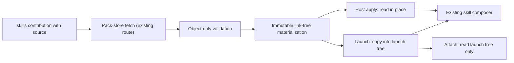

# One Git directory can be a pack skill, and nothing else from that repository arrives

**Disposition:** PAUSED FOR AUTHOR REVISION

**Status:** 2026-11-17. This is the original Fable-authored directory-only design, preserved
with accepted compatibility and TOML-spelling corrections. No production change is built.
The owner subsequently requested consideration of supporting repository content while limiting
skill exposure and activation. Fable is revising that behavior; this version is not an
implementation hand-off. A local-object offline-lint regression at `b5a5fe32` fails on the
new `as` field. No upstream fetch, launch or host apply was run. Upstream claims in the request
(file counts, license location) remain unverified.

> **In short.** A `skills` contribution may name its bytes with the manifest's existing Git address (`source`, with `//subdir` and a required `?ref=`) instead of `from`. The pack store fetches by its existing route, but the bytes are read as Git objects, never checked out. Everything after that point is the existing pack skill path.

**Why it matters.** Today the only ways to get one upstream skill are to select the whole repository (which brings its hooks, plugin manifest and every other skill) or to keep a hand copy.

**The shape.** Three pieces: a declaration on the existing contribution, a link-free immutable materialization in the pack store, and a resolved source directory handed to the existing skill composer at both the host and jail notches.

**Cost.** One new record file and one new store area. A collision rule stricter than the pack
tier's applies to these contributions only. A build older than this feature never delivers a
sourced skill. Its `yolo pack lint` refuses the new fields; at launch and host apply it skips
a contribution that carries `as` or `license`, with one note, and uses the rest of the pack;
a contribution carrying only `source` may instead be reported as invalid. Updating yolo is
the remedy.

**Start at [§4](#4-selected-architecture-and-rejected-alternatives).**

**Needs your ruling:** None in the original design. Its implementation is paused for the
author's revision of the owner's subsequent supporting-content request.

**Reads with:** [pack-system.md](../reference/pack-system.md) (selection authority, staging, fetch), [workspace Git skill imports](../reference/workspace-git-skills/README.md) (the separate workspace-authority mechanism, left unchanged), [projection.md](../reference/workspace-git-skills/projection.md) (the confinement rule table this design mirrors).

---

## 1. Need

A reviewable pack declaration imports exactly one skill directory from a Git repository:

- at a required explicit ref;
- with its supporting files and executable bits;
- optionally under a chosen name;
- with the repository-root license beside it;
- through the existing audience, namespace, host and jail delivery.

It activates nothing from upstream. It fails visibly when the source is missing or unusable.

The request's BMAD and Superpowers addresses are illustrative data. This design installs, selects and executes neither.

## 2. Non-goals

- **No change to this repository's or the owner's live environment.** No pack is created or selected, and no shipped pack uses the feature. The request's `docs/tillr/roadmap.md`, `yolo-packs/` and default pack lists belong to another repository.
- **No workspace authority change.** Workspace `skill_imports`, its store, its broker route and its access classes are untouched. No workspace declaration can select a pack or a sourced skill.
- **No new grant, RPC, credential channel, broker operation or repository-scoped read.**
- **No upstream activation.** No upstream manifest, `needs`, hook, plugin registration, briefing or program is parsed or honored. There is no dependency closure and no automatic expansion to paths the skill refers to.
- **No core agent registry and no tool name in core.** The audience stays the existing `agents` routing.
- **No global change to existing collision behavior** between contributions that are not sourced.
- **No change to `yolo check` policy for never-fetched Git sources** (see [§8.3](#83-reader-states-and-commands)).
- **Deferred:**
  - a generic `[[sources]]` concept;
  - a skill at a repository root;
  - a license opt-out;
  - `yolo pack footprint` accepting a Git pack handle;
  - store garbage collection.

## 3. Verified existing mechanisms, and why each is insufficient

| Mechanism | What it does (anchor) | Why it does not meet the need |
| :--- | :--- | :--- |
| Git pack entry | Whole repository or `//subdir` pack root, fetched by `Store.Resolve` in `internal/packsrc` | A skill directory as pack root delivers nothing; a whole repository delivers every skill, hook and plugin claim |
| Legacy `only`/`exclude` | Path filters on a legacy pack entry | No TOML spelling; lives in user config, not a pack; cannot rename; drops the license; skills two levels deep are not found |
| `skills` with `from` | Pack-relative directory of skill directories (`SkillsSources` in `internal/packdecl`) | Bytes must already be in the pack |
| Workspace `skill_imports` | Broker-filtered fetch into a per-workspace store; object-only confined projection (`materializeSkill` in `internal/skillimports`) | Workspace authority and cache partition; no audience, rename, namespace, license or host delivery; its reader API is bound to a workspace `Store` and its records |
| Manifest-named Git `source` | `program` via source and built-tree `files` already make the host fetch a manifest-named address through `packsrc` (`Contribution.Source`, `PinForks`) | Wrong kinds; proves the route and the address grammar exist, not the skill delivery |
| Pack-store subdirectory checkout | `git checkout` into `trees/<commit>-<key>` (`checkoutTree`) | Honors the user's Git config (filters, attributes); written in place, not renamed; gitlinks inside the subtree are not uniformly refused |
| Namespaced delivery | `Delivered` in `internal/packname`; `renamedSkill` rewrites the copied `name:` when a namespace applies | No per-skill rename; bare delivery leaves `name:` alone |
| Collision refusal | `Collisions` in `internal/hostskills`: two selected packs claiming one delivered name in one destination is fatal at check, launch, attach and host apply | Same-pack duplicates are later-source-wins; in the jail a pack silently wins over an ordinary built-in |

The request's three shapes were treated as inputs and checked against this survey. The survey surfaced a fourth option the request did not list: the existing `source` address field.

## 4. Selected architecture, and rejected alternatives

**Selected: a sourced skill** *(coined here)* — a `skills` contribution whose `source` is a Git address naming one directory. The nearest thing it is not: a Git pack, whose manifest is read and honored.



| Alternative | Verdict |
| :--- | :--- |
| New keys `git`/`ref`/`path` on the contribution (request shape A as spelled) | Rejected: the manifest already spells a Git address with ref and subdirectory in `source`; three more keys would be a second spelling of one concept |
| Generic `[[sources]]` (shape B) | Rejected for now: a kind that delivers nothing is a new concept in a closed registry, and it invites whole-tree use |
| TOML `only`/`skills_root` on pack entries (shape C) | Rejected: not reviewable in a pack, no rename, plugin claims survive filters |
| User-scope `skill_imports` | Rejected: crosses the documented workspace/pack authority boundary and has no audience or host delivery |
| Reuse the pack-store checkout for the bytes | Rejected: checkout honors user Git filters and attributes |
| Call the workspace import reader directly | Rejected as an API (it requires workspace records and authority). Its rule table is adopted as behavior; whether code is shared is the planner's choice |
| Fork-pin refresh policy (resolve once, move only on update) | Rejected: skills are pack content, and Git pack content on a branch already refreshes hourly |

## 5. Declaration and ownership

```toml
[[skills]]
source  = "git+https://github.com/obra/superpowers.git//skills/brainstorming?ref=22f0b463e7a5e579904dd6211a520321035526f7"
as      = "superpowers-brainstorming"   # optional
license = "LICENSE"                     # optional
agents  = ["claude", "pi"]              # existing field, unchanged
```

### 5.1 Field rules

All field rules are static and checked offline by manifest validation and `yolo pack lint`.

- **`source`** uses the existing manifest address grammar (`Parse` in `internal/packsrc`).
  - The ref is required.
  - The `//subdir` part is required and non-empty, a clean relative path with no `..`.
  - Accepted transports are `git+https`, `git+ssh`, `git+http` and `git+file`. A plain `file://` directory is refused, with the message pointing at `from`.
  - A URL carrying a password is refused.
  - `source` and `from` are mutually exclusive.
- **One contribution names one skill directory.** Several skills need several contributions. Contributions naming one repository share its mirror.
- **`as`** is optional. It must be a valid skill name that is already in normalized form. It is refused without `source`.
- **`license`** is optional. It is a clean repository-root-relative file path with no `..`. It is refused without `source`.
- **`agents` and `describes`** behave as on any `skills` contribution. The legacy JSON `contributes` form accepts the same fields; the legacy `skills` shorthand does not gain them.
- **A legacy `only` filter on the selecting entry withholds every sourced skill of that pack and fetches nothing for it.** An allowlist of pack paths cannot name one. `exclude` alone has no effect on sourced skills. `yolo pack explain` states the withholding.

### 5.2 Authority

The decision stays at selection. A pack reaches a launch only through the user-scope `packs` list.

A fetched pack's sourced skill is honored like a local pack's, under the existing invariant that origin does not decide what a selected pack's claims may do.

The fetch uses only the pack store's established route: host `git`, with the user's Git configuration for transport. It never uses the Git broker import route, workspace grants or the workspace import store.

### 5.3 State and writers

| State | Writer | Readers |
| :--- | :--- | :--- |
| Mirror objects | Existing pack-store fetch, under the per-mirror lock | Validator, materializer |
| Sourced-skill resolution record: (repository, ref) → commit, shared by every pack naming that pair | Fetch-capable resolution only, under the store's existing lockfile-lock discipline | Every command |
| Materialization | Fetch-capable resolution only | Host apply, launch staging, read-only commands |
| Launch tree copy and its tree-record entry | Launch staging | Attach |

The record is a new file beside the existing pack and fork lock files. Its name is the planner's choice. It is not `packs.lock.json`, which is keyed by pack name and holds selection state.

## 6. Lifecycle, cache, and host/jail consistency

### 6.1 Refresh policy

This is the existing Git-pack policy (`Refresh` in `internal/packsrc`), unchanged:

| Ref | At host launch or host apply | `yolo pack install` / `update` |
| :--- | :--- | :--- |
| Full commit ID | Fetched once, never refreshed | Verifies presence |
| Tag | Resolved once, never auto-refreshed | Force refresh |
| Branch | Refreshed when the existing hourly interval is due | Force refresh |

- A failed refresh with a usable recorded commit warns and uses it.
- Launch fetches are detached with the existing 60-second timeout. Interactive install and update may prompt.
- **A record advances only to a validated commit.** If a branch moves to a commit whose selected tree fails validation, the record stays on the previous commit and a warning names both commits and the reason.

### 6.2 Resolution sequence

Writers are launch, host apply, `pack install` and `pack update`.

1. Resolve the declaring pack as today.
2. For each sourced contribution of a selected pack, not withheld by `only`, fetch or refresh per [§6.1](#61-refresh-policy) under the mirror lock. Blobs for the selected tree and the license are obtained in this phase.
3. Validate the selected tree from objects ([§8.1](#81-confinement-rules)).
4. Materialize to a temporary directory and rename into place.
5. Publish the record.

Every sourced contribution a selected pack declares is resolved, whatever its audience. Upstream manifests are never read, so resolution is one level deep.

### 6.3 Cache decision

**The shared pack store safely supplies sourced-skill objects.** The mirror, locks and refresh stamps are the same authority domain: user-selected pack content fetched by the host user.

The pack store's `trees/` checkouts are never used for sourced skills. The workspace import store is never read or written.

| Protection | How it survives |
| :--- | :--- |
| Transport and credentials | Existing mirror fetch: hooks disabled, prompts disabled at launch, no new channel |
| Filters, attributes, hooks | No checkout. Bytes come from tree listing and blob reads only, with system and global Git config disabled |
| Cached reader | Readers address the commit by full ID with lazy fetching disabled. An absent object is "not fetched", never a network request |
| Partial writes | Temp-then-rename. A materialization that exists has passed validation |
| Rule changes | Materialization identity covers commit, subdirectory, base name, license source and a validator format version. A tightened rule invalidates old materializations |
| Concurrency | Fetch is serialized per mirror. Materialization is idempotent, and a rename loser discards its copy |

### 6.4 Host and jail

- Both notches read the same materialization through the same composer and writer, so their bytes agree.
- `yolo host apply` reads it in place.
- A launch copies it into that launch's own tree, beside the staged pack and not inside the pack root. The tree record lists each sourced contribution's staged location and outcome.
- **Attach reads the tree record and staged bytes only.** It never resolves, fetches or materializes.
- In-jail code never resolves a sourced contribution. The staged manifest's `source` is inert there.

## 7. Naming, collisions and license

### 7.1 Name

- The base name is `as`, or else the last component of the subdirectory. A base name that is not a valid skill name requires `as`.
- The delivered name is `Delivered(namespace, base)`. **`as` never escapes the selecting entry's namespace or `bare` setting.**
- The delivered `SKILL.md` `name:` always equals the delivered name for a sourced skill, bare delivery included. It uses the existing `renamedSkill` semantics: replace or insert that one line, keep every other byte.
- The store materialization keeps upstream's `SKILL.md` bytes. The rewrite happens on the delivered copy, as it does today.
- `yolo pack explain` reports any rewrite, with the old and new name.

### 7.2 Collisions

A sourced skill's claim (destination, delivered name) is computed from the declaration alone. It participates in collision checks even when its bytes are not fetched. Comparison is per resolved agent destination, as today.

| Other claimant, same destination and delivered name | Result |
| :--- | :--- |
| Skill of another selected pack, shared or conventional local | Refused (existing rule, unchanged) |
| Another contribution of the same pack, local or sourced | **Refused (new, sourced only).** Existing later-source-wins stays for pairs of non-sourced sources |
| Built-in skill, either shipped name, and the rendered mechanics skill | **Refused at both notches (new, sourced only).** Host already refuses; the jail's pack-wins rule stays for non-sourced skills |
| Reserved name of the destination | Existing fence: withheld and reported |
| Workspace-layer skill or workspace import | Existing rule: the workspace copy is shadowed, with disclosure. A workspace cannot break a launch this way |

A refusal uses the existing `pack skill name collision` finding and its severity:

- `yolo check` fails;
- launch and attach refuse before any container work;
- host apply returns non-zero before writing.

The message names both contributors, the sourced one by pack, address and base name. Its next step is to set `as` or change the entry's namespace. No claimant is silently dropped.

A house `brainstorming` is therefore never replaced. The existing rule that an unresolved layer suppresses a destination's check is unchanged.

### 7.3 License

- **Explicit `license`.** The named root-relative path must be a regular blob of at most 1 MiB at the selected commit. Otherwise the contribution is refused. It is delivered at the skill's top level under its basename, mode 0644. If the skill directory already has an entry of that name (compared case-insensitively), the contribution is refused.
- **Omitted.** If the skill directory already holds a top-level `LICENSE`, `LICENSE.md`, `LICENSE.txt` or `COPYING`, nothing is copied. Otherwise the first of those four that is a regular blob at the repository root is copied. If none exists, nothing is copied and inspection says "no license file found". This is a note, not an error.
- The license is the only byte from outside the selected directory that ever arrives.

## 8. Confinement, resources, failure and inspection

### 8.1 Confinement rules

**The materialization contains only regular files and directories.**

| Tree entry | Result |
| :--- | :--- |
| Regular blob | Written 0644, or 0755 when executable in Git |
| Symlink to a file inside this skill directory | Dereferenced into a regular copy |
| Symlink to a directory, or escaping, absolute, dangling or cyclic | Whole contribution refused |
| Gitlink (submodule), or any other mode or type | Whole contribution refused |
| Two names differing only by case | Whole contribution refused |
| Subdirectory path crossing a symlink or gitlink, or absent | Whole contribution refused |
| No top-level `SKILL.md` resolving to a regular file | Whole contribution refused |

- No partial skill is ever delivered.
- Nested `SKILL.md` files are plain bytes.
- Upstream manifests and scripts are plain bytes. yolo never runs or parses them.

### 8.2 Bounds

Bounds apply per contribution. They are charged before reading and never refunded.

| Bound | Value |
| :--- | :--- |
| Entries | 4096 |
| Total bytes, including dereferenced copies and the license | 32 MiB |
| Tree listing | 8 MiB |
| Link target | 4096 bytes |

Exceeding any bound refuses the contribution.

### 8.3 Reader states and commands

| State | Meaning |
| :--- | :--- |
| READY | Record and materialization present |
| REFUSED | Commit and objects present; the validator, run without writes, refuses with a named reason |
| NOT FETCHED | No record, or objects absent |

| Caller | READY | REFUSED | NOT FETCHED |
| :--- | :--- | :--- | :--- |
| `yolo check` (never fetches) | Checked | FAIL naming the contribution | The existing never-fetched `[SKIP]`, naming the contribution and `yolo pack install` |
| `yolo pack explain` (never fetches) | Commit, file count, executables, license, delivered name per agent | Reason | Listed under "declared, not fetched", never under `delivers` |
| `yolo pack lint` offline | Static rules only, and says contents were not verified | Same | Same |
| `yolo pack lint --online` | Fetches into its scratch store by the established route, runs the full validator, prints the listing; never writes the launch store | Exit non-zero | Exit non-zero if the fetch fails |
| `yolo pack install` / `update` | Reports fetched or moved | Exit non-zero | Exit non-zero, existing message shape |
| Launch, host apply | Deliver | **Fatal by name**, unless a previous validated commit exists ([§6.1](#61-refresh-policy)) | Fetch; if that fails, **fatal** with the existing never-fetched message naming the contribution |
| Attach | Read staged bytes | Not reachable | Not reachable |
| Dry-run launch | Report | Report | Report, no fetch |

`yolo pack status` lists each sourced repository, ref, recorded commit and state, read-only.

`yolo pack footprint` emits one review-worthy claim per sourced contribution in the existing claim list. The claim says:

- the host fetches this repository at this ref;
- only this directory is delivered, under this name;
- whether a license is copied.

It lists the directory's executables when READY and says "contents not fetched" otherwise. It never emits a plugin or hook claim for the upstream repository.

Launch output follows the existing fetched, updated and could-not-refresh event lines. A healthy unchanged sourced skill prints nothing.

**The request's "`yolo check` fails on a never-fetched source" is declined.** Read-only check never fetching, and reporting never-fetched Git sources as a skip, is current policy for every Git pack. Changing it for one contribution kind would be inconsistent, and changing it everywhere is a policy decision nobody asked for. Visible failure exists at install, update, online lint, launch and host apply.

## 9. Acceptance, through real callers

These are observable outcomes, using local `git+file` fixture repositories with no network and no agent. Any synthetic launch sets both `YOLO_NO_PROGRAM_READINESS=1` and `YOLO_NO_AUTO_CAPTURE=1`.

1. **Delivery.** A local pack with two sourced contributions (one two levels deep, one renamed with `as`) is driven through `pack install`, then host apply into a temporary home and through launch staging. Each selected agent destination holds exactly those two skills, with supporting files, preserved executable bits, a license file and `name:` equal to the delivered name. Host and jail bytes are identical.
2. **Nothing else arrives.** The fixture repository's hooks, plugin manifest and sibling skills appear in no staged tree, destination or footprint claim.
3. **Attach.** After the mirror and store materialization are removed, an attach still delivers the staged bytes and contacts nothing.
4. **Collisions.** `yolo check`, launch and host apply each refuse, naming both contributors, for a sourced name against another pack, the same pack and a built-in. The check case holds with the source never fetched. A namespaced or `as`-renamed skill coexists with a house skill of the upstream name. A workspace skill of the same name is shadowed, not fatal.
5. **Refusals.** An escaping link, a directory link, a gitlink, a missing marker, a missing subdirectory, an over-bound tree, a missing explicit license and a license name collision each fail by name with nothing delivered.
6. **Refresh.** A pinned commit and a tag are not refetched at launch. A branch moves when due and prints the moved line. A branch that moves to an unusable commit stays on the previous one with a warning. An unreachable remote with a cached commit warns and delivers.
7. **Missing source.** For a never-fetched unreachable source, `pack install`, `lint --online`, launch and host apply fail by name with the install next step. `check` and `explain` print the not-fetched row and fetch nothing.
8. **Declaration.** `source` with `from`, a missing ref, an empty subdirectory, a plain `file://` directory, a URL password, and `as` or `license` without `source` each fail offline lint.
9. **Filters.** A legacy `only` entry withholds sourced skills and fetches nothing.
10. **Isolation.** A user Git config that defines a smudge filter does not alter delivered bytes. The workspace import store is untouched throughout.

> **Scope of these criteria.** Every item above is asserted against a build that contains
> this feature. Item 8 is the authoring read (`yolo pack lint`) of that build. Nothing here
> asserts what an older binary does with a sourced contribution. That is the existing
> use-read skew behavior, which this work neither changes nor adds tests for, beyond the
> existing skew tests continuing to pass unmodified.

## 10. Decision ledger

| ID | Ruling / Decision | Date | Settled in | Built |
| :--- | :--- | :--- | :--- | :--- |
| GSS-D1 | Implement as `source` on a `skills` contribution; no new address keys | 2026-11-17 | [§5](#5-declaration-and-ownership) | No |
| GSS-D2 | Fetch by the pack store's existing route only; never the broker or workspace store | 2026-11-17 | [§5.2](#52-authority) | No |
| GSS-D3 | Shared mirrors supply objects; bytes are read as objects, never from a checkout | 2026-11-17 | [§6.3](#63-cache-decision) | No |
| GSS-D4 | Refresh is the existing Git-pack policy; a record advances only to a validated commit | 2026-11-17 | [§6.1](#61-refresh-policy) | No |
| GSS-D5 | Materialization is immutable, link-free and written by rename; attach reads the launch tree only | 2026-11-17 | [§6.4](#64-host-and-jail) | No |
| GSS-D6 | `as` sets the base name under the entry's namespace; delivered `name:` always equals the delivered name | 2026-11-17 | [§7.1](#71-name) | No |
| GSS-D7 | Strict collisions for sourced skills only: same pack and built-ins are refused; existing overrides elsewhere stand | 2026-11-17 | [§7.2](#72-collisions) | No |
| GSS-D8 | License: explicit literal path, or a four-name default; absence under the default is a note | 2026-11-17 | [§7.3](#73-license) | No |
| GSS-D9 | Whole-contribution refusal for unsafe entries; per-contribution bounds | 2026-11-17 | [§8.1](#81-confinement-rules) | No |
| GSS-D10 | Launch and host apply fail closed on a missing or unusable source; read-only commands never fetch | 2026-11-17 | [§8.3](#83-reader-states-and-commands) | No |
| GSS-D11 | `yolo check` failing on a never-fetched source is declined as an unrequested policy change | 2026-11-17 | [§8.3](#83-reader-states-and-commands) | No |
| GSS-D12 | A legacy `only` filter withholds sourced skills | 2026-11-17 | [§5.1](#51-field-rules) | No |

## 11. Residual edges and unverified points

### Upstream edges (the pack author's to judge)

- A skill that refers outside its directory is cut off there. The request names two cases: BMAD's setup script in a sibling directory, and Superpowers reading the repository root for a version string. yolo neither expands the selection nor warns about such references.
- Git LFS content arrives as pointer text.
- Delivered scripts keep their executable bits. An agent may run them; yolo never does.

### Design risks

| Risk | Mitigation |
| :--- | :--- |
| A selected third-party pack names a private repository the host user can read, and its skill directory reaches the jail | Same trust class as any selected pack's claims; the footprint claim names the repository. No new credential is used |
| A build older than this feature does not deliver a sourced skill, and is not guaranteed to refuse the pack. Its use read (launch, host apply, in-jail read) skips a contribution carrying `as` or `license` before validating it, reports one note, and delivers the pack's other contributions, including conventional local skills. A contribution carrying only `source` may be reported as invalid by that build's own validation. Its authoring read (`yolo pack lint`) refuses unknown fields. The new collision refusals of [§7.2](#72-collisions) are not enforced there either | Existing version-skew behavior (`DecodeForUse`), unchanged and not changeable in shipped binaries. The skip is visible, not fail-closed. The note says "a newer yolo may read the field (update yolo)"; update that host or jail. No minimum-version mechanism is added |
| No store garbage collection; bounds are per contribution, not per pack | Matches the pack store today; deferred |

### Unverified (planner to confirm before relying on them)

- **Mirrors are partial clones.** The planner confirmed `fetchMirror` uses `clone --bare --filter=blob:none` in [`store.go`](../../internal/packsrc/store.go). The selected tree's blobs must be obtained in the writer phase, as [§6.2](#62-resolution-sequence) requires.
- **The mirror's own repository-local config** is assumed to be yolo-written and harmless to tree and blob reads.
- **The request's passing bare-name collision** was observed on build 0.17.1. The tree at `b5a5fe32` has tests named for refusing it, which were read, not run.
- **Native macOS** behavior, a real host apply, and a real launch were not exercised.