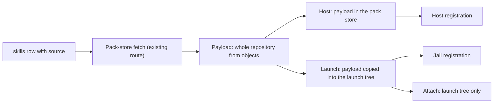

# The whole repository is deployed as supporting data; only the skills a pack names are registered

**Disposition:** IMPLEMENT

**Status:** 2026-11-17. Candidate implementation and focused production-caller gates are complete. The permanent lint regression is GREEN. A matched nested Podman fresh launch and recorded attach execute the synthetic registration after private cache/origin removal, and stopped-jail verification passes. Exact-candidate review and the combined landing gate remain pending; native Mac and native agent discovery are not claimed.
Canonical copy includes the accepted Fable concurrency/stamp/reader amendments below. Ledger Built flags await the completed candidate's conformance review.
Tree grounded at `566ef01f` (production at `b5a5fe32`); no upstream fetch/execution,
launch or host apply. No feature-green claim.

> **In short.** A sourced skill no longer arrives as a cut-out directory. The repository at the pinned commit is deployed once, with its layout intact, outside every agent skills directory. Each selected skill is registered as a small real directory whose `SKILL.md` is yolo's and whose other entries are links into that deployed tree. Deployment is not activation: nothing in the repository is parsed, registered or run by yolo.

**Why it matters.** A skill's scripts can reach the rest of their repository through the delivered path, which the directory-only design cut off.

**The shape.** Declaration (unchanged spelling), one shared immutable **payload** per repository commit, one **registration** per selected skill per agent destination.

**Cost.** yolo writes symlinks into agent skills directories for these skills only. A whole repository is copied into each launch. Relative paths work when the operating system resolves them, not when a tool collapses `..` textually first.

**Start at [§4](#4-selected-architecture-and-rejected-alternatives).**

**Needs your ruling:** None.

**Reads with:** [git-skill-subtrees-plan.md](git-skill-subtrees-plan.md) (the grounded implementation hand-off; no production behavior built), [pack-system.md](../reference/pack-system.md) (selection authority, staging, fetch), [workspace Git skill imports](../reference/workspace-git-skills/README.md) (the separate workspace mechanism, unchanged).

---

## What changed after the owner's feedback

This canonical copy folds in Fable's accepted **one shared record, per-caller validation,
no per-selection history** addendum and **repository/ref stamp and leaf-lock correction**
of 2026-11-17, followed by the accepted **final reader clarification** (distinct missing-payload
state and effective-plan survival). Their live contracts are [the transaction](#62-resolution-sequence-and-transaction),
[confinement](#81-confinement-rules) and [reader states](#83-reader-states-and-commands),
not a second conflicting normative body.

The owner asked how a sourced skill handles dependencies elsewhere in its repository, and proposed deploying the whole repository while limiting what is exposed.

- **Adopted.** The whole repository at the selected commit is deployed. Selection now controls registration only.
- **Superseded.** "Nothing else from that repository arrives" is withdrawn. Upstream hooks, plugin manifests and unselected skills now exist as files in the payload. They are never parsed, registered or activated.
- **New mechanism.** A registration links into the payload, so repository-relative paths resolve from the delivered skill path. The old design copied the directory, which made a second copy with no linkage.
- **Unchanged.** The declaration spelling, authority, fetch route, refresh policy, collision rules, license rule and read-only command policy.
- **Corrected.** The manifest example now uses the real `[[skills]]` table. Older-build behavior is stated as a skip, not a refusal.

Ledger rows GSS-D5 and GSS-D9 are superseded. GSS-D3 and GSS-D8 are amended. GSS-D13 to GSS-D20 settle deployment and registration. The concurrency amendment, GSS-D21 and GSS-D22, settles shared-record fallback without a selection history. See the [decision ledger](#10-decision-ledger).

## 1. Need

A reviewable pack declaration registers chosen skills from a Git repository:

- at a required explicit ref;
- with the rest of the repository present, in its original layout, as supporting files the skill can reach by relative path;
- optionally under a chosen name;
- with the repository's license terms beside the registered skill;
- through the existing audience, namespace, host and jail delivery.

It activates nothing from upstream, and it fails visibly when the source is missing or unusable.

The request's BMAD and Superpowers addresses are illustrative data. This design installs, selects and executes neither.

## 2. Non-goals

- **No promise that an upstream script or application works.** Deploying bytes makes repository-relative reads possible. It does not create runtime state, install dependencies or supply a workspace path ([§8.4](#84-what-resolves-and-what-does-not)).
- **No upstream activation.** No upstream manifest, `needs`, hook, plugin registration, briefing or program is parsed or honored. No submodule is initialized, no dependency downloaded, no script run.
- **No file-access boundary.** Registration controls what agents discover. A selected skill, and any process in the jail, can read every payload file.
- **No change to the owner's live environment.** No pack is created or selected, and no shipped pack uses the feature.
- **No workspace authority change.** Workspace `skill_imports`, its store, broker route and access classes are untouched. No workspace declaration can select a pack or a sourced skill.
- **No new grant, RPC, credential channel, broker operation or repository-scoped read.**
- **No agent name in core.** The audience stays the existing `agents` routing.
- **No global change to symlink guardrails.** Pack staging's escaping-link refusal, the skill copier's dereferencing of source links and the jail sync's refusal of source links all stand ([§7.4](#74-the-link-exception-and-its-fence)).
- **No change to already-shipped binaries or the version-skew mechanism.**
- **Deferred:**
  - a payload root narrower than the repository;
  - other contribution kinds reading from a payload ("whatever else can be filtered");
  - a generic named `[[sources]]` concept;
  - a skill at the repository root;
  - a license opt-out;
  - `yolo pack footprint` accepting a Git pack handle;
  - store garbage collection.

## 3. Existing mechanisms, and why each is insufficient

The request's three shapes and the owner's "deploy the whole pack, then filter" were each checked against this survey.

| Mechanism | What it does (anchor) | Why it does not meet the need |
| :--- | :--- | :--- |
| Git pack entry | Whole repository as a pack root (`Store.Resolve` in `internal/packsrc`) | Conventional reading activates it: plugin discovery has no gate (`HonoredPlugins` in `internal/packload`), every skill one level deep is delivered, deeper skills are missed |
| Wrapped agent plugin | A root with a `plugin.json` at a recognized location is copied whole into the skills destination (`deliverPluginTree` in `internal/hostskills`) | The existing whole-tree delivery. It lands inside a discovery root and registers the plugin and its hooks |
| Legacy `only`/`exclude` | Remove files from the staged tree (`Spec` in `internal/packstage`) | They delete bytes; they do not limit registration. No TOML spelling, no rename, and they live in user config |
| `skills` with `from` | Pack-relative directory of skill directories | Bytes must already be in the pack |
| Skill delivery copier | Copies a source skill directory, materializing every symlink (`copyTree` in `internal/hostskills`) | A copy has no path back to the repository |
| Staged pack content | Non-skill pack files are readable in the jail under the pack tree mount, outside discovery roots | Proves "deployed but not registered" already exists; has no linkage from a skill |
| Workspace `skill_imports` | Object-only confined projection (`materializeSkill` in `internal/skillimports`) | Workspace authority and cache; reader bound to a workspace store |
| Manifest-named Git `source` | `program` and built-tree `files` already fetch a manifest-named address through `packsrc` | Wrong kinds; proves the route and grammar exist |
| Pack-store checkout | `git checkout` into `trees/` (`checkoutTree`) | Honors user Git filters and attributes; written in place |

No existing switch keeps a whole Git pack's files while suppressing its conventional registrations. The scout searched the discovery path and the staging filters and found none; an exhaustive absence across every config field was not confirmed.

## 4. Selected architecture, and rejected alternatives

Two terms are coined here.

- **Payload** *(coined here)*: the whole repository tree at one commit, written from Git objects into an immutable directory that sits outside every agent skills directory. The nearest thing it is not: a pack. Nothing reads its manifests.
- **Registration** *(coined here)*: the directory an agent discovers for one selected skill. The nearest thing it is not: a copy of the upstream skill directory.



### 4.1 Why sharing a payload beats filtering a whole pack

Filtering a whole Git pack is activation by subtraction. The repository enters as a pack, and every conventional reader, present and future, must know a switch that tells it to ignore what it finds. Plugin discovery has no such gate today, and whole-plugin delivery places the tree inside a discovery root.

A payload is activation by addition. Nothing in it is read unless a `skills` row names a directory. A new conventional reader added later cannot reach it, because the payload is never handed to pack loading, plugin discovery or pack staging.

So no generic filter infrastructure is built. One kind, `skills`, reads from a payload. Letting other kinds do so is a later capability.

### 4.2 Rejected alternatives

| Alternative | Verdict |
| :--- | :--- |
| Directory-only copy plus root license (the previous design) | Superseded: cuts off every sibling and root dependency |
| Directory copy, with the repository deployed elsewhere and no link | Rejected: a second copy in an unrelated place helps no relative path |
| Wrapper: the whole repository inside the registered directory, `SKILL.md` lifted to its top | Rejected: breaks the skill's own `SKILL.md`-relative references, which are the common case, and puts unselected `SKILL.md` files under a discovery root where a recursively scanning agent finds them |
| The registered directory as one symlink to the payload's skill directory | Rejected: the `name:` rewrite would need a private copy of the whole repository per name; in the jail the entry dangles on the host side where existing code reads the delivered `SKILL.md`; discovery of a linked skill directory is unverified per agent. Its one advantage is recorded in [§8.4](#84-what-resolves-and-what-does-not) |
| Whole Git pack with a "register only these" filter | Rejected: [§4.1](#41-why-sharing-a-payload-beats-filtering-a-whole-pack) |
| New keys `git`/`ref`/`path` | Rejected: `source` already spells a Git address with ref and subdirectory |
| Generic `[[sources]]` | Deferred: the payload is identified by its address, so no name is needed yet |
| User-scope `skill_imports` | Rejected: crosses the workspace/pack authority boundary |
| Reuse the pack-store checkout | Rejected: checkout honors user Git filters and attributes |
| Fork-pin refresh policy | Rejected: skills are pack content, which refreshes hourly on a branch |

## 5. Declaration and ownership

In normalized `pack.toml` a skills row is a `[[skills]]` table with no `kind` field.

```toml
[[skills]]
source  = "git+https://github.com/obra/superpowers.git//skills/brainstorming?ref=22f0b463e7a5e579904dd6211a520321035526f7"
as      = "superpowers-brainstorming"   # optional
license = "LICENSE"                     # optional
agents  = ["claude", "pi"]              # existing field, unchanged
```

`[[contributes]]` with `kind` is the legacy `pack.json` shape. `yolo pack lint` refuses it in `pack.toml`, and the parser is not widened to accept it. The legacy JSON `contributes` form accepts the same three fields; the legacy `skills` shorthand does not.

### 5.1 Field rules

All field rules are static and checked offline by manifest validation and `yolo pack lint`.

- **`source`** uses the existing manifest address grammar (`Parse` in `internal/packsrc`).
  - The ref is required.
  - The `//subdir` part is required and non-empty, a clean relative path with no `..`. **It names the skill directory to register.** The payload is always the whole repository.
  - Accepted transports are `git+https`, `git+ssh`, `git+http` and `git+file`. A plain `file://` directory is refused, pointing at `from`.
  - A URL carrying a password is refused. The existing parser does not refuse it, so this is a new check for sourced rows only.
  - `source` and `from` are mutually exclusive.
- **One row registers one skill directory.** Several skills need several rows. Rows naming one repository and ref share one payload.
- **`as`** is optional, a valid skill name already in normalized form, refused without `source`.
- **`license`** is optional, a clean repository-root-relative file path with no `..`, refused without `source`.
- **`agents` and `describes`** behave as on any skills row.
- **A legacy `only` filter on the selecting entry withholds every sourced skill of that pack and fetches nothing for it.** `exclude` alone has no effect. `yolo pack explain` states the withholding.

### 5.2 Authority

The decision stays at selection. A pack reaches a launch only through the user-scope `packs` list. A fetched pack's sourced row is honored like a local pack's.

The fetch uses only the pack store's established route: host `git`, with the user's Git configuration for transport. It never uses the Git broker import route, workspace grants or the workspace import store.

Selecting a pack with a sourced row is consent to deploy that repository's files as data. It is not consent to anything the repository declares about itself.

### 5.3 State and writers

| State | Writer | Readers |
| :--- | :--- | :--- |
| Mirror objects | Existing pack-store fetch, under the per-mirror lock | Validator, materializer |
| Resolution record: (repository, ref) → latest commit, shared by every pack naming that pair; no per-selection history | Fetch-capable resolution under the mirror lock; a leaf record-file lock covers only read-modify-write | Every command, revalidating its own rows |
| Payload, one per (repository, commit, validator format version) | Fetch-capable resolution only | Host apply, launch staging, read-only commands |
| Launch-tree payload copy and its tree-record entries | Launch staging | Attach, in-jail readers |
| Registration in an agent destination | The existing skill composer, at each notch | Agents |

The record is a new file beside the pack and fork lock files, named by the planner. It is not `packs.lock.json`.

## 6. Lifecycle, cache, and host/jail consistency

### 6.1 Refresh policy

The existing Git-pack policy (`Refresh` in `internal/packsrc`), unchanged:

| Ref | At host launch or host apply | `yolo pack install` / `update` |
| :--- | :--- | :--- |
| Full commit ID | Fetched once, never refreshed | Verifies presence |
| Tag | Resolved once, never auto-refreshed | Force refresh |
| Branch | Refreshed when the hourly interval is due | Force refresh |

- A failed refresh warns and uses the recorded commit **only if this caller revalidates its entire group at that commit**. There is no remembered last-good commit for another selection.
- Launch fetches are detached with the existing 60-second timeout.
- **A record advances only to a validated commit.** Validated means the payload is within bounds and every sourced row in the publishing caller's immutable selection snapshot naming that (repository, ref) passes [§8.1](#81-confinement-rules). This is not a guarantee for other selections.

### 6.2 Resolution sequence and transaction

Writers are fresh launch, host apply, `pack install` and `pack update`. After resolving the declaring packs, each invocation takes one immutable snapshot of its own selected packs and their sourced rows not withheld by `only`, whatever their audience. It is never a union across environments or processes. A pair's group is **all** snapshot rows naming that repository identity and ref, across every selected pack.

Process pairs one at a time:

1. Acquire the existing per-mirror lock for the repository, held through step 6. Reload the shared record and call its commit `R`; discard any record read before acquiring the lock.
2. Decide on fetching in the new sourced adapter by [§6.1](#61-refresh-policy) alone: no sourced record, a branch whose existing pair stamp is due, or forced refresh. Do not call `fetchStep` unmodified: it also fetches when the mirror-local ref is absent. With a record present that absence is not a trigger; read its commit by full OID with lazy fetching disabled. Unusability for this caller is not itself a trigger either. Reuse pair-stamp/transport mechanics only without adding triggers. A fetch gives candidate `C`; obtain every blob of its whole tree in this writer phase.
3. If `C` differs from `R`, validate whole-payload bounds and every row of the group at `C` from objects.
4. If **all** pass, materialize by temp-then-rename and publish `R := C`. If **any** fails, publish neither a payload nor a record for `C`.
5. If the record was not advanced, revalidate the whole group at `R` from objects. If every row passes, use `R`; its payload may be materialized from already-present objects without fetching. Otherwise report the failing rows REFUSED (or absent objects NOT FETCHED).
6. Release the mirror lock and return one immutable (commit, payload) result for this pair. Staging, tree-record writing and every registration use that result, never another record read.

**Lock order:** existing `lockMirror(repo)` → **new skills-record lock**. This leaf is held only for short record read-modify-write, never across fetch or validation; nothing is acquired and no existing pack/fork/patch code is called below it. Existing fork-record→mirror ordering, ordinary Refresh releasing mirror before its pack-record save, and sorted multi-mirror patch locking remain unchanged. A sourced transaction never holds two mirror locks.

**Due stamp:** reuse `Store.Dir/stamps/mirrorSlug(Repo)/mirrorSlug(Ref)`, written once on successful sourced transport before content validation. Successful sourced transport includes the ref fetch, any required selected full-commit pin fetch, and explicit promisor-blob completion. The sourced caller suppresses the shared ref-step stamp; ordinary Refresh keeps its ref-step stamp and existing best-effort pin-failure behavior. A failed required network subprocess, including timeout or cancel, preserves the stamp's bytes and time, leaving the pair due for an immediate same-clock retry. A local failure after successful ref transport — resolving the commit, enumerating missing objects, exceeding the listing bound, or receiving an invalid missing OID — still stamps. Completion-fetch errors must therefore remain distinguishable from local errors. No per-record due state. Successfully fetched invalid contents are paced hourly; failed transport or failed best-effort stamp write retains the existing retry policy. Ordinary Refresh of the same pair shares this pacing: either successful transport paces the other. Read-only surfaces never consult a stamp for a decision, nor create, write or touch it.

Every sourced row a selected pack declares is resolved, whatever its audience. Resolution is one level deep, because nothing in the payload is read as a declaration. Early attach comparison reads declarations/cache only; new sourced writer work waits for the fresh-launch disposition. Attach uses the running tree, never this transaction.

### 6.3 Payload properties

| Property | Rule |
| :--- | :--- |
| Source of bytes | Tree listing and blob reads only, with system and global Git config disabled. No checkout, so no filter, attribute or hook runs |
| Cached reader | Addresses the commit by full ID with lazy fetching disabled. An absent object is "not fetched", never a network request |
| Publication | Temp-then-rename. A payload that exists has passed validation |
| Immutability | Never modified after publication. Written without write permission bits; executable bits follow Git |
| Sharing | One payload serves every pack, row, alias and agent destination naming that commit. No per-name copy exists, because the `name:` rewrite lives in the registration |
| Identity | Repository identity, commit and validator format version. A tightened rule makes a new payload |
| Concurrency | Whole-group resolution is serialized per mirror, with a leaf record-file lock. Materialization is idempotent; a rename loser discards its copy |
| Placement | A new area of the pack store, never `trees/`, never inside a pack root, never inside an agent skills directory |

Store garbage collection stays deferred. Read-only payload files mean a future collector, or a user deleting by hand, must restore write permission first.

### 6.4 Host and jail

- **Host apply** registers against the payload in the pack store.
- **A launch** copies each needed payload once into that launch's own tree, in a reserved area beside the staged packs and inside no pack root. The tree record lists each payload (repository, commit, location, counts) and each registration with its outcome.
- **The jail** sees the launch-tree payload through the existing pack-tree mount. On Podman that mount is `/ctx/packs`, read-only. On Apple Container the pack tree is a copy under the agent home with no read-only guarantee, so a jail process there can alter its own launch's payload copy.
- **Attach reads the tree record and launch-tree bytes only.** It never resolves, fetches or materializes.
- In-jail code never resolves a sourced row.

**Parity.** Host and jail registrations have the same entry names, the same regular-file bytes and links that resolve to identical content. Link target text differs by the payload's location at each notch, and by nothing else.

## 7. Registration, naming, collisions and license

### 7.1 What a registration contains

A registration is a real directory named for the delivered name, in the agent's skills destination.

| Entry | Form |
| :--- | :--- |
| `SKILL.md` | Regular file: upstream bytes with `name:` set to the delivered name |
| Every other top-level entry of the upstream skill directory | Symlink with an absolute target: that entry inside the payload, at the path the reading notch sees |
| License file, when [§7.3](#73-license) supplies one | Regular file, mode 0644 |

Nothing else is written. The registration holds no copy of supporting files.

The delivered `SKILL.md` is the only upstream byte yolo alters, and it alters a private regular file. The payload keeps upstream's `SKILL.md` unchanged.

### 7.2 Name and aliases

- The base name is `as`, or else the last component of the subdirectory. A base name that is not a valid skill name requires `as`.
- The delivered name is `Delivered(namespace, base)`. `as` never escapes the selecting entry's namespace or `bare` setting.
- The delivered `name:` always equals the delivered name, bare delivery included, by the existing `renamedSkill` semantics.
- `yolo pack explain` reports any rewrite, with the old and new name.
- **One upstream directory may be registered more than once**, by several rows or several packs, under different delivered names. Each registration is its own directory with its own `SKILL.md`; all link into the same payload. No alias can overwrite another, and the cost of an alias is one small directory.
- Two registrations with the same delivered name in one destination are a collision ([§7.5](#75-collisions)).

### 7.3 License

The whole repository, root license included, is in the payload. This rule decides only what sits beside `SKILL.md`.

- **Explicit `license`.** The named root-relative path must resolve to a regular blob of at most 1 MiB at the selected commit, or the row is refused. It is copied into the registration under its basename. If the skill directory already has an entry of that name (compared case-insensitively), the row is refused. Nothing is overwritten.
- **Omitted.** If the skill directory already holds a top-level `LICENSE`, `LICENSE.md`, `LICENSE.txt` or `COPYING`, nothing is added. Otherwise the first of those four that is a regular blob at the repository root is copied. If none exists, inspection says "no license file found", as a note.

### 7.4 The link exception and its fence

Today no yolo code writes a link into a skills destination. The skill copier dereferences every source link, and the jail sync refuses a source that is not a regular file or directory. Those rules stand.

The exception is typed, not ambient:

- A link is written only as an entry the composer's plan states explicitly for a sourced registration. It is never copied from a source tree.
- Its target is always inside one payload, computed by yolo from the tree record. No declaration field can name a target.
- Links found inside any source tree are still dereferenced or refused exactly as today.
- A destination link not in the current plan is removed by the existing stale-entry handling.

In the jail, registrations are composed on the host into the staging directory that is then mounted read-only. Their links name in-jail paths, so they dangle when viewed from the host. Host-side code must record them by their target text and never follow them. The existing destination digest already records links that way.

### 7.5 Collisions

A sourced skill's claim (destination, delivered name) is computed from the declaration alone. It participates even when nothing is fetched.

| Other claimant, same destination and delivered name | Result |
| :--- | :--- |
| Skill of another selected pack | Refused (existing rule) |
| Another row of the same pack, local or sourced | **Refused (sourced only).** Later-source-wins stays for pairs of non-sourced sources |
| Built-in skill under either shipped name, and the rendered mechanics skill | **Refused at both notches (sourced only).** The jail's pack-wins rule stays for non-sourced skills |
| Reserved name of the destination | Existing fence: withheld and reported |
| Workspace-layer skill or workspace import | Existing rule: the workspace copy is shadowed, with disclosure |

A refusal uses the existing `pack skill name collision` finding. `yolo check` fails; launch and attach refuse before any container work; host apply returns non-zero before writing. The message names both contributors, and its next step is to set `as` or change the namespace.

Unselected skills in a payload claim nothing. The rule that an unresolved layer suppresses a destination's check is unchanged.

## 8. Confinement, bounds, failure and inspection

### 8.1 Confinement rules

Two scopes apply. The selected directory is held to the strict rule, because it sits behind a discovery root. The rest of the payload is supporting data and is held to whole-root confinement.

**Inside a selected skill directory** (any violation refuses that row):

| Tree entry | Result |
| :--- | :--- |
| Regular blob | Kept; executable bit follows Git |
| Symlink resolving inside this skill directory | Kept as the relative link Git records |
| Symlink resolving outside this skill directory, absolute, dangling or cyclic | Row refused |
| Gitlink, or any other mode | Row refused |
| Two names differing only by case | Row refused |
| Subdirectory path absent, or crossing a symlink or gitlink | Row refused |
| No top-level `SKILL.md` resolving to a regular blob inside the directory | Row refused |

The outside-the-directory refusal keeps a scanning agent that follows links from walking out of the selected skill into another skill's `SKILL.md`.

**Elsewhere in the payload** (the entry is omitted and counted; the payload is still published):

| Tree entry | Result |
| :--- | :--- |
| Regular blob | Kept; executable bit follows Git |
| Relative symlink resolving inside the repository root | Kept as recorded |
| Symlink that is absolute, escapes the root or dangles | Omitted |
| Gitlink (submodule) | Omitted; never initialized |
| Names differing only by case in one directory | All of that group omitted, on every platform |
| Any other mode | Omitted |

- Omissions are reported by count and path in `explain`, `footprint` and `lint --online`.
- A cycle among kept links is harmless to yolo, whose payload copier never follows links.
- Every copy of a payload preserves links as links and re-checks that each stays inside the root.
- **Effective-plan survival:** raw selected-directory validity is necessary but insufficient. After whole-root omissions, the selected directory, its marker and **every planned registration target** must survive in the effective payload plan. Otherwise the whole row is REFUSED, naming the omitted path and cause (for example `selected path skills/Foo/chosen omitted by case-collision group {skills/Foo, skills/foo}`). No collision-group retention, copy-around, partial registration or READY dangling link. Unrelated supporting omissions remain counted and do not refuse the row.
- Upstream manifests, hooks and scripts are plain bytes. yolo never runs or parses them.
- Git LFS content is pointer text.

### 8.2 Bounds

The per-skill bounds of the previous design (4096 entries, 32 MiB) no longer apply; they were sized for one directory.

Bounds apply per payload, are charged before reading, and are never refunded.

| Bound | Value |
| :--- | :--- |
| Entries | 32,768 |
| Total blob bytes | 256 MiB |
| Tree listing | 16 MiB |
| Link target | 4096 bytes |
| Delivered `SKILL.md`, and license file | 1 MiB each |

- **Why a bound exists.** Each launch copies the payload, and an unbounded repository would make every launch pay an unbounded copy.
- **Where the numbers come from.** Judgement, not measurement. They sit well above the request's two repositories (237 and 694 staged files, the requester's counts).
- **No knob.** A refusal names the measured size and the bound. A repository legitimately over a bound cannot be used until the deferred narrower payload root exists or the bound is raised in code.

There is no per-registration bound beyond the 1 MiB files, because a registration holds links.

### 8.3 Reader states and commands

A row has two parts with separate states: its payload and its own directory.

Classification is derived on every read, **first match wins**; no new state is persisted.

| Order | State | Meaning |
| :--- | :--- | :--- |
| 1 | NOT FETCHED | No record, or objects absent |
| 2 | REFUSED | Objects present but payload bounds, selected-row rules or effective-plan survival fail, with a named reason |
| 3 | NOT MATERIALIZED | Record present, objects complete and valid, but published payload absent |
| 4 | READY | Record and published payload present; this caller's row passes [§8.1](#81-confinement-rules) |

| Caller | READY | REFUSED | NOT FETCHED | NOT MATERIALIZED |
| :--- | :--- | :--- | :--- | :--- |
| `yolo check` (never fetches) | Checked | FAIL naming the row | Existing never-fetched `[SKIP]`, naming row and `yolo pack install` | SKIP with exact not-materialized diagnostic below |
| `yolo pack explain` (never fetches) | Per payload: commit, files, bytes, executables, omissions. Per row: delivered name per agent, license | Reason | "declared, not fetched", never `delivers` | Declared, not materialized; never `delivers` |
| `yolo pack lint` offline | Static rules only; contents not verified | Same | Same | Same |
| `yolo pack lint --online` | Scratch store, full validator, both listings; never writes launch store | Exit non-zero | Exit non-zero if fetch fails | Scratch writer follows ordinary triggers/validation |
| `yolo pack install` / `update` | Reports fetched or moved | Exit non-zero | Exit non-zero, existing message shape | Forced-refresh semantics unchanged, not promised network-free |
| Launch, host apply | Deliver | **Fatal by name**, unless `R` reloaded under mirror lock passes this caller's whole group | Fetch only when policy calls for it; no usable record and failed fetch is fatal by row | Rematerialize from local objects when not due; other triggers unchanged |
| Attach | Read launch-tree bytes | Not reachable | Not reachable | Host store absence irrelevant to launch tree |
| Dry-run launch | Report | Report | Report, no fetch | Report, no repair |

**NOT MATERIALIZED** is the same read-only skip posture as NOT FETCHED, but never its wording. It registers/delivers nothing, is not a failure, and other rows are unaffected. The exact diagnostic is:

```text
<row>: not materialized — objects present and valid; published payload absent; the next fresh launch or host writer rematerializes from local objects
```

Do not diagnose missing objects, a fetch, the remote or the network in this state. Readers leave stamp, mirror, record and payload root unchanged. The shared pure validator judges object completeness, bounds, each row and effective-plan survival on readers too; invalid rows are REFUSED **before** payload absence is considered.

A fresh-launch/host writer on a not-due branch repairs by validating and publishing from present full-commit objects under the existing mirror/leaf-lock contract: no fetch, stamp advance or mirror change. No-record/due/force triggers remain unchanged, and install/update retain forced-refresh semantics. Repair that fails effective validation is REFUSED, never READY.

`yolo pack status` lists each sourced repository, ref, recorded commit and state, read-only.

**Every cached reader revalidates its own rows** at the recorded full commit ID with lazy fetching off. Shared record/payload existence proves nothing about another caller's directory or license. Readers take no mirror lock, fetch nothing and write no record or payload; absent objects are NOT FETCHED. One record may correctly be READY for B and REFUSED for A simultaneously. Offline lint remains static-only and discloses unverified contents.

**Previous validated commit means exactly `R`**, reloaded under the mirror lock and revalidated for this caller's whole group in that transaction. It is not an earlier commit, another selection's assurance, or an old payload found on disk. There is no per-selection last-good index or history.

If B advances a moving pair to a commit valid for B but invalid for A, A's existing launch tree and attach stay unchanged. A's next resolution fails closed unless a due/forced refresh obtains a usable tip. Launch/host apply fail before destination writes; check fails and explain reports REFUSED. The error names the row, recorded commit and confinement reason, and explains that every selection naming this repository/ref shares the record. It directs the user to pin the row's ref to a usable full commit, or correct/remove the row; `yolo pack update` helps only if upstream moved again. Nothing retries silently. A full-commit ref is its own pair and cannot be moved by B; a tag may change only on forced install/update.

**Declared is not ready.** Every read-only surface separates what the manifest declares from what is on disk. A declared row never appears under `delivers` until READY.

**Footprint** separates deployment from activation in two claim types.

- One review-worthy claim per payload: the host fetches this repository at this ref; the whole repository is deployed as supporting files (files, bytes and executables when READY; honest state/reason otherwise, never "contents not fetched" for NOT MATERIALIZED); every file is readable by the selected skills and by anything in the jail; nothing in it is registered or run by yolo.
- One claim per row: this directory is registered under this name for these agents; its own executables; whether a license file is added.

Footprint never emits a plugin, hook or skill claim for anything else in the repository. Executable counts cover the whole payload, because an agent may run any of them.

**`yolo check` failing on a never-fetched source stays declined.** Read-only check never fetching is current policy for every Git pack. Visible failure exists at install, update, online lint, launch and host apply.

### 8.4 What resolves, and what does not

This is an honest limit of the mechanism, and inspection text must not overstate it.

**Resolves.** Any path the operating system walks through a registration link. A file in a subdirectory of the skill, reached as `<registration>/scripts/x`, is physically inside the payload. From there `..` climbs the real repository: sibling skills, shared directories and the root are where upstream put them.

**Does not resolve.**

- A path collapsed textually before use. A tool that normalizes `<registration>/scripts/../../..` as a string lands in the agent's skills directory, not the repository. A shell `cd` with logical paths behaves this way.
- A climb that starts at the registration's own top level. `SKILL.md` prose that says `../other-skill/notes.md`, or a top-level script that climbs from the path it was invoked by, starts in a real directory and leaves through the discovery root. A one-symlink registration would have handled the operating-system-resolved form of this case; it was rejected for the reasons in [§4.2](#42-rejected-alternatives).
- Anything that is not in the repository. The request's BMAD case looks for `_bmad/scripts/resolve_customization.py` under the project root. The file's bytes are now in the payload, but nothing places them in a workspace, so that skill is still expected to offer its setup.

The request's Superpowers case, a script two levels below the repository root reading `../../..`, has the shape that resolves. That script was not run.

### 8.5 Older builds

This is existing version-skew behavior, unchanged and not changeable in shipped binaries.

| Read | Build with the feature | Older build |
| :--- | :--- | :--- |
| Authoring (`yolo pack lint`) | Enforces [§5.1](#51-field-rules) offline | Refuses `as` and `license` as unknown fields |
| Use (launch, host apply, in-jail read) | Resolves, validates and delivers; fails closed per [§8.3](#83-reader-states-and-commands) | Skips a row carrying `as` or `license` before validating it, with one note, and uses the rest of the pack. A row carrying only `source` may instead be reported invalid, since that build's validation rejects `source` on a skills row |

An older build therefore gives no sourced skill, no strict collisions and no whole-pack refusal. The skip is visible, not fail-closed. The existing note's wording is "a newer yolo may read the field (update yolo)"; it is prose, not a command, and this design names no update command and does not change the note. No minimum-version mechanism is added.

## 9. Acceptance, through real callers

Observable outcomes, using a local synthetic `git+file` repository. No network, no upstream fetch, no coding agent, model or API call. Any emitted launcher sets both `YOLO_NO_PROGRAM_READINESS=1` and `YOLO_NO_AUTO_CAPTURE=1`, disables update checks, keeps its home and workspace under owned durable scratch, and cleans up. No owner config, grant or installed agent is touched.

The fixture repository is mixed on purpose: a root `VERSION` and `LICENSE`; a selected skill two levels deep with a script in a subdirectory; a sibling skill; a shared directory; a plugin manifest at a recognized location; a hooks file; an executable outside any skill; an in-root link, an escaping link and a gitlink outside the selected directory.

1. **Relative dependency through the registered path.** The test executes the selected skill's script by its delivered path in the host destination, and by its path in the staged jail destination resolved against the launch tree. The script reads the root `VERSION` and a sibling directory's file by `..` and prints them. The printed bytes equal the fixture's. Asserting that the files exist in the payload does not satisfy this item.
2. **Registration shape.** Each selected destination holds exactly the registered names. Each is a real directory with a regular `SKILL.md` whose `name:` is the delivered name, links for the other top-level entries, and the license file. Executable bits survive.
3. **Nothing else registers.** No destination, staged skills tree, tree record or footprint claim contains the sibling skill, the plugin, the hook or the outside executable as a skill, plugin, hook or program. The payload does contain those files, and inspection reports them as deployed files.
4. **Payload outside discovery.** No payload path lies under any resolved skills destination, at either notch.
5. **Aliases.** One directory registered under two names yields two registrations, one payload and two different `name:` lines. The payload's `SKILL.md` is byte-identical to upstream.
6. **Parity.** Host and jail registrations match per [§6.4](#64-host-and-jail).
7. **Attach.** After the mirror and store payload are removed, an attach delivers the launch-tree bytes and contacts nothing.
8. **Collisions.** `yolo check`, launch and host apply each refuse, naming both contributors, for a sourced name against another pack, the same pack and a built-in. The check case holds with the source never fetched. A workspace skill of the same name is shadowed, not fatal.
9. **Refusals and omissions.** Inside the selected directory, an escaping link, a gitlink, a case collision, a missing marker and a missing subdirectory each refuse the row by name. Outside it, the escaping link and gitlink are omitted and counted, and delivery succeeds. An over-bound payload, a missing explicit license and a license name collision each refuse by name.
10. **Refresh.** A pinned commit and a tag are not refetched at launch. A branch moves when due. A branch that moves to an unusable commit stays on the previous one with a warning. An unreachable remote with a cached commit warns and delivers.
11. **Missing source.** For a never-fetched unreachable source, `pack install`, `lint --online`, launch and host apply fail by name. `check` and `explain` print the not-fetched row and fetch nothing.
12. **Declaration.** The `[[skills]]` example lints clean. `[[contributes]]` with `kind` in `pack.toml`, `source` with `from`, a missing ref, an empty subdirectory, a plain `file://` directory, a URL password, and `as` or `license` without `source` each fail offline lint.
13. **Filters.** A legacy `only` entry withholds sourced skills and fetches nothing.
14. **Isolation.** A user Git config defining a smudge filter does not alter payload bytes. No fixture script is run by yolo. The workspace import store is untouched.
15. **Guardrails intact.** A symlink placed in an ordinary pack's skill directory is still dereferenced on delivery, and an escaping link in a fetched pack is still refused at staging.
16. **In-transaction fallback.** Record `c1`; branch `c2` invalid for one A row. A warns with both commits and the row, delivers `c1`, keeps record `c1`, and creates no `c2` payload.
17. **Cross-caller invalidation.** B's group passes `c2` and publishes it. A's earlier launch still attaches with unchanged `c1` tree/record; A's next launch and host apply fail by row and `c2`, write no registration and contact nothing when no refresh is due. Check fails for A and passes for B against the same record.
18. **Reload under lock.** A has read the record and waits on B's held mirror lock. B publishes `c2`; A then uses the outcome determined by `c2`, never stale pre-lock data. No destination mixes group commits.
19. **Atomic group.** Three rows across two packs; candidate passes rows 1 and 2, fails row 3. With record `c1`, all deliver `c1` and record stays; without a prior record, fatal with neither record nor registration. Warning names row 3; failed candidate payload is not published.
20. **No lazy fetch.** Remove remote. Absent recorded objects make readers report NOT FETCHED with mirror/record/stamps unchanged. With objects present, a pin, tag and not-due branch launch without remote contact. With record present and the mirror-local branch ref deleted, a not-due branch launch succeeds by recorded full OID, makes no remote contact, and leaves the stamp byte-identical.
21. **Pin immunity.** A pins `c1`, B follows branch; B's `c2` advance cannot change A's pair record, payload or deliveries.
22. **Lock map.** The companion maps every sourced acquisition path; the skills record-file lock is a leaf and a sourced transaction never holds two mirror locks. Concurrency tests synchronize through explicit mirror-lock events, never sleeps.
23. **Deleted payload reader.** From READY delete only the published payload; real readers report NOT MATERIALIZED with the exact diagnostic above, no delivery/registration and unchanged mirror, record, stamp and payload root. No missing-object/remote/fetch wording; an invalid row remains REFUSED first.
24. **Not-due repair.** From that state, with remote unreachable, real fresh-launch/host writer restores READY registrations from objects; no transport event and mirror/stamp byte-identical. Install/update still obey force rules.
25. **Effective omissions.** Select `//skills/Foo/chosen` in a repo also holding `skills/foo/other`: raw chosen subtree passes but effective ancestor omission refuses the row by omitted path/cause; no candidate payload/registration. A case group under unselected `docs/A` and `docs/a` stays omit-and-count, delivery READY.

**Scope of these criteria.** Every item is asserted against a build that contains the feature. Nothing here asserts what an older binary does; the existing skew tests keep passing unmodified.

**Native agent discovery is not tested.** These items prove what yolo writes and what the operating system resolves. They do not prove that any agent lists a registration, reads through its links, permits its file tools to follow a link out of the skills directory, or ignores nested `SKILL.md` files under a selected directory. The tree's own comment that agents follow linked skill directories is a comment, not evidence gathered here.

## 10. Decision ledger

| ID | Ruling / Decision | Date | Settled in | Built |
| :--- | :--- | :--- | :--- | :--- |
| GSS-D1 | `source` on a skills row; no new address keys. The subdirectory names the skill to register | 2026-11-17 | [§5](#5-declaration-and-ownership) | No |
| GSS-D2 | Fetch by the pack store's existing route only; never the broker or workspace store | 2026-11-17 | [§5.2](#52-authority) | No |
| GSS-D3 | Shared mirrors supply objects; bytes are read as objects, never from a checkout. Amended: this now covers the whole repository | 2026-11-17 | [§6.3](#63-payload-properties) | No |
| GSS-D4 | Existing ref policy; validation is for the publishing caller's complete group, not a cross-caller guarantee | 2026-11-17 | [§6.1](#61-refresh-policy) | No |
| GSS-D5 | Superseded by GSS-D13 and GSS-D14. Still in force from it: immutable, written by rename, attach reads the launch tree only | 2026-11-17 | [§6.4](#64-host-and-jail) | No |
| GSS-D6 | `as` sets the base name under the entry's namespace; delivered `name:` always equals the delivered name | 2026-11-17 | [§7.2](#72-name-and-aliases) | No |
| GSS-D7 | Strict collisions for sourced skills only | 2026-11-17 | [§7.5](#75-collisions) | No |
| GSS-D8 | License: explicit path or four-name default; absence is a note. Amended: it decides what sits beside `SKILL.md`; the root license is in the payload regardless | 2026-11-17 | [§7.3](#73-license) | No |
| GSS-D9 | Superseded by GSS-D16 and GSS-D17 | 2026-11-17 | [§8.1](#81-confinement-rules) | No |
| GSS-D10 | Fallback is only the shared commit reloaded under lock and revalidated by this caller; otherwise fatal. Readers never fetch | 2026-11-17 | [§8.3](#83-reader-states-and-commands) | No |
| GSS-D11 | `yolo check` failing on a never-fetched source is declined | 2026-11-17 | [§8.3](#83-reader-states-and-commands) | No |
| GSS-D12 | A legacy `only` filter withholds sourced skills | 2026-11-17 | [§5.1](#51-field-rules) | No |
| GSS-D13 | The whole repository at the commit is deployed as one shared, immutable payload outside every discovery root. Deployment activates nothing | 2026-11-17 | [§4](#4-selected-architecture-and-rejected-alternatives) | No |
| GSS-D14 | A registration is a real directory: yolo's `SKILL.md`, links for the other top-level entries, an optional license copy | 2026-11-17 | [§7.1](#71-what-a-registration-contains) | No |
| GSS-D15 | yolo-written links exist only as planned entries of a sourced registration; every existing link guardrail stands | 2026-11-17 | [§7.4](#74-the-link-exception-and-its-fence) | No |
| GSS-D16 | Two confinement scopes: strict refusal inside a selected directory; omit-and-count elsewhere in the payload; in-root links preserved | 2026-11-17 | [§8.1](#81-confinement-rules) | No |
| GSS-D17 | Bounds are per payload: 32,768 entries, 256 MiB, no knob | 2026-11-17 | [§8.2](#82-bounds) | No |
| GSS-D18 | One directory may be registered under several names; aliases share the payload and never a `SKILL.md` | 2026-11-17 | [§7.2](#72-name-and-aliases) | No |
| GSS-D19 | Footprint and explain report the deployed payload and the registered skills as separate claims | 2026-11-17 | [§8.3](#83-reader-states-and-commands) | No |
| GSS-D20 | Filtering a whole Git pack, and other kinds reading a payload, are not built | 2026-11-17 | [§4.1](#41-why-sharing-a-payload-beats-filtering-a-whole-pack) | No |
| GSS-D21 | Immutable selection; whole-pair-group mirror→new skills-record leaf transaction; one result per pair; readers revalidate, never fetch or touch stamps; sourced adapter uses existing pair stamp without extra triggers; stamps once after required ref/pin/blob network steps and before validation, preserves stamp on required network failure, stamps deterministic local failures, leaves ordinary Refresh unchanged | 2026-11-17 | [§6.2](#62-resolution-sequence-and-transaction), [§8.3](#83-reader-states-and-commands) | No |
| GSS-D22 | No durable per-selection history; moving shared record can invalidate next resolution. Full-commit pin is durable remedy | 2026-11-17 | [§8.3](#83-reader-states-and-commands) | No |
| GSS-D23 | NOT MATERIALIZED is a distinct derived reader skip with exact diagnostic, no writes or false delivery; REFUSED takes precedence | 2026-11-17 | [§8.3](#83-reader-states-and-commands) | No |
| GSS-D24 | Not-due writer repairs from local objects without fetch/stamp/mirror change; install/update keep force semantics | 2026-11-17 | [§8.3](#83-reader-states-and-commands) | No |
| GSS-D25 | Selected directory, marker and every planned registration target must survive effective payload omissions, else whole-row REFUSED by path/cause | 2026-11-17 | [§8.1](#81-confinement-rules) | No |
| GSS-D26 | No case-group retention or copy-around; unrelated omissions stay omit-and-count | 2026-11-17 | [§8.1](#81-confinement-rules) | No |

## 11. Costs, risks and unverified points

### Costs accepted

- **More bytes reach the jail and the host store.** Every file of the repository, including scripts and hook files nobody selected, is readable and runnable by an agent. yolo never runs them.
- **A launch copies the whole payload.** One copy per repository commit per launch, however many skills are registered.
- **Host agents hold links into the pack store.** Payload files carry no write permission, which stops accidental edits, not a determined one.
- **Relative-path fidelity is partial** ([§8.4](#84-what-resolves-and-what-does-not)).

### Risks

| Risk | Mitigation |
| :--- | :--- |
| A selected third-party pack names a private repository the host user can read, and now the whole repository reaches the jail, not one directory | Same trust class as any selected pack's claims. The payload footprint claim names the repository and says the whole of it is deployed |
| An agent's own scanner descends from a registration and treats a nested `SKILL.md` as a skill | Unchanged from a copied directory. Links leaving the selected directory are refused, so the scan cannot reach other skills |
| Existing code follows a registration link where it should record it | The cross-filesystem archive fallback copies through links; the planner must keep sourced registrations out of that path or teach it the typed entry |
| A pack-tree walker treats the launch tree's payload area as a pack | The area is reserved beside the staged packs; the planner must confirm what enumerates the launch-tree root |
| An older build skips the row instead of refusing the pack | Existing skew behavior ([§8.5](#85-older-builds)) |
| On Apple Container a jail process can modify its launch's payload copy | Bounded to that launch. Registration is not a security boundary in any case |

### Unverified (planner to confirm before relying on them)

- **Native delivery remains unexercised.** The planner verified Podman's `/ctx/packs`, Apple Container's `/home/agent/.yolo-packs`, and macos-user's `StagedPackTreeRoot` under `/Users/Shared/yolo-staged/packs`. The companion maps these actual callers; runtime/native copy/link evidence is still owed.
- **Mirrors are partial clones.** The planner confirmed bare `--filter=blob:none`; complete writer-phase acquisition is required by [§6.2](#62-resolution-sequence-and-transaction), not an optional checkout fallback.
- **The mirror's repository-local config** is assumed yolo-written and harmless to tree and blob reads.
- **The bounds** are unmeasured. The copy cost of a 256 MiB payload at launch has not been timed.
- **Native macOS**, a real host apply and a real launch were not exercised. Case-insensitive filesystems are covered by rule, not by test.
- **Upstream claims** in the request (file counts, license locations, the two dependency examples) are the requester's and were not reproduced.