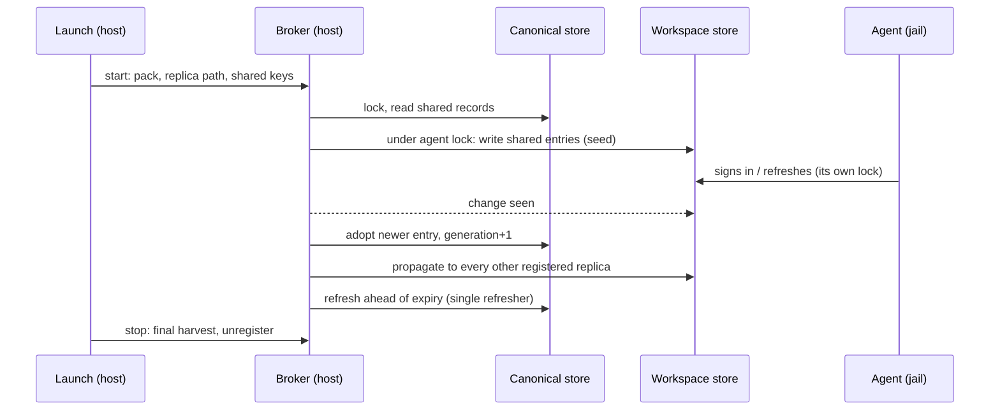

# One sign-in per user-level MCP server: a host broker that shares the entries, not the store

**Status:** 2026-11-03. Draft; nothing built. Evidence from five research reports read the same day
(listed under [Evidence](#appendix-a-evidence)), and from the tree at `407106f82`.

> **In short.** No agent can split its MCP token store per server, so the only honest way to share
> user-level sign-ins and keep workspace ones private is for yolo to own the split: a host broker
> that is the one writer of a machine-wide canonical store and the one refresher of every entry in
> it, copying entries in and out of each workspace's private store under that agent's own lock.

**Why it matters.** Today a remote MCP sign-in is per workspace for pi, Codex, Copilot and opencode
(each signs in again in every project), and machine-wide *whole-store* for Claude and Muse (so a
workspace-only server's tokens sit in a file every jail reads). Neither matches the owner's rule.

**The shape.** Five parts: the remote `mcp_servers` form ([§4](#4-prerequisite-a-remote-mcp_servers-form));
a scope rule computed at composition ([§5](#5-which-servers-are-user-level)); a per-agent
`mcp_auth` declaration with Lua key functions ([§6](#6-what-an-agent-pack-declares)); the canonical
store ([§7](#7-the-canonical-store)); the broker, shipped as a loophole of a new `mcp-auth` pack
([§8](#8-the-broker)).

**Cost.** One more host daemon per jail; an adapter per agent that must be measured against a real
sign-in before it ships; Copilot, agy and omp wait on facts yolo does not have.

**Start at [§3](#3-why-it-cannot-be-a-link)** — why no cheaper mechanism meets the rule. The rest
falls out of it.

**Needs your ruling:** [OQ-MA1](#OQ-MA1), [OQ-MA2](#OQ-MA2), [OQ-MA3](#OQ-MA3), [OQ-MA4](#OQ-MA4),
[OQ-MA5](#OQ-MA5), [OQ-MA6](#OQ-MA6).

**Reads with:** [`mcp-configuration.md`](../reference/mcp-configuration.md) (how the one MCP table is
composed and projected), [`claude-login-without-interception.md`](claude-login-without-interception.md)
(the credential view and the broker this one is modeled on),
[`jail-home.md`](../reference/jail-home.md#shared-credentials) (the `shared_credentials` hook this
does not use), [`loophole-system.md`](../reference/loophole-system.md) (how a pack ships a host
daemon), [`keychain-from-a-jail.md`](keychain-from-a-jail.md) (why keychain-backed stores are out
of reach). No plan seed yet: the design-only brief.

---

## 1. The owner's rule, and the verdict

The owner's ask, 2026-11-03: share each agent's remote-MCP sign-ins across workspaces, *"ideally
only if they are defined at the user level. per workspace mcps should not be shared … and this
should apply across all agents."* After hearing that no agent splits its store per server, he asked
to explore a broker that copies individual entries: *"seems worth it."*

**Verdict: build the broker, behind the remote `mcp_servers` form, Codex first.** Four principles
carry the rest of the document:

- **P1. One writer per canonical entry.** Only the broker writes the canonical store, and only the
  broker refreshes a shared entry. An agent's own store has two writers (the agent and the broker),
  serialized by the agent's own lock.
- **P2. Scope is yolo's fact, decided at composition.** A server is shared only when yolo can prove
  it is user-level. A server yolo cannot see is never shared silently.
- **P3. Core knows stores, never agents.** A pack declares where its agent keeps sign-ins and how to
  read a key; core implements lock protocols and file formats by name, with no switch on a tool.
- **P4. Every skipped share says why and names the next step**
  ([happy path](../reference/happy-path-principle.md)).

## 2. Vocabulary

- **Sign-in** — the OAuth state an agent keeps for one remote MCP server: access token, refresh
  token, expiry, and usually a client registration. Not a model login, which is out of scope.
- **Agent store** — the file (or directory) where one agent keeps every server's sign-in, in one
  home: `~/.codex/.credentials.json`, `~/.pi/agent/mcp-auth.json`. One per workspace in a jail.
- **Entry** — one server's sign-in inside an agent store, under the agent's own key.
- **Canonical store** *(coined here)* — the broker's machine-wide record of every shared entry, one
  file per agent pack, in host-only state no jail mounts. Not an agent store: no agent reads it.
- **Replica** *(coined here)* — an agent store the broker keeps in step with the canonical store:
  each running jail's workspace store, and the real home's store at `yolo host`. Not a copy of the
  whole store: only the shared entries are the broker's; every other entry is left as the agent
  wrote it.
- **User-level server** — defined in [§5](#5-which-servers-are-user-level). **Workspace server** is
  every other server yolo composes. **Unknown server** *(coined here)* is one in an agent store
  that yolo did not compose: a plugin's, a project `.mcp.json`'s, one added with the agent's own
  `mcp add`.
- **Sign-in identity** *(coined here)* — the fields of a server that decide which token it needs:
  its `url`, `transport`, the `headers` the agent hashes into its key, and `oauth.client_id`. Not
  `env`, `requires_env` or `provides`.

## 3. Why it cannot be a link

The research established, per agent, that nothing short of copying entries meets the rule:

| Agent | Store | Keyed by | Can one server move? | Shared today |
|---|---|---|---|---|
| Claude | `.credentials.json`, `mcpOAuth` map, same file as the login | `name\|sha256(type,url,headers)[:16]` | no; env var moves whole store | whole store, machine-wide (CL-D22 bridge) |
| Codex | `~/.codex/.credentials.json`, MCP only | `name\|sha256(http,url,{})[:16]` | no | no |
| pi | `~/.pi/agent/mcp-auth.json`, MCP only | `mcp__name\|url` | no | within one workspace |
| opencode | `~/.local/share/opencode/mcp-auth.json` | name, URL checked | no | no |
| Copilot | `~/.copilot/mcp-oauth-config/<hash>.*` file sets; Keychain on macOS | undocumented native hash of url+client id | no | no |
| agy | `mcp_oauth_tokens.json` under `~/.gemini` (dir unmeasured) | probably name | no | no |
| Muse | `~/.config/muse/auth.json`, same file as the login | name + URL hash (inferred) | no | whole store, via the login hook |
| omp | `agent.db` SQLite, same table as logins | random id written into `mcp.json` | no | no |

So three cheaper mechanisms fail:

- **A `shared_credentials` link on the whole store** shares workspace servers' tokens too, and
  Claude and Codex refuse to *write* through a symlink (`O_NOFOLLOW`). It is the status quo for
  Claude and Muse, and the owner's rule asks for less.
- **A link per entry** does not exist: entries are keys inside one file.
- **Moving the store per workspace** (an env var) moves the whole store, and is what already happens.

> [!WARNING]
> A whole-store share isolates *use*, not *reading*: an entry keyed by name and URL is only used by
> a jail declaring that same server, but every jail can read every token. That is why "the keys
> already differ" is not an argument for the link.

## 4. Prerequisite: a remote `mcp_servers` form

yolo cannot declare a remote server today: `knownMCPServerKeys` is `command, args, env,
requires_env, provides` (`internal/config/config.go:186`), and no derive renders a `url`. Every
remote server an agent signs in to was added through the agent's own config, so yolo has no scope
for any of them. The form:

```toml
[mcp_servers.linear]
url = "https://mcp.linear.app/mcp"
transport = "http"          # "http" (streamable HTTP, the default) or "sse"
headers = { X-Org = "acme" } # optional; written verbatim, ${VAR} not interpolated
oauth = { client_id = "…", scopes = ["read"] }   # optional; pre-registered client
```

- **Exactly one of `command` and `url`.** Both, or neither, is refused naming the key to remove.
  `args`, `env` with `url` are refused the same way; `requires_env` and `provides` apply to both.
- **Each agent pack's `derive.lua` renders the remote form** into its tool's dialect; a derive that
  has no remote form yet leaves the server out and the boot names it per agent
  (`linear: Muse has no remote MCP form in yolo yet; it is configured for claude, codex, pi`).
- **The form is worth shipping on its own**, before any sharing: it lets a user declare a remote
  server once for every agent.

## 5. Which servers are user-level

**A server is user-level when the user's layer alone composes a server of the same name with the
same sign-in identity.** The composer computes two tables: the *effective* table it already builds
(packs, then user config, then workspace config), and a *user-only* table (packs the user's config
selects, then the user's config). Every server in the effective table gets one scope:

| Case | Scope | Why |
|---|---|---|
| In user config only | user | |
| From a pack the user's config selects | user | the owner's "or a pack the user selects" |
| From a pack only the workspace config selects | workspace | the selection is the workspace's |
| In workspace config only | workspace | |
| In both, identity equal (workspace changes only `env`, say) | user | the same token serves both |
| In both, identity differs (workspace changes `url` or `headers`) | workspace | it needs a different token |
| User-level, removed by the workspace with `null` | absent here | the canonical entry is kept; this replica gets none |
| Workspace server whose name *and* identity equal a user one | user | indistinguishable by every agent's key |
| A different name, same URL as a user server | workspace | — except under a URL-keyed agent, below |
| In a `--local` (`yolo-jail.local.toml`) or a per-workspace file under `~/.config/yolo-jail/workspaces/` | workspace | both are this workspace's files |
| Unknown server | not shared by default | [OQ-MA2](#OQ-MA2) |

- **A URL-keyed agent forces one more share.** Copilot keys by URL and client id, not name, so a
  workspace server with a user server's URL lands on the same entry. The broker treats that entry
  as shared and the launch says so (`notion-staging: same URL as your user-level notion, so Copilot
  shares its sign-in`).
- **At `yolo host`**, the composed table is the user's alone
  ([`mcp-configuration.md`](../reference/mcp-configuration.md#at-the-host-notch)), so every server
  yolo renders there is user-level.
- **Scope is recomputed on every launch.** A server that moves from workspace to user config is
  shared from its next launch on: the broker adopts the workspace's existing entry as canonical
  ([§8.2](#82-adopt)) rather than asking for a new sign-in.
- **`yolo config why mcp_servers.<name>`** names the scope and the layer that decided it.

## 6. What an agent pack declares

A pack whose agent keeps MCP sign-ins declares one `[[mcp_auth]]` block. Core reads only the
declaration; the pack's `derive.lua` supplies the two functions that need the agent's knowledge.

```toml
[[mcp_auth]]
store = ".codex/.credentials.json"     # home-relative; a file or (format = "dir") a directory
format = "json"                        # "json" | "dir" | "unsupported"
entries_at = []                        # JSON path of the entry map; Claude: ["mcpOAuth"]
companions = []                        # parallel maps under the same key; Claude: [["mcpOAuthClientConfig"]]
empty_store = "delete"                 # what the agent leaves when no entry remains: "delete" | "{}"
lock = { protocol = "flock", path = ".codex/mcp-oauth-locks/file-store.lock" }
fields = { access_token = "access_token", refresh_token = "refresh_token",
           expires_at = { path = "expires_at", unit = "ms" }, client_id = "client_id" }
rereads_before_refresh = true          # MEASURED per agent version, see §8.4
unsupported_reason = ""                # with format = "unsupported": the line the launch prints
```

The pack's `derive.lua` provides:

- **`mcp_auth_key(server)`** → the agent's key for a composed server (Codex: name, `|`, the first 16
  hex of sha256 over its canonical JSON). Core hands Lua `sha256` and a canonical JSON serializer.
- **`mcp_auth_match(key, entry)`** → the server name and URL an existing entry belongs to, or nil.
  Used to classify entries yolo did not write.

Core implements these lock **protocols** by name, each the agent-neutral description of a library's
behavior: `flock` (an advisory lock on a named file), `proper-lockfile` (a `<target>.lock`
directory, stale after its declared seconds), `mkdir-heartbeat` (a lock directory whose holder
touches it), and `none`. A store whose protocol is `none` gets no live sync
([§8.5](#85-launch-boundary-only)).

Declared per shipped agent:

| Pack | format | lock | Ships in |
|---|---|---|---|
| codex | `json`, `entries_at = []`; derive pins `mcp_oauth_credentials_store = "file"` | `flock` | slice 1 |
| pi | `json` | `proper-lockfile`, beside the real file | slice 2 |
| opencode | `json` | `mkdir-heartbeat` in `~/.local/state/opencode/locks` | slice 2 |
| claude | `json`, `entries_at = ["mcpOAuth"]`, one companion | `proper-lockfile` `.storage-write.lock`, 15 s stale | slice 2, in view mode ([OQ-MA3](#OQ-MA3)) |
| copilot | `unsupported`: key is an undocumented native hash that varies | — | when the key is reproducible |
| agy | `unsupported`: path and write mode unmeasured | — | after one measured sign-in |
| muse-code | `unsupported`: key composition unknown; yolo renders no MCP for it | — | after it gets a remote form |
| omp | `unsupported`: SQLite, shared with its logins | — | upstream, or never |

## 7. The canonical store

- **Where:** `~/.local/share/yolo-jail/state/mcp-auth-broker/<pack>.json`, mode `0600`, host-only.
  No launch mounts it, as the Claude broker's canonical login is not mounted (CL-D2).
- **Keyed by** `(server name, sign-in identity digest)`, not by the agent's key, so a change to
  an agent's key function does not orphan an entry.
- **Each record holds** the agent's native entry verbatim (and its companions), the fields
  extracted through `fields`, a monotonic **generation** number, the workspace it was adopted from,
  and its state: `live`, `refreshing`, `dead` (the authorization server refused the refresh).
- **Per agent pack, not per server across agents** in v1: a Codex sign-in does not serve pi
  ([OQ-MA5](#OQ-MA5)). Tokens are bound to the client that registered them, and each agent
  registers its own.
- **Lock:** one `flock` on `<pack>.lock` beside it for every read-modify-write, and one refresh
  lock per record.

## 8. The broker

Shipped as the `mcp-auth-broker` loophole of a new pack, `mcp-auth`, which every agent pack that
declares `[[mcp_auth]]` `needs` (as `claude` needs `claude-auth`). Its host daemon is
`yolo internal daemon mcp-auth-broker`, one per jail, started and stopped with the launch
([HD-R1](host-daemon-ownership.md#HD-R1)). It has no jail-facing client: what serializes jails is
the canonical store's lock, not one process. A registry directory beside the store lists each
running replica `(pack, store path, lock path, shared key set)`, written by the launch and removed
when the jail stops.



### 8.1 Seed

At launch, before the agent starts: for each user-level server the launch's composition lists, the
broker writes the canonical record's entry into the workspace store under the agent's key, taking
the agent's lock. An entry already there with a **lower** generation, or none, is replaced; every
non-shared entry is left byte-for-byte. Seeding runs before any agent process exists, so it works
on every backend whatever the lock protocol.

### 8.2 Adopt

When a workspace store changes (an `inotify`/FSEvents watch, with a 30 s poll as the floor), the
broker reads it under the agent's lock and classifies each entry through `mcp_auth_match`:

- **A shared server's entry that differs from canonical** — a sign-in or a refresh in the jail — is
  adopted: canonical takes it with generation + 1.
- **A shared server's entry that disappeared** from a store that parsed cleanly is a sign-out: the
  record is removed and the removal propagated ([OQ-MA4](#OQ-MA4)). A store that does not parse is
  never read as "every entry gone"; the broker logs it and waits for the next change.
- **Workspace and unknown servers' entries** are never read past their key.

Two adoptions of one record at once are serialized by the canonical lock; the later write wins and
the earlier token family is abandoned (its jail is overwritten with the winner). That costs nothing
but the loser's in-memory token.

### 8.3 Propagate

After every canonical change, the broker writes the record into every *other* registered replica
of that pack whose shared key set holds it, each under that replica's agent lock. A replica whose
lock cannot be taken within 10 s is retried at 1, 2, 4 … 60 s and logged once; it is never written
without its lock.

### 8.4 Refresh: the broker is the single refresher

Rotating refresh tokens are single-use, and some authorization servers revoke the whole token family
when an old one is redeemed. Identical copies also expire at the same instant, so every jail would
try to refresh at once. Therefore:

- **The broker refreshes every live record ahead of expiry**, when a quarter of its lifetime or
  10 minutes remain, whichever is later, under the record's refresh lock, re-reading the record
  after taking the lock. It discovers the token endpoint from the server URL (RFC 9728 protected
  resource metadata, then RFC 8414), redeems the refresh token with the entry's client id (and
  secret, when there is one), writes canonical, and propagates.
- **A copy keeps its refresh token only when the agent re-reads its store before refreshing**
  (`rereads_before_refresh`, measured per agent). Such an agent, finding a fresh token on disk,
  never redeems the old one. Otherwise the copy is written without a refresh token, the credential
  view's rule (CL-D1). Which model holds when the broker is down is [OQ-MA1](#OQ-MA1).
- **A refused refresh** (`invalid_grant`) marks the record `dead`, removes the entry from every
  replica, and the next launch line names the next step: `linear: its sign-in was revoked; sign in
  again inside any jail with codex mcp login linear` (the command is the pack's, from a
  `login_hint` declaration field).
- **A transient failure** (network, 5xx) retries at 30 s, 1, 2, 5 min until expiry; past expiry the
  agent's own refresh, where it holds a refresh token, is the fallback.

### 8.5 Launch-boundary only

Where the agent's lock cannot be shared between the broker and the agent — lock protocol `none`, or
`flock` across a VM file share (Apple Container) — the broker does only [§8.1](#81-seed) at start
and an adopt at stop, and copies never carry a refresh token. The launch says so: `MCP sign-ins for
codex are shared at launch and exit only on Apple Container; a sign-in in another jail reaches this
one at its next launch.`

### 8.6 What the launch prints

One block, every launch, per agent:

```text
MCP sign-ins (codex): linear, sentry shared from your user-level servers
  notion kept to this workspace: yolo-jail.toml changes its url. To share it, declare it in your
    user config: yolo config set mcp_servers.notion.url https://mcp.notion.com/mcp --user
  plugin:slack:slack not yolo's: kept to this workspace. To share it, declare it in mcp_servers.
```

`yolo mcp-auth status` lists the same per agent and workspace, with each record's generation,
expiry and last refresh, and never a token.

## 9. Parity: every backend and notch

| | podman | Apple Container | macos-user | `yolo host` |
|---|---|---|---|---|
| Replica path | `<ws>/.yolo/home/<agent>/…`, host-visible | same, over the VM share | the sandbox account's home | the real home |
| Seed + harvest | yes | yes | yes, if the host can write the account home (Mac witness) | yes |
| Live sync | yes: one kernel, `flock` and lock dirs both hold | only for directory-lock protocols, unmeasured over the share; `flock` stores are launch-boundary | yes, one kernel | yes |
| Keychain-backed stores | — | — | Codex: pinned to `file`; Copilot, Claude: Keychain, unsupported | as macos-user; [OQ-MA6](#OQ-MA6) |
| Daemon admitted | yes | needs admission (only `openai-auth-broker` is today); it dials nothing from the jail | yes | runs for the agent `yolo host --` launches |

- **A Keychain store is out of reach** ([`keychain-from-a-jail.md`](keychain-from-a-jail.md)). The
  pack declares it with `format = "unsupported"` on that platform, and the line names the next
  step the pack knows, or says none exists yet: `Copilot keeps MCP sign-ins in the macOS Keychain
  here, which yolo cannot share; each workspace signs in once.`
- **Parity is per behavior, not per commit.** Slice 1 ships podman and Linux `yolo host`; the other
  columns wait on their witnesses, not on who uses them.

## 10. Existing state on the day it ships

- **Codex, pi, opencode workspace stores** already hold sign-ins. At the first launch with sharing,
  each user-level entry found there is adopted; when several workspaces hold one, the first
  adopted wins and later ones are overwritten at their next launch. Nobody signs in again.
- **Claude in bridge mode and Muse** keep their whole-store share until [OQ-MA3](#OQ-MA3) is ruled;
  the launch line says the store is shared whole.
- **pi's session homes** link `mcp-auth.json` into each session, and pi takes its lock beside the
  link, not the file, so the broker's lock and a session's do not exclude each other. pi waits for
  that to be fixed (the lock beside the real path, or the broker locking every registered session
  link) before slice 2.

## 11. Forbidden behavior

- Never write an agent store without that agent's lock, and never through a symlink.
- Never read, copy or log a workspace or unknown server's entry beyond its key.
- Never mount the canonical store into a jail.
- Never redeem a shared refresh token anywhere but the broker, once the record is canonical.
- Never delete a canonical record because a replica failed to parse.
- No `YOLO_*` switch turns sharing off for a yolo bug; a user who wants a server private declares
  it in the workspace config.

## 12. What this does not cover

- **Model logins**, already decided per agent.
- **Cross-agent sharing** of one server's sign-in, filed as [OQ-MA5](#OQ-MA5), not built in v1.
- **Performing a sign-in on the host.** The OAuth flow still runs in the jail, with the agent's own
  `/mcp` or `mcp login`.
- **A project's own MCP files** reaching an agent: that stays as
  [`workspace-mcp-sources.md`](workspace-mcp-sources.md) rules it.

## 13. Alternatives considered

| Alternative | Verdict |
|---|---|
| Whole-store `shared_credentials` / `shared_directory` per agent | Rejected: shares workspace servers; Codex and Claude refuse to write through the link. |
| Boot-time copy only, everywhere | Rejected as the default: two live jails drift and burn a rotating token. Kept as the degraded mode ([§8.5](#85-launch-boundary-only)). |
| Newest-wins propagation, agents refresh themselves | Rejected: copies expire together and race; a family-revoking server logs everyone out. |
| A yolo token helper that agents call for a header (`!cmd` in omp) | Rejected for v1: only omp supports it, and the agent then never signs in itself. |
| One canonical entry per server for every agent | Deferred to [OQ-MA5](#OQ-MA5). |
| Interception of token endpoints, as the Claude broker does | Rejected: endpoints are per server and discovered at run time; one CA intercept per server is a large trust surface for no gain over [§8.4](#84-refresh-the-broker-is-the-single-refresher). |

## 14. Risks

| Risk | Mitigation |
|---|---|
| An agent update changes its key or format | `mcp_auth_match` fails closed: an entry it cannot classify is not shared, and `yolo check` names the agent version |
| An agent caches a refresh token in memory and redeems it after the broker rotated it | `rereads_before_refresh` is measured per version; false means copies carry none |
| The broker's discovery fails for a server | The record stays agent-refreshed, launch-boundary only, and the line says so |
| Codex deletes its store file when the last entry goes | The broker reads a missing file as an empty store, and creates the file only when it has an entry to write (an empty file fails Codex's parse) |

## 15. What I would build, in order

1. **The remote `mcp_servers` form** and the codex derive's rendering of it, plus scope attribution
   in the composer and `config why`. Useful alone.
2. **Slice 1: the `mcp-auth` pack, the broker, the canonical store, Codex end to end** on podman and
   Linux `yolo host`: seed, adopt, propagate, host refresh, the launch block, `yolo mcp-auth status`.
   Codex first because it has one file, one `flock`, a reproducible key and an MCP-only store.
3. **Slice 2:** pi (after the lock fix), opencode, Claude in view mode; the Apple Container and
   macos-user witnesses.
4. **Slice 3:** Copilot once its key is reproducible, agy after a measured sign-in, Muse and omp when
   their packs render remote servers.

What done looks like: sign in to a user-level server in one Codex jail; a second running jail in
another workspace uses it within seconds with no prompt; a workspace server signed in in the first
never appears in the second's store; `yolo mcp-auth status` shows one refresh per expiry window,
by the broker.

## 16. Open Questions

1. 💬 **OQ-MA1: When the broker is down, should a jail's agent still be able to refresh a shared sign-in itself?**

   Dana has two jails open on the same Linear server. The broker refreshes Linear's token before
   it expires and writes the new one into both. If the broker is stopped (a crash, a host
   restart mid-session), the token expires an hour later and the agent wants to refresh.

   - **Copies carry the refresh token where the agent re-reads its store first.** Dana's agent
     refreshes and keeps working; the broker adopts the result when it is back. Cost: if the agent
     was measured wrong, two jails redeem one token and Dana signs in again.
   - **Copies never carry a refresh token.** Dana's agent says the server needs a new sign-in; she
     signs in, and the broker adopts it. Cost: an outage costs a sign-in; a token never leaks
     twice.

   <!-- vantage: question id=OQ-MA1 leaning="Carry the refresh token only for agents measured to re-read their store before refreshing; strip it otherwise. An outage should not cost a sign-in where the agent is measured safe." -->

   _Leaning:_ Carry the refresh token only for agents measured to re-read their store before
   refreshing; strip it otherwise. An outage should not cost a sign-in where the agent is measured
   safe.

   **Answer:**
   > _(empty — fill in when decided)_

2. 💬 **OQ-MA2: Should sign-ins for servers yolo never sees ever be shared?**

   Sam installed a Claude plugin that brings a Slack MCP server, and added Sentry with `codex mcp
   add`. Neither is in any yolo config, so yolo cannot tell whether Sam meant them for every
   project or just this one. Today every new workspace asks him to sign in to both again.

   - **Never share them.** The launch names each one with the command that declares it in his user
     config; once declared, it is shared. Cost: one config line per server.
   - **Share plugin servers, not the rest.** Plugins are installed per user, so Slack is shared at
     once. Cost: a plugin enabled for one project shares too.
   - **Share every unknown server.** Sam never sees a second prompt. Cost: a project's own
     `.mcp.json` server is shared, which is exactly what the owner ruled against.

   <!-- vantage: question id=OQ-MA2 leaning="Never share them, and name each with the one command that declares it. yolo cannot prove they are user-level, and the rule is to share only what it can." -->

   _Leaning:_ Never share them, and name each with the one command that declares it. yolo cannot
   prove they are user-level, and the rule is to share only what it can.

   **Answer:**
   > _(empty — fill in when decided)_

3. 💬 **OQ-MA3: Claude and Muse already share every MCP sign-in machine-wide; should yolo narrow that?**

   Priya uses Claude. Its MCP tokens live in the same file as her Claude login, and yolo already
   shares that whole file with every jail so the login works everywhere. So a server she signed in
   to for one client project is readable in every other jail. Muse has the same shape.

   - **Keep it, and say so at launch.** Nothing changes until Claude moves to per-workspace
     credential files (already planned); then the broker shares only user-level entries. Cost:
     workspace tokens stay readable machine-wide meanwhile.
   - **Narrow it now** by making Claude's per-workspace credential file the default sooner. Cost:
     that change is gated on measurements of Claude's login nobody has run yet.

   <!-- vantage: question id=OQ-MA3 leaning="Keep it and say so at launch; narrow it when Claude's per-workspace credential files become the default. The login change carries its own measured gate, and this should not jump it." -->

   _Leaning:_ Keep it and say so at launch; narrow it when Claude's per-workspace credential files
   become the default. The login change carries its own measured gate, and this should not jump it.

   **Answer:**
   > _(empty — fill in when decided)_

4. 💬 **OQ-MA4: Should signing out of a shared server in one jail sign out everywhere?**

   Lee runs `/mcp` in one Codex jail and logs out of Linear. The entry disappears from that
   workspace's store. Lee's other three jails still hold the shared sign-in.

   - **Sign out everywhere.** The broker removes it from every jail; the next use asks for a sign-in.
     Cost: an agent that drops an entry by mistake signs Lee out machine-wide.
   - **Sign out here only.** The other jails keep it, and this jail gets it back at its next launch.
     Cost: logging out does not stick, which is surprising.

   <!-- vantage: question id=OQ-MA4 leaning="Sign out everywhere, but only from a store that parsed cleanly. A shared sign-in is one sign-in, and Claude's machine sign-out already works this way." -->

   _Leaning:_ Sign out everywhere, but only from a store that parsed cleanly. A shared sign-in is
   one sign-in, and Claude's machine sign-out already works this way.

   **Answer:**
   > _(empty — fill in when decided)_

5. 💬 **OQ-MA5: Should one agent's sign-in serve another agent for the same server?**

   Ana signs in to Linear in Codex, then opens pi in another workspace. Both name the same
   user-level server. Each agent registered its own OAuth client, and a refresh token works only
   for the client that got it.

   - **Per agent (v1).** pi asks Ana to sign in once, then shares among pi jails. Cost: one sign-in
     per agent per server.
   - **Across agents.** The broker hands Codex's access token to pi and refreshes it as Codex's
     client. Cost: pi presents another client's token, which some servers reject, and every
     adapter must translate entries.

   <!-- vantage: question id=OQ-MA5 leaning="Per agent in v1; revisit when a second agent's adapter is built and a real server is measured accepting another client's token." -->

   _Leaning:_ Per agent in v1; revisit when a second agent's adapter is built and a real server is
   measured accepting another client's token.

   **Answer:**
   > _(empty — fill in when decided)_

6. 💬 **OQ-MA6: On a Mac, should `yolo host` move Codex's MCP sign-ins out of the Keychain so they can be shared?**

   Omar runs `yolo host -- codex` on his Mac. Codex keeps MCP sign-ins in the login Keychain
   there, which the broker cannot reach, while his jails use a file. Pinning Codex to its file
   store at the host would let the broker share them, but Codex would stop looking in the
   Keychain.

   - **Pin the file store at the host too.** Omar signs in once more at the host, then host and
     jails share. Cost: one sign-in per server, once; tokens move from the Keychain to a `0600` file.
   - **Leave the host on the Keychain.** The host signs in separately forever, and the launch says
     so. Cost: the host is the one notch that does not share.

   <!-- vantage: question id=OQ-MA6 leaning="Pin the file store at the host, disclosed at the first launch; the Keychain already leaves the host out of every share, and parity across notches is the standing rule." -->

   _Leaning:_ Pin the file store at the host, disclosed at the first launch; the Keychain already
   leaves the host out of every share, and parity across notches is the standing rule.

   **Answer:**
   > _(empty — fill in when decided)_

## Decision Ledger

Implementation decisions taken in this draft, inside the owner's 2026-11-03 ask. None is a ruling.

| ID | Decision | Date | Settled in | Built |
| :--- | :--- | :--- | :--- | :--- |
| MA-D1 | Share entries through a host broker; no link, mount or env-var mechanism meets the rule | 2026-11-03 | [§3](#3-why-it-cannot-be-a-link) | — |
| MA-D2 | A remote `mcp_servers` form (`url`, `transport`, `headers`, `oauth`) is the prerequisite and ships first | 2026-11-03 | [§4](#4-prerequisite-a-remote-mcp_servers-form) | — |
| MA-D3 | User-level = the user-only composition yields the same name and sign-in identity | 2026-11-03 | [§5](#5-which-servers-are-user-level) | — |
| MA-D4 | Packs declare `[[mcp_auth]]`; key and match functions live in `derive.lua`; core implements lock protocols by name | 2026-11-03 | [§6](#6-what-an-agent-pack-declares) | — |
| MA-D5 | Canonical store per agent pack, host-only, keyed by name and identity digest, with generations | 2026-11-03 | [§7](#7-the-canonical-store) | — |
| MA-D6 | The broker is the single refresher of a canonical record, ahead of expiry | 2026-11-03 | [§8.4](#84-refresh-the-broker-is-the-single-refresher) | — |
| MA-D7 | Where the lock cannot cross, share at launch and exit only, and say so | 2026-11-03 | [§8.5](#85-launch-boundary-only) | — |
| MA-D8 | The broker is a loophole of a new `mcp-auth` pack that agent packs `need` | 2026-11-03 | [§8](#8-the-broker) | — |
| MA-D9 | Codex is the first agent: one file, one `flock`, reproducible key, MCP-only store | 2026-11-03 | [§15](#15-what-i-would-build-in-order) | — |

## Appendix A: Evidence

The per-agent research, each claim with its file:line or URL, is [`mcp-auth-stores.md`](../research/mcp-auth-stores.md): Claude Code 2.1.317, Codex `rust-v0.166.0`, Copilot CLI 1.0.105, pi 1.0.1, oh-omp 0.15.3, opencode 1.19.0, agy, and Muse 1.4.14. In the tree:
`internal/config/config.go:186` (no remote form), `internal/oauthbroker/store.go` and
`internal/claudeview/claudeview.go:351-361` (the Claude broker's locked read-modify-write),
`packs/claude-auth/loopholes/claude-oauth-broker/loophole.toml` (a pack-shipped broker),
`internal/cli/run/loopholeinert.go` (Apple Container's daemon allow-list).
