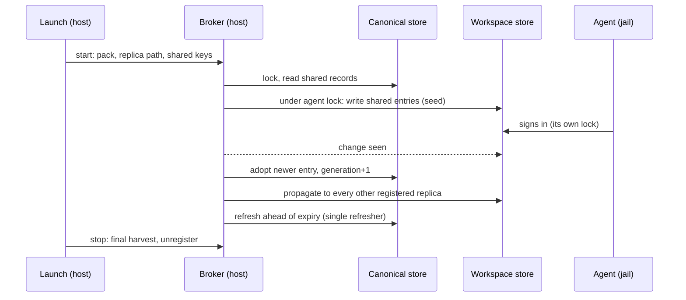

# One sign-in per user-level MCP server: a host broker that shares the entries, not the store

**Status:** 2026-11-03. Nothing built. Evidence read the same day ([Appendix A](#appendix-a-evidence)); tree claims checked at `05f445e8d`.

> **In short.** Because no agent can split its MCP token store per server, sharing only the
> user-level sign-ins means yolo owns the split: one host broker writes a canonical copy of each
> shared entry, refreshes it alone, and copies it into each workspace's store under the agent's own lock.

**Why it matters.** Today pi, Codex, Copilot and opencode sign in again in every workspace, while
Claude and Muse share their whole store, so a workspace-only server's tokens are readable in every jail.

**The shape.** A remote `mcp_servers` form, a scope rule, a per-pack store declaration, a canonical
store, and the broker; opted in, the broker also adopts one agent's sign-in and serves it to all.

**Cost.** One more host daemon per jail, and a measured adapter per agent; Copilot, agy and omp wait.
For Slack, every agent then appears to Slack as Claude Code's Slack app, with that app's scopes.

**Start at [§3](#3-why-it-cannot-be-a-link)** — why no cheaper mechanism meets the rule.

**Needs your ruling:** [OQ-MA2](#OQ-MA2).

**Reads with:** [`mcp-auth-stores.md`](../research/mcp-auth-stores.md) (the per-agent store research),
[`mcp-configuration.md`](../reference/mcp-configuration.md) (how the MCP table is composed),
[`claude-login-without-interception.md`](claude-login-without-interception.md) (the broker this one
is modeled on), [`universal-login-sharing.md`](universal-login-sharing.md) (model logins; reconciled
in [§9.8](#98-how-this-sits-with-one-model-login-for-several-agents)). No plan seed: this is a design-only pass.

---

## 1. The requirement, and the verdict

**The requirement.** A remote MCP sign-in made in one workspace serves every other workspace when,
and only when, the server is defined at the user level; a server defined by one workspace stays in
that workspace; and the rule holds for every agent yolo runs. Opted in, one sign-in serves every
agent, not only every workspace. The owner's own words are in [Appendix B](#appendix-b-the-owners-words).

**Verdict: build the broker, behind the remote `mcp_servers` form, Codex first.** Four principles
carry the rest of the document:

- **P1. One writer per canonical entry.** Only the broker writes the canonical store, and only the
  broker refreshes a shared entry. An agent's own store has two writers (the agent and the broker),
  serialized by the agent's own lock.
- **P2. Scope is yolo's fact, decided at composition.** A server is shared only when yolo can prove
  it is user-level. A server yolo cannot see is never shared silently.
- **P3. Core knows stores, never agents.** A pack declares where its agent keeps sign-ins and how to
  read a key; core implements lock protocols and file formats by name, with no switch on a tool.
- **P4. Every skipped share says why and names the next step**
  ([happy path](../reference/happy-path-principle.md)).

## 2. Vocabulary

- **Sign-in** — the OAuth state an agent keeps for one remote MCP server: access token, refresh
  token, expiry, and usually a client registration. Not a model login, which is out of scope.
- **Agent store** — the file (or directory) where one agent keeps every server's sign-in, in one
  home: `~/.codex/.credentials.json`, `~/.pi/agent/mcp-auth.json`. One per workspace in a jail.
- **Entry** — one server's sign-in inside an agent store, under the agent's own key.
- **Canonical store** *(coined here)* — the broker's machine-wide record of every shared entry, one
  file per agent pack, in host-only state no jail mounts. Not an agent store: no agent reads it.
- **Replica** *(coined here)* — an agent store the broker keeps in step with the canonical store:
  each running jail's workspace store, and the real home's store at `yolo host`. Not a copy of the
  whole store: only the shared entries are the broker's; every other entry is left as the agent
  wrote it.
- **User-level server** — a server the user's layer alone produces with the same name and sign-in
  identity; the full rule is [§5](#5-which-servers-are-user-level). **Workspace server** is every
  other server yolo composes. **Unknown server** *(coined here)* is one in an agent store that yolo
  did not compose: a plugin's, a project `.mcp.json`'s, one added with the agent's own `mcp add`.
- **Sign-in identity** *(coined here)* — the fields of a server that decide which token it needs:
  its `url`, `transport`, the `headers` the agent hashes into its key, and `oauth.client_id`. Not
  `requires_env` or `provides`.
- **OAuth client** — the program the authorization server issued a client id to (by
  pre-registration, a client metadata document, or dynamic registration) and that redeems codes and
  refresh tokens under it. Normally each agent is its own client for each server.
- **One-sign-in server** *(coined here)* — a user-level server the user opted in with
  `sign_in = "once"` ([§9.2](#92-the-opt-in)), whose only refresher is the broker. Not a server
  merely shared across workspaces, which is every user-level server.
- **Delivery route** *(coined here)* — how an agent receives a one-sign-in server's access token:
  a **header command** the agent runs, or an entry the broker writes into the agent store. Not a
  sign-in: the agent never talks to the authorization server for that server.

## 3. Why it cannot be a link

Per agent, nothing short of copying entries meets the rule
([`mcp-auth-stores.md`](../research/mcp-auth-stores.md) has the file:line evidence):

| Agent | Store | Keyed by | Can one server move? | Shared today |
|---|---|---|---|---|
| Claude | `.credentials.json`, `mcpOAuth` map, same file as the login | `name\|sha256(type,url,headers)[:16]` | no; env var moves whole store | whole store, machine-wide ([CL-D22](claude-login-without-interception.md#CL-D22) bridge) |
| Codex | `~/.codex/.credentials.json`, MCP only | `name\|sha256(http,url,{})[:16]` | no | no |
| pi | `~/.pi/agent/mcp-auth.json`, MCP only | `mcp__name\|url` | no | within one workspace |
| opencode | `~/.local/share/opencode/mcp-auth.json` | name, URL checked | no | no |
| Copilot | `~/.copilot/mcp-oauth-config/<hash>.*` file sets; Keychain on macOS | undocumented native hash of url+client id | no | no |
| agy | `mcp_oauth_tokens.json` under `~/.gemini` (dir unmeasured) | probably name | no | no |
| Muse | `~/.config/muse/auth.json`, same file as the login | name + URL hash (inferred) | no | whole store, via the login hook |
| omp | `agent.db` SQLite, same table as logins | random id written into `mcp.json` | no | no |

So three cheaper mechanisms fail:

- **A `shared_credentials` link on the whole store** shares workspace servers' tokens too, and
  Claude and Codex refuse to *write* through a symlink (`O_NOFOLLOW`). It is the status quo for
  Claude and Muse, and the rule asks for less.
- **A link per entry** does not exist: entries are keys inside one file.
- **Moving the store per workspace** (an env var) moves the whole store, and is what already happens.

> [!WARNING]
> A whole-store share isolates *use*, not *reading*: an entry keyed by name and URL is only used by
> a jail declaring that same server, but every jail can read every token. That is why "the keys
> already differ" is not an argument for the link.

## 4. Prerequisite: a remote `mcp_servers` form

yolo cannot declare a remote server today: `knownMCPServerKeys` is `command, args, env,
requires_env, provides` (`internal/config/config.go`), and no derive renders a `url`. Every
remote server an agent signs in to was added through the agent's own config, so yolo has no scope
for any of them. The form:

```toml
[mcp_servers.linear]
url = "https://mcp.linear.app/mcp"
transport = "http"          # "http" (streamable HTTP, the default) or "sse"
headers = { X-Org = "acme" } # optional; written verbatim, ${VAR} not interpolated
oauth = { client_id = "…", scopes = ["read"], callback_port = 3118 }   # optional; pre-registered client
sign_in = "per_agent"       # or "once": one sign-in for every agent (§9), user config only
```

- **Exactly one of `command` and `url`.** Both, or neither, is refused naming the key to remove.
  `args` and `env` with `url` are refused the same way; `requires_env` and `provides` apply to both.
- **Each agent pack's `derive.lua` renders the remote form** into its tool's dialect; a derive that
  has no remote form yet leaves the server out and the boot names it per agent
  (`linear: Muse has no remote MCP form in yolo yet; it is configured for claude, codex, pi`).
- **`oauth.client_id` and `callback_port` are rendered into every agent** that has a static-client
  setting (Claude `oauth.clientId`, Codex `oauth.client_id`, pi `oauth.clientId`, opencode
  `oauth.clientId`, Copilot `oauthClientId`), so a server that refuses dynamic registration works
  in each agent with the user's own app. A client secret is never rendered into an agent's config;
  `oauth.client_secret_command` exists only for the broker ([§9.4](#94-the-brokers-client-identity)).
- **The form is worth shipping on its own**, before any sharing: it lets a user declare a remote
  server once for every agent.

## 5. Which servers are user-level

**A server is user-level when the user's layer alone composes a server of the same name with the
same sign-in identity.** The composer computes two tables: the *effective* table it already builds
(packs, then user config, then workspace config), and a *user-only* table (packs the user's config
selects, then the user's config). Every server in the effective table gets one scope:

| Case | Scope | Why |
|---|---|---|
| In user config only | user | |
| From a pack the user's config selects | user | the user chose the pack |
| From a pack only the workspace config selects | workspace | the selection is the workspace's |
| In workspace config only | workspace | |
| In both, identity equal (workspace changes only `requires_env`, say) | user | the same token serves both |
| In both, identity differs (workspace changes `url` or `headers`) | workspace | it needs a different token |
| User-level, removed by the workspace with `null` | absent here | the canonical entry is kept; this replica gets none |
| Workspace server whose name *and* identity equal a user one | user | indistinguishable by every agent's key |
| A different name, same URL as a user server | workspace | — except under a URL-keyed agent, below |
| In a `--local` (`yolo-jail.local.toml`) or a per-workspace file under `~/.config/yolo-jail/workspaces/` | workspace | both are this workspace's files |
| Unknown server | not shared by default | [OQ-MA2](#OQ-MA2) |

- **A URL-keyed agent forces one more share.** Copilot keys by URL and client id, not name, so a
  workspace server with a user server's URL lands on the same entry. The broker treats that entry
  as shared and the launch says so (`notion-staging: same URL as your user-level notion, so Copilot
  shares its sign-in`).
- **At `yolo host`**, the composed table is the user's alone
  ([`mcp-configuration.md`](../reference/mcp-configuration.md#at-the-host-notch)), so every server
  yolo renders there is user-level.
- **Scope is recomputed on every launch.** A server that moves from workspace to user config is
  shared from its next launch on: the broker adopts the workspace's existing entry as canonical
  ([§8.2](#82-adopt)) rather than asking for a new sign-in.
- **`yolo config why mcp_servers.<name>`** names the scope and the layer that decided it.
- **A Claude plugin can reach the agent through yolo.** A pack can wrap a Claude plugin (its
  `.claude-plugin/` tree, hooks and `mcpServers`), delivered whole under `skills_tier =
  "namespaced"` ([`pack-system.md`](../reference/pack-system.md)), and the `packs` entry that
  selects it says which layer chose it. Its MCP servers do **not** enter yolo's MCP composition
  today: yolo parses the plugin's `mcpServers` only to disclose it as code that runs in the jail
  (`internal/pluginpack`, `notePackJailCode` in `internal/cli/run`), and Claude starts the servers
  itself under keys `plugin:<plugin>:<server>`. Sharing them would need the composer to read each
  wrapped plugin's servers (its manifest field and `.mcp.json`) into the scope tables with the
  selecting layer's scope, and the Claude adapter's `mcp_auth_match` to map a `plugin:` key back
  to that server. Whether to is [OQ-MA2](#OQ-MA2).

## 6. What an agent pack declares

A pack whose agent keeps MCP sign-ins declares one `[[mcp_auth]]` block. Core reads only the
declaration; the pack's `derive.lua` supplies the two functions that need the agent's knowledge.

```toml
[[mcp_auth]]
store = ".codex/.credentials.json"     # home-relative; a file or (format = "dir") a directory
format = "json"                        # "json" | "dir" | "unsupported"
entries_at = []                        # JSON path of the entry map; Claude: ["mcpOAuth"]
companions = []                        # parallel maps under the same key; Claude: [["mcpOAuthClientConfig"]]
empty_store = "delete"                 # what the agent leaves when no entry remains: "delete" | "{}"
lock = { protocol = "flock", path = ".codex/mcp-oauth-locks/file-store.lock" }
fields = { access_token = "access_token", refresh_token = "refresh_token",
           expires_at = { path = "expires_at", unit = "ms" }, client_id = "client_id" }
rereads_before_refresh = true          # MEASURED per agent version, see §8.4
login_hint = "codex mcp login {name}"  # the agent's own sign-in command, quoted by launch lines
unsupported_reason = ""                # with format = "unsupported": the line the launch prints
```

The pack's `derive.lua` provides:

- **`mcp_auth_key(server)`** → the agent's key for a composed server (Codex: name, `|`, the first 16
  hex of sha256 over its canonical JSON). Core hands Lua `sha256` and a canonical JSON serializer.
- **`mcp_auth_match(key, entry)`** → the server name and URL an existing entry belongs to, or nil.
  Used to classify entries yolo did not write.

Core implements these lock **protocols** by name, each the agent-neutral description of a library's
behavior: `flock` (an advisory lock on a named file), `proper-lockfile` (a `<target>.lock`
directory, stale after its declared seconds), `mkdir-heartbeat` (a lock directory whose holder
touches it), and `none`. A store whose protocol is `none` gets no live sync
([§8.5](#85-launch-boundary-only)).

Declared per shipped agent:

| Pack | format | lock | Ships in |
|---|---|---|---|
| codex | `json`, `entries_at = []`; derive pins `mcp_oauth_credentials_store = "file"` | `flock` | slice 1 |
| pi | `json` | `proper-lockfile`, beside the real file | slice 2 |
| opencode | `json` | `mkdir-heartbeat` in `~/.local/state/opencode/locks` | slice 2 |
| claude | `json`, `entries_at = ["mcpOAuth"]`, one companion | `proper-lockfile` `.storage-write.lock`, 15 s stale | slice 2, in view mode ([OQ-MA3](#decision-ledger)) |
| copilot | `unsupported`: key is an undocumented native hash that varies | — | when the key is reproducible |
| agy | `unsupported`: path and write mode unmeasured | — | after one measured sign-in |
| muse-code | `unsupported`: key composition unknown; yolo renders no MCP for it | — | after it gets a remote form |
| omp | `unsupported`: SQLite, shared with its logins | — | upstream, or never |

## 7. The canonical store

- **Where:** `~/.local/share/yolo-jail/state/mcp-auth-broker/<pack>.json`, mode `0600`, host-only.
  No launch mounts it, as the Claude broker's canonical login is not mounted
  ([CL-D2](claude-login-without-interception.md#CL-D2)).
- **Keyed by** `(server name, sign-in identity digest)`, not by the agent's key, so a change to
  an agent's key function does not orphan an entry.
- **Each record holds** the agent's native entry verbatim (and its companions), the fields
  extracted through `fields`, a monotonic **generation** number, the workspace it was adopted from,
  and its state: `live`, `refreshing`, `dead` (the authorization server refused the refresh).
- **Per agent pack, not per server across agents**: a Codex sign-in does not serve pi. Each agent
  is its own OAuth client, and a refresh token works only for the client it was issued to. A
  one-sign-in server has one record of its own instead, the broker's
  ([§9](#9-one-sign-in-for-every-agent-opt-in)).
- **Lock:** one `flock` on `<pack>.lock` beside it for every read-modify-write, and one refresh
  lock per record.

## 8. The broker

Shipped as the `mcp-auth-broker` loophole of a new pack, `mcp-auth`, which every agent pack that
declares `[[mcp_auth]]` `needs` (as `claude` needs `claude-auth`). Its host daemon is
`yolo internal daemon mcp-auth-broker`, one per jail, started and stopped with the launch
([HD-R1](host-daemon-ownership.md#HD-R1)). It has no jail-facing client for per-agent sharing:
what serializes jails is the canonical store's lock, not one process. A registry directory beside
the store lists each running replica `(pack, store path, lock path, shared key set)`, written by
the launch and removed when the jail stops.



### 8.1 Seed

At launch, before the agent starts: for each user-level server the launch's composition lists, the
broker writes the canonical record's entry into the workspace store under the agent's key, taking
the agent's lock. An entry already there with a **lower** generation, or none, is replaced; every
non-shared entry is left byte-for-byte. Seeding runs before any agent process exists, so it works
on every backend whatever the lock protocol.

### 8.2 Adopt

When a workspace store changes (an `inotify`/FSEvents watch, with a 30 s poll as the floor), the
broker reads it under the agent's lock and classifies each entry through `mcp_auth_match`:

- **A shared server's entry that differs from canonical** — a new sign-in in the jail — is
  adopted: canonical takes it with generation + 1, and the copy left in the store loses its
  refresh token by [§8.4](#84-refresh-the-broker-is-the-single-refresher).
- **A shared server's entry that disappeared** from a store that parsed cleanly is a sign-out
  everywhere: the record is removed and the removal propagated to every replica, so the next use
  in any jail asks for a sign-in, as Claude's machine sign-out already behaves
  ([OQ-MA4](#decision-ledger)). A store that does not parse is never read as "every entry gone";
  the broker logs it and waits for the next change.
- **Workspace and unknown servers' entries** are never read past their key.

Two adoptions of one record at once are serialized by the canonical lock; the later write wins and
the earlier token family is abandoned (its jail is overwritten with the winner). That costs nothing
but the loser's in-memory token.

### 8.3 Propagate

After every canonical change, the broker writes the record into every *other* registered replica
of that pack whose shared key set holds it, each under that replica's agent lock. A replica whose
lock cannot be taken within 10 s is retried at 1, 2, 4 … 60 s and logged once; it is never written
without its lock.

### 8.4 Refresh: the broker is the single refresher

Rotating refresh tokens are single-use, and some authorization servers revoke the whole token family
when an old one is redeemed. Identical copies also expire at the same instant, so every jail would
try to refresh at once. Therefore:

- **The broker refreshes every live record ahead of expiry**, when a quarter of its lifetime or
  10 minutes remain, whichever is later, under the record's refresh lock, re-reading the record
  after taking the lock. It discovers the token endpoint from the server URL (RFC 9728 protected
  resource metadata, then RFC 8414), redeems the refresh token with the entry's client id (and
  secret, when there is one), writes canonical, and propagates.
- **A copy never carries a refresh token** ([OQ-MA1](#decision-ledger)): the broker writes the
  access token and its expiry only, the credential view's rule
  ([CL-D1](claude-login-without-interception.md#CL-D1)). With the broker down, a copy expires and
  the agent asks for a new sign-in, which the broker adopts when it is back. The one exception is
  an agent measured to break on an entry with no refresh token, and only for as long as that
  measurement stands ([§15](#15-risks)).
- **A refused refresh** (`invalid_grant`) marks the record `dead`, removes the entry from every
  replica, and the next launch line names the next step: `linear: its sign-in was revoked; sign in
  again inside any jail with codex mcp login linear` (the command is the pack's `login_hint`).
- **A transient failure** (network, 5xx) retries at 30 s, 1, 2, 5 min until expiry; past expiry the
  record is not refreshed, and the launch line names `yolo mcp-auth status`.

### 8.5 Launch-boundary only

Where the agent's lock cannot be shared between the broker and the agent — lock protocol `none`, or
`flock` across a VM file share (Apple Container) — the broker does only [§8.1](#81-seed) at start
and an adopt at stop, and copies never carry a refresh token. The launch says so: `MCP sign-ins for
codex are shared at launch and exit only on Apple Container; a sign-in in another jail reaches this
one at its next launch.`

### 8.6 What the launch prints

One block, every launch, per agent:

```text
MCP sign-ins (codex): linear, sentry shared from your user-level servers
  notion kept to this workspace: yolo-jail.toml changes its url. To share it, declare it in your
    user config: yolo config set mcp_servers.notion.url https://mcp.notion.com/mcp --user
  plugin:slack:slack not yolo's: kept to this workspace. To share it, declare it in mcp_servers.
```

`yolo mcp-auth status` lists the same per agent and workspace, with each record's generation,
expiry and last refresh, and never a token.

## 9. One sign-in for every agent, opt in

[§8](#8-the-broker) shares one agent's sign-in across workspaces. This section shares one sign-in
across agents. **It works for most agents, as long as one process, the broker, is the only
refresher of the sign-in.** The broker becomes that refresher by adopting a sign-in an agent
already made, the first route ([§9.3](#93-adopting-a-sign-in-an-agent-already-has)), or by signing
in as a client of its own, the fallback ([§9.4](#94-the-brokers-client-identity)). The rest of this
section earns that answer.

### 9.1 What the protocol allows

From the MCP authorization specification, 2025-11-25 revision:

| Fact | What it means for sharing |
|---|---|
| Clients MUST send the `resource` parameter naming the server; servers MUST validate that a token was "issued specifically for them as the intended audience" | An access token is bound to the **server**, not to the program presenting it. Codex can present a token pi got, at the same URL |
| The spec requires no check of which client presents a token; refresh follows OAuth 2.1, which binds a refresh token to the client it was issued to, and "for public clients, authorization servers MUST rotate refresh tokens" | A refresh token is **usable only by its own client**, and once redeemed it is gone |
| Registration, in priority order: a pre-registered client, a Client ID Metadata Document (the client id is an HTTPS URL to a JSON document), dynamic registration (RFC 7591), else ask the user | Each agent normally registers **its own** client, so every agent's tokens belong to a different client |
| Redirect URIs must be registered, matched exactly, and be `localhost` or HTTPS; PKCE with S256 is required | Whoever runs the sign-in must own a fixed, registered loopback callback |

So translating one agent's entry into the other agents' stores shares only an access token, for
its lifetime (often an hour). Keeping it alive means refreshing as the client that got it, from a
process that is not that agent; done while the agent also refreshes, that is the race
[§8.4](#84-refresh-the-broker-is-the-single-refresher) removes, made worse. **So exactly one
process refreshes: the broker keeps the refresh token on the host and gives every agent only the
current access token.**

What each agent does today, and the knob that matters here:

| Agent | Registers by default | Takes a static client id | Can get a header from a command |
|---|---|---|---|
| Claude 2.1.317 | dynamic registration | `oauth.clientId`, `callbackPort`, `clientSecretHelper` | `headersHelper` (string in the binary) |
| Codex 0.166.0 | dynamic registration | `oauth.client_id`, `client_secret`, callback url and port | `http_headers_helper` |
| pi 1.0.1 | dynamic registration | `oauth.clientId`, `clientSecret`, `callbackPort` | a header value `!command` |
| opencode 1.19.0 | dynamic registration | `oauth.clientId`, `clientSecret` | none found (unverified) |
| Copilot 1.0.105 | dynamic registration | `oauthClientId` | none found (unverified) |
| agy, Muse | unmeasured | unmeasured | unmeasured |
| omp 0.15.3 | its own flow | `clientId` written into `mcp.json` | a header value `!command` (bundled doc) |

**Slack is the strict case.** Its MCP server has no dynamic registration and accepts only apps
published in the Slack Marketplace or internal to a Slack workspace
([Appendix C](#appendix-c-slack-measured)). So "sign in to Slack once" means signing in once in an
agent whose harness carries a client id Slack accepts, and letting the broker adopt it
([§9.3](#93-adopting-a-sign-in-an-agent-already-has)), or, failing that, the user's own Slack app
([§9.4](#94-the-brokers-client-identity)).

### 9.2 The opt-in

```toml
# ~/.config/yolo-jail/config.toml
[mcp_servers.slack]
url = "https://mcp.slack.com/mcp"
sign_in = "once"     # adopt the sign-in Claude Code's Slack plugin already made

# Or, with no agent able to sign in, the user's own Slack app:
# oauth = { client_id = "1234.5678", client_secret_command = ["pass", "show", "slack-mcp"],
#           callback_port = 3118 }
```

- **`sign_in`** takes `"per_agent"` (the default: each agent signs in once, shared across
  workspaces by [§8](#8-the-broker)) or `"once"`. It can be turned on per server, or for every
  user-level server at once with the user-scope key `mcp_sign_in = "once"`, which a server's own
  `sign_in = "per_agent"` opts back out of ([OQ-MA5](#decision-ledger)).
- **Under the user-wide switch, a server that cannot take one sign-in is not refused.** It keeps
  per-agent sign-in, and the launch prints one line naming what it lacks and the fix (for Slack,
  a sign-in in Claude Code, or its own app's `oauth.client_id`), as
  [§9.7](#97-refresh-sign-out-and-where-it-cannot-work)'s fallbacks do. A server that sets
  `sign_in = "once"` itself and cannot take it is refused, naming the same fix.
- **`"once"` is user config only.** A workspace config setting it is refused, naming
  `yolo config set mcp_servers.slack.sign_in once --user`: the broker acts for the user on every
  workspace, so the workspace cannot opt in for them.
- **A workspace that changes the server's sign-in identity** makes it a workspace server
  ([§5](#5-which-servers-are-user-level)), which is never one-sign-in; a workspace `null` removes it,
  and that jail is given no token.
- **Turning it off** returns every agent to its own sign-in at its next launch; the broker revokes
  its tokens when the server advertises a revocation endpoint (RFC 7009) and deletes the record.

### 9.3 Adopting a sign-in an agent already has

**This is the first route.** The broker becomes the refresher by taking over a sign-in an agent
made with its own client, not by registering one. The user's own app
([§9.4](#94-the-brokers-client-identity)) is the fallback for a server no agent can sign in to.

**Among yolo's agents only Claude Code signs in to Slack today**, through Slack's published Claude
Code plugin, whose client id Slack accepts. Codex, pi and the other harnesses get no client id from
Slack, and Slack offers nowhere to register one ([Appendix C](#appendix-c-slack-measured)). So for
Slack the source is Claude and the consumers are Codex, pi and opencode. The mechanism names no
agent: any agent pack whose `[[mcp_auth]]` adapter reads an entry for the server's URL can be the source.

What the design rests on, each measured or read 2026-11-03 and detailed in
[Appendix C](#appendix-c-slack-measured):

- **Claude keeps the record in a file every jail can reach.** On Linux and in every jail it is an
  `mcpOAuth` entry in `.credentials.json`, written under the `.storage-write.lock` lock. On a Mac
  outside a jail it is (INFERRED) in the Keychain, out of reach ([§10](#10-parity-every-backend-and-notch)),
  so on a Mac the source is a jail's Claude.
- **The client is public, so a refresh needs only the client id.** Claude holds no secret for it.
- **The tokens rotate.** Access tokens last 12 hours; a refresh token is single-use, so the broker
  must be the only one redeeming it.
- **Slack checks the token, not who presents it, as far as anything says** (INFERRED). The
  first-use check in [§9.7](#97-refresh-sign-out-and-where-it-cannot-work) settles it per server.

**What the broker does:**

1. **Match.** For a user-level server declared with `sign_in = "once"` (or under
   `mcp_sign_in = "once"`) and no `oauth.client_id` of the user's own, the broker reads each agent
   store through its adapter under that agent's lock, and takes an entry whose server URL and
   issuer match the declared server. The agent's own name for the server does not matter
   (`plugin:slack:slack` matches `[mcp_servers.slack]`). Of several matching entries it takes the
   latest sign-in.
2. **Check it can be the refresher.** It adopts only a record whose refresh needs nothing beyond
   what the agent's store holds: a public client (client id only), or a client the agent
   registered itself whose secret is in the store's companion map. A record from a client with a
   secret held elsewhere is not adopted, and the launch says so.
3. **Adopt.** It copies the record into the canonical store with `adopted_from = "claude"`, the
   client id, the issuer and the token endpoint.
4. **Move the refresh token out.** Under `.storage-write.lock`, a read-modify-write of the one
   `mcpOAuth` entry keeps the access token and expiry and removes `refreshToken`. Every other key
   stays, the same rule as [CL-D13](claude-login-without-interception.md#CL-D13). From then on the
   refresh token is on the host only, so Claude cannot redeem it in parallel and no jail can read
   it ([§12](#12-forbidden-behavior)).
5. **Refresh, alone.** The broker refreshes as that client by
   [§8.4](#84-refresh-the-broker-is-the-single-refresher)'s schedule, which for a 12-hour token
   is 3 hours ahead.
6. **Write back after each refresh.** It writes the new access token and expiry into the source
   agent's entry under the same lock, so Claude's own Slack plugin keeps working with no change to
   Claude's config. Claude reads `mcpOAuth` from storage when it uses it, and its entry never gets
   close enough to expiry to start a refresh.
7. **Serve the rest** by [§9.6](#96-delivery-routes)'s routes: Codex and pi through the header
   command, opencode through its store. The source agent is not given a second Slack server: it
   keeps the one it signed in with.

> [!WARNING]
> The refresh token is never written back into the source agent's entry, though that would keep
> Claude working with no broker: Claude would then hold a token it might redeem while the broker
> does, and every jail mounts that file. With no broker running, Claude's entry expires within
> 12 hours and Claude asks to sign in again; that sign-in is adopted like the first.

**What it costs**, stated at launch and in `yolo mcp-auth status`:

```text
mcp sign-in
  slack   one sign-in, adopted from Claude Code (Slack app 1601185624273.8899143856786)
          Codex, pi and opencode use it. Slack shows them all as that app.
```

- **Slack sees every agent as the app that signed in.** Slack's records, app management and IP
  allowlist apply to that app, and revoking it signs every agent out.
- **The scopes are that app's grant.** The agents get what the Claude plugin's app requested, not
  what the server offers: the measured record's scope has no `search:*`, while the server's
  metadata advertises it. Wider scopes need the user's own app.
- **The app is not yolo's.** If its owner rotates the client id or Slack revokes the app, the next
  refresh fails with `invalid_client` or `invalid_grant`. The broker drops the record and the line
  names both ways back: `slack: Claude Code's Slack sign-in was revoked. Sign in again in Claude
  (/mcp), or use your own app: yolo config set mcp_servers.slack.oauth.client_id <id> --user`.
- **One more lock writer on Claude's file.** The Claude login broker writes the same file under the
  same lock directory. Both are host daemons and both rewrite only their own key.

Measured before this ships, with a real sign-in: Codex and pi connect with the adopted token;
Claude keeps working after its entry loses `refreshToken`, and does not drop the entry or prompt;
Slack accepts the refresh with the client id alone.

### 9.4 The broker's client identity

When no agent's sign-in can be adopted ([§9.3](#93-adopting-a-sign-in-an-agent-already-has)), or
the user names a client of their own, the broker signs in itself. It picks its client in this
order, and records which:

1. **The user's own client**, which wins over adoption when set, from `oauth.client_id`, with
   `oauth.client_secret_command` for a confidential client. The command runs on the host only, each
   time the broker needs the secret; the secret is never written to disk by yolo and never crosses
   into a jail.
2. **Dynamic registration by the broker**, when the server has a `registration_endpoint`. The
   registration is kept in the record and reused; an `invalid_client` later re-registers once.
3. **Otherwise it refuses**, naming both steps: `slack: no agent has signed in, and the server
   takes no automatic registration. Sign in once in Claude Code (/mcp), or register your own app:
   yolo config set mcp_servers.slack.oauth.client_id <id> --user`.

Its redirect URI is `http://127.0.0.1:<callback_port>/callback`, default port 33418, on the host.

**yolo publishes no client metadata document of its own.** A server whose only registration route
is a Client ID Metadata Document gets the refusal above, and the user registers their own app. No
server in hand needs one, and a published client is a lasting public commitment; it is revisited
when a real server accepts only that route ([OQ-MA7](#decision-ledger)).

### 9.5 Signing in once

**Signing in in any agent that can is signing in once.** For Slack that is Claude Code's `/mcp`
with the Slack plugin; within seconds the broker adopts the sign-in by
[§9.3](#93-adopting-a-sign-in-an-agent-already-has), and every other agent has it.

`yolo mcp-auth login <server>` is for the fallback client ([§9.4](#94-the-brokers-client-identity)).
With no client of its own it starts no flow and prints the agent sign-in to do instead. Otherwise
it runs the authorization-code flow with PKCE and the `resource` parameter, as the broker's client:

- **At the host**, it opens the browser and listens on the host loopback.
- **In a jail**, the command asks the host broker over the loophole's endpoint; the broker prints
  the URL, which the user opens in the host's browser, and the redirect lands on the host where the
  broker listens. A sign-in from a jail therefore needs no port forwarded into the jail.
- **On Apple Container** a jail cannot reach the broker, so the command there says `run yolo
  mcp-auth login slack in a host terminal` and exits non-zero.
- **Success** writes one canonical record for the server, not per agent, and every running agent
  gets the token by its route below within seconds. A second login replaces the record.

### 9.6 Delivery routes

Each agent pack states which routes its agent supports; its derive renders the server accordingly,
**with the agent's own OAuth turned off for that server**, so no agent starts a sign-in of its own.

| Route | How | Agents | Works on |
|---|---|---|---|
| Header command | The derive renders the agent's command-backed header to run `yolo mcp-auth header slack` (JSON or a bare value, as the agent expects). The command asks the broker for the current access token, refreshed first when under 5 minutes remain | Claude, Codex, pi; omp once yolo renders its MCP | every backend that reaches the broker: not Apple Container |
| Store entry | The broker writes the access token, its expiry and the record's client id into the agent store through the agent's `[[mcp_auth]]` adapter, never a refresh token, and rewrites it after each refresh ([§8.3](#83-propagate)) | opencode; the agent an adopted sign-in came from; Claude and Codex on Apple Container | every backend whose store yolo can write |
| Own sign-in | No route: the agent signs in itself, per agent, with the user's own `oauth.client_id` rendered in (or by its own dynamic registration where the server offers it), and the launch says `slack: Copilot cannot use yolo's sign-in, so it signs in on its own`. With neither, it is not given the server, and the line names `yolo config set mcp_servers.slack.oauth.client_id <id> --user` ([OQ-MA8](#decision-ledger)) | Copilot, agy, Muse until their keys or helpers are known | every backend |

The header command is preferred where both exist: no agent store is written, the token is
fetched when the agent connects, and a jail whose launch did not compose the server is refused by
the broker (it knows each jail's one-sign-in set from the connection's host-asserted identity).
When the broker has no record, the command exits non-zero and prints `slack: not signed in. Run:
yolo mcp-auth login slack`; the agent reports the server as failed, and the launch block shows the
same line.

### 9.7 Refresh, sign-out, and where it cannot work

- **Refresh is the broker's alone**, always, by [§8.4](#84-refresh-the-broker-is-the-single-refresher)'s
  schedule. No agent holds the refresh token ([OQ-MA1](#decision-ledger)). With the broker down,
  the header command fails and a store entry expires; the line names `yolo mcp-auth status`.
- **Sign-out** is `yolo mcp-auth logout <server>`, which revokes where it can and clears every
  route. An agent's own logout of a store-route entry does not sign the broker out: the broker
  writes the entry back, and the agent's next start says `slack signs in through yolo: yolo
  mcp-auth logout slack`.
- **Where it cannot work**, each named at launch with its next step:

| Case | What the user sees |
|---|---|
| The server accepts only specific clients, no agent has a sign-in yolo can adopt, and the user can register no app (Slack with no Claude Code sign-in and no permission to create an internal app) | `slack: sign in once in Claude Code (/mcp), or ask a workspace admin to allow internal apps` |
| An agent's sign-in whose client has a secret the agent's store does not hold | `slack: Claude's sign-in uses a client yolo cannot refresh; each agent signs in itself`, and the server falls back to `per_agent` |
| The adopted app is revoked, or its client id rotated | the line in [§9.3](#93-adopting-a-sign-in-an-agent-already-has)'s costs, naming a new agent sign-in or the user's own app |
| No pre-registered client and no dynamic registration (a server offering only a client metadata document included) | the refusal in [§9.4](#94-the-brokers-client-identity) |
| Sender-constrained tokens (DPoP: the token response has `token_type` `DPoP`), which only the key holder can present | `slack issues tokens bound to one process; each agent signs in itself`, and the server falls back to `per_agent` |
| A server that checks the presenting client beyond the token's audience | measured per server on first use: a 401 right after a fresh token marks the record and falls back to `per_agent`, with the line |
| An agent with no route | it signs in itself, per agent, with the line in [§9.6](#96-delivery-routes)'s own-sign-in row |
| A Keychain-backed store on macOS with no header command | as the agent with no route |

> [!WARNING]
> **yolo never starts a sign-in under another product's client id, and never renders one into an
> agent's config.** It only adopts a sign-in an agent made with its own client, refreshes it as
> that client with nothing but what the agent's store holds, and says at every launch whose app the
> agents are using. The user's grant is the one the agent obtained; yolo widens nothing.

### 9.8 How this sits with one model login for several agents

[`universal-login-sharing.md`](universal-login-sharing.md) asks the same question of *model*
logins, and its third question chooses between one file both agents parse, a derive from one
canonical store into each agent's schema, and two stores. Three things differ here, and they are
why this can be built without waiting for that ruling:

- **The canonical record is protocol-defined.** Every remote MCP server speaks OAuth 2.1 by
  specification, so the broker's record has the same fields whatever the agent; model logins are
  vendor-shaped (Muse's `providers.meta` against pi's flat map) and have no common schema.
- **An agent is at most the source of the first sign-in, never its refresher.** That design
  translates one agent's login into another's file and leaves both agents refreshing; here an
  adopted record moves to the broker, which alone refreshes it, and every agent, the source
  included, is a consumer of the broker's record.
- **Most agents take the token by command,** so the store-format half, which is the whole of that
  design's difficulty, applies only to the store route.

What carries over is its principles: one canonical copy and views of it (its P2), and the format
half declared by packs (its P3). The opt-in key does not contradict P3's "never a config key core
invents": `sign_in` names who the OAuth client is for a server the user declared, a fact of the
user's config, while every format stays a pack's declaration. If that design rules for the derive,
the `[[mcp_auth]]` adapter is a working precedent for it; if it rules for two stores, nothing here
changes.

## 10. Parity: every backend and notch

| | podman | Apple Container | macos-user | `yolo host` |
|---|---|---|---|---|
| Replica path | `<ws>/.yolo/home/<agent>/…`, host-visible | same, over the VM share | the sandbox account's home | the real home |
| Seed + harvest | yes | yes | yes, if the host can write the account home (Mac witness) | yes |
| Live sync | yes: one kernel, `flock` and lock dirs both hold | only for directory-lock protocols, unmeasured over the share; `flock` stores are launch-boundary | yes, one kernel | yes |
| Keychain-backed stores | — | — | Codex: Keychain where it reaches one, unless `mcp_sign_in_store = "file"`; Copilot, Claude: Keychain, unsupported | as macos-user |
| Daemon admitted | yes | needs admission (only `openai-auth-broker` is today); it dials nothing from the jail | yes | runs for the agent `yolo host --` launches |

- **A Keychain store is out of reach** ([`keychain-from-a-jail.md`](keychain-from-a-jail.md)). The
  pack declares it with `format = "unsupported"` on that platform, and the line names the next
  step the pack knows, or says none exists yet: `Copilot keeps MCP sign-ins in the macOS Keychain
  here, which yolo cannot share; each workspace signs in once.`
- **yolo does not relax another program's Keychain use by default.** On a Mac, `yolo host` leaves
  Codex on its Keychain store, so Codex's MCP sign-ins are not shared there, and the launch says
  so: `codex keeps MCP sign-ins in the macOS Keychain here, so they are not shared. To share them:
  yolo config set mcp_sign_in_store file --user`. The user-scope key `mcp_sign_in_store` takes
  `"agent"` (the default: each agent's own default store) or `"file"`, which makes every agent pack
  that declares a file-store setting render it (Codex: `mcp_oauth_credentials_store = "file"`), so
  the broker can share that agent's sign-ins. Like the other sign-in keys it is refused in project
  config, naming the `--user` command ([OQ-MA6](#decision-ledger)). The same default and key apply
  under macos-user wherever Codex can reach a Keychain; a container jail has no Keychain, so Codex's
  file store is already its only store there and the key changes nothing.
- **Parity is per behavior, not per commit.** Slice 1 ships podman and Linux `yolo host`; the other
  columns wait on their witnesses, not on who uses them.

## 11. Existing state on the day it ships

- **Codex, pi, opencode workspace stores** already hold sign-ins. At the first launch with sharing,
  each user-level entry found there is adopted; when several workspaces hold one, the first
  adopted wins and later ones are overwritten at their next launch. Nobody signs in again.
- **Claude in bridge mode and Muse** keep their whole-store share, and every launch says the store
  is shared whole, until Claude's per-workspace credential files become the default; from then the
  broker shares only user-level entries. That login change carries its own measured gate, and this
  design does not jump it ([OQ-MA3](#decision-ledger)).
- **pi's session homes** link `mcp-auth.json` into each session, and pi takes its lock beside the
  link, not the file, so the broker's lock and a session's do not exclude each other. pi waits for
  that to be fixed (the lock beside the real path, or the broker locking every registered session
  link) before slice 2.

## 12. Forbidden behavior

- Never write an agent store without that agent's lock, and never through a symlink.
- Never read, copy or log a workspace or unknown server's entry beyond its key.
- Never mount the canonical store into a jail.
- Never redeem a shared refresh token anywhere but the broker, once the record is canonical.
- Never give a jail a one-sign-in server's refresh token or client secret, and never hand its
  access token to a jail whose launch did not compose that server. An adopted record's refresh
  token is removed from the source agent's store once the broker holds it.
- Never start a sign-in under a client id the broker adopted, and never adopt a record whose
  refresh needs a secret the agent's store does not hold.
- Never delete a canonical record because a replica failed to parse.
- No `YOLO_*` switch turns sharing off for a yolo bug; a user who wants a server private declares
  it in the workspace config.

## 13. What this does not cover

- **Model logins**, already decided per agent.
- **Copying one agent's sign-in into another agent's store while both keep refreshing.** An
  agent's sign-in is shared only by the broker adopting it and becoming its single refresher
  ([§9.3](#93-adopting-a-sign-in-an-agent-already-has)).
- **Moving an agent's own sign-in to the host.** An agent's `/mcp` or `mcp login` still runs in
  the jail; only the broker's fallback client signs in on the host ([§9.5](#95-signing-in-once)).
- **A project's own MCP files** reaching an agent: that stays as
  [`workspace-mcp-sources.md`](workspace-mcp-sources.md) rules it.

## 14. Alternatives considered

| Alternative | Verdict |
|---|---|
| Whole-store `shared_credentials` / `shared_directory` per agent | Rejected: shares workspace servers; Codex and Claude refuse to write through the link. |
| Boot-time copy only, everywhere | Rejected as the default: two live jails drift and burn a rotating token. Kept as the degraded mode ([§8.5](#85-launch-boundary-only)). |
| Newest-wins propagation, agents refresh themselves | Rejected: copies expire together and race; a family-revoking server logs everyone out. |
| A yolo token helper that agents call for a header, for per-agent sharing | Rejected for [§8](#8-the-broker): the agent then never signs in itself, so there is no per-agent sign-in to share. Adopted for one-sign-in servers as the header route ([§9.6](#96-delivery-routes)). |
| Copy one agent's sign-in into every other agent's store, refresh token included | Rejected: two refreshers of one rotating token log everyone out. The adopted form moves the refresh token to the broker ([§9.3](#93-adopting-a-sign-in-an-agent-already-has)). |
| Adopt an agent's sign-in and make the broker its only refresher | Adopted, as the first route ([§9.3](#93-adopting-a-sign-in-an-agent-already-has)). |
| The broker as an OAuth client of its own for a server, opted in | Adopted as the fallback ([§9.4](#94-the-brokers-client-identity)). |
| Render a vendor's published client id into every agent, or start sign-ins under it | Rejected: every agent would run its own sign-in and refresh as that app, so the race returns, and yolo would be choosing another product's app rather than using the user's own grant. |
| Interception of token endpoints, as the Claude broker does | Rejected: endpoints are per server and discovered at run time; one CA intercept per server is a large trust surface for no gain over [§8.4](#84-refresh-the-broker-is-the-single-refresher). |

## 15. Risks

| Risk | Mitigation |
|---|---|
| An agent update changes its key or format | `mcp_auth_match` fails closed: an entry it cannot classify is not shared, and `yolo check` names the agent version |
| An agent caches a refresh token in memory and redeems it after the broker rotated it | Copies carry no refresh token ([OQ-MA1](#decision-ledger)), so there is none to redeem |
| The broker's discovery fails for a server | The server is not shared: each workspace's agent keeps its own sign-in, nothing is copied, and the launch line names the server and `yolo mcp-auth status` |
| The adopted app's owner rotates its client id, or Slack revokes the app | The next refresh fails; the broker drops the record and the line names a new agent sign-in or the user's own app ([§9.3](#93-adopting-a-sign-in-an-agent-already-has)) |
| Claude misbehaves on an entry with no `refreshToken` (drops it, or prompts) | A measurement before the adoption ships; if it fails, the broker leaves the refresh token in place and refreshes 3 hours ahead so Claude never reaches expiry: the one case [OQ-MA1](#decision-ledger) allows, because removing it is not possible there |
| Codex deletes its store file when the last entry goes | The broker reads a missing file as an empty store, and creates the file only when it has an entry to write (an empty file fails Codex's parse) |

## 16. What I would build, in order

1. **The remote `mcp_servers` form** and the codex derive's rendering of it, plus scope attribution
   in the composer and `config why`. Useful alone.
2. **Slice 1: the `mcp-auth` pack, the broker, the canonical store, Codex end to end** on podman and
   Linux `yolo host`: seed, adopt, propagate, host refresh, the launch block, `yolo mcp-auth status`.
   Codex first because it has one file, one `flock`, a reproducible key and an MCP-only store.
3. **Slice 2:** pi (after the lock fix), opencode, Claude in view mode; the Apple Container and
   macos-user witnesses.
4. **One sign-in for every agent, adopted from Claude, header route:** `sign_in = "once"`, the
   Claude adapter's read and write-back of one `mcpOAuth` entry, adoption, `yolo mcp-auth header`,
   `status` and `logout`, rendered for Codex and pi. This is the Slack case. Then the fallback
   client and `yolo mcp-auth login`. It needs no store adapter beyond Claude's, so it could precede
   step 2 if Slack-everywhere is wanted first. Each agent's route ships after two measurements
   with a real sign-in: the agent re-runs the header command on reconnect (or a 401) rather than
   once per process, and it starts no OAuth flow of its own for a server rendered without one.
5. **Slice 3:** the store route for opencode and for Apple Container; Copilot once its key is
   reproducible, agy after a measured sign-in, Muse and omp when their packs render remote servers.

**What done looks like:**

- Sign in to a user-level server in one Codex jail; a second running jail in another workspace uses
  it within seconds with no prompt.
- A workspace server signed in in the first jail never appears in the second's store.
- `yolo mcp-auth status` shows one refresh per expiry window, by the broker.
- With `slack` opted in and Claude Code already signed in to Slack, Codex and pi in any jail list
  Slack's tools with no prompt, Claude's Slack plugin keeps working, and no agent's store holds a
  Slack refresh token.

## 17. Open Questions

1. 💬 **OQ-MA2: Should sign-ins for servers yolo never sees ever be shared?**

   Sam added Slack's MCP server through a Claude plugin, and Sentry with `codex mcp add`. Neither
   is in his yolo config, so every new workspace asks him to sign in again. A plugin wrapped in a
   pack his user config selects is one yolo can prove is his.

   - **A. Never share them.** The launch names the command that declares each in his user config.
     Cost: a config line per server.
   - **B. Share every plugin's servers.** Slack is shared at once. Cost: a plugin enabled for one
     project is shared too.
   - **C. Share all of them.** No second prompt. Cost: a project's own `.mcp.json`
     server is shared, which the rule forbids.
   - **D. Share servers from plugins a user-config pack delivers.** Slack through such a pack is
     shared at once; Sentry is not, and the launch names the pack route. Cost: wrapping
     the plugin in a pack once.

   <!-- vantage: question id=OQ-MA2 leaning="D: share servers from plugins yolo delivers through a pack your user config selects, and never ones installed outside yolo. It shares exactly what yolo can prove is user-level." -->

   _Leaning:_ D: share servers from plugins yolo delivers through a pack your user config selects,
   and never ones installed outside yolo. It shares exactly what yolo can prove is user-level.

   **Answer:**
   > _(empty — fill in when decided)_

## Decision Ledger

The `MA-D` rows are implementation decisions taken inside the owner's 2026-11-03 ask, not rulings.
The `OQ-MA` rows are the owner's rulings on compacted questions.

| ID | Ruling / Decision | Date | Settled in | Built |
| :--- | :--- | :--- | :--- | :--- |
| MA-D1 | Share entries through a host broker; no link, mount or env-var mechanism meets the rule | 2026-11-03 | [§3](#3-why-it-cannot-be-a-link) | — |
| MA-D2 | A remote `mcp_servers` form (`url`, `transport`, `headers`, `oauth`) is the prerequisite and ships first | 2026-11-03 | [§4](#4-prerequisite-a-remote-mcp_servers-form) | — |
| MA-D3 | User-level = the user-only composition yields the same name and sign-in identity | 2026-11-03 | [§5](#5-which-servers-are-user-level) | — |
| MA-D4 | Packs declare `[[mcp_auth]]`; key and match functions live in `derive.lua`; core implements lock protocols by name | 2026-11-03 | [§6](#6-what-an-agent-pack-declares) | — |
| MA-D5 | Canonical store per agent pack, host-only, keyed by name and identity digest, with generations | 2026-11-03 | [§7](#7-the-canonical-store) | — |
| MA-D6 | The broker is the single refresher of a canonical record, ahead of expiry | 2026-11-03 | [§8.4](#84-refresh-the-broker-is-the-single-refresher) | — |
| MA-D7 | Where the lock cannot cross, share at launch and exit only, and say so | 2026-11-03 | [§8.5](#85-launch-boundary-only) | — |
| MA-D8 | The broker is a loophole of a new `mcp-auth` pack that agent packs `need` | 2026-11-03 | [§8](#8-the-broker) | — |
| MA-D9 | Codex is the first agent: one file, one `flock`, reproducible key, MCP-only store | 2026-11-03 | [§16](#16-what-i-would-build-in-order) | — |
| MA-D10 | Cross-agent sharing makes the broker the only refresher of a shared sign-in; no two programs refresh one record (amended 2026-11-03 for adoption) | 2026-11-03 | [§9.1](#91-what-the-protocol-allows) | — |
| MA-D11 | Opt in with `sign_in = "once"` on the user's `mcp_servers.<name>`, default `"per_agent"`; refused in workspace config | 2026-11-03 | [§9.2](#92-the-opt-in) | — |
| MA-D12 | The broker's client: the user's own when set; else an adopted agent sign-in; else a published metadata document, then dynamic registration, else a refusal naming an agent sign-in and the user's own app; a secret comes from `client_secret_command` on the host only (the metadata-document step withdrawn by [OQ-MA7](#decision-ledger), 2026-11-03) | 2026-11-03 | [§9.4](#94-the-brokers-client-identity) | — |
| MA-D13 | `yolo mcp-auth login` runs on the host's browser and loopback, from the host or a jail | 2026-11-03 | [§9.5](#95-signing-in-once) | — |
| MA-D14 | Header command first, store entry second; the agent's own OAuth is off for a one-sign-in server | 2026-11-03 | [§9.6](#96-delivery-routes) | — |
| MA-D15 | DPoP-bound tokens, and a server that rejects a fresh token, fall back to per-agent sign-in with a line | 2026-11-03 | [§9.7](#97-refresh-sign-out-and-where-it-cannot-work) | — |
| MA-D16 | Adopt an agent's existing sign-in as the first route: match by server URL and issuer, adopt only when the agent's store holds all a refresh needs, latest sign-in wins, automatic under `sign_in = "once"` and disclosed at every launch | 2026-11-03 | [§9.3](#93-adopting-a-sign-in-an-agent-already-has) | — |
| MA-D17 | An adopted record's refresh token moves to the host; the source agent's entry keeps only a fresh access token, written back under its lock after each refresh | 2026-11-03 | [§9.3](#93-adopting-a-sign-in-an-agent-already-has) | — |
| MA-D18 | yolo never starts a sign-in under an adopted client id, nor renders one into an agent's config | 2026-11-03 | [§9.7](#97-refresh-sign-out-and-where-it-cannot-work) | — |
| MA-D19 | The Codex Keychain opt-in is the agent-neutral user-scope key `mcp_sign_in_store` (`"agent"` default, `"file"`), rendered by each pack that declares a file-store setting, refused in project config | 2026-11-03 | [§10](#10-parity-every-backend-and-notch) | — |
| OQ-MA1 | **Owner's ruling (2026-11-03):** a copy in an agent's store never carries a refresh token where removing it is possible; only the broker refreshes, and with the broker down a copy expires and the agent asks for a sign-in. Owner: *"don't carry a refresh token if that's possible."* The one case it is not: an agent measured to break on an entry with no refresh token | 2026-11-03 | [§8.4](#84-refresh-the-broker-is-the-single-refresher) | — |
| OQ-MA5 | **Owner's ruling (2026-11-03):** opt in both ways, per server (`sign_in = "once"`) and for ALL user-level servers at once (user-scope `mcp_sign_in = "once"`; a server's `sign_in = "per_agent"` opts out). Owner: *"I also want opt in for ALL servers for MCP signin across agents."* Implementation decisions, not rulings: the key's spelling, and that under the user-wide switch a server that cannot take one sign-in keeps per-agent sign-in with a launch line naming the fix rather than being refused | 2026-11-03 | [§9.2](#92-the-opt-in) | — |
| OQ-MA3 | **Owner's ruling (2026-11-03):** keep Claude's and Muse's whole-store share and say so at launch; narrow it when Claude's per-workspace credential files become the default. Owner: *"Keep it and say so at launch; narrow it when Claude's per-workspace credential files become the default. The login change carries its own measured gate, and this should not jump it."* | 2026-11-03 | [§11](#11-existing-state-on-the-day-it-ships) | — |
| OQ-MA4 | **Owner's ruling (2026-11-03):** an entry that disappears from a cleanly parsed store signs that server out everywhere. Owner: *"Sign out everywhere, but only from a store that parsed cleanly. A shared sign-in is one sign-in, and Claude's machine sign-out already works this way."* | 2026-11-03 | [§8.2](#82-adopt) | — |
| OQ-MA6 | **Owner's ruling (2026-11-03), neither drafted option:** on a Mac, `yolo host` keeps Codex on its Keychain store by default, so its MCP sign-ins are not shared there and the launch says so and names the opt-in; a user-scope key switches Codex to its file store so they can be shared. Owner: *"I'm hesitant to relax somebody else's security restrictions, so I'm tempted to say here, by default, Codex will just not get them shared. And if you want them to be shared, we should give you a config to explicitly turn off the keychain usage of Codex ... if you want it to be able to share things."* The key's spelling is [MA-D19](#decision-ledger) | 2026-11-03 | [§10](#10-parity-every-backend-and-notch) | — |
| OQ-MA7 | **Owner's ruling (2026-11-03):** yolo publishes no OAuth client metadata document for now. Owner: *"Not for now: no server in hand needs it, and a published client is a lasting public commitment. Revisit when a real server accepts only that route."* | 2026-11-03 | [§9.4](#94-the-brokers-client-identity) | — |
| OQ-MA8 | **Owner's ruling (2026-11-03):** an agent that cannot take the shared sign-in signs in itself, with a launch line. Owner: *"It signs in itself, with the line: she asked for the server in every agent, and one extra sign-in is a smaller loss than a missing server."* | 2026-11-03 | [§9.6](#96-delivery-routes) | — |

## Appendix A: Evidence

The per-agent research, each claim with its file:line or URL, is
[`mcp-auth-stores.md`](../research/mcp-auth-stores.md): five source-read reports covering Claude
Code 2.1.317, Codex `rust-v0.166.0`, Copilot CLI 1.0.105, pi 1.0.1, oh-omp 0.15.3, opencode 1.19.0,
agy, and Muse 1.4.14.

In the tree, checked at `05f445e8d`:

- `internal/config/config.go`, `knownMCPServerKeys` (no remote form).
- `internal/oauthbroker/store.go` and `internal/claudeview/claudeview.go` (`StorageLockDir`, the
  Claude broker's locked read-modify-write).
- `packs/claude-auth/loopholes/claude-oauth-broker/loophole.toml` (a pack-shipped broker).
- `internal/cli/run/loopholeinert.go` (Apple Container's daemon allow-list: `openai-auth-broker` only).

Agent knobs, read 2026-11-03: Codex `rust-v0.166.0` `codex-rs/config/src/mcp_types.rs:159-180`
(`McpServerOAuthConfig`) and `:402-411` (`http_headers`, `bearer_token_env_var`,
`http_headers_helper`); Claude Code 2.1.317's binary carries `headersHelper` ("Executing
headersHelper to get dynamic headers") and an `oauth` schema with `clientId`, `callbackPort` and
`clientSecretHelper`; pi 1.0.1 `docs/mcp.md:81` (`!command` header values). opencode and Copilot
were searched for a header command and none was found; that negative is unverified.

The protocol: the MCP authorization specification, revision 2025-11-25,
<https://modelcontextprotocol.io/specification/2025-11-25/basic/authorization>: *Client
Registration Approaches*, *Resource Parameter Implementation*, *Token Handling*, and *Security
Considerations* (refresh rotation for public clients, redirect URIs, PKCE).

Slack, read 2026-11-03:

- <https://docs.slack.dev/ai/slack-mcp-server> (only Marketplace or internal apps; confidential
  OAuth with `client_id` and `client_secret`, PKCE for desktop clients).
- <https://docs.slack.dev/ai/slack-mcp-server/connect-to-harnesses> (per-harness setups; the Claude
  plugin's client id and `callbackPort` 3118; Codex and pi with no client id) and
  <https://docs.slack.dev/ai/slack-mcp-server/connect-to-cursor> (Cursor's client id).
- <https://docs.slack.dev/ai/slack-skills-plugin> ("the Slack MCP Server is not available on Codex yet").
- <https://docs.slack.dev/authentication/using-pkce> (public-client refresh with `client_id` only)
  and <https://docs.slack.dev/authentication/using-token-rotation> (12-hour access tokens,
  single-use refresh tokens).
- The metadata documents <https://mcp.slack.com/.well-known/oauth-authorization-server> and
  <https://mcp.slack.com/.well-known/oauth-protected-resource> (no registration endpoint, no
  metadata-document support; not certificate-bound).
- <https://github.com/anthropics/claude-code/issues/52354> and a Cursor forum thread, 2026 (no dynamic registration), and
  <https://github.com/anthropics/claude-code/issues/53253> (the plugin's configuration).
- Claude's Slack record in this jail, read for key names, the public client id and the redirect
  URI only: `~/.claude-shared-credentials/.credentials.json`, `mcpOAuth`, no `mcpOAuthClientConfig`.

## Appendix B: The owner's words

All 2026-11-03. They are the source of the requirement in [§1](#1-the-requirement-and-the-verdict).

- The rule: share each agent's remote-MCP sign-ins across workspaces, *"ideally only if they are
  defined at the user level. per workspace mcps should not be shared … and this should apply
  across all agents."* After hearing that no agent splits its store per server, on a broker that
  copies individual entries: *"seems worth it."*
- Across agents: *"is it possible that we could share across mcp servers with different agents?
  that would be great. sign into slack once and get it everywhere. probably want this to be opt in."*
- Adoption: *"slack has an mcp connector that works for me on claude, I just want to share that
  auth with other agents too,"* and then: sign in once, in whichever agent you like, and yolo adopts it.
- The rulings, quoted in the Decision Ledger rows [OQ-MA1](#decision-ledger) and [OQ-MA3](#decision-ledger) to [OQ-MA8](#decision-ledger).

## Appendix C: Slack, measured

The facts [§9.3](#93-adopting-a-sign-in-an-agent-already-has) rests on, each read or measured
2026-11-03 (sources in [Appendix A](#appendix-a-evidence)).

**Which agents can sign in to Slack at all.** Slack's server takes "only directory-published apps
or internal apps", says "unlisted apps are prohibited from using MCP", and has no dynamic
registration. Its authorization-server metadata has no `registration_endpoint` and no
`client_id_metadata_document_supported`. So an agent with no client id Slack accepts has nowhere
to register and cannot sign in:

| Harness | Slack's published setup | Signs in without the user's own app |
|---|---|---|
| Claude Code | the Slack plugin, `clientId` `1601185624273.8899143856786`, `callbackPort` 3118 (*Connect to harnesses*) | yes |
| Cursor | the Slack plugin, `CLIENT_ID` `3660753192626.8903469228982` (*Connect to Cursor*) | yes; not a yolo agent |
| Codex | a section with no client id; the plugin page says "the Slack MCP Server is not available on Codex yet" and installs skills only | no |
| pi, and "other harnesses" | `"auth": "oauth"` with no client id, or "Your Slack app's client ID" | no, without the user's own app |

Slack also lists Claude.ai and Perplexity as partner clients; neither is a yolo agent.

**Where Claude keeps the record** (measured in this jail, key names only):

- **Linux, and every jail:** `.credentials.json` in Claude's config directory, under the top-level
  `mcpOAuth` map, keyed `plugin:slack:slack|<16 hex>` (`name|sha256(type,url,headers)[:16]`). The
  entry's fields are `accessToken`, `clientId`, `discoveryState`, `expiresAt`, `issuer`,
  `redirectUri`, `refreshToken`, `scope`, `serverName` and `serverUrl`. Under
  [CL-D22](claude-login-without-interception.md#CL-D22) that file is
  `~/.claude-shared-credentials/.credentials.json`, one file every jail on the machine shares.
  Writes take Claude's lock directory `.storage-write.lock` (proper-lockfile, stale after 15 s;
  [CL-D13](claude-login-without-interception.md#CL-D13)). Claude reads `mcpOAuth` from storage
  when it uses it (`readAsync()?.mcpOAuth`, [`mcp-auth-stores.md`](../research/mcp-auth-stores.md)).
- **macOS, outside a jail:** Claude keeps its credentials in the login Keychain item
  `Claude Code-credentials`
  ([`macos-keychain-exposure-by-program.md`](../research/macos-keychain-exposure-by-program.md)).
  That `mcpOAuth` sits in the same item, as it shares the file on Linux, is INFERRED, not measured.

**The client is public.** The record's `redirectUri` is `http://localhost:3118/callback`, and the
store has no `mcpOAuthClientConfig` entry for it, so Claude holds no secret for this client.
Slack's *Using PKCE* page: localhost redirects "are treated as desktop redirects if the app has
opted into PKCE", and "Refreshes for those tokens do not require a `client_secret` because they are
intended to be used on a public client"; the refresh is `grant_type=refresh_token
refresh_token=… client_id=…`. One discrepancy to measure: the authorization-server metadata
advertises only `client_secret_post` as the token endpoint's auth method.

**The tokens rotate.** Slack's *Using token rotation*: the access token "will always expire in
43,200 seconds, which is 12 hours", and "Refresh tokens are designed to be used once", revoked
"after a short grace period". With PKCE, "all refresh tokens issued to your app will expire in 30
days". Whether those 30 days restart at each rotation is unmeasured; if they do not, the user signs
in again once a month.

**Slack checks the token, not who presents it, as far as anything says.** The specification
requires a server to check only the token's audience ([§9.1](#91-what-the-protocol-allows)).
Slack's protected-resource metadata sets `tls_client_certificate_bound_access_tokens` to false, and
its token type is a bearer, not DPoP. Slack does tie each request to the app: it applies "the same
restrictions" as the app's IP allowlist. That another program may present the token is INFERRED:
no Slack page says so.
