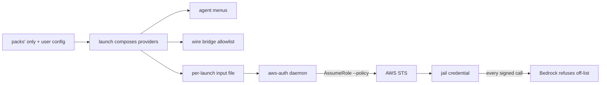

# A model outside the list cannot be called

**Status:** 2026-11-06. Nothing built. Code claims verified at `8987ad733`; AWS behavior SOURCED
from AWS's documentation the same day, and not yet measured against an account
([§9](#9-how-it-is-tested-and-what-done-looks-like)).

> **In short.** The only enforcement that holds "however the agent learned the id" is one the
> provider applies to the credential itself. For Bedrock that already exists: the `aws-auth`
> service mints the jail's credential with an STS session policy, so the narrowed model list
> becomes a deny statement in that policy, and AWS refuses every other model.

**Why it matters.** On 2026-11-06 a pi subagent in a jail called GPT-6 Sol on Bedrock when the
owner's menu offered only GPT-6.1 Sol: the subagent tool listed every model the region serves.
Every refusal yolo installs today lives in an agent's own config or on the wire bridge's path
([§2](#2-where-a-refusal-can-live-today)), so an agent that reads an id from anywhere else, and
sends it from its own client, is never refused.

**The shape.** One list, three readers: the pickers render it, the wire bridge refuses against it,
and the `aws-auth` service turns it into a session-policy statement at every mint
([§5](#5-where-it-is-enforced-the-mint)).

**Cost.** A launch whose agents reach Bedrock under a narrowed list gets a credential that cannot
call anything else, background requests included. A list longer than about a dozen entries does
not fit AWS's 2,048-character session-policy limit and is refused rather than widened
([§4.4](#44-the-size-limit)).

**Start at [§3](#3-the-enforced-set-one-list)**, the set itself; the ARNs and the mint follow from it.

**Needs your ruling:** [OQ-MA1](#OQ-MA1), [OQ-MA2](#OQ-MA2), [OQ-MA3](#OQ-MA3).

**Reads with:** [`model-allowlist-plan.md`](model-allowlist-plan.md) (the implementation plan's
seed, incomplete while the questions are open),
[`model-lists-and-pickers.md`](model-lists-and-pickers.md) (where the list comes from and how each
picker renders it), [`wire-bridge-gateway.md`](wire-bridge-gateway.md) (the bridge's allowlist,
which this design does not change), [`agent-credentials.md`](../reference/agent-credentials.md#sso-backed-bedrock-credentials-aws-auth)
(the `aws-auth` service this design extends).

---

## 1. The ask, and the verdict

The owner, 2026-11-06: *"I want to add a feature starting with bedrock, although I would like it
to cover everything eventually, where we can give a list of model IDs that are valid and disallow
everything outside that set. Ideally, this would be linked to … the model selections that we pass
around. … I would like to mechanically just prevent it even possibly using that model no matter
how it discovers it."* Fixing the subagent tool's list is out of scope; the owner is doing that
separately.

**Verdict.** Build credential enforcement for Bedrock first, because AWS evaluates every request
against the credential's session policy wherever the request was sent from. The enforced set is
the list the pickers already render under an `only` ([§3](#3-the-enforced-set-one-list)), so
there is one list and no second place to keep in step. Every other provider gets the
strongest point it offers, stated honestly in [§8](#8-other-providers-later), and for the
subscriptions that point is weaker than this one.

Three principles carry the rest:

- **P1. Narrow only.** Nothing this design adds can widen what a credential may do. The statement
  it adds is a deny; the user's own session policy, role and profile are untouched.
- **P2. One list.** The set a credential admits is exactly the set the menus show under an
  `only`. A model is never allowed without being offered, or offered without being allowed.
- **P3. Fail closed, and say so.** When the set cannot be turned into a policy, the mint refuses
  with the reason and the fix; it never falls back to an unrestricted credential.

## 2. Where a refusal can live today

Two terms are coined here, and the rest of the doc uses them:

- **Credential enforcement** *(coined here)* — the provider refuses the request because the
  credential that signed it does not permit that model. It holds for every request signed with the
  credential, from any process, by any client. It is not a check yolo runs.
- **Path enforcement** *(coined here)* — something yolo runs in the request's path refuses it. It
  holds only for requests that take that path. The wire bridge's allowlist is the one instance.

Neither is the same as a **menu**: what an agent offers. A menu steers; it refuses nothing.

| Point | Kind | What it guarantees | Built |
| :--- | :--- | :--- | :--- |
| claude's `availableModels`, opencode's `whitelist`, pi's refusing wrapper | agent-side refusal | that agent, used as configured, refuses an off-list id; four measured gaps on claude's side ([`model-lists-and-pickers.md` §14.2](model-lists-and-pickers.md#142-what-each-row-rests-on)) | ✅ under an `only` ([MM-D5](model-lists-and-pickers.md#MM-D5)) |
| pi's `enabledModels` | menu | nothing: Tab and `--model` reach every credentialed model ([pi's shortlist](../reference/providers.md#pi-enabledmodels-is-a-shortlist)) | ✅ |
| The wire bridge's allowlist | path enforcement | every request on the bridged path, refused with a 400 naming the list ([WG-I43](wire-bridge-gateway.md#WG-I43)) | ✅ ([§6.1](wire-bridge-gateway.md#61-how-the-allowlist-is-built)) |
| The `aws-auth` session policy | credential enforcement | every request signed with the jail's credential | the policy is passed today ([`mint.go`](../../internal/awsauth/mint.go), `AssumeArgv`); nothing writes a model list into it |

The owner's subagent fell through all four rows above the last: pi on `-p bedrock` calls Bedrock
with its own client, so the bridge never sees the request, and the subagent's menu came from the
region's whole list. The bridge runs in the jail and the caller token is a same-user file read
away ([`agent-credentials.md`](../reference/agent-credentials.md#what-crosses-into-the-jail)), so
even an agent on the bridged path can read the credential pointer and call Bedrock directly.
**Only the last row closes that.**

## 3. The enforced set: one list

### 3.1 Which list

The **enforced set** *(coined here)* of a provider is the set of wire ids its composed model list
holds, when two things are true:

1. an `only` narrowed that list (the composed `models_only` mark,
   [`modellists.go`](../../internal/packload/modellists.go)), and
2. the active profile's `enforce_models` is on, its default.

This is the set the wire bridge already refuses against ([WG-I40](wire-bridge-gateway.md#WG-I40)),
and the set claude, opencode and pi already render as their exact menus. Adding the credential is
adding one more refusal under the switch that governs every refusal
([MM-D5](model-lists-and-pickers.md#MM-D5)): *one switch decides every refusal*. A list with no
`only` refuses nothing, as [OQ-MM3](model-lists-and-pickers.md#OQ-MM3) ruled on 2026-10-15; that
ruling stands, and this design adds no second trigger for a refusal.

Today only a pack can write an `only`: a user's `providers.<name>` has no key for it
([`providerschema.go`](../../internal/config/providerschema.go)). The owner's own menu is a user
list, which therefore enforces nothing. How a user marks a list as the allowed set, with a config
verb, is [OQ-MA1](#OQ-MA1).

### 3.2 One credential, every agent in the launch

`aws-auth` serves **one credential per launch**: one daemon per jail, one pointer, one caller
token for every agent on a Bedrock provider ([`loophole.toml`](../../packs/aws-auth/loopholes/aws-auth/loophole.toml)).
A launch can put two agents on two Bedrock providers, or one provider under two profiles, so the
credential's set is computed over the launch, never per agent:

- **The credential's set is the union of the enforced sets** of every Bedrock provider a selected
  agent's active profile reaches.
- **If any such reach is not enforced** (no `only`, or `enforce_models` off), the credential gets
  no model statement, because restricting it would refuse an agent the user left unrestricted.
  The launch says which agent and profile lifted it ([§7.2](#72-what-the-user-sees)).
- **Per-agent credentials would not help.** Any jail process can read any agent's env file, so a
  narrower credential for one agent is a file read away from another
  ([`agent-credentials.md`](../reference/agent-credentials.md#what-crosses-into-the-jail)).

This is [WG-I40](wire-bridge-gateway.md#WG-I40)'s rule for the bridge's shared adapter route,
applied to the shared credential: refuse only what every sharer would refuse.

An agent whose pack declares `unlisted_background_models` (codex and copilot,
[WG-I41](wire-bridge-gateway.md#WG-I41)) sends background requests that may name off-list models.
The bridge admits those; whether the credential does is [OQ-MA3](#OQ-MA3).

### 3.3 Degenerate sets

| Case | Credential | Launch |
| :--- | :--- | :--- |
| No Bedrock provider reached | no pointer at all, as today | nothing new |
| Reached, nothing enforced | no model statement; today's credential | nothing new; `yolo check` notes it |
| Enforced, one or more ids | the statement of [§4](#4-from-ids-to-arns) | one disclosure line naming the count and source |
| Enforced, and the set is empty (an `only` intersection left nothing) | a statement that denies every model (P3) | a warning: every model call will be refused, with the verb that widens the list |
| Enforced, but the permission mode cannot carry a policy (`unnarrowed`) | [OQ-MA2](#OQ-MA2) | [OQ-MA2](#OQ-MA2) |

An empty enforced set is not "unset": the user asked for only these, and these are none.

### 3.4 What a running jail sees when the list changes

The set is computed when the launch composes its provider table, and the daemon reads it then
([§5.2](#52-how-the-set-reaches-the-daemon)). A running jail keeps the set it launched with
across every re-mint; a changed list applies at the next launch of that workspace. A list
changed from inside a jail is a config change, which reaches a launch only through the host's
config-change confirmation ([`config-safety.md`](../reference/config-safety.md)).

## 4. From ids to ARNs

### 4.1 Aliases and versions

The set holds **wire ids**: what an agent sends as the model. An alias (`default`, `fast`, `sol`)
is resolved to its id first and never appears in a policy; a row's `wire_id`, where it has one,
is the id ([`providers.md`](../reference/providers.md#wire-id)).

**Ids match exactly, never by prefix or version.** GPT-6.1 Sol and GPT-6 Sol are different
strings (`us.openai.gpt-6.1-sol` and, illustratively, `us.openai.gpt-6-sol`), so listing one admits
nothing of the other. This is deliberate: claude's own allowlist matches a plain id by
`-`-segment prefix, so a listed `gpt-6-sol` also admits `gpt-6-sol-<anything>`
([`model-lists-and-pickers.md` §14.2](model-lists-and-pickers.md#142-what-each-row-rests-on)),
and a credential that guessed families the same way would admit models nobody listed.

### 4.2 What AWS authorizes a call against

SOURCED from AWS's Bedrock User Guide, 2026-11-06:

- **On-demand foundation model** (`anthropic.…`, called by its own id): the
  `foundation-model/<id>` ARN in the source region.
- **Geographic inference profile** (`us.…`, `eu.…`, `apac.…`): the profile ARN, the foundation
  model in the source region, and the foundation model in every destination region the profile
  lists ([geographic cross-Region inference](https://docs.aws.amazon.com/bedrock/latest/userguide/geographic-cross-region-inference.html)).
- **Global inference profile** (`global.…`): the profile ARN, the foundation model in the source
  region, and the region-less `arn:aws:bedrock:::foundation-model/<id>`
  ([global cross-Region inference](https://docs.aws.amazon.com/bedrock/latest/userguide/global-cross-region-inference.html)).
- **runtime's OpenAI-compatible and Messages routes**: `bedrock:InvokeModel` and
  `…WithResponseStream`, plus `project/default`
  ([`bedrock-plumbing.md` §6.6](bedrock-plumbing.md#66-iam-per-use), its risk R5).
- **`bedrock-mantle`**, a user recipe rather than a shipped route, authorizes under its own
  `bedrock-mantle:*` actions, whose resource ARNs AWS does not document
  ([`bedrock-plumbing.md`](bedrock-plumbing.md#66-iam-per-use)).

### 4.3 The statement

For each id in the set, the daemon looks the id up in the region's list it already fetches and
caches with the profile's own credential ([`modellist.go`](../../internal/awsauth/modellist.go);
[OQ-MM6](model-lists-and-pickers.md#16-decision-ledger)):

| The id is, per AWS's own list | ARNs the statement admits |
| :--- | :--- |
| a system-defined inference profile | `arn:aws:bedrock:*:*:inference-profile/<id>`, and `arn:aws:bedrock:*::foundation-model/<backing id>` for each model AWS says backs it; for a `global.` profile, also `arn:aws:bedrock:::foundation-model/<backing id>` |
| a foundation model | `arn:aws:bedrock:*::foundation-model/<id>` |
| in neither list | both literal forms of the id, and the launch warns that the region does not list it |

The backing model comes from AWS's `ListInferenceProfiles` answer, never from stripping a
`us.` prefix: a model's identity is declared by AWS, not parsed from an id
([OQ-BR9](bedrock-plumbing.md#decision-ledger)'s rule). The region is a wildcard, so a profile
that gains a destination region keeps working.

The geography is still enforced: admitting `us.openai.gpt-6.1-sol` admits its backing model in
every region, but a call through `global.openai.gpt-6.1-sol` is also authorized against that
profile's own ARN, which is not admitted. Admitting the backing model also admits it on demand,
by its own id; that is the same model.

The statement itself:

```json
{ "Sid": "YoloModelAllowlist", "Effect": "Deny", "Action": "bedrock:*",
  "NotResource": [
    "arn:aws:bedrock:*:*:inference-profile/us.openai.gpt-6.1-sol",
    "arn:aws:bedrock:*::foundation-model/openai.gpt-6.1-sol",
    "arn:aws:bedrock:*:*:project/default" ] }
```

plus a second deny of `bedrock-mantle:*` on every resource, because mantle's resources cannot be
named. `bedrock:*` rather than the two invoke actions: the jail's credential is invoke-only by
design, and a deny on every Bedrock action outside the admitted ARNs also covers invoke-shaped
actions AWS adds later (asynchronous invoke, batch jobs). With no user session policy, the daemon
also writes `{"Effect": "Allow", "Action": "*", "Resource": "*"}`, so the role's own policy
remains the bound and the deny is the only narrowing.

### 4.4 The size limit

STS refuses a session policy whose plaintext exceeds 2,048 characters
([`AssumeRole`](https://docs.aws.amazon.com/STS/latest/APIReference/API_AssumeRole.html)).
Computed for this design's minified statements, with no user policy: an empty set costs 285
characters, ten geographic-profile entries 1,715, and ten global ones 2,075. So the budget is
about twelve geographic entries or nine global ones, fewer beside a user's own policy. Two
profiles of one model share their foundation-model ARN, which the composer writes once.

Over the limit the mint refuses, naming the count, the limit and two fixes: shorten the list, or
put the model restriction in the role's own policy and turn `enforce_models` off for the
credential. It never drops entries, merges ids into wildcards, or omits the statement (P1, P3).

## 5. Where it is enforced: the mint



### 5.1 Permission modes

The policy rides the `AssumeRole` the service already makes
([`agent-credentials.md`](../reference/agent-credentials.md#permission-modes)):

| Mode | Today | With an enforced set |
| :--- | :--- | :--- |
| `role_arn` and `session_policy` | `AssumeRole` with the user's policy | the user's statements, then the model statements appended |
| `role_arn` | `AssumeRole`, no policy | `AssumeRole` with the allow-all statement and the model statements |
| `unnarrowed` | no `AssumeRole`: the profile's own credentials | no call carries a policy: [OQ-MA2](#OQ-MA2) |

The user's session policy is user-scope only, because the workspace config is writable from
inside a jail ([OQ-SSO4](../reference/agent-credentials.md#sso-decision-ledger)). That ruling still
holds here: the enforced set can come from any config layer or pack, but it only ever appends a
deny, so a workspace can make the credential narrower and never broader (P1). The user's own
statements are copied unchanged.

### 5.2 How the set reaches the daemon

The launch writes the credential's set into the daemon's **per-launch input**, the private file
the `{launch_input}` token names ([`tokens.go`](../../internal/loopholedecl/tokens.go);
[BX-D12](pack-brokers.md#decision-ledger)'s one mechanism), from a new core-owned producer. The
producer names no AWS concept: it writes, for the providers whose credential pointer a pack
declares `served_by` this loophole, the union of [§3.2](#32-one-credential-every-agent-in-the-launch),
whether any reach lifted it, and the region. `aws-auth`'s manifest declares the producer, as
`mcp-auth` declares its own ([`loophole.toml`](../../packs/mcp-auth/loopholes/mcp-auth-broker/loophole.toml)).
The request a jail sends still names nothing that changes what is minted
([`handler.go`](../../internal/awsauthdaemon/handler.go)).

### 5.3 At the mint

1. Resolve each id to ARNs ([§4.3](#43-the-statement)) from the region's cached list. A stale
   list is good enough, since a profile's backing model does not change. With no list at all,
   fetch it once, within the existing budget.
2. If no list can be had, refuse the mint with the fetch's own failure and fix (`aws sso login
   --profile <p>`, or the list permission the profile lacks). The SDK puts that message in the
   agent's error ([`agent-credentials.md`](../reference/agent-credentials.md#when-the-sso-session-lapses)).
3. Compose the policy, check its size ([§4.4](#44-the-size-limit)), and pass it as `--policy`.
4. Cache the credential under the profile **and** the policy's digest. The cache is shared by
   every jail's daemon and keyed by profile alone today ([`state.go`](../../internal/awsauth/state.go)),
   so two jails with different sets would each read the other's entry as a miss and re-mint on
   every request.

A nested jail borrows its parent's pointer, so it gets the parent's credential, set included
([SSO-D3](../reference/agent-credentials.md#sso-decision-ledger)). At `yolo host` the same
daemon serves, but a `[default]` with credentials in the user's own `~/.aws` outranks the pointer,
as it does today, and yolo cannot see that.

## 6. What the user writes

Every step is a config verb. Today, with a pack:

```console
$ yolo pack add local/models          # a pack whose `models` contribution says `only`
$ yolo config set allow.aws-auth.role_arn arn:aws:iam::123456789012:role/BedrockInvoke
```

The first line needs a pack file written by hand, which the verb rule exists to avoid; the user
spelling is [OQ-MA1](#OQ-MA1). Turning the credential statement off for a profile is the
existing switch:

```console
$ yolo config set profiles.bedrock.enforce_models false
```

`yolo check` prints the credential's set beside the menus it already reports: the count, the ids,
the pack or config line each came from, the policy's size against the limit, and any agent whose
reach lifted it.

## 7. What a refused call looks like

### 7.1 What the agent sees

- **On its own client** (pi on `-p bedrock`, claude in Bedrock mode, codex): AWS's own
  `AccessDeniedException`, naming the action and the model's ARN. AWS documents that such a message
  names the policy type that denied it; that the Bedrock message says "explicit deny in a session
  policy" is to be measured ([§9](#9-how-it-is-tested-and-what-done-looks-like)). yolo cannot
  reword it.
- **On the bridge**: the bridge's own 400, naming the model, the list and the switch, before any
  upstream is dialed ([WG-I43](wire-bridge-gateway.md#WG-I43)). Unchanged; AWS would refuse the
  same request anyway.
- **In its briefing**: one line from the `aws-auth` pack, on every launch whose credential carries
  the statement, saying that an access-denied answer naming a session policy means the model is
  outside this jail's allowed set, listing the set, and saying the user changes it on the host.
  Listing the set needs the computed-briefing producer of
  [`computed-briefings.md`](computed-briefings.md); until it is built, the line names
  `yolo check` instead of the ids.

### 7.2 What the user sees

| When | Line | Next step it names |
| :--- | :--- | :--- |
| Every launch with a statement | `aws-auth: the Bedrock credential admits 4 models (us.openai.gpt-6.1-sol, …), from providers.bedrock's list` | the verb that changes the list |
| A reach lifted it | `aws-auth: the Bedrock credential admits every model — codex's profile codex-bedrock has enforce_models off` | the switch, or the profile |
| Empty set | a warning that every model call will be refused | the verb that widens the list |
| An id AWS does not list in the region | the existing currency warning ([MM-D16](model-lists-and-pickers.md#MM-D16)) | the list entry |
| Mint refused (too large, no list, `unnarrowed` under [OQ-MA2](#OQ-MA2)'s A) | the refusal, in the launch check and in each agent's AWS error | the fix, as [§4.4](#44-the-size-limit) and [§5.3](#53-at-the-mint) state |

The host never sees a refused model call made from an agent's own client: the request goes from
the jail to AWS. The record of such refusals is AWS's CloudTrail, under the same `yolo-jail`
session name the service uses today.

## 8. Other providers, later

| Provider | Credential reaches the jail as | Strongest point | What it can guarantee |
| :--- | :--- | :--- | :--- |
| Bedrock (`aws-auth`) | a short-lived STS credential, narrowed on the host | credential enforcement, this design | every signed call, from any process |
| `openai-codex` (`codex-auth`) | the subscription's access token, handed to the agent | agent-side refusal; path enforcement on a bridged profile | no credential enforcement: yolo knows no model scope it can put on the token. The list is the subscription's whole universe ([ML-D1](model-lists-and-pickers.md#ML-D1)), so the only narrowing is an `only` |
| Claude subscription (`claude-auth`) | the OAuth access token, refreshed through the broker | claude's own `availableModels`; path enforcement when routed through the bridge | no credential enforcement, for the same reason |
| HTTP gateways with an API key (OpenRouter, z.ai, Kilo) | the key, in the agent's environment | path enforcement on a bridged profile | the bridged path only, since the bridge runs in the jail and the key is readable there. A provider-side key scope, where a gateway offers one, would be credential enforcement; which gateways do is unsurveyed |

The general rule this table states: **credential enforcement needs a credential minted on the host
with a scope the provider checks.** For a provider without one, the wire bridge is the most a jail
can do, and it stops a misdirected agent, not a determined one. Moving a subscription's token out
of the jail, so only a host-side or bridge-side hop holds it, is
[Part 4](wire-bridge-gateway.md#5-part-4--the-subscription-arm-and-opt-in-failover-ruled)'s
territory, not this design's.

## 9. How it is tested, and what done looks like

No test runs an agent or calls AWS ([AGENTS.md](../../AGENTS.md#testing)). The `aws` CLI is
reached only through the existing `Runner` seam ([`mint.go`](../../internal/awsauth/mint.go)).

- **The composer is a pure function** from (set, region list, user policy) to policy text or a
  refusal. Table tests over fixture list answers: an on-demand id, a geographic and a global
  profile, two profiles sharing a model, an id in neither list, GPT-6 Sol beside GPT-6.1 Sol
  (exactly one admitted), an empty set, the user's `Statement` as an object and as an array, and
  the size boundary on both sides.
- **A small evaluator in the test package** applies the statement's deny-with-`NotResource` to the
  resource sets [§4.2](#42-what-aws-authorizes-a-call-against) lists per call type, and asserts
  which calls survive. It encodes AWS's documented evaluation, not AWS: it proves the composer
  matches the design, and the live measurement below proves the design matches AWS.
- **The mint's argv** carries the composed policy under each permission mode, through the `Runner`
  seam; a refusal runs no `aws`.
- **The producer** is tested through the launch's production call site, so the test fails when the
  call site is deleted: a launch over the shipped packs and a fixture pack's `only` writes the set,
  a second agent on an unenforced profile lifts it, and `unlisted_background_models` behaves as
  [OQ-MA3](#OQ-MA3) rules.
- **The cache** keeps two digests for one profile side by side.

**Done**, observably:

1. A launch with an `only` prints the admitted count and source, and `yolo check` lists the ids
   and the policy's size.
2. MEASURED by the maintainer against his account, with the CLI and no agent: a credential from
   that launch converses with `us.openai.gpt-6.1-sol` and is refused GPT-6 Sol, a global profile
   of an admitted model, and an off-list id on runtime's Responses route; the refusal text is
   recorded in this doc. Live Bedrock measurements without an agent are already authorized for
   this account.
3. The same measurement confirms whether `*` in the region field matches the region-less global
   ARN; if it does, the composer drops the third ARN of [§4.3](#43-the-statement).

## 10. Non-goals

- **Fixing what a subagent tool lists.** The owner is doing that separately.
- **A second list.** No allowlist key that differs from what the menus show (P2).
- **Prefix, family or version matching.** Ids are exact ([§4.1](#41-aliases-and-versions)).
- **Application inference profiles** in the first build. An application profile's ARN in the set
  is admitted literally and its backing model is not resolved, so a call through it is refused;
  `yolo check` says so.
- **Scoping `bedrock-mantle`** beyond denying it whole under a set.
- **Budgets, rate limits or spend caps.** The bridge refuses those too
  ([`wire-bridge-gateway.md` §7](wire-bridge-gateway.md#7-what-the-bridge-still-refuses)).
- **Credential enforcement for the subscriptions.** [§8](#8-other-providers-later) says why.

## 11. Alternatives considered

| Alternative | Verdict |
| :--- | :--- |
| Put every Bedrock agent on the bridge and enforce there | Rejected: path enforcement only. An agent can still read the pointer and sign its own request |
| A host-side proxy holding the credential | Rejected, as [`agent-credentials.md`](../reference/agent-credentials.md#sso-options) rejected it: the pointer design exists so no proxy carries model traffic |
| Condition keys instead of resolved ARNs: admit any foundation model when `bedrock:InferenceProfileArn` names an admitted profile | Rejected for the first build: it needs no list, but each id costs a third ARN, and an on-demand id cannot be told from a profile id without parsing it. Kept as the fallback if [§5.3](#53-at-the-mint)'s list dependency proves brittle |
| Wildcard families (`*openai.gpt-6.1-sol`) to fit more ids | Rejected: it admits every geography of the model, which a company choosing `us.` for data residency did not ask for |
| A managed policy the user creates, passed by ARN | Rejected: a second source of truth (P2). Still the user's fix when the list outgrows the limit, through the role's own policy |
| A distinct session name under a set, so AWS's refusal names the cause | Rejected: it changes the CloudTrail principal whenever a list changes, which an organization's audit may key on |

## 12. Risks

| Risk | Mitigation |
| :--- | :--- |
| **R1.** An agent's background request names an off-list model and fails mid-session | [OQ-MA3](#OQ-MA3) decides; either way the launch line names the agents that declare such traffic |
| **R2.** AWS adds a model-invoking action outside `bedrock:*` and `bedrock-mantle:*` | The statement is regenerated per mint; adding a prefix is one composer change. Recorded as a check in the seed |
| **R3.** The wildcard region does not match the region-less global ARN | The composer writes that ARN explicitly until [§9](#9-how-it-is-tested-and-what-done-looks-like)'s measurement says otherwise |
| **R4.** A company's existing `only`, written to shape menus, now also narrows the credential | Intended by P2 and [MM-D5](model-lists-and-pickers.md#MM-D5)'s one switch; the launch line discloses it, and `enforce_models` turns it off |
| **R5.** The list fetch fails and the mint refuses | The cache is reused at any age; the refusal names `aws sso login` or the missing list permission |

---

## 13. Open Questions

### Background to [OQ-MA1](#OQ-MA1)

A pack's `models` contribution has two verbs, `add` and `only`, and every `only` intersects
([§7.2 of the list design](model-lists-and-pickers.md#72-composition-rules)). A user's own
`providers.<name>.models` composes last, per alias, and carries no `only`. The owner ruled on
2026-10-15 that an `only` *"can be from the users config, the companies config, wherever"*
([OQ-MM3](model-lists-and-pickers.md#OQ-MM3)), but no user key spells one yet. Option A mirrors the
pack verb. Option B marks the composed list itself as the allowed set, so a model added to the
menu by any layer is allowed too, and a company's `only` still intersects with it. Under B the
key's name is `models_only`, the name the composed table already uses for this state.

### Background to [OQ-MA2](#OQ-MA2)

`unnarrowed` is a supported, user-only mode in which the service runs no `AssumeRole` and serves
the profile's own credentials ([`settings.go`](../../internal/awsauth/settings.go)). A session
policy is an argument to `AssumeRole`, and an AWS IAM Identity Center role cannot be assumed again
from itself without a trust policy the user cannot edit, so this mode has no place to put the
statement. Which company packs already ship an `only` to `unnarrowed` users is unsurveyed.

### Background to [OQ-MA3](#OQ-MA3)

codex's review and memories requests name models outside the picker, and which ids copilot's
background requests carry is unmeasured; both packs declare `unlisted_background_models`
([WG-I41](wire-bridge-gateway.md#WG-I41)), and the bridge admits whatever they send. The
credential is shared by the whole launch ([§3.2](#32-one-credential-every-agent-in-the-launch)).

1. 💬 **OQ-MA1: How do I say "only these Bedrock models" in my own config?**

   Matt's menu lists GPT-6.1 Sol through his own `providers.bedrock.models`. He wants that list
   enforced and runs a config verb on the host. Today no user key does it; only a pack's `only`
   enforces.

   - **A — A list of allowed ids.** `yolo config add providers.bedrock.only us.openai.gpt-6.1-sol`.
     Matt keeps two lists: the menu and the allowed ids. An id in one and not the other is dropped,
     and `yolo check` names it.
   - **B — A switch that makes the menu the allowed set.**
     `yolo config set providers.bedrock.models_only true`. One list: adding a model to the menu
     allows it. A pack that adds models to that provider widens the allowed set too, and the
     launch line names the pack.

   <!-- vantage: question id=OQ-MA1 leaning="B — one list is what was asked for, and two lists drift the way the subagent's did." -->

   _Leaning:_ B — one list is what was asked for, and two lists drift the way the subagent's did.

   **Answer:**
   > _(empty — fill in when decided)_

2. 💬 **OQ-MA2: What happens when the AWS credential cannot carry the restriction?**

   Priya's user config sets `allow.aws-auth.unnarrowed = true`, and her company's pack narrows
   Bedrock with an `only`. She runs `yolo -p bedrock -- pi`. With no role to assume, yolo has no
   way to make AWS refuse other models.

   - **A — Refuse the launch.** She reads: the Bedrock credential cannot enforce the model list
     without a role; set `allow.aws-auth.role_arn`, or turn `enforce_models` off. Nothing runs
     until she does one.
   - **B — Launch, and say so every time.** She reads, on every launch and in `yolo check`, that
     AWS does not enforce the list and why. Menus and the bridge still refuse.

   <!-- vantage: question id=OQ-MA2 leaning="B — unnarrowed is a supported mode, and refusing would stop launches that worked yesterday over a list written for menus." -->

   _Leaning:_ B — unnarrowed is a supported mode, and refusing would stop launches that worked
   yesterday over a list written for menus.

   **Answer:**
   > _(empty — fill in when decided)_

3. 💬 **OQ-MA3: Should codex's background requests be refused when they name an unlisted model?**

   Matt runs codex and pi in one jail on Bedrock, with GPT-6.1 Sol as the only allowed model.
   codex sends its review step to a model he did not list. Today the bridge lets that through,
   because codex's pack declares it.

   - **A — Lift the restriction for the whole launch.** codex's review works. The launch line
     says the credential admits every model because codex is in the jail, so pi is unrestricted too.
   - **B — Enforce anyway.** codex's review fails with AWS's access-denied error. Matt adds the
     review model to the list, or runs codex in a jail of its own.

   <!-- vantage: question id=OQ-MA3 leaning="B — the ask is that no model outside the set can be called, and A silently gives that up whenever codex is present." -->

   _Leaning:_ B — the ask is that no model outside the set can be called, and A silently gives
   that up whenever codex is present.

   **Answer:**
   > _(empty — fill in when decided)_

## 14. Decision Ledger

Implementation decisions with one right answer, made in this design:

| ID | Ruling / Decision | Date | Settled in | Built |
| :--- | :--- | :--- | :--- | :--- |
| <a id="MA-D1"></a>MA-D1 | Credential enforcement for Bedrock is a deny statement appended to the session policy the `aws-auth` service passes to `AssumeRole`; the user's own statements are copied unchanged, and a role with no user policy gets an allow-all statement beside the deny | 2026-11-06 | [§5.1](#51-permission-modes) | — |
| <a id="MA-D2"></a>MA-D2 | The enforced set is the composed list under an `only` with `enforce_models` on: the bridge's allowlist and the menus' list, under the one switch of [MM-D5](model-lists-and-pickers.md#MM-D5) | 2026-11-06 | [§3.1](#31-which-list) | — |
| <a id="MA-D3"></a>MA-D3 | One credential per launch carries the union of the enforced sets its agents reach; any unenforced reach lifts the statement, and the launch names it | 2026-11-06 | [§3.2](#32-one-credential-every-agent-in-the-launch) | — |
| <a id="MA-D4"></a>MA-D4 | The set reaches the daemon through `{launch_input}`, from a core-owned producer keyed on `served_by`, naming no AWS concept | 2026-11-06 | [§5.2](#52-how-the-set-reaches-the-daemon) | — |
| <a id="MA-D5"></a>MA-D5 | Ids become ARNs through AWS's own `ListInferenceProfiles` answer with a wildcard region, never by parsing a geographic prefix; the region-less global ARN is written explicitly until measured | 2026-11-06 | [§4.3](#43-the-statement) | — |
| <a id="MA-D6"></a>MA-D6 | The statement denies `bedrock:*` outside the admitted ARNs and `project/default`, and denies `bedrock-mantle:*` whole | 2026-11-06 | [§4.3](#43-the-statement) | — |
| <a id="MA-D7"></a>MA-D7 | An empty enforced set denies every model, with a warning naming the verb that widens it | 2026-11-06 | [§3.3](#33-degenerate-sets) | — |
| <a id="MA-D8"></a>MA-D8 | A policy over 2,048 characters refuses the mint, naming the count and both fixes; entries are never dropped or merged | 2026-11-06 | [§4.4](#44-the-size-limit) | — |
| <a id="MA-D9"></a>MA-D9 | The shared credential cache is keyed by profile and policy digest | 2026-11-06 | [§5.3](#53-at-the-mint) | — |
| <a id="MA-D10"></a>MA-D10 | With no region list at any age, the mint refuses with the fetch's own failure and fix | 2026-11-06 | [§5.3](#53-at-the-mint) | — |
| <a id="MA-D11"></a>MA-D11 | The role session name stays `yolo-jail` | 2026-11-06 | [§11](#11-alternatives-considered) | — |
| <a id="MA-D12"></a>MA-D12 | A running jail keeps the set it launched with; a changed list applies at the next launch | 2026-11-06 | [§3.4](#34-what-a-running-jail-sees-when-the-list-changes) | — |
