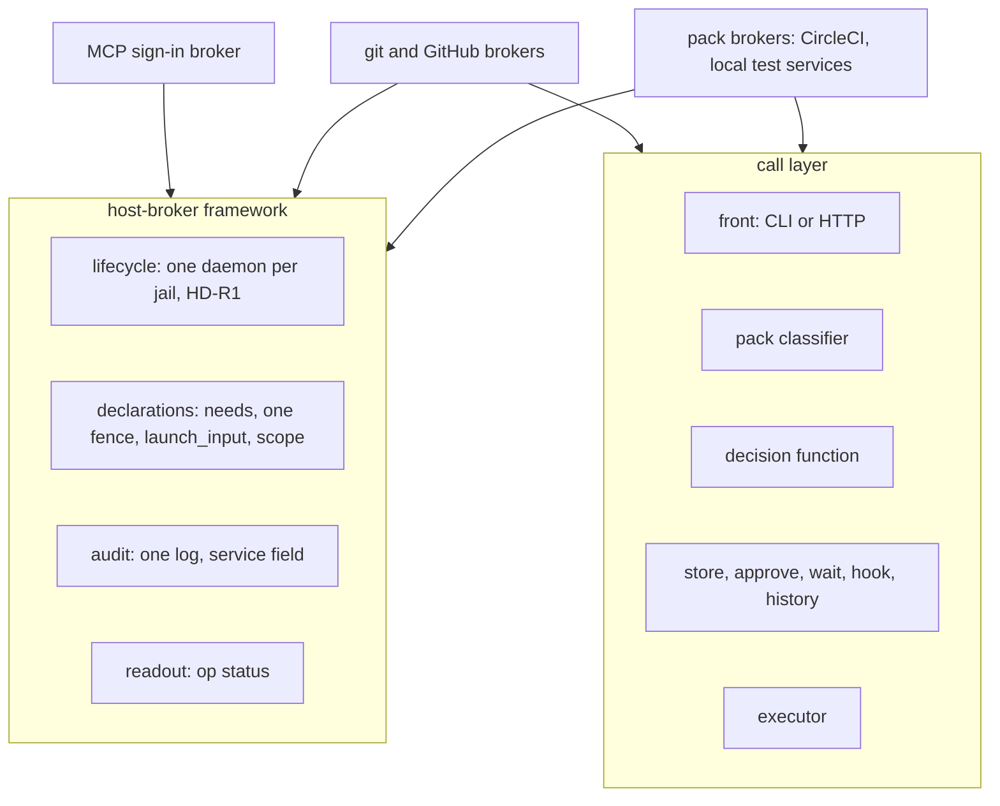

# Pack brokers: a third-party pack brokers its own service through core's grants, approvals and dry run

**Status:** 2026-11-04. Nothing built. Evidence read at `3ccc28def` on 2026-11-04; CircleCI's CLI
and API facts are from its published documentation and changelog of that date, not run. No `yolo`
or agent CLI was run.

> **In short.** A pack knows how to read a call; only core may decide one. So the extension point
> is a **classifier** the pack ships, and everything that grants, files, approves, executes or
> predicts stays in core. Core supplies CLI and HTTP executors by default; a pack supplies an
executor where core cannot apply its credential or prepare its call.

**Why it matters.** A downstream user built their own broker for several internal services
because yolo's approvals only exist for git and GitHub. Each such broker re-implements the store,
the menu, the wait and the audit, and none of them is covered by
[`yolo access`](access-introspection.md).

**The shape.** Two layers. The **host-broker framework** (lifecycle, declarations, fences, audit,
a readout line) is shared by every host daemon that holds a credential for a jail, the MCP sign-in
broker included. The **call layer** adds, for a pack that brokers calls, core's front, decision,
store, approvals and executors around the pack's classifier.

**Cost.** `yolo approve`, `yolo wait` and the config validator stop hard-listing the git and
GitHub sources. One new manifest block, one classifier protocol, two core executors, an in-jail
HTTP front, and a conformance kit.

**Start at [§5](#5-two-layers)**, then [§6](#6-the-decision-is-cores).

**Needs your ruling:** None. The design is settled; the build hand-off and implementation remain
pending.

**Reads with:** [`access-introspection.md`](access-introspection.md) (the readout and the dry run;
its decision function is the one every call broker uses),
[`pack-brokers-plan.md`](pack-brokers-plan.md) (the implementation plan's seed; not a hand-off),
[`mcp-auth-sharing.md`](mcp-auth-sharing.md) (the MCP sign-in broker; see
[§13](#13-coherence-with-the-mcp-sign-in-broker)).

---

## 1. The problem

The owner asked for a full extension point: a pack that is not yolo's, with no change to yolo
core, uses the grant, working-set, request, `yolo approve`, `yolo wait`, `yolo audit` and
`on_request` machinery as the git and GitHub brokers do, and the dry run covers it. CircleCI is
a built-in pack wrapping its CLI. Independently loadable test packs and local CLI/HTTP services
prove the extension point without a public-service account; a human can also operate them on
the host to demonstrate and learn the approval flow.

### 1.1 Requirements

| # | Requirement | From |
| :--- | :--- | :--- |
| R1 | A third-party pack brokers a service with no change to yolo's code | the owner |
| R2 | It uses the same grants, cells, working set, requests, `yolo approve`, `yolo wait`, `yolo audit`, `on_request` and gate as git and GitHub | the owner |
| R3 | `yolo access` reads and predicts its calls with the same guarantee as git's and GitHub's | the owner; [access-introspection R6](access-introspection.md#11-requirements) |
| R4 | One extension point serves a CLI-wrapping broker and an HTTP-wrapping broker | the owner's two proofs |
| R5 | CircleCI ships as a built-in pack wrapping its CLI; where the CLI falls short the design says so, and never silently falls back to the HTTP API | the owner |
| R6 | Local test CLI and HTTP services provide complete broker tests without Linear, CircleCI or another external account | the owner |
| R7 | One host-broker framework, not two: the MCP sign-in broker either fits it or this doc says exactly why not | the coordinator |
| R8 | Every refusal names its next step | [`happy-path-principle.md`](../reference/happy-path-principle.md) |
| R9 | A human can start and operate the local services on the host for demos, tests and learning, with a small documented control surface | the owner |
| R10 | Nested-jail tests use real fronts, transport, classifiers, approvals and executors against the local fixtures | the owner |

### 1.2 What a downstream user's broker asks for

A downstream user's broker, built outside yolo for internal HTTP and CLI services, is evidence of
what a pack would want to build. Each of its features, generalized, and where it lands:

| Feature | Lands | Why |
| :--- | :--- | :--- |
| Brokered HTTP and CLI calls to services yolo does not know | **Extension point** | This design |
| Per-call human approval for any such service | **Core** | Approvals are core's ([§6](#6-the-decision-is-cores)) |
| Time-windowed approvals | **Core**, `yolo approve --for`, capped by a per-cell maximum the pack declares | One store, one clock |
| Approvals that follow a conversation | **Out of scope** | No grant is scoped to a session ([BB-D83](boundary-broker.md#BB-D83)) |
| Previewing a batch of writes and approving them together | **Core, partly**: [OQ-AX1](access-introspection.md#decision-ledger) lets an agent file its requests before acting; an optional denial note is [OQ-BX5](#decision-ledger) | The preview is the dry run |
| Draft-only writes and author attribution | **Out of scope** here | A source's own policy; GitHub's lives in [`github-write-scopes.md`](github-write-scopes.md) |
| Desktop and chat notifications | **Core's `on_request` hook**; anything richer out of tree | The hook already serves any source |
| A web console of requests | **Out of tree**, on the CLI's stable surface | [`boundary-broker.md` §1.5](boundary-broker.md#15-the-maintainers-path-2026-10-23) |
| Work streams and a review inbox | **Out of scope** | Not an access question |
| Labelling calls with the session that made them | **Core**: the host-asserted jail identity is already on every call | The jail cannot label itself |
| MCP servers behind OAuth | **The MCP sign-in broker** ([§13](#13-coherence-with-the-mcp-sign-in-broker)) | Already designed |
| Object-store commands approved one by one | **Extension point**, a pack executor ([§8.3](#83-the-pack-executor)) | Its signing is not a header |
| Endpoint files kept outside per-launch storage; a keeper that restarts a dead daemon | **Not this design**; a backlog item for the host-daemon owners | Daemon plumbing, not access |

## 2. Terms

Every term is *(coined here)* unless it links elsewhere.

| Term | Meaning | What it is not |
| :--- | :--- | :--- |
| **host-broker framework** | What yolo gives every host daemon that holds a credential for a jail: lifecycle, pack declarations, fences, audit, the readout line ([§5.1](#51-the-host-broker-framework)) | Not a daemon; not the call layer |
| **call broker** | A framework daemon that forwards the jail's calls to a service with the host's credential and decides each one: git, GitHub, and every pack broker of this design | Not the MCP sign-in broker, which hands out a token and forwards no call |
| **pack broker** | A call broker a pack declares through this design's `call_broker` block | Not the git or GitHub broker, which core implements today |
| **front** | The jail-side end of a call broker: an intercepted CLI (**CLI front**) or a loopback HTTP endpoint (**HTTP front**) | Not the loopback-TLS front of [`loophole-transport.md`](../reference/loophole-transport.md), which carries the front's frames to the host |
| **classifier** | The pack's program that turns one call into a **classification**: its cell, its resource, its canonical form, and the lookups it needs ([§7.2](#72-the-classifier)) | Not the decision; it never sees standing or a credential |
| **canonical form** | The exact argv or request bytes core executes, produced by the classifier | Not the jail's bytes, which are never sent |
| **lookup** | A read the classifier asks core to run with the host's credential to learn a fact, such as which project a workflow belongs to | The same thing [`access-introspection.md`](access-introspection.md#2-terms) calls a **fact read**, seen from the classifier's side |
| **resource type** | A kind of thing a cell acts on (a pipeline, a workflow, an issue), with its parent type, declared by the pack | Not a cell |
| **scope root** | A resource the human approved at the gate as in scope for a workspace: a repository for a source rooted in git remotes, or a declared root such as a team | Not a grant: it says where calls may go, not which run |
| **executor** | What runs an allowed call with the host's credential: a **core executor** (CLI or HTTP), or the **pack executor** | Not the classifier |

Existing terms used as defined elsewhere: **cell**, **ceiling**, **ask**, **working set**
([`github-write-scopes.md`](github-write-scopes.md#1-the-cells)); **request**, **grant**, **timed
grant**, **Allow once** ([`boundary-broker.md` §1.3](boundary-broker.md#13-terms)); **prediction**,
**act mode**, **evaluate mode**, **decision function** ([`access-introspection.md`](access-introspection.md#2-terms)).

## 3. What exists today

| Fact | Where |
| :--- | :--- |
| A pack loophole's host daemon runs one per jail, started and ended with it, behind the loopback-TLS front, and learns the caller's jail from the connection preamble | [HD-R1](host-daemon-ownership.md#HD-R1), [`loophole-transport.md`](../reference/loophole-transport.md) |
| A third-party pack may ship a host program by URL and checksum; an official pack may not, its programs being yolo subcommands | [OQ-BP8](../reference/pack-binaries.md#OQ-BP8) |
| The `brokered` block declares a source, its forge host, its credential paths (fenced from `mounts`) and its grant kinds; core puts the scope in front of the human at the config-change gate and writes the approved scope to a per-launch file | `internal/loopholedecl` (`brokered.go`) |
| Generic loophole grant kinds, the user's ceiling `[allow.<pack>]` and the project's `[requests.<pack>]` already work for any pack loophole, but grant only per kind, not per call | [`loophole-grants.md`](../reference/loophole-grants.md) |
| The store, working set, limits and audit are written without a service name baked in: the source is a field | `internal/brokerstore`, `internal/brokeraudit` (`Service`) |
| `yolo approve` names the GitHub and git stores in its code and revalidates through each source's own package | `internal/cli/approve.go` (`ApprovalStore()`) |
| The `on_request` hook is notify-only and source-neutral | `internal/brokerhook` |
| A pack's `intercept` contribution puts a forwarder on the jail's PATH ahead of the real program, as the github pack does for `gh` | `packs/github/pack.toml` |
| [`loophole-grants.md` §8](../reference/loophole-grants.md#8-what-this-does-not-license) states the trust model: yolo does not enforce anything on a pack it does not ship | — |

**The gap.** Everything a pack needs exists except the seam: the decision, approvals and execution
are inside `internal/ghbroker` and `internal/gitbroker`, and `yolo approve` knows those two by name.

## 4. Principles

- <a id="BX-P1"></a>**BX-P1. The pack reads; core decides.** No protocol message lets a pack's
  program grant, file, answer, spend or widen anything.
- <a id="BX-P2"></a>**BX-P2. What was classified is what is sent.** Core executes the canonical
  form the classifier returned, never the jail's bytes, so a parser difference between the
  classifier and the service cannot smuggle a second call.
- <a id="BX-P3"></a>**BX-P3. The classifier holds no credential.** Its lookups go through core's
  executor under the read grant, audited like any read.
- <a id="BX-P4"></a>**BX-P4. Allowlist.** An argv word, flag, route or operation the classifier
  does not know is refused ([BB-P2](boundary-broker.md#BB-P2)).
- <a id="BX-P5"></a>**BX-P5. What a pack declares, the gate shows.** Cells, their shipped defaults,
  scope roots and any read-over-a-write-method exception appear in the config-change gate before a
  human's `y`.
- <a id="BX-P6"></a>**BX-P6. One framework.** Every host daemon holding a credential for a jail
  shares one lifecycle, one declaration shape, one fence, one audit log and one readout line,
  whether or not it brokers calls.

## 5. Two layers



### 5.1 The host-broker framework

Every host daemon that holds a host credential for a jail gets, from core:

- **Lifecycle.** Spawned per jail by the launch, detached at the jail's end
  ([HD-R1](host-daemon-ownership.md#HD-R1)), its endpoint published through the loophole transport.
- **Declarations.** The pack `needs` it; its scope, if it has one, goes through the gate.
- **One fence.** Every selected host-daemon loophole's state directory is fenced from `mounts`,
  read-only sources included: a source that is, contains or lies inside it is refused from
  workspace config and disclosed from user config. A loophole's `credential_paths` are added on top
  of that fence, never instead of it. The [MCP sign-in plan's ID-9](mcp-auth-sharing-plan.md#id-9)
  implements it: config validation refuses workspace sources reaching any selected host daemon's
  state directory, including read-only mounts, and discloses the same access at user scope.
- **One per-launch input.** What a launch computes for a daemon and hands it as a file reaches it
  through the `launch_input` key of `[host_daemon]` and its `{launch_input}` token, whose producers
  are a closed, core-owned set ([ID-4](mcp-auth-sharing-plan.md#id-4)). A call broker's approved
  scope roots are one more producer of that set, `call-broker-scope`; the `brokered` block's
  `{repository_scope}` stays as it is, and folding it into `launch_input` is one change that renames
  both, never a third mechanism.
- **Audit.** It writes the one host audit log with its `service`, read by `yolo audit --service`.
  `server` and `generation` are framework audit fields beside `service`, `event`, the
  host-asserted jail and the workspace: optional, set by the daemons whose records have them (the
  MCP sign-in broker), and never a token.
- **A readout line.** It answers the framework's readout request, `{"op":"status"}`, over its own
  endpoint, with whatever it holds for this workspace and never a secret; that answer is the
  daemon's line in [`access-introspection.md` §6](access-introspection.md#6-the-access-readout).
  A call broker answers the same request, and its answer is its whole readout.
- **Backend reach.** On a backend whose jail cannot reach host daemons (Apple Container today,
  except the daemons it admits by name), its readout line says unreachable and names the reason.
  The MCP sign-in broker shows that line on Apple Container until the MCP plan's phase C admits its
  daemon there.

### 5.2 The call layer

A call broker adds, all in core:

- The **front** in the jail, which forwards a call's bytes and nothing else.
- The **pipeline** of [`access-introspection.md` §5](access-introspection.md#5-one-pipeline-two-modes)
  in act and evaluate mode, with the pack's classifier as its classify step.
- The **store**, `yolo approve`, `yolo wait`, the `on_request` hook, `yolo history`, limits.
- The **executor** that runs the canonical form with the host's credential.

A pack broker's daemon *is* core's: the `call_broker` block replaces `host_daemon` for that
loophole, and the launch runs `yolo internal daemon call-broker` for it with the pack's
declaration. The pack ships only its classifier, and optionally a pack executor.

## 6. The decision is core's

The decision function is [`access-introspection.md` §5.2](access-introspection.md#52-the-decision-function),
the same ordered rules git and GitHub use. For a pack broker its inputs come from:

| Input | From |
| :--- | :--- |
| Refused classes | The classifier's `refused` answer, and core's own (an unknown cell, an undeclared resource type, an out-of-scope root) |
| Read grant | The pack's `read` standing, as for any grant-declaring loophole |
| Standing read | A classification whose cell is `read` |
| Cell values | `[requests.<pack>.working_set]` and `[requests.<pack>.all]`, merged as GitHub's are, under the ceiling `[allow.<pack>]`, with the invariant `working_set` ≥ `all` ([`github-write-scopes.md` §2](github-write-scopes.md#2-the-ceiling-and-the-ask)) |
| Working set | Entries of this source, matched against the resource **or any of its parents** in the classification's chain |
| Timed grants, Allow once | Core's store, bound to the command digest of the canonical form |
| Limits | Core's store |

A call that carries several writes, such as a GraphQL document with two mutations, is decided per
write, as a git push is per ref: it runs when every write runs, is refused when any is refused, and
otherwise asks once for the whole call.

**Revalidation in `yolo approve`** is source-neutral: core re-checks the stored classification's
scope root and the workspace's standing, as GitHub's `ApprovalAuthority` does today, and the act
that spends the approval classifies the call again from scratch. A classification that changed
between filing and spending no longer matches the stored digest, so it asks again.

**A denial may carry an optional note.** `yolo approve r-<id> --deny --note "use the release
branch"` records the note with that answer. `yolo wait` and `yolo history` show it as human
feedback, not as a command to execute or a new grant. This applies to every approval source,
including git and GitHub. A denial without a note retains its existing behavior.

## 7. What a pack declares

### 7.1 The block

```toml
# packs/circleci/loopholes/circleci-broker/loophole.toml (sketch; spellings are the plan's)
[call_broker]
source = "circleci"
front = "cli"                      # or "http"
program = "circleci"               # CLI front: the host program; intercepted in the jail
classifier = ["yolo", "internal", "call-broker-classify", "circleci"]
# Built-in classifier is a yolo subcommand; external packs may ship a program.
executor = "core"                  # pack executor where core cannot apply the call
credential_paths = ["~/.config/circleci"]
env_from_host = ["CIRCLE_TOKEN", "DBUS_SESSION_BUS_ADDRESS"]

[call_broker.scope]
roots = "remotes"                  # or "declared"
remote_host = "github.com"
root_template = "gh/{owner}/{repo}"

[[call_broker.resource]]
type = "pipeline"
parent = "project"
[[call_broker.resource]]
type = "workflow"
parent = "pipeline"

[[call_broker.cell]]
name = "rerun_workflows"
tables = ["working_set", "all"]
default = { working_set = true }   # shown at the gate and capped by the user ceiling
max_for = "8h"

[[call_broker.joins_working_set]]
cell = "trigger_pipelines"         # a pipeline the agent triggered joins
[[call_broker.joins_working_set]]
follows = { source = "git", fact = "branch" }   # so does one built from a branch in git's working set

[[call_broker.lookup]]
name = "workflow-project"
cli = ["workflow", "get", "{id}", "--json"]
```

Core validates the block at load, as it validates `brokered`: an unknown key is refused, a cell
name must not be `read`, every resource's parent must be declared, and a `joins_working_set` rule
naming another source names one the workspace selects.

**Scope roots** come in two forms:

- `remotes`: the workspace's git remotes on `remote_host`, mapped through `root_template`, exactly
  as the `brokered` block's scope is read today, plus `brokered.<source>.repos` widening.
- `declared`: roots the workspace lists in `brokered.<source>.roots`, such as `team:ENG`, shown in
  the gate's scope block like a widened repository.

### 7.2 The classifier

There is one classifier interface: a program, not a second declarative-pattern language. A
third-party pack may generate its program from a table. Built-in CircleCI uses a yolo
subcommand and declares no binaries, preserving
[OQ-BP8](../reference/pack-binaries.md#OQ-BP8). Independently loadable test packs use fixture
programs through the same interface, without adding their names to core.

The declared program is run by core as a subprocess per call with an empty environment beyond
`PATH`, an empty working directory, no TTY, a 2 s deadline and a 64 KiB answer cap. It is given
JSON on stdin and answers JSON on stdout:

| Given | Answers one of |
| :--- | :--- |
| The front, the call (argv and a stdin digest; or method, path, query, an allowlisted set of header names and values, body), the scope roots, and the results of any lookups it asked for earlier in this call | `lookups`: named lookups to run, with arguments; at most three rounds per call |
| | `classification`: the canonical form, and for each write in it: the cell, the resource with its parent chain up to a scope root, and a one-line description in the user's terms |
| | `refused`: a class, the reason, and the next step the pack knows |
| | `local`: the call is not the service's and runs in the jail as is (a CLI front's `--help`, `version`) |

It must be deterministic: the same input gives the same answer. Core enforces the deadline, the
cap, the round limit and the schema; the conformance kit checks determinism ([§19](#19-what-done-looks-like)).
A crash, a timeout or an answer that fails the schema refuses the call, naming the pack and its
version, and is audited as `classifier-failed`.

### 7.3 Lookups

A lookup is declared by the pack as a template, CLI argv or HTTP request, and run by core's
executor, never by the classifier. It must classify as a standing read under the pack's own
classifier; core checks this when the block loads, against the conformance fixtures, and again at
run time. A lookup that fails is a fact the classifier is given, and it usually answers `refused`
or classifies the write as asking.

### 7.4 Working-set rules

A third-party pack may ship working-set cell defaults that run without asking. The gate shows
each default before approval, and the user's ceiling still caps it; selecting a pack does not
silently widen that ceiling.

A resource joins the source's working set when:

1. a call in a `joins_working_set` cell creates it; the executor's output names the created id
   through a pack-declared extraction, given to the classifier as the last lookup round; or
2. a lookup's fact names a resource of another source's working set, as a `follows` rule declares:
   a CircleCI pipeline built from a branch the git broker's working set holds; or
3. a human hands it over with `yolo request <pack> working-set <resource>`, as GitHub's hand-over
   works.

Entries leave the set as GitHub's do. The cross-source rule reads only the other source's working
set for this workspace, never its grants.

## 8. What core runs

### 8.1 The CLI executor

Runs the host program the block names, as the host user, with the canonical argv, stdin as the
jail sent it (its digest is in the classification), an empty working directory, no TTY, and an
environment of `PATH`, `HOME` and the block's `env_from_host` taken from the host daemon's own
environment, never the jail's. The host program uses the host's own login, as `gh` does. Stdout,
stderr and the exit status cross back, through core's redactor when the pack declares a readable
credential value (an env var or a file key); a keyring-only login has no redaction backstop, and
the readout says so.

### 8.2 The HTTP executor

Sends the canonical request to the one host the block pins, with the credential header built from
the declared source (an env var or a 0600 file under a fenced path), and:

- follows no redirect: a 3xx crosses back as is, so a credential never reaches another host;
- sends no cookie and keeps none;
- caps the response at 32 MiB and streams it;
- refuses a credential found in a URL or query string in either direction;
- redacts the credential from the response.

**The method floor.** A non-safe method (anything but GET, HEAD, OPTIONS) can be classified `read`
only on a path the block declares `read_over_post`, which the gate shows. GraphQL needs it; a REST
API never should.

### 8.3 The pack executor

For a credential core cannot apply as a header: a request signature over the body (an object
store's), a token minted per call, or a CLI that must run in a prepared directory. Core spawns the
pack's executor only after the decision says the call runs, gives it the canonical form on stdin,
and relays what it prints. The pack's executor holds the credential; core still owns everything
before it and audits the result. Both executor kinds are supported: core executors are the
default, and a pack executor is reserved for calls core cannot apply.

## 9. The trust boundary

| Against | Holds because |
| :--- | :--- |
| **The jail forging an approval** | The store is host-only; the jail-readable approval records only mislead the agent that forges them |
| **The jail widening its reach** | Scope roots and cells reach a decision only through the gate; the jail sends call bytes and nothing else |
| **The jail smuggling a second call** | Core sends the canonical form ([BX-P2](#BX-P2)) |
| **The jail redirecting the credential** | The executors take no host, server, token or config argument from the jail; the classifier refuses any flag or header that names one |
| **A buggy classifier** | Schema, deadline, cap, round limit, the method floor, and lookups that must classify as reads; an unknown cell or resource type is refused by core |
| **A pack lying in its declarations** | The gate shows every cell, default, root form and floor exception before a `y` |

**Not defended: a malicious pack.** A pack's programs run as the host user, so one that wants to
can read the host's login or run `yolo approve` itself. That is the trust model
[`loophole-grants.md` §8](../reference/loophole-grants.md#8-what-this-does-not-license) already
states, and the pack exec banner at launch is where the human accepts it. Two cheap tripwires
catch a careless pack rather than a hostile one: no protocol verb decides, and `yolo approve`
refuses when its own process ancestry includes a call-broker daemon or a classifier, naming the
pack.

## 10. CLI and HTTP: what they share and where they differ

| | CLI front | HTTP front |
| :--- | :--- | :--- |
| In the jail | `intercept` puts a forwarder named for the program ahead of it on PATH | A loopback HTTP listener run by `yolo-jaild`; the pack's `env` names its URL in the variable the client reads, such as a base-URL setting |
| Identity, scope, decision, store, approvals, audit, dry run | Shared | Shared |
| What the classifier reads | argv and the stdin digest | method, path, query, allowlisted headers, body |
| Canonical form | argv | request bytes |
| Lookups | argv templates | request templates |
| Credential | The host program's own login | A header core builds from a declared source |
| Executor hazards | Host file writes by flag, a server or token flag, spawned helper programs, git pushes | Redirects, cookies, credentials in URLs, response size, non-safe methods that read |
| A refusal reaches the agent as | Exit 64 and the refusal text on stderr, as `gh`'s | Status 403 with headers `Yolo-Verdict` and `Yolo-Request`, and a body in the error shape the block declares (GraphQL's `errors` array for the local HTTP proof), whose message is the refusal text |
| An ask reaches the agent as | Exit 75 and the menu | Status 403, `Yolo-Verdict: asks`, the menu in the message |

## 11. Proof one: CircleCI, through its CLI

### 11.1 Why the CLI works here

The pack ships in `packs/circleci`; its classifier is a yolo subcommand, not a manifest binary.
Local fake CLI execution verifies the same classifier and approval wiring in nested jails. It
does not prove the real CLI's login or cloud behavior; those require separate compatibility
evidence. The local fixture must not silently replace the production host program.

CircleCI's current CLI (v1, a Go rewrite on API v3, generally available August 2026) has a verb
for everything an agent needs: listing and reading runs, workflows, jobs, test results and
pipelines; triggering, cancelling, rerunning and approving; reading and setting project
environment variables and contexts. The host's `circleci auth login` stores the token in the
host's keyring, and the host CLI reads it itself, so the jail never sees a token and core injects
nothing, as with `gh`.

### 11.2 Classification

| Command | Cell | Resource | Default |
| :--- | :--- | :--- | :--- |
| `run list/get/watch`, `workflow list/get`, `job get/output`, `job artifact` (listing), `testresult list/get`, `pipeline list`, `envvar list` (values masked), `context list/get`, `context secret list` (names only) | `read` | project, or the item's project by lookup | runs |
| `run trigger`, `pipeline run` | `trigger_pipelines` (joins the working set) | project | asks |
| `workflow rerun` (with or without `--from-failed`) | `rerun_workflows` | workflow → pipeline → project | working set: runs ([OQ-BX6](#decision-ledger)); otherwise asks |
| `run cancel`, `workflow cancel` | `cancel` | pipeline or workflow | working set: runs ([OQ-BX6](#decision-ledger)); otherwise asks |
| `run approve` (a hold job) | `approve_holds` | job → workflow → pipeline → project | asks, even in the working set: a hold is often a deploy gate |
| `envvar set/delete` | `project_envvars` | project | asks |
| `context create/delete`, `context secret set/delete` | `contexts` | the organization, by lookup; `all` table only | asks |
| `pipeline create`, `project` and `policy` writes | `project_settings` | project | asks |

A workflow, job or pipeline id is resolved to its project by a lookup (`workflow get`, `job get`)
before any write; the target must root in a scope root. A project named `circleci/<org>/<project>`
rather than by its VCS slug is resolved to its repository by lookup; one that has none is refused,
naming `brokered.circleci.repos`.

### 11.3 Refused, with the next step

| Command | Why | Next step the refusal names |
| :--- | :--- | :--- |
| `api <path>` | A raw passthrough to every API version: it would bypass every cell | the named verb, if v1 has one; otherwise none through the broker |
| `auth …`, `setting …`, a server flag, `CIRCLE_HOST` | Prints, moves or redirects the credential | the human's host login |
| `env subst` | Can print an injected token | — |
| `extension …`, `mcp …`, `completion install`, `update` | Runs or installs host programs, or serves on the host | run it on the host |
| `preflight run` | Pushes a branch | `git push`, through the git broker |
| `runner token create`, `runner config` | Prints a runner token | the host |
| `orb publish`, `namespace delete` | Irreversible and organization-wide | the host |
| `config generate`, `migrate actions`, `project link`, any `-o`/`--out` flag | Writes host files | the same command without the flag, where output can stream |

### 11.4 Where the CLI falls short

Said plainly, with no HTTP fallback behind any of them:

1. **Cloud only.** v1 speaks API v3, which CircleCI Server does not serve. A Server user's v0 CLI
   has a different grammar this pack does not classify; the daemon refuses to start against a host
   other than CircleCI's cloud, and the readout says so.
2. **No passthrough.** Anything only `circleci api` reaches is unavailable through the broker
   until v1 gains a verb for it.
3. **Files.** A command whose only output is a host file is refused; artifact download is out
   until the plan confirms it can stream to stdout.
4. **A local file input.** `config validate` reads a path; the broker never reads a jail-named
   path on the host, so it is refused until the plan confirms the CLI reads stdin.
5. **The keyring.** A host daemon started without a session bus cannot read a keyring login; the
   read fails, and the refusal names `circleci auth login --insecure-storage` or a host
   `CIRCLE_TOKEN` as the human's choice.
6. **No redaction backstop** for a keyring login, since core cannot read the token to look for it.
7. **A new CLI release's new flags** are refused until the classifier learns them
   ([BX-P4](#BX-P4)); yolo pins no CLI version.

## 12. Local proofs: CLI and HTTP services

### 12.1 What the fixtures prove

The **local proof services** *(coined here)* are small test services with a CLI client and an
HTTP interface, controlled entirely on the host. They are not public-service integrations and
use only synthetic credentials. They exercise the same broker fronts, transport, classifiers,
decision, approvals, executors and audit as a real service, without a CircleCI or Linear account.

The CLI proof covers argv, stdin, lookup-driven resource scope and host-program execution. The
HTTP proof covers method/path/body classification, credentials, redirects and canonical request
execution. Independently loadable fixture packs must work without adding their service names to
core; an in-tree CircleCI pack alone does not establish that extension property.

The services hold a small set of projects and work items with stable ids, parent scope, owner,
state and a write log. Humans and the broker see the same service state. A denied or predicted
write leaves that state and log unchanged; an approved act creates exactly the expected change.
They do not simulate the full CircleCI product.

### 12.2 Calls and failure scenarios

| Proof | Required cases | Observable result |
| :--- | :--- | :--- |
| CLI | List/get, create, update/rerun/cancel, parent lookup, stdin input; unknown or host-file/server/token flags | Reads return synthetic data; writes apply only after the broker permits them; forbidden flags refuse before the host client acts |
| HTTP | Reads and writes over JSON routes; a bounded GraphQL route with queries, mutations, aliases and operation selection | The classifier distinguishes reads from writes and executes only its canonical operation; a multi-write request is decided as a whole |
| Scope | Two projects, resources under each, unknown id and a lookup failure | An approved root does not cover another project; missing facts are reported rather than guessed |
| Approval | Working-set defaults, an uncovered write, timed and one-time approval, duplicate pre-ask, denial with a note | The gate/ceiling and existing limits apply; pre-ask files but does not execute or spend; the note appears in wait/history |
| HTTP guards | Redirect to another local endpoint, credential echo, credential in URL, oversized response, jail-supplied Authorization | No credential follows a redirect or crosses to the jail; the declared caps and refusal shape apply |
| Determinism | Same classification inputs in act and evaluate; changed standing or resource fact | Equal inputs produce equal decisions; real calls re-evaluate changed inputs |
| Custom execution | One synthetic signed-call case using a pack executor | Core approves the canonical call before giving it to the executor; the classifier never receives the synthetic credential |

The HTTP fixture uses a finite allowlist, not arbitrary code execution. A GraphQL query is a
read; a mutation is classified per top-level field; subscriptions and unknown fields refuse.
Multiple operations without an operation name refuse; the selected operation alone is
canonicalized. Its `read_over_post = ["/graphql"]` exception is shown at the gate, so a POST
is never presumed safe just because the fixture implements it.

Failures are explicit fixture scenarios, selected by the host operator or test harness, never
by a jail argument that can alter the broker's credential destination. Tests inspect the second
endpoint's request log to prove redirects do not leak the synthetic credential.

### 12.3 Host operation for demos and learning

A small repository tool supplies a documented way to:

- start the local service and print its address, synthetic identity and state location;
- seed two projects and work items, list/read them, and make a direct host-side change;
- inspect the state and write log while an agent predicts, asks and acts;
- select a failure scenario, reset the demo state, and stop the service.

The default listener is host loopback on a locally allocated port, and each run has private
fixture state. Persistence is opt-in to an explicitly chosen demo directory. Reset affects only
that fixture's state, never a real service, yolo's approval store or a real credential. Host-side
operation is direct and intentionally separate from the jail's brokered client, so a human can
compare the requested call with the resulting change. No web UI or production daemon is owed.

The demo guide walks a human through read, predict, pre-ask, approve once, act, denial with a note
and an out-of-scope refusal. It labels the services and credentials as synthetic, provides exact
build/start/stop commands once implemented, and distinguishes a direct host operation from a
brokered jail call. The selected fixture endpoint is pinned by host-side configuration approved
for that run; no jail-supplied server override can redirect the host credential.

### 12.4 End-to-end acceptance

Nested-jail tests start the local service on the host side of the test, load the fixture packs,
and send calls from the jail through the real fronts and approval transport. Assertions cover
service state, host write logs, request ids, working-set entries, grant use and audit events. A
fake classifier verdict or a unit-only executor test cannot stand in for this path.

The CircleCI pack's nested-jail fixture uses a fake host CLI with the supported grammar and
exercises its actual classifier. This proves policy and execution wiring, not the upstream
CircleCI CLI's account login, release compatibility or cloud behavior. Those facts require
separate compatibility evidence. Nested podman also cannot prove real rootless network
reachability; native/CI checks retain that boundary.

## 13. Coherence with the MCP sign-in broker

[`mcp-auth-sharing.md`](mcp-auth-sharing.md) is accepted and unbuilt. Its broker uses the
host-broker framework ([§5.1](#51-the-host-broker-framework)) and sits outside the call layer, for
three reasons: it forwards no call, so there is nothing to classify or decide; it files no request,
so approvals do not apply; and it deliberately hands an access token to the jail, the opposite of a
call broker, whose credential never crosses. Every touch point:

| Touch point | The MCP design | This design |
| :--- | :--- | :--- |
| Names | The pack `mcp-auth`, its loophole `mcp-auth-broker`, the verb `yolo mcp-auth` | The same names, everywhere this design and the readout use them |
| Lifecycle | `yolo internal daemon mcp-auth-broker`, one per jail, [HD-R1](host-daemon-ownership.md#HD-R1) | The framework's lifecycle, unchanged |
| Declarations | The `mcp-auth` pack, `needs`ed by every agent pack declaring `[[mcp_auth]]` | The framework's `needs`; no `call_broker` block |
| Per-launch input | The share file, through `launch_input = "mcp-auth-share"` and `{launch_input}` ([ID-4](mcp-auth-sharing-plan.md#id-4)) | The framework's one per-launch input mechanism; a call broker's scope is another producer of it |
| Fence | A host-only canonical store under the loophole's state directory ([ID-9](mcp-auth-sharing-plan.md#id-9)) | The framework's fence is every selected host daemon's state directory, with `credential_paths` on top |
| Audit | `service = "mcp-auth"`, events `adopt`, `refresh`, `sign-out`, `dead`, `seed`, `harvest`, `header`, with `server` and `generation` ([ID-10](mcp-auth-sharing-plan.md#id-10)) | `server` and `generation` are framework audit fields; never a token |
| Readout line | `{"op":"status"}` over its endpoint, rendering `yolo.mcp-auth.status/1`, the same object `yolo mcp-auth status` prints ([ID-8](mcp-auth-sharing-plan.md#id-8)) | `{"op":"status"}` is the framework's readout request; that object is the daemon's line in `yolo access` |
| Identity | `yolo mcp-auth header` answers by host-asserted identity and refuses a server the launch did not compose | The framework's identity; the refusal names its next step |
| Apple Container | The jail cannot reach the broker until phase C admits it; store entries are written at launch instead | The readout shows the framework's unreachable line there until phase C |
| Dry run | — | None: it decides no call ([access-introspection non-goals](access-introspection.md#10-non-goals)); the readout lists what it holds |
| Approvals, `yolo approve`, `yolo wait`, `yolo history` | Files no request | Never lists its records: they are sign-in records, not requests |

**A future MCP call broker**, one that keeps a server's token on the host and forwards each tool
call for approval, would be a pack broker with an HTTP front: a JSON-RPC `tools/call` classified by
its tool name. Nothing here builds it.

## 14. Failure paths

| Failure | What happens |
| :--- | :--- |
| The classifier is missing, fails its checksum, crashes or times out | Refused, naming the pack and its version; `yolo check` reports the pack; audited |
| A lookup fails | The classifier is told; the call is refused or asks, as it would in evaluate mode |
| The host program is missing | Refused, naming its install as the human's host step |
| The host login is missing or expired | The executor's failure crosses back, plus the pack-declared login hint as the next step |
| Two calls at once | Each runs its own pipeline; the store's lock serializes filing and spending, as for GitHub |
| A pack is removed while requests are pending | They expire on the store's clock; `yolo approve` lists them with the pack shown as removed and refuses to approve them |
| A pack upgrade changes a classification | A pending request's digest no longer matches; it asks again |
| The jail sends an `Authorization` header to the HTTP front | It is dropped, and the response says so in a header |

## 15. Non-goals

- **No change to the git and GitHub brokers' rules.** They move onto the shared decision function
  through [`access-introspection.md`](access-introspection.md); they keep their own front and
  classifier.
- **No declarative classifier language.** Every classifier is a program
  ([OQ-BX2](#decision-ledger)).
- **No host login verb.** A pack's credential is the host program's login or a declared file.
- **No defense against a malicious pack** ([§9](#9-the-trust-boundary)).
- **No CircleCI Server.**

## 16. Alternatives considered

| Alternative | Verdict |
| :--- | :--- |
| **The pack ships the whole daemon** and calls core's store as a library | Rejected: the pack would decide, and a bug would file or spend wrongly; [BX-P1](#BX-P1) |
| **A plugin loaded into yolo's process** | Rejected: Go plugins are fragile across builds, and it runs pack code with yolo's own state open |
| **CircleCI over API v2 instead of its CLI** | Rejected by the owner's direction; the CLI covers the agent's needs |
| **One generic HTTP broker with a route table and no classifier** | Rejected as the only form: GraphQL defeats it. A route table may be a classifier the pack writes |
| **The classifier gets the credential and does its own lookups** | Rejected: [BX-P3](#BX-P3); lookups would not be audited reads |

## 17. Risks

| Risk | Mitigation |
| :--- | :--- |
| A classifier misreads a write as a read | The method floor; lookups must classify as reads; the conformance kit's fixtures; the audit shows every read |
| The classifier's latency on every call | One subprocess per call with a 2 s deadline; the plan measures it, and a long-lived classifier is a later change if it bites |
| A pack's shipped working-set defaults are too generous | The gate shows each default ([BX-P5](#BX-P5)) and the user ceiling caps it ([OQ-BX6](#decision-ledger)) |
| CircleCI's CLI moves fast | Unknown words are refused, not passed |

## 18. What I would build, in order

1. **Source-neutral approvals.** `yolo approve`, `yolo wait` and the config validator read sources
   from the selected packs' declarations instead of naming git and GitHub. No behavior change.
2. **The framework's `{"op":"status"}` readout request** and its audit fields for every host
   daemon. The fence and `launch_input` arrive with the MCP sign-in plan; this design reuses them.
3. **The `call_broker` block, the classifier protocol and the CLI executor**, with the CircleCI
   pack as the first user.
4. **The local test CLI and HTTP services**, their independently loadable fixture packs and
   small host-operated demo controls; the HTTP proof includes a bounded GraphQL route.
5. **The HTTP front and executor, and the pack executor**, exercised against those services.
6. **The conformance kit and nested-jail end-to-end tests**, plus the host demo guide.

## 19. What done looks like

- With the CircleCI pack selected and `circleci auth login` done on the host, `circleci run list`
  in the jail lists runs; `circleci workflow rerun <id>` on a workflow of a pipeline built from the
  agent's pushed branch runs unasked; the same on another branch's workflow asks, with a menu that
  `yolo approve r-<id>` answers.
- `yolo access -- circleci run approve <job>` predicts `asks`, naming `approve_holds`.
- `circleci api /me` is refused, naming the named verb.
- The local CLI and HTTP proofs run end to end in nested jails without an external account.
  Predicting or pre-asking a write changes no fixture state; approval followed by act changes
  it once. An out-of-scope project refuses before the service receives a write.
- A human on the host can start, seed, inspect, change, reset and stop the demo services, and
  follow a short guide through approval and denial with a note. The demo changes only synthetic
  state and credentials.
- `yolo audit --service circleci` lists every call, read or write, refused included.
- **The conformance kit** *(coined here)*: a command a pack author runs against their pack that
  feeds its fixtures through the classifier twice (determinism), through act and evaluate mode
  (same verdict), checks each lookup classifies as a read, and checks the block loads. A pack
  broker is done when the kit passes.

## Decision Ledger

Owner rulings and designer decisions are recorded below. A settled decision is not evidence
that its implementation is built.

| ID | Ruling / Decision | Date | Settled in | Built |
| :--- | :--- | :--- | :--- | :--- |
| OQ-BX1 | Both executor forms: core CLI/HTTP by default, pack executor where core cannot sign or prepare the call | 2026-11-04 | [§8](#8-what-core-runs) | — |
| OQ-BX2 | Classifiers are programs; a pack may generate its program from a table, with no second classifier language in core | 2026-11-04 | [§7.2](#72-the-classifier) | — |
| OQ-BX3 | Ship CircleCI as a built-in pack; prove extensibility with local test packs/services and nested-jail end-to-end tests, not a separately hosted CircleCI pack | 2026-11-04 | [§11.1](#111-why-the-cli-works-here) | — |
| OQ-BX4 | Replace the public-service proof with local test CLI and HTTP services a human can operate on the host for demos, testing and learning | 2026-11-04 | [§12](#12-local-proofs-cli-and-http-services) | — |
| OQ-BX5 | Optional denial note appears in yolo wait and yolo history for every approval source | 2026-11-04 | [§6](#6-the-decision-is-cores) | — |
| OQ-BX6 | Third-party working-set defaults may run unasked after the gate shows each one, bounded by the user ceiling | 2026-11-04 | [§7.4](#74-working-set-rules) | — |
| BX-D1 | Two layers: the host-broker framework for every credential daemon, and the call layer for brokers of calls | 2026-11-04 | [§5](#5-two-layers) | — |
| BX-D2 | A pack broker's daemon is core's; the pack ships a classifier and optionally an executor | 2026-11-04 | [§5.2](#52-the-call-layer) | — |
| BX-D3 | Core executes the classifier's canonical form, never the jail's bytes | 2026-11-04 | [§4](#4-principles) | — |
| BX-D4 | Lookups run through core's executor and must classify as reads | 2026-11-04 | [§7.3](#73-lookups) | — |
| BX-D5 | Scope roots are the workspace's remotes or roots declared in the workspace config, both through the gate | 2026-11-04 | [§7.1](#71-the-block) | — |
| BX-D6 | A resource may join a source's working set by following another source's working set, as declared | 2026-11-04 | [§7.4](#74-working-set-rules) | — |
| BX-D7 | A call with several writes is decided per write; it asks once for the whole call | 2026-11-04 | [§6](#6-the-decision-is-cores) | — |
| BX-D8 | The HTTP executor follows no redirect, and a non-safe method reads only on a declared, gate-shown path | 2026-11-04 | [§8.2](#82-the-http-executor) | — |
| BX-D9 | The MCP sign-in broker uses the framework and not the call layer | 2026-11-04 | [§13](#13-coherence-with-the-mcp-sign-in-broker) | — |
| BX-D10 | CircleCI's `api` passthrough is refused; the CLI's shortfalls are stated and not filled from the HTTP API | 2026-11-04 | [§11.4](#114-where-the-cli-falls-short) | — |
| BX-D11 | The framework's fence is every selected host-daemon loophole's state directory, read-only `mounts` included; `credential_paths` adds to it. Adopted from the MCP sign-in plan's ID-9 | 2026-11-04 | [§5.1](#51-the-host-broker-framework) | Implemented |
| BX-D12 | One per-launch input mechanism: `launch_input` and `{launch_input}`, with a closed core-owned producer set; a call broker's scope is a producer of it. Renaming either is one change that renames both | 2026-11-04 | [§5.1](#51-the-host-broker-framework) | — |
| BX-D13 | `{"op":"status"}` is the framework's readout request, for credential daemons and call brokers alike | 2026-11-04 | [§5.1](#51-the-host-broker-framework) | — |
| BX-D14 | `server` and `generation` are framework audit fields, optional per daemon | 2026-11-04 | [§5.1](#51-the-host-broker-framework) | — |
| BX-D15 | On Apple Container the MCP sign-in broker's readout line is the framework's unreachable line until the MCP plan's phase C admits it | 2026-11-04 | [§13](#13-coherence-with-the-mcp-sign-in-broker) | — |
| BX-D16 | Names are the MCP design's (`mcp-auth`, `mcp-auth-broker`, `yolo mcp-auth`); its records are never listed by `yolo approve`, `yolo wait` or `yolo history` | 2026-11-04 | [§13](#13-coherence-with-the-mcp-sign-in-broker) | — |
