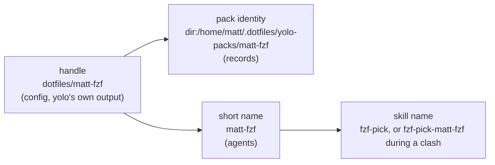

# One pack, three names — and why no agent should ever read `yolo-packs_2fmatt:foo`

**Status:** 2026-10-31. Nothing built. Evidence verified at `42d9a7cdf` (main) and at
`576fe4f01` (the held worktree); agent behavior read from the bundles installed in this jail the
same day ([§5](#5-how-each-agent-treats-a-skill-name)).

> **In short.** A pack's config handle, the key its records sit under, and the name an agent
> invokes are three jobs that want three different strings, and every defect here comes from one
> string doing all three. Keep the handle for config and yolo's own output, key records on where
> the pack lives, and give an agent the shortest name that is unique in the selected set: the
> bare skill, with the pack's own short name added only while two packs ship one skill.

**Why it matters.** Escaping the handle into the agent's namespace produced
`/yolo-packs_2fmatt:foo`, which is unreadable and is not even a legal Copilot plugin name; using
the handle's last segment instead lets `dotfiles/tools` and `acme/tools` meet.

**The shape.** The handle (the user's words) determines a pack identity (what records key on) and
a short name (what agents see); only the source name in the handle is ever edited by hand.

**Cost.** One more record-key migration under the journal [RC-D47](readable-config.md#RC-D47)
built; the namespaced opt-in changes spelling or goes ([OQ-PN3](#OQ-PN3)); the 2026-08-05 rule
that a skill clash refuses the launch is replaced if [OQ-PN1](#OQ-PN1) rules so.

**Start at [§4](#4-the-proposal-three-names-three-jobs)** — the three names. The rest falls out of it.

**Needs your ruling:** [OQ-PN1](#OQ-PN1), [OQ-PN2](#OQ-PN2), [OQ-PN3](#OQ-PN3),
[OQ-PN4](#OQ-PN4), [OQ-PN5](#OQ-PN5), [OQ-PN6](#OQ-PN6), [OQ-PN7](#OQ-PN7).

**Reads with:** [`readable-config.md`](readable-config.md) (the rulings this keeps),
[`config-user.md` §4](config-user.md#4-naming-a-pack-that-is-not-shipped) (the handle grammar),
[`pack-system.md`](../reference/pack-system.md#skills-collision) (today's skill-clash refusal).
No implementation-plan seed is open yet; the build order in [§11](#11-build-order) is its first
content once this is accepted.

---

## 1. What the owner asked for

Five statements, all from 2026-10-31, in the order they were made. Each is a requirement the
design is checked against in [§4.7](#47-why-nothing-can-collide).

- **R1 — no escaped names.** On the escaped skill name `/yolo-packs_2fmatt:foo`: *"that is super
  ugly and I hate it. why are we doing this?"*
- **R2 — one coherent model, short names.** *"I think we need to take these issues as a coherent
  whole because changing one thing in one place makes things worse than the other. … I hate having
  so many separators. I hate having so many prefixes with skills we now have essentially three
  name parts: where it came from, which pack it's from, and then which skill it is, which is going
  to be so long that nobody's going to have any idea what any of their skills mean anymore,
  because they're not even going to be able to read the skill name because it's going to just be
  all prefix until it's cut off."*
- **R3 — renamable source names.** *"yolo-packs is a weird name. That's an artifact of the
  organization in my config file, not about any mental model I have about what things are named.
  So I'm thinking that we also probably need to allow people to rename this part of the names
  because just the directory base name is not always going to be right."*
- **R4 — collision-free without the user arbitrating.** *"we need to make sure that names from
  different packs aren't going to collide, even though we get customization here. I don't want a
  situation where two third-party packs have the chance to collide, and the user is now in the
  position of trying to divvy up the namespace."*
- **R5 — shipped packs.** How shipped packs are named, and whether the absence of a prefix is
  enough to signal a yolo built-in.

### 1.1 Rulings this design keeps

| Ruling | What it says | What this design does with it |
| :--- | :--- | :--- |
| [OQ-RC15](readable-config.md#decision-ledger) (2026-10-25) | *"A pack yolo does not ship is named by its source … the shipped set is the only bare namespace, as core is."* `local/<name>`, `<source>/<name>`, `<owner>/<repo>`; no bare path form | **Kept whole** for config and for every place yolo names a pack back to the user (the list in [`config-user.md` §4](config-user.md#4-naming-a-pack-that-is-not-shipped)). Agent-facing names were never on that list; [§4.3](#43-the-short-name--what-agents-see) gives them their own rule. No amendment is proposed |
| [RC-D43](readable-config.md#RC-D43) (2026-10-31) | `yolo config migrate` turns a legacy path into `[pack_sources.<dir basename>]` plus `<basename>/<pack>` | Kept; its default source name is the subject of [OQ-PN6](#OQ-PN6) |
| [RC-D47](readable-config.md#RC-D47) (2026-10-31) | A rename carries every name-keyed record inside the journaled migration | Kept as the mechanism; [OQ-PN4](#OQ-PN4) decides whether records stay keyed by name at all |
| The skill-clash refusal ([`pack-system.md`](../reference/pack-system.md#skills-collision), 2026-08-05; jail parity 2026-09-28) | Two packs shipping one unnamespaced skill name is fatal, the local pack included | Re-asked as [OQ-PN1](#OQ-PN1), because R4 forbids its remedy for two third-party packs |
| Per-pack tier (S2, [`packdecl.go`](../../internal/packdecl/packdecl.go#L80-L103)) | *"a tier decides what a skill is CALLED, which is a global property"* | Kept and generalized: one skill has one name at every agent ([§4.4](#44-skills-bare-by-default-qualified-only-during-a-clash)) |

## 2. Where a pack's name appears today

Every surface where a pack's name ends up, verified 2026-10-31. "Held fix" is the unlanded
worktree `agent-aa30e25b86a0e5a26` (commits `5a4b8dbb9`, `3551eec58`, `576fe4f01`), whose
ledger row RC-D48 spells every slashed name as one escaped path component.

| Surface | Read by | Main today | With the held fix | Evidence |
| :--- | :--- | :--- | :--- | :--- |
| `packs` entry | the user | handle, `dotfiles/matt-fzf` | same | [`references.go:96`](../../internal/packsrc/references.go#L96) |
| `[pack_sources]` key | the user | user-chosen; migration defaults to the directory's base name, `-2` on a repeat | same | [`configmigrate/packs.go:137`](../../internal/configmigrate/packs.go#L137-L165) |
| launch pack line, `pack ls`/`explain`/`footprint`/`lint` | the user | handle | same | [`config-user.md` §4](config-user.md#4-naming-a-pack-that-is-not-shipped) |
| staged tree directory | nobody | the name escaped (`_2f` for `/`) | same | [`config/packs.go:148`](../../internal/config/packs.go#L148) |
| `packs.lock.json`, `forks.lock.json` (`<pack>/<bin>`), check records, build receipts, host program records, host-skills manifest owners | yolo | keyed by name, which is the handle | same; the jail now keys as the launch does | [RC-D47](readable-config.md#RC-D47) |
| a skill, default (flat) tier | the agent | `/<skill>`; two packs with one name refuse the launch | same | [`tier.go:39`](../../internal/hostskills/tier.go#L39) |
| a skill, namespaced opt-in | the agent | `/<pack>:<skill>`, plugin named by the raw name (a nested directory for a slashed one) | `/yolo-packs_2fmatt:foo` | [`packdecl.go:80`](../../internal/packdecl/packdecl.go#L80-L103) |
| a wrapped plugin | the agent | the plugin manifest's own name; two packs claiming one plugin name are refused | same | [`plugin.go`](../../internal/hostskills/plugin.go) |
| a `files` contribution in another pack's slot | the agent's loader | `<slot>/<pack>` (raw name, nested for a slashed one) | `<slot>/yolo-packs_2fpi-fork` | [`mergedest.go:566`](../../internal/packload/mergedest.go#L566-L600) |
| a `reads-host` grant with no `into` | the agent, via its briefing | `/ctx/host-<staged directory>/<file>` | same | [`packload.go:571`](../../internal/packload/packload.go#L571-L576) |
| briefing provenance label | the user reading a composed `CLAUDE.md` | `<!-- from pack: NAME -->` | same | [`briefing.go:1184`](../../internal/jailcontent/briefing.go#L1184) |

**The size of it.** No shipped pack and none of the owner's seven dotfiles packs declares
`skills_tier = "namespaced"` (checked 2026-10-31 through the github broker), so the escaped skill
namespace R1 reacts to has no real user yet; the `files` landing and the `/ctx` directory do. The
owner's selected set has no skill clash today, since the refusal would have stopped every launch.

## 3. The tension, named

Four properties are wanted, and without a registry they cannot all hold at once:

1. **Short** — at most two parts, one separator, readable when a picker cuts it off (R2).
2. **Collision-free** — two packs never yield one name (R4).
3. **Registry-free** — any directory or repository is a pack; nobody hands out names.
4. **No user arbitration** — the user never picks names to make third-party packs fit (R4).

Two authors with no registry can both call a pack `tools` and a skill `review`. Something has to
give: either the name grows (Homebrew's `user/repo/name`), a registry renames one (Claude Code's
marketplace `renames` table), one silently loses (pi keeps the first one found,
[§5](#5-how-each-agent-treats-a-skill-name)), or a human chooses (today's refusal).

**This design gives up stability under change instead.** A name is a function of the selected
set: it is the bare skill while it is unique, and grows the pack's short name only while a second
selected pack ships the same one. Adding a pack can therefore rename a skill the user already
knows, and the launch says so every time ([§9](#9-what-done-looks-like)). Every alternative pays
with one of the four properties ([§6](#6-alternatives-considered)).

A second tension sits under the spelling: **one spelling at every agent, or the richest spelling
each agent supports.** Claude Code, Copilot and Codex namespace plugin skills as `plugin:skill`;
pi has no namespace and limits a skill name to lowercase letters, digits and hyphens. The
parity principle (every agent gets the same behavior) picks one spelling that every agent can
carry, and that is [OQ-PN2](#OQ-PN2).

## 4. The proposal: three names, three jobs

**P1. Each name has one job, and no surface reads a name that is not its own.** yolo's output reads
the handle, state reads the identity, agents read the short name.

**P2. An agent-facing name is never escaped and never contains a source name** unless two selected
packs share a pack name, and then only for those packs.

**P3. Uniqueness is computed by yolo from the selected set; the only names a user may ever be asked
to change are their own source names.** Never a pack's, never a skill's.

### 4.1 The handle — config and yolo's own output

[OQ-RC15](readable-config.md#decision-ledger) is kept exactly: shipped packs bare (`yolo/<name>`
accepted), `local/<name>`, `<source>/<name>` through `[pack_sources]`, `<owner>/<repo>` for a
repository that is one pack. The handle stays the name on every surface yolo prints to the user,
and in config tables keyed by pack (`[allow."local/my-auth"]`). The briefing provenance label
uses the handle too: its job is to send the reader to a config line, it is never typed, and no
picker truncates it.

The handle **stops being** a record key ([§4.2](#42-the-pack-identity--what-records-key-on)) and
**never becomes** an agent-facing name ([§4.3](#43-the-short-name--what-agents-see)).

### 4.2 The pack identity — what records key on

**Pack identity** *(coined here)*: the canonical place a pack is read from, independent of what
the user calls it. Not the handle (that is the user's label) and not a content hash (content
changes every commit).

| Pack | Identity |
| :--- | :--- |
| shipped | `yolo:<name>` (a shipped pack's `formerly` rename moves it, as today) |
| a local directory (`local/…` or a local source) | `dir:<physical path>`, symlinks resolved as `packsrc.LocalDirectoryIdentity` already does |
| a pack inside a git source | `git:<normalized repository>//<subdirectory>`, no ref |
| a repository that is one pack | `git:<normalized repository>`, no ref |

Every record keyed by a pack name today moves to the identity: the `packs.lock.json` entry, fork
pins (`<identity>` + `<bin>`), check records, build receipts, host program records, the
host-skills manifest owners and the namespaced plugin manifest's `x-yolo-pack`. Each record also
stores the handle it was last written under, for display only. CLI arguments keep taking
handles: `yolo pack status dotfiles/pi-fork/pi` resolves the handle to an identity first.

With records keyed this way, renaming a source moves no state, and two handles naming one
directory are already refused (`duplicate local pack directory`,
[`readablepacks.go:78`](../../internal/config/readablepacks.go#L78)). The cost is the mirror image: moving
a pack's directory or repository changes its identity, so its pins and build receipts start over.
[OQ-PN4](#OQ-PN4) asks which of the two moves should be free.

The staged tree directory stays the escaped handle: nobody reads it, and the escape is injective.

### 4.3 The short name — what agents see

**Short name** *(coined here)*: the pack's name as an agent sees it. It is the handle's last
segment (`matt-fzf`, `pi-fork`, `matt-craft` for `{ git = …/mschulkind-oss/matt-craft }`, the bare
name for a shipped pack), **normalized** to what every agent accepts: lowercased, every character
outside `a-z`, `0-9`, `-` replaced by `-`, runs of `-` collapsed, leading and trailing `-`
dropped. It is not the handle and not the manifest's `name`, which stays informational
([`packload.go:38`](../../internal/packload/packload.go#L38-L75)).

Computed once per launch (and per `yolo host apply`) over the selected packs, in this order:

1. Every selected pack gets its normalized last segment.
2. A shipped pack keeps its short name unconditionally. Shipped names are distinct by construction,
   and [OQ-RC15](readable-config.md#decision-ledger) makes the shipped set the only bare namespace.
3. Every third-party pack whose short name equals another selected pack's — a second third-party
   pack, or a selected shipped one — becomes **qualified**: the normalized
   `<source name>-<pack segment>`. All members of a clash are qualified, not all but the first, so
   config order never decides who keeps the plain name.
4. If two short names still coincide (only hyphenation can do it: source `a-b` with pack `c`, and
   source `a` with pack `b-c`), the launch refuses, naming both source names and
   `yolo pack source rename` as the step. For a repository listed directly, whose owner the user
   did not choose, the step is to name it through `[pack_sources]`.
5. A name that normalizes to nothing (a directory called `___`) is refused the same way.

Where it is used: the `files` landing (`<slot>/<short name>`), the `/ctx/host-<short name>/`
directory, the namespaced subtree and its plugin name if [OQ-PN3](#OQ-PN3) keeps that tier, and the
qualifier of a clashing skill ([§4.4](#44-skills-bare-by-default-qualified-only-during-a-clash)).
Example: the owner's selection yields `pi-fork`, `matt`, `matt-fzf`, `matt-mods`, `matt-craft`,
`matt-agentwork`, `seat-profiles` and `claude-bedrock-global` beside the shipped names, with no
clash, so every agent-facing name is what it was before the TOML conversion.

### 4.4 Skills: bare by default, qualified only during a clash

A skill reaches every agent as its own name, `review`, exactly as the default tier does today.

**When two selected packs ship one skill name** and both reach at least one common destination,
the leaning of [OQ-PN1](#OQ-PN1) is that each of those skills is delivered **qualified** by its pack's
short name, in the spelling [OQ-PN2](#OQ-PN2) settles (leaning `review-matt`, `review-acme`). The
decision is made over the whole selected set and applied at **every** destination the skill
reaches, so one skill has one name in every agent, as the per-pack tier rule (S2) requires. yolo
writes the qualified name as the delivered directory's name and as the `name` field in its copy of
`SKILL.md`, because pi and Copilot key a skill on that field, not on the directory
([§5](#5-how-each-agent-treats-a-skill-name)). The pack's own files are never edited.

Unchanged by this design: built-in skills, the workspace layer (which fills only names nothing above
took), and the rule that identical content under one name is not a clash
([`compose.go`](../../internal/hostskills/compose.go)). A qualified name longer than 64 characters,
the limit pi and Copilot enforce, is refused naming the pack and the skill.

The same rule applies to a **wrapped plugin's name**: two packs wrapping plugins that call
themselves `configure` are each delivered with the plugin name qualified, rather than refused.
yolo already rewrites one field of the copied manifest (its ownership marker,
[`plugin.go`](../../internal/hostskills/plugin.go)), so this is a second field, not a new kind of edit.

### 4.5 Shipped and third-party

- **In config, the absence of a prefix is the signal, and it is complete**: [OQ-RC15](readable-config.md#decision-ledger) lets only a
  shipped pack be bare, so `claude` cannot be anything else, and `yolo/claude` is the explicit
  spelling for a reader who wants it.
- **In agent-facing names there is no signal**, and this design adds none: `configuring-the-jail`
  and `review` look alike in a skill picker. Where a skill came from is answered by
  `yolo pack explain`, by the skill's own description, and by the briefing label. Whether that is
  enough is [OQ-PN7](#OQ-PN7).
- **A shipped pack never yields its short name**: a third-party `local/claude` selected beside
  shipped `claude` is the one qualified, as `local-claude`.

### 4.6 Renaming

- **A source name** is the user's word and is renamed with **`yolo pack source rename OLD NEW`**
  *(proposed here)*: one journaled edit rewriting the `[pack_sources]` key and every handle that
  uses it, across the user config files (the `packs` list and pack-keyed tables). A hand edit is
  equally valid; a handle left pointing at the old name is refused by `yolo check` naming the verb.
  Under [OQ-PN4](#OQ-PN4)'s leaning no state moves, and agent-facing names change only for a pack
  that is currently qualified.
- **A pack's own name** is its directory name, the author's word. Whether a user may alias it is
  [OQ-PN5](#OQ-PN5); nothing in this design requires it.
- **The migration's default source name** is the subject of [OQ-PN6](#OQ-PN6).

### 4.7 Why nothing can collide

- **Handles** cannot collide: source names are keys of one TOML table, `local` and `yolo` are
  reserved ([`references.go:53`](../../internal/packsrc/references.go#L53)), and a pack segment is
  a directory under its source.
- **Identities** cannot collide: they are physical paths and repository addresses.
- **Short names** are unique by steps 3–5 of [§4.3](#43-the-short-name--what-agents-see), and the
  only case yolo cannot settle on its own is two source names the user chose that hyphenate alike.
- **Skill and plugin names** are unique because a clash qualifies every member with a short name,
  and short names are unique.

Against the requirements: R1 holds (no escape reaches an agent); R2 holds for every name except a
skill whose pack *and* skill name both clash; R3 holds (source names are renamed by a verb, with no
state to move); R4 holds (nothing the user has to divide among third parties); R5 is answered in
[§4.5](#45-shipped-and-third-party).

## 5. How each agent treats a skill name

Read from the installed bundles on 2026-10-31. VERIFIED rows quote the shipped code or its
changelog; UNVERIFIED rows say why.

| Agent (version) | Namespace | Two skills with one name | Name rule |
| :--- | :--- | :--- | :--- |
| Claude Code 2.1.312 | plugin skills `plugin:skill` (VERIFIED) | same file loaded twice is skipped; a plugin skill already present as a user-level skill is skipped; which of two different personal skills wins is UNVERIFIED | plugin name: no `/`, `\`, `..`, spaces, leading `.`; kebab-case only warned (VERIFIED) |
| Copilot CLI 1.0.105 | plugin skills `pluginName:skill` (VERIFIED); "same name from different plugins coexist" since 1.0.66, "namespaced custom skills" since 1.0.88 (changelog, VERIFIED) | the higher-priority one wins, the other skipped with a message (VERIFIED); the exact key it dedups on is compiled code, UNVERIFIED | plugin name 1–64 of `[a-z0-9.-]`, alphanumeric at both ends (VERIFIED) — **`yolo-packs_2fmatt` is not a legal Copilot plugin name** |
| Codex 0.162.1 | plugin skills prefixed `plugin_name:` (VERIFIED, its own instructions) | UNVERIFIED (native loader) | 64 characters, `[a-z0-9-]` only in its bundled skill-creator, not shown in the loader (weak) |
| pi (fork, 1.4.0) | none; invoked `/skill:<name>` (VERIFIED) | the first found wins and the loser is reported as a collision (VERIFIED) | at most 64 of `[a-z0-9-]`, no leading, trailing or doubled `-`; a violation only warns (VERIFIED) |
| agy 1.2.9 | UNVERIFIED (stripped binary) | has a shadowing concept; order UNVERIFIED | UNVERIFIED |

What this settles: **the only spelling every agent carries is a plain name of lowercase letters,
digits and hyphens, at most 64 characters**, which is why the short name is normalized to it and
why [OQ-PN2](#OQ-PN2) leans away from `:`. An earlier note in this jail's memory said Copilot dedups
plugin skills by bare name; its 1.0.66 changelog entry says otherwise, and that note is stale.

## 6. Alternatives considered

| Alternative | What it gives up | Verdict |
| :--- | :--- | :--- |
| The handle, escaped, everywhere (the held fix) | short (R1, R2), and Copilot's plugin-name rule | Rejected by the owner on sight |
| The handle's last segment, with any clash refused | no user arbitration (R4) | Rejected: the user divides the namespace |
| Always `<pack>:<skill>` for every pack | short (R2), and pi has no `:` | Rejected; kept only as the opt-in [OQ-PN3](#OQ-PN3) asks about |
| The first-listed pack keeps the bare name, later ones qualified | config order silently picks a winner, the defect the 2026-08-05 refusal removed | Offered as an option in [OQ-PN1](#OQ-PN1), not the leaning |
| A content- or source-derived suffix (`review-3f2a`) | short and readable; a hash cannot be hidden from an invoked name | Rejected |
| An author-declared global name (the manifest's `name`, reverse-DNS) | registry-free uniqueness needs long names; two authors still pick `tools` | Rejected for agent names; the manifest `name` stays informational |
| Leave namespacing to each agent (deliver every pack as a plugin) | parity: pi and agy have no plugin namespace | Rejected |
| Records keyed by handle, carried on rename | a hand edit of a source name needs a carry step | Kept as [OQ-PN4](#OQ-PN4)'s alternative |

## 7. Migration from today's names and the held fix

**Records.** Under [OQ-PN4](#OQ-PN4)'s leaning every name-keyed record is re-keyed to the identity
once, inside the same journaled, roll-forward migration RC-D47 uses, at the first launch or
`yolo host apply` of a build that has this design. The handle each record was written under is
kept beside it. A record whose pack is no longer selected keeps its old key and is re-keyed if the
pack returns, since yolo can resolve the identity only for a pack in the config. A legacy JSONC
config is re-keyed the same way: its names resolve to identities through the same resolver.

**Agent-facing names.** For every pack whose name has no `/` (every shipped pack, and every legacy
path-named pack before the TOML conversion), the short name equals today's name, so nothing an
agent sees changes. For a converted pack, the short name restores the pre-conversion name. A
namespaced subtree or `files` landing written under an escaped or nested name is archived as
composition residue at the next apply, as any retired entry is.

**The held fix, commit by commit.**

| Commit | Survives? |
| :--- | :--- |
| `3551eec58` — the jail names a recorded pack by the name the launch loaded it under, so fork keys agree host and jail | **As is.** A real defect independent of spelling; under identity keys the jail reads the identity from the same record |
| `576fe4f01` — the LSP plugin's claimant no longer uses a probe pack named `lsp_servers/yolo-lsp`; `yolo pack status` splits `<pack>/<bin>` at the last `/` | **As is.** Both are true whatever the agent-facing spelling, and a bin name holds no `/` |
| `5a4b8dbb9` — one escape (`internal/slug`) for every name that becomes a path, `x-yolo-pack` in the plugin manifest, `ClaimsAt` | **In part.** The slug package, its use for the staged directory, `x-yolo-pack` and `ClaimsAt` survive. Its use for the skill namespace, plugin name and `files` landing is replaced by the short name, and RC-D48's ledger row lands narrowed to the internal half |

## 8. Edge cases and failure paths

- **No third-party packs**: every name is a shipped name; nothing is qualified.
- **One pack listed twice** under two handles: refused today as a duplicate directory; unchanged.
- **A clash that appears mid-session**: names are computed at launch and at `yolo host apply`, never
  in a running jail; an attach reads the running jail's tree and its names.
- **A pack removed**: its clash partners lose their qualifier at the next launch, and the launch says
  so.
- **Two packs, one skill, no common destination** (a pi-only skill and a claude-only skill): no
  clash, both stay bare.
- **A skill or pack name already of the form `x-y`** that equals another's qualified name (pack
  `matt` skill `review-acme` beside pack `acme` skill `review`): the qualified names are checked
  against every delivered name, and a remaining match is refused naming both packs. This is an
  author-side clash a rename cannot fix for the user, and it is expected to be vanishingly rare.
- **Normalization changes a name** (`My_Tools` → `my-tools`): the launch's pack line shows the short
  name beside the handle whenever they differ.
- **Re-keying fails partway**: the journal rolls forward at the next run, as RC-D47's does; no record
  is read under a half-migrated key.

## 9. What done looks like

- No agent-facing name — skill, plugin, `files` landing, `/ctx` directory — contains `_2f`, `/` or
  a source name, unless two selected packs share a pack name.
- With the owner's config, every skill invocation and every landing directory is the same as before
  the TOML conversion.
- When a qualification is in force the launch prints one disclosure line per clash, for example
  `skills: review is review-matt (local/matt) and review-acme (acme/tools) — both packs ship it`,
  and `yolo pack explain <handle>` lists each skill under the name agents invoke.
- `yolo pack source rename yolo-packs dotfiles` rewrites the config in one confirmed edit, and the
  next launch re-pins nothing, rebuilds nothing and changes no agent-facing name.
- `yolo pack ls` shows the handle, and the short name where it differs.

## 10. Non-goals

- **No change to the config grammar.** [OQ-RC15](readable-config.md#decision-ledger) and [RC-D43](readable-config.md#RC-D43) stand as ruled.
- **No registry** and no reserved names beyond the shipped set, `local` and `yolo`.
- **No marking of shipped content in agent-facing names** unless [OQ-PN7](#OQ-PN7) rules otherwise.
- **No change to built-in or workspace skills**, or to how a wrapped plugin's skills are invoked
  when its name is unique.
- **No renaming of a skill by the user.** A user who wants a different name forks the pack.

## 11. Build order

1. Land `3551eec58` and `576fe4f01` now; they fix defects this design does not touch.
2. The short name and its clash rule, for the `files` landing, the `/ctx` directory and the
   namespaced subtree; land `5a4b8dbb9`'s internal half with it.
3. Skill and plugin qualification, once [OQ-PN1](#OQ-PN1) and [OQ-PN2](#OQ-PN2) are ruled.
4. Identity-keyed records and their migration, once [OQ-PN4](#OQ-PN4) is ruled.
5. `yolo pack source rename`, and the migration offer per [OQ-PN6](#OQ-PN6).

## 12. Risks

| Risk | Mitigation |
| :--- | :--- |
| Adding a pack renames a skill the user's notes or prompts use | The launch names every qualification; a clash needs two packs shipping one skill name, which the owner's set has never had |
| An agent changes its name rules or dedup key | Names are normalized to the strictest rule seen ([§5](#5-how-each-agent-treats-a-skill-name)), so a looser agent costs nothing |
| Rewriting `name` in a copied `SKILL.md` breaks a skill that reads its own name | Only during a clash, and the pack's own file is never touched; `yolo pack explain` shows the delivered name |
| Moving a pack's directory loses its pins | It is a visible re-pin, not a silent wrong one; [OQ-PN4](#OQ-PN4) is where the owner can trade it the other way |

## 13. Open Questions

1. 💬 **OQ-PN1: When two packs ship a skill with the same name, what should the agent see?**

   Matt selects `local/matt` and `acme/tools`; both ship a skill called `review`. He runs `yolo`.
   Today the launch refuses and tells him to rename a skill, which he cannot do to acme's pack
   without forking it. The refusal was ruled on 2026-08-05 so that no clash resolves silently.

   - **Refuse, as today.** Matt reads the refusal and must fork or drop a pack.
   - **Qualify both.** Matt's agents list `review-matt` and `review-acme`, and the launch prints
     one line saying why; `/review` stops existing while both are selected.
   - **The first-listed keeps `review`.** Matt's `/review` keeps working, acme's is `review-acme`;
     reordering `packs` silently swaps which one `/review` is.

   <!-- vantage: question id=OQ-PN1 leaning="Qualify both — nothing wins silently, which is what the 2026-08-05 refusal protected, and nobody has to fork a pack." -->

   _Leaning:_ Qualify both — nothing wins silently, which is what the 2026-08-05 refusal protected, and nobody has to fork a pack.

   **Answer:**
   > _(empty — fill in when decided)_

2. 💬 **OQ-PN2: How should a qualified skill be spelled?**

   Matt's `local/matt` and `acme/tools` both ship `review`, so each needs the pack's name added.
   His skill picker cuts long names off on the right. pi accepts only lowercase letters, digits and
   hyphens in a skill name; Claude Code, Copilot and Codex also understand `plugin:skill`.

   - **`review-matt`.** Typing `/rev` lists every pack's `review` together, and a cut-off name still
     shows the skill; it reads less like the `plugin:skill` convention. Same at every agent.
   - **`matt-review`.** Groups by pack in a sorted list; truncation hides the skill first. Same at
     every agent.
   - **`matt:review`.** The convention Claude Code users know, but pi has no `:`, so a pi user would
     see a different name for the same skill.

   <!-- vantage: question id=OQ-PN2 leaning="review-matt — the skill word survives truncation and autocomplete finds every variant; weak on convention." -->

   _Leaning:_ review-matt — the skill word survives truncation and autocomplete finds every variant; weak on convention.

   **Answer:**
   > _(empty — fill in when decided)_

3. 💬 **OQ-PN3: Should a pack still be able to ask for all its skills to be prefixed?**

   A pack author ships generic skill names (`configure`, `setup`) and sets
   `skills_tier = "namespaced"`, so Claude shows `/acme:configure`. No shipped pack and none of
   Matt's seven own packs set it today. With clashes qualified automatically, the opt-in's original
   purpose, keeping a pack's skills apart from the user's own in a real home, is gone since yolo
   composes that directory itself.

   - **Keep it, with the short name.** Claude and Copilot show `/acme:configure`; pi, which has no
     namespace, shows `configure`, so one skill has two names.
   - **Retire it.** Every skill is bare unless it clashes; a manifest still declaring it gets a lint
     warning and nothing else.

   <!-- vantage: question id=OQ-PN3 leaning="Retire it — no known user, and it is the one place a skill would be named differently per agent." -->

   _Leaning:_ Retire it — no known user, and it is the one place a skill would be named differently per agent.

   **Answer:**
   > _(empty — fill in when decided)_

4. 💬 **OQ-PN4: Should renaming a source or moving a pack's directory keep its pins and builds?**

   Matt's forked `pi` is pinned and built under the pack `yolo-packs/pi-fork`. He renames the source
   to `dotfiles`, and next month moves `~/.dotfiles` to `~/dotfiles`. yolo's records (lock pins,
   build receipts, check records) are keyed by the pack's name today, so the rename alone would
   re-pin and rebuild unless something carries them.

   - **Key records on where the pack lives.** The rename costs nothing; the move re-pins and rebuilds
     once, and the launch says so.
   - **Key records on the name, carried on rename.** The rename runs the same carry step the TOML
     migration uses, including after a hand edit; the move keeps everything.

   <!-- vantage: question id=OQ-PN4 leaning="Key on where the pack lives — renaming is what users will do, moving a dotfiles tree is rare, and a hand edit then needs no carry." -->

   _Leaning:_ Key on where the pack lives — renaming is what users will do, moving a dotfiles tree is rare, and a hand edit then needs no carry.

   **Answer:**
   > _(empty — fill in when decided)_

5. 💬 **OQ-PN5: Should a user be able to give a pack a different name of their own?**

   Matt uses a third-party pack whose directory is `tools-for-agents-v2`, so its `files` landing and
   any clash prefix read that way. The old JSONC config let an entry carry `name = "…"`, which the
   TOML conversion has no spelling for. Nothing in this design needs it: clashes resolve on their
   own.

   - **No.** The pack's name is its directory name; Matt can fork it to change that.
   - **Yes, `{ pack = "acme/tools-for-agents-v2", as = "tools" }`.** Matt reads `tools` everywhere an
     agent sees it, and the clash rule then treats his alias like any short name.

   <!-- vantage: question id=OQ-PN5 leaning="No — an alias brings back the user dividing names, and no real pack needs it yet." -->

   _Leaning:_ No — an alias brings back the user dividing names, and no real pack needs it yet.

   **Answer:**
   > _(empty — fill in when decided)_

6. 💬 **OQ-PN6: What should `yolo config migrate` call a source the user never named?**

   Matt's old config lists `~/.dotfiles/yolo-packs/matt`. He runs `yolo config migrate`, which today
   writes `[pack_sources] yolo-packs = "~/.dotfiles/yolo-packs"` and the handle `yolo-packs/matt`,
   taking the directory's name. That name shows in his config and in yolo's output, though no
   longer in any agent's.

   - **Keep the directory's name, and name the rename verb on that line of the plan.** One
     confirmation, as today; Matt runs `yolo pack source rename` if he wants `dotfiles`.
   - **Ask for each source during the migration.** Matt types `dotfiles` once; the migration gains a
     prompt per source.

   <!-- vantage: question id=OQ-PN6 leaning="Keep the directory's name and print the rename command — the name no longer reaches agents, so it is cheap to fix later." -->

   _Leaning:_ Keep the directory's name and print the rename command — the name no longer reaches agents, so it is cheap to fix later.

   **Answer:**
   > _(empty — fill in when decided)_

7. 💬 🤷 **OQ-PN7: Should a skill yolo ships look different from a third-party one?**

   Matt opens Claude's skill picker and sees `configuring-the-jail` (yolo's) beside `review` (a
   third-party pack's). Nothing in either name says where it came from; `yolo pack explain` and
   each skill's description do. In config, a bare name already means shipped.

   - **No marker.** Names stay short; origin is one command away.
   - **A `yolo-` prefix on shipped skills.** Matt sees `yolo-configuring-the-jail`; every shipped
     skill gets longer.

   <!-- vantage: question id=OQ-PN7 leaning="No marker — the ask is for shorter names, and origin is a lookup, not something invoked." -->

   _Leaning:_ No marker — the ask is for shorter names, and origin is a lookup, not something invoked.

   **Answer:**
   > _(empty — fill in when decided)_

## Decision Ledger

| ID | Ruling / Decision | Date | Settled in | Built |
| :--- | :--- | :--- | :--- | :--- |
| PN-D1 | Records, yolo's output and agents each read their own name (handle, identity, short name); an agent-facing name is never escaped. A designer decision from R1–R4, pending the owner's review of this doc | 2026-10-31 | [§4](#4-the-proposal-three-names-three-jobs) | — |
| PN-D2 | A short name is the handle's last segment normalized to `[a-z0-9-]`; shipped packs keep theirs; every third-party member of a clash is qualified as `<source>-<pack>`; only the user's own source names are ever named as the fix | 2026-10-31 | [§4.3](#43-the-short-name--what-agents-see) | — |
