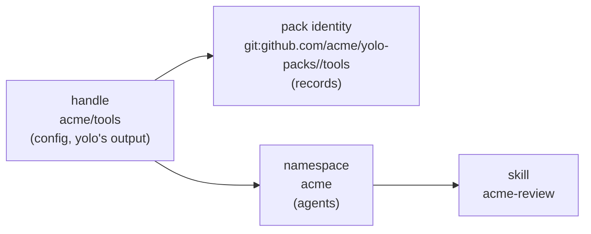

# Pack naming: what config, records and agents each call a pack

> **In short.** Every pack the user did not get from yolo lives in a **namespace**: the source
> name the user chose in `[pack_sources]`, or, for a pack listed on its own, its last segment or a
> `namespace` the user writes. An agent sees `<namespace>-<skill>`. Shipped packs, and entries the
> user marks `bare = true`, deliver the skill alone. A name depends only on its own config entry,
> never on what else is selected, so adding a pack can be refused but can never rename a skill.

**Why it matters.** Escaping a handle into an agent's namespace produced `/yolo-packs_2fmatt:foo`;
qualifying names only during a clash made one pack's arrival rename another's skills. Both are
ruled out ([PN-D3](#PN-D3), [PN-D4](#PN-D4)).

**Start at [§3](#3-the-design).** Every question is ruled; nothing is built.

**Reads with:** [`config-user.md` §4](config-user.md#4-naming-a-pack-that-is-not-shipped) (the
handle grammar, [OQ-RC15](readable-config.md#decision-ledger)),
[RC-D43](readable-config.md#RC-D43) and [RC-D47](readable-config.md#RC-D47) (the migration and its
record carry), [`pack-system.md`](../reference/pack-system.md#skills-collision) (today's skill-clash
refusal). The build order in [§9](#9-build-order) seeds the implementation plan once this is
accepted.

---

## 1. Requirements

From the owner, 2026-10-31:

- **R1 — no escaped names.** On `/yolo-packs_2fmatt:foo`: *"that is super ugly and I hate it."*
- **R2 — short names, few separators.** *"I hate having so many separators. I hate having so many
  prefixes … where it came from, which pack it's from, and then which skill it is, which is going
  to be so long that nobody's going to have any idea what any of their skills mean anymore."*
- **R3 — renamable source names.** *"yolo-packs is a weird name. That's an artifact of the
  organization in my config file … we also probably need to allow people to rename this part of
  the names."*
- **R4 — no collisions the user must divide.** *"I don't want a situation where two third-party
  packs have the chance to collide, and the user is now in the position of trying to divvy up the
  namespace."* A user may choose a namespace prefix, never individual skill names
  ([PN-D4](#PN-D4)).
- **R5 — stable names.** *"never rename based on pack inclusion. I hate that more than anything."*
  ([PN-D3](#PN-D3))
- **R6 — shipped packs.** Whether the absence of a prefix is enough to mark a yolo built-in.

## 2. Where a pack's name appears

| Surface | Read by | Today on main | Evidence |
| :--- | :--- | :--- | :--- |
| `packs` entry | the user | handle, `dotfiles/matt-fzf` | [`references.go:96`](../../internal/packsrc/references.go#L96) |
| `[pack_sources]` key | the user | user-chosen; the migration defaults to the directory's base name | [`configmigrate/packs.go:137`](../../internal/configmigrate/packs.go#L137-L165) |
| launch pack line, `pack ls`/`explain`/`footprint`/`lint` | the user | handle | [`config-user.md` §4](config-user.md#4-naming-a-pack-that-is-not-shipped) |
| staged tree directory | nobody | the handle escaped (`_2f` for `/`) | [`config/packs.go:148`](../../internal/config/packs.go#L148) |
| `packs.lock.json`, `forks.lock.json` (`<pack>/<bin>`), check records, build receipts, host program records, host-skills manifest owners | yolo | keyed by handle | [RC-D47](readable-config.md#RC-D47) |
| a skill (default tier) | the agent | `/<skill>`; two packs with one name refuse the launch | [`tier.go:39`](../../internal/hostskills/tier.go#L39) |
| a skill (`skills_tier = "namespaced"`) | the agent | `/<pack>:<skill>`, plugin named by the handle | [`packdecl.go:80`](../../internal/packdecl/packdecl.go#L80-L103) |
| a wrapped plugin | the agent | the plugin manifest's own name; two packs claiming one are refused | [`plugin.go`](../../internal/hostskills/plugin.go) |
| a `files` contribution in another pack's slot | the agent's loader | `<slot>/<handle>` (nested for a slashed handle) | [`mergedest.go:566`](../../internal/packload/mergedest.go#L566-L600) |
| a `reads-host` grant with no `into` | the agent, via its briefing | `/ctx/host-<staged directory>/<file>` | [`packload.go:571`](../../internal/packload/packload.go#L571-L576) |
| briefing provenance label | the user reading a composed `CLAUDE.md` | `<!-- from pack: NAME -->` | [`briefing.go:1184`](../../internal/jailcontent/briefing.go#L1184) |

No shipped pack and none of the owner's packs declares `skills_tier = "namespaced"`, and the
owner's selected set has no skill clash.

## 3. The design



**P1. Each name has one job.** yolo's output reads the handle, state reads the identity, agents
read names built from the namespace.

**P2. An agent-facing name is a function of its own config entry.** It reads the entry's
namespace, its `bare` setting, its pack directory and its skill directory — never another
selected pack. Adding, removing or reordering packs changes no delivered name.

**P3. A clash is refused, never resolved.** When two entries would deliver one name, the launch and
`yolo check` refuse, naming both entries and the one step that fixes it. The step is never "rename
a skill": it is choosing a namespace, setting `bare`, or, for a defect inside one author's
namespace, selecting only one of the two packs.

**P4. Nothing an agent sees is escaped.** Every agent-facing name is lowercase letters, digits and
hyphens, at most 64 characters — the only spelling every agent carries
([§5](#5-how-each-agent-treats-a-skill-name)).

### 3.1 The handle — config and yolo's own output

[OQ-RC15](readable-config.md#decision-ledger) as ruled: shipped packs bare (`yolo/<name>`
accepted), `local/<name>`, `<source>/<name>` through `[pack_sources]`, `<owner>/<repo>` for a
repository that is one pack. The handle is the name on every surface yolo prints to the user, in
config tables keyed by pack (`[allow."local/my-auth"]`), and in the briefing provenance label. It
is never a record key and never an agent-facing name.

### 3.2 The pack identity — what records key on

**Pack identity** *(coined here)*: the canonical place a pack is read from, independent of what the
user calls it.

| Pack | Identity |
| :--- | :--- |
| shipped | `yolo:<name>` (a shipped pack's `formerly` rename moves it) |
| a local directory (`local/…` or a local source) | `dir:<physical path>`, symlinks resolved as `packsrc.LocalDirectoryIdentity` does |
| a pack inside a git source | `git:<normalized repository>//<subdirectory>`, no ref |
| a repository that is one pack | `git:<normalized repository>`, no ref |

Every name-keyed record — the `packs.lock.json` entry, fork pins (`<identity>` + `<bin>`), check
records, build receipts, host program records, host-skills manifest owners, the plugin manifest's
`x-yolo-pack` — is keyed on the identity and stores the handle it was last written under for
display. CLI arguments take handles and resolve them first. Renaming a source moves no state;
moving a pack's directory or repository starts its pins and receipts over once, and the launch
says so ([PN-D10](#PN-D10)).

The staged tree directory stays the escaped handle: nobody reads it, and the escape is injective.

### 3.3 The namespace — what agents see

**Namespace** *(coined here)*: the word every agent-facing name of a pack starts with. The user
chose it or accepted its default; it never depends on the selected set.

| Entry | Namespace |
| :--- | :--- |
| a shipped pack | none: delivered bare |
| `<source>/<pack>` | the source key, `<source>` |
| `local/<pack>` | `<pack>` (`local` is yolo's word, not the user's, so each local pack is its own namespace) |
| a repository that is one pack | its last segment, `matt-craft` for `{ git = "…/mschulkind-oss/matt-craft" }` |
| an entry or source with `bare = true` | none: delivered bare |

A pack listed on its own takes `namespace = "…"` to choose a different word:
`{ git = "https://github.com/bob/tools", namespace = "bob" }`. A source's namespace is its key, so
it is chosen when the source is named, has no second spelling ([PN-D11](#PN-D11)), and is changed with `yolo pack source rename`
([§3.6](#36-renaming)). A source key, and a `namespace` value, must already be in
`[a-z0-9-]`; `yolo check` refuses anything else and prints the legal spelling. A pack or skill
directory name, which the author chose, is lowercased and every other character becomes `-`.

### 3.4 Delivered names

| Thing | Namespaced | Bare |
| :--- | :--- | :--- |
| a skill | `<namespace>-<skill>` at every agent ([PN-D8](#PN-D8)) | `<skill>` |
| a wrapped plugin | `<namespace>-<plugin manifest name>` | the manifest name |
| a `files` landing, `/ctx/host-…/` directory | `<namespace>-<pack>`, or `<namespace>` for a pack that is its own namespace | `<pack>` |

yolo writes a skill's delivered name as its directory name and as the `name` field of its copy of
`SKILL.md` (pi and Copilot key a skill on that field, [§5](#5-how-each-agent-treats-a-skill-name)),
and a plugin's as the `name` field of its copied manifest. The pack's own files are never edited.
Built-in skills and the workspace skill layer are unchanged. One skill has one name at every agent.
A pack manifest's `skills_tier = "namespaced"` no longer changes any name; `yolo pack lint` warns
that it is ignored ([PN-D9](#PN-D9)).

### 3.4.1 A worked example

```toml
[pack_sources]
dotfiles = { path = "~/.dotfiles/yolo-packs", bare = true }   # the user's own packs
work = "~/src/work-packs"                                      # a team's packs, namespaced
acme = { git = "https://github.com/acme/yolo-packs" }         # a third party's, namespaced

packs = [
  "claude",
  "dotfiles/matt",
  "dotfiles/matt-fzf",
  "work/deploy",
  "acme/tools",
  "acme/lint",
  { pack = "local/scratch", bare = true },
  { git = "https://github.com/alice/tools" },
  { git = "https://github.com/bob/tools", namespace = "bob" },
]
```

| Entry | Namespace | Ships | Agents see | `files` landing |
| :--- | :--- | :--- | :--- | :--- |
| `claude` | none (shipped) | its skills | their own names | `claude` |
| `dotfiles/matt` | none (`bare`) | `review`, `commit` | `review`, `commit` | `matt` |
| `dotfiles/matt-fzf` | none (`bare`) | `fzf-pick` | `fzf-pick` | `matt-fzf` |
| `work/deploy` | `work` | `deploy`, `review` | `work-deploy`, `work-review` | `work-deploy` |
| `acme/tools` | `acme` | `review`, `configure` | `acme-review`, `acme-configure` | `acme-tools` |
| `acme/lint` | `acme` | `check` | `acme-check` | `acme-lint` |
| `local/scratch` | none (`bare`) | `notes` | `notes` | `scratch` |
| alice's `tools` | `tools` (its last segment) | `fmt` | `tools-fmt` | `tools` |
| bob's `tools` | `bob` (chosen) | `fmt` | `bob-fmt` | `bob` |

Three packs ship `review`, and the agent sees three names: `review`, `work-review`, `acme-review`.

Each change below starts from that config:

| Change | Result | Step named |
| :--- | :--- | :--- |
| Remove `acme/lint`, add `acme/extra` | No other entry's names change | — |
| Drop bob's `namespace` | Refused: alice's and bob's repositories are both `tools` | `namespace = "…"` on either |
| Add `{ pack = "local/notes", bare = true }`, which also ships `notes` | Refused: two bare entries deliver `notes` | drop `bare` on one (its skill becomes `notes-notes`), or rename your own skill |
| Add `dotfiles/matt-review`, which also ships `review` | Refused: `dotfiles` is bare, so both deliver `review` | the same: un-bare `dotfiles`, or rename your own skill |
| A yolo release ships a skill named `commit` | Refused at the first launch on that release, naming `dotfiles/matt` | `bare = false` on `dotfiles` (every skill there becomes `dotfiles-…`), or rename your skill |
| Mark `acme` bare | Refused: `acme/tools` delivers `review` beside `dotfiles/matt`'s | leave `acme` namespaced: bare is for packs you control |
| Add a skill `work-review` to `dotfiles/matt` | Refused: it is the name `work/deploy`'s `review` delivers | choose a different source key for `work`, or rename your skill |
| Add `{ pack = "local/tools", bare = true }` | Refused: its landing `tools` is alice's | `namespace = "…"` on alice's entry, or drop `bare` |
| acme ships `check` in both `acme/tools` and `acme/lint` | Refused: one namespace delivers `check` twice | select one; `yolo pack lint` on acme's source reports it to acme |
| `yolo pack source rename work ops` | `work-deploy` becomes `ops-deploy`, `work-review` becomes `ops-review`; the plan lists both before you confirm | — |

`bare` is a promise that an entry's names will not meet anyone else's. It is safe for packs you
write, and every way it can break shows up as one of the refusals above, never as a rename.

### 3.5 Clashes

Every case below is refused at `yolo check`, the launch and `yolo host apply`, with the step named:

| Clash | Example | Step |
| :--- | :--- | :--- |
| two namespaces with one word | two repositories named `tools`; `local/acme` beside source `acme` | set `namespace = "…"` on either entry |
| two delivered names that hyphenate alike | namespace `a-b` with skill `c`, namespace `a` with skill `b-c` | choose a different namespace for either |
| two bare entries ship one skill, or a bare entry ships a shipped skill's name | the user's bare `review` beside another bare `review` | give one entry a namespace (`bare = false`), or rename the user's own skill |
| two packs in one namespace ship one skill | `acme/tools` and `acme/lint` both ship `review` | select only one; the defect is the source author's, and `yolo pack lint` on the source reports it to them |

A third party's names are namespaced by a word the user chose or accepted, so two third-party
packs cannot clash unless the user has marked one bare. Within one namespace the author owns every
name, so a clash there is the author's defect, not the user's division to make. Identical skill
content under one name is not a clash ([`compose.go`](../../internal/hostskills/compose.go)).

### 3.6 Renaming

- **A source**: `yolo pack source rename OLD NEW` *(proposed here)* rewrites the `[pack_sources]`
  key and every handle and pack-keyed table that uses it, in one journaled, confirmed edit. Because
  the source key is the namespace, the plan lists every agent-facing name that changes; this is a
  rename the user asked for. No record moves ([PN-D10](#PN-D10)). A hand edit is
  equally valid; a handle left pointing at the old key is refused by `yolo check` naming the verb.
- **A pack listed on its own**: set or change its `namespace`.
- **A pack's own name, or a skill's**: the author's words. A user who wants different ones forks the
  pack.

### 3.7 Shipped and third-party

In config, the absence of a prefix marks a shipped pack, completely:
[OQ-RC15](readable-config.md#decision-ledger) lets only a shipped pack be bare. In agent-facing
names, a shipped skill and a skill from a bare entry look alike; `yolo pack explain` and the
skill's description say where it came from. Shipped skills carry no marker by default
([PN-D13](#PN-D13)); a user who wants one sets `shipped_skill_prefix = "yolo"` in their user
config, and every skill yolo ships, built-in skills included, is delivered as
`yolo-<skill>`. The prefix is the user's word, set once, and depends on nothing selected; a
delivered name it produces is checked against every other like any name
([§3.5](#35-clashes)).

### 3.8 Against the requirements

R1: no escape reaches an agent. R2: at most two parts, one separator, and bare where the user says
so. R3: a source is renamed by a verb, moving no state. R4: third-party names are separated by
namespaces the user picks or accepts, and the user never picks a skill name. R5: no delivered name
reads the selected set. R6: [§3.7](#37-shipped-and-third-party).

## 4. The cost

A namespaced skill is longer than the bare skill, permanently, even when nothing else ships that
name. That is the price of [R5](#1-requirements) without a registry: a name that cannot change when
a pack arrives has to be distinct before it arrives. `bare = true` is where the user buys the
short name back for packs they trust not to clash, and pays for that with a refusal if one does.

## 5. How each agent treats a skill name

Read from the bundles installed in this jail on 2026-10-31.

| Agent (version) | Namespace | Two skills with one name | Name rule |
| :--- | :--- | :--- | :--- |
| Claude Code 2.1.312 | plugin skills `plugin:skill` (VERIFIED) | the same file loaded twice is skipped; a plugin skill already present as a user-level skill is skipped; which of two different personal skills wins is UNVERIFIED | plugin name: no `/`, `\`, `..`, spaces, leading `.`; kebab-case only warned (VERIFIED) |
| Copilot CLI 1.0.105 | plugin skills `pluginName:skill`; same-named skills from different plugins coexist (changelog 1.0.66, VERIFIED) | the higher-priority one wins, the other skipped with a message (VERIFIED) | plugin name 1–64 of `[a-z0-9.-]`, alphanumeric at both ends (VERIFIED) |
| Codex 0.162.1 | plugin skills prefixed `plugin_name:` (VERIFIED) | UNVERIFIED | 64 characters of `[a-z0-9-]` in its bundled skill-creator (weak) |
| pi (fork, 1.4.0) | none; invoked `/skill:<name>` (VERIFIED) | the first found wins; the loser is reported (VERIFIED) | at most 64 of `[a-z0-9-]`, no leading, trailing or doubled `-`; a violation only warns (VERIFIED) |
| agy 1.2.9 | UNVERIFIED | has a shadowing concept; order UNVERIFIED | UNVERIFIED |

The only spelling every agent carries is a plain name of lowercase letters, digits and single
hyphens, at most 64 characters. A delivered name longer than that is refused naming the pack and
the skill.

## 6. Alternatives considered

| Alternative | What it gives up |
| :--- | :--- |
| The handle, escaped, everywhere | R1, R2, and Copilot's plugin-name rule |
| Bare names, qualified only while two selected packs clash | R5: adding a pack renames a skill |
| The first-listed pack keeps the bare name | R5, and config order silently picks a winner |
| Bare names, any clash refused | R4: the user divides third parties' names |
| `<namespace>-<pack>-<skill>` always | R2: three parts |
| A content- or source-derived suffix (`review-3f2a`) | R2: an unreadable invoked name |
| Leave namespacing to each agent's plugin system | parity: pi and agy have no plugin namespace |

## 7. Migration

**Agent-facing names.** `yolo config migrate` writes `bare = true` on every entry and source it
converts ([PN-D7](#PN-D7)), so every skill, plugin, `files` landing and `/ctx` directory keeps
the name it had before conversion.

**Source names.** A source the old config never named takes its folder's name, with no prompt
([PN-D12](#PN-D12)). The conversion offer — the launch's question and `yolo config migrate`'s plan
— lists every pack whose name changes, old beside new
(`~/.dotfiles/yolo-packs/matt → yolo-packs/matt`), so the new names are seen before anything is
written. A `files` landing or namespaced subtree
written under an escaped or nested name is archived as composition residue at the next apply.

**Records.** Every name-keyed record is re-keyed to the identity
once, inside the journaled, roll-forward migration [RC-D47](readable-config.md#RC-D47) uses, at the
first launch or `yolo host apply` of a build that has this design. A record whose pack is not
selected keeps its key and is re-keyed if the pack returns. A legacy JSONC config is re-keyed the
same way.

**The held slash-name fix** (worktree `agent-aa30e25b86a0e5a26`, unlanded):

| Commit | Lands? |
| :--- | :--- |
| `3551eec58` — the jail names a recorded pack by the name the launch loaded it under | As is |
| `576fe4f01` — the LSP plugin's claimant uses `ClaimsAt`; `yolo pack status` splits `<pack>/<bin>` at the last `/` | As is |
| `5a4b8dbb9` — `internal/slug`, `x-yolo-pack`, `ClaimsAt`, escaped agent-facing names | The slug package for the staged directory, `x-yolo-pack` and `ClaimsAt` only; its RC-D48 row lands narrowed to that |

## 8. What done looks like

- No agent-facing name contains `_2f`, `/` or `:` added by yolo.
- After `yolo config migrate`, the owner's agents see the same names as before.
- With the example in [§3.4.1](#341-a-worked-example), removing `acme/lint` or adding a pack changes no
  delivered name of any other entry; a clash is a refusal naming both entries and the step.
- `yolo pack source rename yolo-packs dotfiles` rewrites the config in one confirmed edit, lists
  any agent-facing name it changes, and the next launch re-pins and rebuilds nothing.
- `yolo pack explain <handle>` lists each skill under its delivered name; `yolo pack ls` shows the
  handle and the namespace.

## 9. Build order

1. Land `3551eec58` and `576fe4f01`; they fix defects independent of spelling.
2. Namespaces, `bare` and `namespace`, delivered names and the clash refusals, with
   `5a4b8dbb9`'s internal half; retire `skills_tier = "namespaced"` to a lint warning.
3. Identity-keyed records and their migration.
4. `yolo pack source rename`; the migration's `bare` marking and its old-to-new name list.
5. `shipped_skill_prefix`.

## 10. Risks

| Risk | Mitigation |
| :--- | :--- |
| A yolo release ships a skill whose name a user's bare entry already uses | The launch refuses naming the user's entry and `bare = false`; nothing is renamed silently |
| An agent tightens its name rules | Names already meet the strictest rule seen ([§5](#5-how-each-agent-treats-a-skill-name)) |
| Rewriting `name` in a copied `SKILL.md` breaks a skill that reads its own name | The pack's file is untouched; `yolo pack explain` shows the delivered name |
| Moving a pack's directory loses its pins | A visible re-pin, never a wrong one |

## Decision Ledger

| ID | Ruling / Decision | Date | Settled in | Built |
| :--- | :--- | :--- | :--- | :--- |
| <a id="PN-D1"></a>PN-D1 | yolo's output, records and agents each read their own name (handle, identity, namespace-built names); nothing an agent sees is escaped. Designer decision from R1–R4 | 2026-10-31 | [§3](#3-the-design) | — |
| <a id="PN-D2"></a>PN-D2 | ~~A third-party pack whose short name clashes in the selected set is qualified as `<source>-<pack>`~~ — superseded by [PN-D3](#PN-D3) | 2026-10-31 | — | — |
| <a id="PN-D3"></a>PN-D3 | **Owner ruling:** no name changes because of which packs are selected — *"no. never rename based on pack inclusion. I hate that more than anything."* A clash is refused, never resolved by renaming | 2026-10-31 | [§3](#3-the-design) P2, P3 | — |
| <a id="PN-D4"></a>PN-D4 | **Owner ruling:** the user may choose a namespace prefix, never the names that collide — *"it would be ok if the user chooses a namespacing prefix if needed, just not skill names or whatever it is that collides. for instance you could name a repository that has 5 packs with a user-defined prefix and then that is the namespace."* | 2026-10-31 | [§3.3](#33-the-namespace--what-agents-see) | — |
| <a id="PN-D5"></a>PN-D5 | A source's namespace is its key; a pack listed on its own is its own namespace (last segment, or `namespace = "…"`); delivered names are `<namespace>-<name>`, bare for shipped packs and `bare = true` entries. Designer decision from PN-D3 and PN-D4 | 2026-10-31 | [§3.3](#33-the-namespace--what-agents-see), [§3.4](#34-delivered-names) | — |
| <a id="PN-D6"></a>PN-D6 | Two packs of one namespace shipping one skill name are refused as the source author's defect; the step is selecting one, and `yolo pack lint` on the source reports it. Designer decision: the only stable alternative is a three-part name, which R2 rules out | 2026-10-31 | [§3.5](#35-clashes) | — |
| <a id="PN-D7"></a><a id="OQ-PN1"></a>PN-D7 | **Owner ruling:** a pack outside the shipped set is prefixed unless its entry or source says `bare = true`, and the migration writes `bare = true` on everything it converts — *"nothing changes at conversion, and every pack added later is prefixed until Matt says otherwise."* | 2026-10-31 | [§3.3](#33-the-namespace--what-agents-see), [§7](#7-migration) | — |
| <a id="PN-D8"></a><a id="OQ-PN2"></a>PN-D8 | **Owner ruling:** a prefixed skill is `<namespace>-<skill>` at every agent — *"one separator, and one name for a skill at every agent."* | 2026-10-31 | [§3.4](#34-delivered-names) | — |
| <a id="PN-D9"></a><a id="OQ-PN3"></a>PN-D9 | **Owner ruling:** `skills_tier = "namespaced"` is retired to a lint warning; the user's `bare` holds — *"no pack uses it, and the user's choice should be the one that holds."* | 2026-10-31 | [§3.4](#34-delivered-names) | — |
| <a id="PN-D10"></a><a id="OQ-PN4"></a>PN-D10 | **Owner ruling:** records key on where the pack lives; a rename moves nothing, a move re-pins once — *"renaming is what users will do, moving a dotfiles tree is rare, and a hand edit then needs no carry."* | 2026-10-31 | [§3.2](#32-the-pack-identity--what-records-key-on) | — |
| <a id="PN-D11"></a><a id="OQ-PN5"></a>PN-D11 | **Owner ruling:** a source's key is its namespace, with no second spelling — *"one word per source is the simpler model, and the rename verb already changes it."* | 2026-10-31 | [§3.3](#33-the-namespace--what-agents-see) | — |
| <a id="PN-D12"></a><a id="OQ-PN6"></a>PN-D12 | **Owner ruling:** the migration names an unnamed source after its folder, with no prompt, and the conversion offer lists every pack's new name — *"Whatever is most default, less configuration, I think is the ideal configuration … it would be nice in the 'Do you want to convert?' message to also explicitly spell out the new pack names."* | 2026-10-31 | [§7](#7-migration) | — |
| <a id="PN-D13"></a><a id="OQ-PN7"></a>PN-D13 | **Owner ruling:** shipped skills carry no marker by default; `shipped_skill_prefix` in user config adds one — *"by default there should be no marker, but we need to have some config language so that the user can prefix them if they so choose in their user config."* | 2026-10-31 | [§3.7](#37-shipped-and-third-party) | — |
