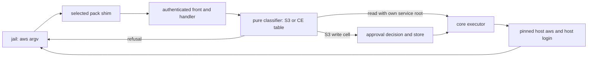

# AWS operation broker

**Status:** Verified 2026-11-17 against `bde502e4a`. MEASURED: Linux synthetic
production mediation and nested Podman delivery. UNMEASURED: native macOS,
installed AWS CLI compatibility, real IAM/account/billing behavior.

Yolo manages the coding environment's selected tools and policy; confinement is one
setting of that environment. The selected `aws` pack routes the jail's `aws` command
through a call broker to the host's pinned AWS CLI and configured login. It admits
exact S3 rows and read-only Cost Explorer queries, not arbitrary AWS operations.
The independent `aws-auth` credential service and Bedrock behavior are unchanged.

[Scoped broker policy](../../design/scoped-broker-policy.md) is the accepted, unbuilt contract for fine-grained
read approvals and host-owned S3 profile routing. Its [declaration-owned contexts](../../design/scoped-broker-policy.md#71-model)
and [declaration-only gate behavior](../../design/scoped-broker-policy.md#8-authority-state-concurrency-withdrawal-failure)
are target behavior, not implementation changes. It supersedes broad-read-only policy as the target contract,
not the verified behavior described here, and leaves `aws-auth` unchanged.

## Reading map

| Question | Authority |
| :--- | :--- |
| What admits a service, and what does withdrawal mean? | [Authority and roots](authority.md) |
| Which argv shapes run, and how are they canonicalized? | [Operation grammar](grammar.md) |
| What executes, what can bypass it, and what can evidence establish? | [Execution and observations](execution.md) |
| What does the generic call broker guarantee? | [Pack brokers](../../design/pack-brokers.md) |
| What published CLI behavior supports the boundary grammar? | [Grounding](../../research/aws-operation-broker-grounding.md) |

The three child pages own separate facts. Authority owns root and allowance
semantics; grammar owns admission/value bounds; execution owns runtime limits and
observations. This index does not duplicate their parameter tables.

## Terms

Generic **front**, **classifier**, **canonical form**, **scope root**, **resource
chain**, **cell** and **executor** are defined by the
[call-broker contract](../../design/pack-brokers.md#2-terms).

The following terms originate in this subsystem's design:

- **Service table:** exact classification rows selected by the first argv word.
  Not a plugin or an inference from a `Get*`/`Describe*` prefix.
- **Root scheme:** the prefix before `://` identifying a service's scope grammar.
  Not a URL dereferenced by the executor.
- **Service root:** a workspace-declared root accepted by that service's grammar.
  Not the user read grant; both are required for a read.
- **Label:** a bounded ASCII tag/search/key value accepted by the query grammar.
  Not an arbitrary AWS string.

## Execution spine

The classifier receives argv, a stdin digest, approved roots and lookup facts.
It receives neither host environment nor credentials nor stdin bytes. It answers
one canonical call or one refusal; it requests no lookup. Core verifies each
resource chain ends in a gate-approved parentless root, then checks live authority
and write policy. Only the executor receives the pinned host environment.

There is at most one host AWS CLI process for an admitted call. This is **not** a
cap on AWS HTTP requests or charges: the trusted host CLI may retry and S3 may page.
Cost Explorer's canonical invocation asks for one explicit page.

## Invariants and exclusions

- Unknown services and operations deny by default. Adding a table does not
  automatically authorize existing workspaces for that service.
- Each service consumes only roots in its own scheme. The shared read grant
  cannot turn an S3 root into Cost Explorer authority.
- All host words come from parsed, validated, canonical values. Jail profile,
  region, endpoint, signing, debug and input-file options never run.
- Host login configuration is trusted. The broker adds no account, role or
  billing-view pin and does not change IAM.
- Cost Explorer has no write cell and never files an approval request.
- S3 stdin binding, approval transactions, Allow once and timed answers remain
  the generic broker's behavior.
- No service plugin registry, response cache, spend meter or broker retry exists.
- This is command mediation, not account-wide read-only security. Other jail
  credentials can bypass it.

## Identity and replacement

The only active identity is pack/source `aws`, with loophole `aws-broker` and
classifier dispatch `yolo internal call-broker-classify aws`. There is no old-name
alias, `formerly` entry, compatibility wrapper or source migration.

Historical records under `aws-s3` remain removed-source, deny-only inventory.
They cannot execute, authorize or replay an `aws` call; new calls do not spend old
Allow-once or timed answers. Historical fixture and release material is not
selectable compatibility. [Authority](authority.md#direct-replacement) explains
how an old configuration fails and the next step it names.

## Where the code lives

| Component | Package and anchor |
| :--- | :--- |
| Selected shim, host variables and write cells | `packs/aws` |
| Service vocabulary and exact pure classification | `internal/awsclassify`, `Classify`, `ceRows` |
| CLI classifier subprocess dispatch | `internal/cli`, `runInternal` |
| Generic roots, provenance and edit validation | `internal/config`, `lowerReadableCallRoots`, `ResolveReadableAllowance` |
| Live read/write decision and execution | `internal/callbroker`, `currentAuthority`, `decideCall`, `pinCLI` |
| Full-check credential-bypass observation | `internal/cli/check`, `reportAWSCredentialBypass` |
| Independent local proof host/service | `internal/s3fixture` (test content, not a shipped broker) |

Adding a service requires another exact table, its own root scheme, resource types
and new write cells if applicable, plus independent synthetic conformance. It is
not permission to widen a row or generic grant reader. Follow the
[service mediation recipe](../../design/approval-experience/service-mediation.md).
