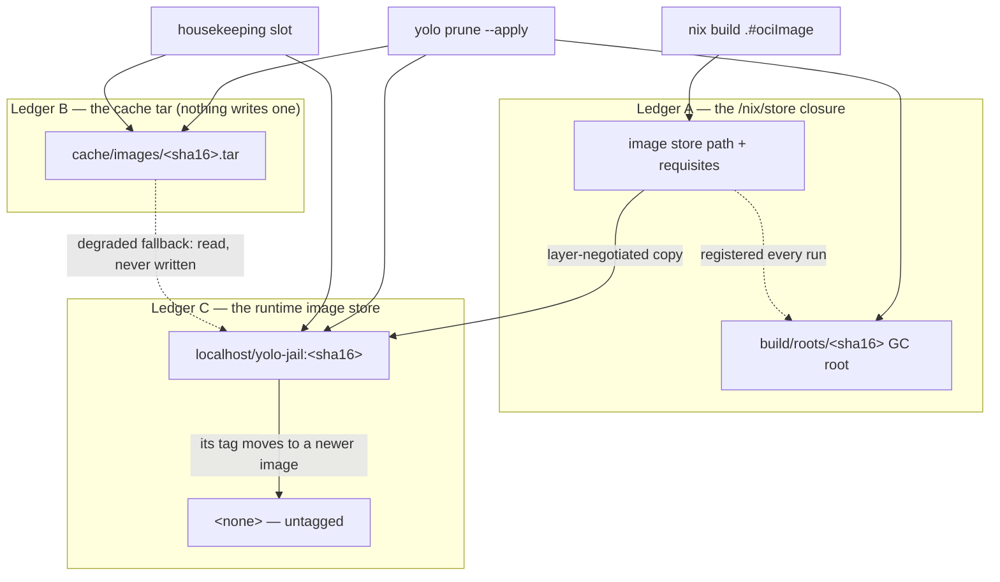

# Disk footprint — reclamation that runs without a human

**Status:** Verified 2026-10-16 against `8e65f3444`. MEASURED: every automatic class is pinned at
its call site and its callee by unit tests, the image reap and the owner label by real launches,
and the host's image-tar backlog read 0 B on 2026-09-14. UNMEASURED: the re-measure of the whole
machine after every reclaimer shipped, and the mise store after its first 30-day window
([owed](#owed-measurements)).

yolo writes bytes in many stores: the runtime's image store, `/nix/store`, the shared download
cache, the shared mise tool store, vendor version directories, captures and staging trees. Every
one of them has a reclaimer, an explicit statement that nothing reclaims it, or an owner that is
not yolo. Reclaimers run from the **housekeeping slot** of every launch, never from a timer, and
`yolo prune` is the recovery tool that runs the same functions by hand. `yolo stores` lists every
store, its size and who, if anyone, reclaims it.

This reference was graduated from two design docs, `minimal-disk-footprint.md` (the image
ledgers and the reclaimer invariants) and `disk-levers-and-backfill.md` (the backfill policy, the
slot and the inventory), and from the lifecycle-sweep half of the plan `storage-lifecycle.md`.

| Component | Lives in |
| :--- | :--- |
| The housekeeping slot, its locks and its per-class debounce | `internal/cli/run` (`runHousekeeping`, `withHousekeepingPass`, `classDebounce`) |
| The offered tier: the prompt and the recorded answers | `internal/cli/run` (`offer.go`) |
| The image reap (Ledger C) | `internal/prune` (`AutoReapOldImages`, `PruneOldImages`), `internal/cli/run` (`autoreapimages.go`) |
| Image tars (Ledger B) | `internal/prune` (`PruneImageCache`, `ResolveImageCacheKeep`) |
| yolo's own store outputs and the prefix roots | `internal/prune` (`storeoutputs.go`, `LivePrefixSources`, `PruneOrphanPrefixRoots`), `internal/image` (`RegisterPrefixRoot`) |
| The shared cache's age purge | `internal/prune` (`PurgeCacheByAge`, `CachePurgeDefaultSubdirs`) |
| The host content-addressed cache alias | `internal/hostcas` (`Stores`, `Plan`), `internal/cli/run` (`hostcasalias.go`) |
| The mise use record and its reclaimer | `internal/miseuse`, `internal/entrypoint` (`miseuserecord.go`), `internal/prune` (`miseversions.go`) |
| The inventory and its sample ledger | `internal/cli/stores` |
| Lifecycle sweeps | `internal/prune` (`staleoutlinks.go`, `agentstaging.go`, `agentlogs.go`) |
| Build-state links and embedded pack trees in the slot | `internal/prune` (`buildstate.go`, `embeddedtrees.go`), `internal/cli/run` (`buildstatehousekeeping.go`) |

**Reads with:** [`image-retention.md`](image-retention.md) (what the image and GC-root reapers
may delete, and on what evidence), [`image-staging-vs-baking.md`](image-staging-vs-baking.md)
(how an image is built and delivered), [`storage-and-config.md`](storage-and-config.md) (where
these stores live), [`in-jail-nix-roots.md`](in-jail-nix-roots.md) (roots a jail makes).

---

## Principles

### The reclaimer invariants

<a id="reclaimer-invariants"></a>

Numbered so code comments can cite them; `internal/capture`, `internal/prune` and the image
loader do.

**P1. A running jail's image closure is reachable from a durable GC root at every instant.** The
root is re-asserted on every run before the build's ephemeral out-link is dropped, so there is no
unrooted window ([a GC is safe at any moment](image-retention.md#a-gc-is-safe-at-any-moment)).

**P2. Reclamation is fail-safe on unknown liveness.** If yolo cannot enumerate the running jails,
it reaps nothing. Every liveness-gated sweep has this polarity.

**P3. Deleting a cache tar never strands a running jail.** A tar is a one-shot load artifact; the
runner depends on the store closure. This is what licenses deleting tars aggressively, so it is
the invariant to guard hardest: anything that makes a tar load-bearing at run time (a lazy
re-load, a rollback that reads it) breaks it.

**P4. No reclaimer may delete an artifact an in-flight launch is between steps on.** It is honored
by naming and by recovery, not by a lock: an in-flight archive is named so no sweep matches it or
is spared by an age floor, and the one reader a reclaimer can still race, the degraded tar
fallback, re-verifies each candidate at the point of use and moves on when one vanished.

> [!WARNING]
> **A reclaimer's reach is a filename pattern, and a write path can start matching it without
> anyone editing the reclaimer.** That is how the `*.tmp` sweep under `cache/images` came to
> delete an in-flight delivery's archive, fixed by an age grace floor. A new writer under a
> swept directory must check what the sweeps there match. Do not read P4 as a lock: nothing asks
> a deleter's permission.

**P5. yolo never carelessly collects the host store.** Store deletion is bounded, rooting-aware,
host-only, and scoped to paths yolo itself realized; never a blanket collect.

**P6. yolo does not manage host symlinks or mounts as a general primitive.** A layout a human
declared, which yolo consumes, is the only acceptable shape
([`cache-relocation.md`](../plans/cache-relocation.md)). No reclaimer may become a way around it.

**P7. A reclaimer must be safe to run at an arbitrary moment.** An automatic trigger makes this
literal: the slot runs whenever any jail starts, including while others are mid-build. Anything
added here closes its race before, or in the same change as, it gains a trigger.

### The backfill rules

<a id="backfill-rules"></a>

Two terms, coined in the design doc this reference replaces:

- **Steady-state retention** — bounding what a mechanism produces from now on: a reaper with a
  trigger, or a write path that leaves nothing behind. It says nothing about what is already on
  disk, and it is a rule, not a byte budget.
- **Backfill** — the bytes a mechanism put on disk before its steady-state fix shipped, which
  the fix stopped producing but did not remove. Not a leak (a leak is still growing). Its
  defining property: the reaper's own evidence usually does not reach it, because the bytes
  predate the reaper's records.

**BF-P1. Backfill and steady state get separate dispositions, decided per store.**

**BF-P2. A first pass over a backlog is a one-time event per store per machine, and its outcome
is recorded on disk.** After it the steady-state reaper owns the store.

**BF-P3. Automatic where the evidence is complete and regeneration is bounded and known** — "a
`nix build` or an image copy", not "a re-download of unknown size". Complete evidence means the
same veto that protects live state covers everything the pass could touch.

**BF-P4. Offered, at a launch on a terminal, with the measured size, where the evidence is
partial, the store is shared with the user's non-yolo work, or regeneration is expensive.** An
offer is a prompt, not a hint.

### Why a hint is not a trigger

Every reclaimer once existed, was correct and tested, and had exactly one caller: a human typing
`yolo prune`. `yolo prune` printed a hint whenever the image-tar cache passed a size threshold;
the hint was true for over a month, and the 125 tars it named, 404 GiB, were still on disk byte
for byte ten days after they were first counted (MEASURED 2026-08-25). **A reclaimer whose only
trigger is a human noticing is a suggestion, not a mechanism.** So the delete lives in the
process that made the bytes, or in the launch that follows, and `yolo prune` is demoted to the
recovery tool for what crashed mid-write, what predates a fix, and what another backend left.

## The three ledgers of an image

One loaded image is stored three times, with three owners and three reclaim stories. A **ledger**
*(a term from the design doc this replaces)* is one of those copies.



### Ledger A — the store closure

<a id="ledger-a"></a>

Pinned by an indirect GC root under `build/roots/`, keyed by the same hash of the store path as
every other per-image artifact, and re-asserted on every run. Its reaper and its rules are
[`image-retention.md`](image-retention.md#gc-root-retention--age-except-under-a-running-image)'s.
Growth here is roots doing their job; what the store accumulates is unrooted paths, which is the
host's `min-free` setting ([the host's auto-GC](image-retention.md#the-hosts-auto-gc-warn-never-edit))
and, for yolo's own outputs, [the store-output reaper](#yolos-own-store-outputs).

### Ledger B — the cache tar

<a id="ledger-b"></a>

**No backend writes a retained tar.** Podman takes a layer-negotiating copy straight from the
store, and a backend that cannot (Apple Container, podman on macOS) gets a temporary archive the
launch removes, built in a per-attempt directory under the state dir's `image-delivery/`
([delivering into the runtime](image-staging-vs-baking.md#delivering-into-the-runtime)). What a
machine still holds is the legacy backlog.

- **The reaper** keeps the newest *keep* tars by modification time, drops the rest, and sweeps
  `*.tmp` older than a grace floor. *Keep* is per runtime: zero on podman, a few on Apple
  Container ([OQ-BF6](#why-its-this-way)).
- **The trigger** is the slot, on its own debounce, and `yolo prune`.

> [!WARNING]
> **Zero tars retained is not zero tars readable.** The degraded fallback (`newestTars`) still
> loads any `*.tar` it finds when a build failed or was skipped and the runtime holds no image.
> A change that "finishes" [OQ-DF1](#why-its-this-way) by deleting that reader removes the
> offline safety net the ruling kept. Temporary archives are named so the reader cannot match
> them: a temporary archive loaded as a legacy tar would claim the wrong tag on the path that
> exists to rescue a launch.

### Ledger C — the runtime image store

<a id="ledger-c"></a>

Every configuration keeps a permanent content-addressed tag, so a superseded image is a visible
row rather than an orphan. Which rows are kept is [image retention](image-retention.md#image-retention--one-pointer-per-workspace)'s
rule. This section is about **which rows yolo may consider at all**.

An image goes `<none>` when the last name it held moves to another image: the legacy `:latest`
alias moving off an image that held nothing else (a pre-content-tag image, or one loaded by the
degraded tar fallback, which carries only `:latest`). A nameless row has lost the repository name
that was the evidence it was yolo's.

**Provenance is a label baked into the image config**, `org.yolo-jail.owner`, which survives the
loss of the tag and stays filterable by Podman. On Podman the reaper lists candidates with two
queries, the repository-name filter and the label filter, because Podman refuses both in one. The
label's value is `yolo`, proving the image is yolo-built rather than identifying which build. The
probe passes no `-a`, which would surface build intermediates the ruling does not cover.

Apple Container uses `container image list --format json` and considers exact yolo-jail repository
references only; optional owner-label widening is intentionally absent. It joins native
all-container JSON by the full image descriptor digest and, before each deletion, re-reads inventory
and liveness and inspects the stored reference to verify its exact name and digest. Apple Container
has no proven in-use delete veto, so any failed or ambiguous check skips deletion; the interval
between the final check and deletion remains an unverified native-runtime race.

> [!WARNING]
> **A label says "ours". It never says "not in use", and a removal needs both.** Podman's liveness
> veto ([`image-retention.md`](image-retention.md)) gates every removal, and plain non-forcing
> `rmi` is a second veto. Apple Container does not widen ownership by label; its fresh image,
> all-container and inspect checks gate each reference deletion. Rows older than the label are left
> alone permanently and listed by `yolo stores` as a class nothing reclaims; `podman image prune` is
> the user's to run ([OQ-DF3](#why-its-this-way)).

Ledger C has no write-path moment to clean up after itself: a launch that mints a new tag never
supersedes another workspace's. That is why it is reaped from the slot and Ledger B was fixed
at its writer ([OQ-DF2](#why-its-this-way)).

## The housekeeping slot

<a id="the-housekeeping-slot"></a>

The **housekeeping slot** *(coined in the design doc this replaces)* is the window in the host
`yolo` process after the container is running and attached, while the launcher waits on its
child. The launcher spawns the runtime and waits rather than exec'ing into it, so the window
exists for the jail's whole life. Work there never delays the jail, needs no daemon (it dies with
the launch), and runs with the host's view of every store. It is not a background job: same
process, same lifetime, same environment.

**What runs there, each class on its own daily stamp:** the superseded-image reap, the
[build-state links](#build-state-links) (before the store outputs, whose candidates those links
keep rooted), other builds' embedded pack trees, yolo's own store outputs, the shared cache's
measure and (with consent) purge, the mise store's measure and (with consent) removal,
agent-staging orphans with retired loophole state, the launching workspace's agent logs (every
launch, no stamp), [orphaned per-jail
state](#orphaned-per-jail-state), image tars, superseded flake-bundle generations, unused
[development bundles](#development-bundles), and the start of the detached scratch-volume remover
([`durable-scratch-space.md`](jail-home.md)). `runHousekeeping` is the
list.

Three properties anything added must respect:

- **The goroutine dies on `os.Exit`.** A class can be cut mid-delete, so every pass is
  restartable and stamps its debounce only on completion, and not while a signal is ending the
  process.
- **Both streams are the container's.** The slot writes only to
  `<workspace>/.yolo/logs/housekeeping.log`. It printed on stderr once, which landed on top of a
  running agent's TUI; `yolo stores` and `yolo prune` are the human-facing surfaces.
- **Nothing that needs a terminal runs there.** The [offer](#the-offer) happens before the
  container attaches.

**On `macos-user`** the launch runs a slot of its own for four classes only, the retired
loophole-state generations, the shared cache's offered purge, other builds' embedded pack trees
and [orphaned per-jail state](#orphaned-per-jail-state), started on its own goroutine before the
backend's dispatch ([BF-D3](#BF-D3), [BF-D4](#BF-D4)). **`yolo host`** runs none: it execs into its
program, and none of the slot's stores grows at that notch.

## Two tiers, one mapping

<a id="two-tiers"></a>

| Store | Tier | Why | Steady state |
| :--- | :--- | :--- | :--- |
| Tagged Podman images; Apple Container yolo-jail references | automatic | runtime liveness and per-workspace pointers; Apple also revalidates native reference binding before deletion | one current image per workspace |
| Image tars on a streaming runtime | automatic | a tar is one-shot (P3); regeneration is a build | none |
| Superseded vendor versions | automatic, in the launcher itself | the live symlink is complete evidence | two builds per program |
| Agent staging, retired loophole state | automatic | tri-state gated; small | swept |
| Development bundles (`just dev`) | automatic, and after each new bundle is published | the runtime and the process table say what is in use; regeneration is a rebuild | the newest three, plus any in use |
| [Orphaned per-jail state](#orphaned-per-jail-state) | automatic, in a jail too | tri-state gated; the next launch writes each file again, and an approval or pointer goes only once its workspace is gone | swept once untouched past its age floor |
| yolo's own unrooted store outputs | automatic, host-only | every running jail's prefix is rooted ([OQ-BF4](#why-its-this-way)), and nix refuses a live path | deleted by name |
| Shared cache, older than its age cutoff | **offered**, then automatic | regeneration is a re-download of unknown size | age purge, once consented |
| Unused mise tool versions | **offered**, then automatic | regeneration is a re-download for a workspace that returns | versions no jail used within the window, once consented |
| Untagged Podman rows | automatic for labelled rows; never for rows older than the label | a row without the label carries no evidence it is yolo's | listed by `yolo stores` |
| Agent worktrees | never | not yolo's bytes | none |

### The offer

<a id="the-offer"></a>

One prompt shape for every offered class, before the container attaches, on a terminal:

```console
$ yolo
Reclaimable on this machine (measured 2026-09-06 21:45, older than yolo's rules allow):
  cache files older than 30 d      49.3 GiB   (pants 39.4, pex 6.4, uv 3.1, npm 0.4)
Reclaim now? [y]es / [n]ot now (ask again in 7 days) / ne[v]er (yolo prune stays available)
```

- **`y`** makes the class automatic; it is never asked again, and its pass runs in that same
  launch's slot, debounce or not ([DF-D10](#DF-D10)).
- **`n`** defers it; the offer returns once the deferral has aged.
- **`never`** is the only answer that stops the asking without deleting anything.
- **The offer recurs**: a class is offered whenever its last measurement is above the threshold
  and no standing answer covers it ([OQ-BF1](#why-its-this-way)). For a class that recurs by
  normal use (the cache, the store outputs, untagged rows) that is the steady state; for a
  one-shot class (tars on podman, the tagged image backlog) a returning offer **is** the bug
  report.
- **Without a terminal**, one line names the size and `yolo prune --apply`; no prompt, no
  deletion. Never an implicit yes.
- **Every offered class due at one launch shares one prompt.**

### Triggers and defaults

<a id="triggers-and-defaults"></a>

- **Automatic tier:** every launch, in the slot, at most once a day per class. A host launch
  acts on host stores; a nested launch acts on its own podman store and state dir, never on
  `/nix/store`.
- **Offered tier:** before the container attaches, as above.
- **Measure late, offer early.** The size a prompt shows is the previous slot's dated
  measurement, or a probe cheap enough to run in front of a launch. A cache walk never runs
  there. Each walk has a time budget; a walk that exceeds it reports a partial figure and says
  so, and the next pass resumes where it stopped (see [the shared cache](#the-shared-cache)).
- **Degenerate inputs.** An empty store or a class with nothing reclaimable is silent. A store
  the probe cannot read declines its class for this pass and does not stamp the debounce, so the
  next launch retries.

## One writer, concurrency, failure

<a id="one-writer-concurrency-failure"></a>

**One writer per store.** A store's reaper is its only deleter in yolo, and `yolo prune --apply`
calls the same function. The load sentinel keeps its one writer.

**The race that matters**: launch B decides its image is present, launch A's reap sees no
container on it yet and no sentinel entry and removes it, and B's `podman run` fails. Two locks
close it:

- **The shared housekeeping lock** is taken by a launch around its image re-inspect-and-record,
  and by a pass around **each deletion**, rechecking under it that the item is still unused.
- **The pass lock** is held, non-blocking, for a whole pass, so two passes never interleave; a
  loser skips its pass and leaves its debounce unstamped.

The shared lock used to be held for a whole pass, which kept a launch's re-inspect waiting for
it ([OQ-PR2](podman-readiness.md#why-its-this-way)). While an upgrade mixes
versions, an older pass that knows only the shared lock can run between a newer pass's
deletions; their deletions still never overlap
([PR-D14](podman-readiness.md#PR-D14)).

**Failure paths.** A measurement that fails skips its class silently. A delete that fails midway
stops the class, names what was and was not removed, and does not stamp. A store deletion nix
refuses as still alive is the veto working, never retried with `--ignore-liveness`. A stamp that
cannot be written fails toward checking more often. The offer has no timeout, and Ctrl-C aborts
the launch.

> [!CAUTION]
> **Forbidden, in the slot and in `yolo prune` alike:** deleting outside yolo's own stores, the
> `yolo-jail` image repository and yolo's own store output names; touching a workspace tree
> beyond its `.yolo/`; `podman image prune`, `podman system prune`, `nix-collect-garbage` or an
> unbounded `nix store gc`; removing a path any `build/roots`, prefix root or resolving out-link
> points at; acting on `/nix/store` from inside a jail; prompting without a terminal; blocking
> the container's start on a delete or a walk.

## yolo's own store outputs

<a id="yolos-own-store-outputs"></a>

Every from-source launch builds an install prefix (the mounted yolo binaries) and a Go build
behind it, and nothing collected either: the host daemon's `min-free` was zero and yolo's only
store collector was opt-in. The Go build is garbage the moment the prefix exists, because the
prefix copies the binaries.

**The reaper deletes yolo's own unrooted `*-yolo-jail-install-prefix` and `*-yolo-jail-go-0-dev`
paths by name** with `nix store delete`, host-only, in the slot and in `yolo prune`. Nix's own
refusal to delete a live path stays as the second veto. A named, self-scoped deletion of paths
yolo realized is not the careless collect P5 forbids ([OQ-BF3](#why-its-this-way)).

### Prefix roots

<a id="prefix-roots"></a>

Since the binaries left the image, a jail's pid1 runs from a store path the launch bind-mounts.
The build's out-link is one per checkout and moves to the newest prefix, so a long-running jail
would run from a path nothing roots. **Every prefix a container is running from has a durable
root under `build/prefix-roots/`, registered at launch and held while a container runs from it**
([OQ-BF4](#why-its-this-way)). The reaper asks the runtime which prefix each running jail mounts;
a container with no prefix mount is an answer, and one that cannot be inspected declines the
whole pass, naming the container.

> [!WARNING]
> **Neither the load sentinel nor an age floor may protect a prefix.** The sentinel is a
> most-recently-used list and cannot answer "in use"; an age cutoff reaps a jail's binaries more
> certainly the longer it runs. One test decides a root's policy: can losing it cost only a
> rebuild? An idle image closure, yes, so age; a running jail's prefix, no, so liveness. Prefix
> roots therefore must not live in `build/roots`, whose reaper ages roots out.

In a jail, a prefix root is registered under the host's spelling of its link
([`in-jail-nix-roots.md`](in-jail-nix-roots.md#yolos-own-roots)).

**No launch registers a prefix root any more.** A launch now mounts the prebuilt helper binaries
of the bundle it runs from, so nothing builds an install prefix. The roots already on disk are
reaped by liveness, from the slot as well as from `yolo prune`, as one of the
[build-state links](#build-state-links).

### Build-state links

<a id="build-state-links"></a>

The build dir holds GC-root links that only `yolo prune`, or nothing, used to remove. Each one
roots a store closure, so a link nobody removes is a closure nix can never collect. On
2026-10-24 one jail's build dir held 938 prefix roots, 413 retired prefix out-links pinning about
392 install prefixes, 170 image-copier link pairs and six image-extras roots.

**The slot's build-state class removes them, at most once a day, before the store-output
class**, and `yolo prune` runs the same functions. Each kind keeps the policy the
[prefix-root test](#prefix-roots) gives it: can losing the link cost only a rebuild?

| Link | Policy | Kept |
| :--- | :--- | :--- |
| `prefix-roots/<sha16>` | Liveness | The prefix a running jail executes from, and any root younger than the grace |
| `jail-prefix-<sha16>`, the retired prefix out-links | Liveness | The out-link of a prefix a running jail executes from, and any link younger than the prefix-root grace. No yolo writes these names any more |
| `image-copier-<sha16>` and its `-man` twin | Age | The newest link, and any link written within the retention. A dangling link, or a `-man` link with no main link, goes at once. No running jail runs the copier, and a launch that copies rebuilds and re-links it first |
| `package-roots/extras-*` and `package-roots/jail-*` | Liveness, then age | Any profile a running jail was started with (its `YOLO_STORE_PROFILES` and `YOLO_STORE_FHS_PROFILES`), the newest root of each kind, and any root written within the retention |

**Unknown liveness declines.** If the runtime cannot list its jails, or cannot report one
running container's mounts or environment, the liveness parts remove nothing, the decline goes to
`housekeeping.log` naming the missing evidence, and the class stays due for the next launch. The
copier links need no liveness and are swept either way. The class runs in a jail too: the links
are in the jail's own build dir, and the runtime it asks is the jail's own.

**Not reaped: the launch records and stock records** (`launch-images/`, `stock-images/`), one
small file per image identity. A launch record whose store path is gone is already treated as a
miss by its reader. A stock record is how the image reaper maps a running stock-tagged jail to its
root, and without one that jail's mapping becomes unknown and the reaper declines
([`image-retention.md`](image-retention.md#current-values)). Their bytes do not justify that risk.

**Embedded pack trees** (`embedded-packs/`, one per yolo build) are swept by the slot on every
backend, under their own stamp, by the lease rule `yolo prune` already used: this build's tree is
never removed, and neither is a tree whose lease is held or cannot be probed.

### The prefix on macOS

<a id="the-prefix-on-macos"></a>

A macOS podman runs in a VM that shares no host store, so a prefix mounted out of `/nix/store`
does not exist there. **The launch refuses on darwin when either mount source is under
`/nix/store` and `YOLO_NIX_HOST_DAEMON` is unset** (`prefixUnreachableFromVM`), naming the two
ways forward: share `/nix` with the VM and set that variable, or launch from an installed bundle,
which stages under `$HOME` ([OQ-BF7](#why-its-this-way)).

> [!WARNING]
> **Staging the prefix under the home is not refuted, only not built.** It would be a second
> delivery mechanism for the binaries, a copy per build plus a lifecycle to reap. If the
> population of macOS developers on a live checkout grows, it is still the shape, and it would
> remove the refusal. The macOS nightly shares `/nix`, so no CI job covers the refusal's default
> path; `TestDarwinRefusesAStorePrefix` pins the decision, not the podman behavior behind it.
> Apple Container is not verified on hardware.

## The shared cache

<a id="the-shared-cache"></a>

`cache/` under the machine store is mounted at `~/.cache` in every jail and shared by every
workspace. Its reclaimer is an age purge by modification time over a default subdir list, with
browser and tool-profile subdirs refused even when named.

**Which caches manage themselves decides the list** ([OQ-BF2](#why-its-this-way)): Go's build
cache and `staticcheck` trim themselves (Go's cache evicts entries unused for days), so a purge
there is a no-op. `go-build` stays on the list because removing it would be a change with no bytes
behind it, and must never be cited as evidence the purge works. `staticcheck` stays off. `nce`,
content-addressed with no eviction, is on. pants, uv, pip, npm and pex do not self-trim; they are
why the purge is offered.

**The purge resumes; it does not restart.** It walks each subdir in name order and keeps its place
between passes in `build/cache-purge-progress.json`: one place for the measurement and one for the
consented removal, since each is its own walk with its own budget. A pass the budget stops goes on
from there at the next launch, the class stays due until both walks have reached the end of the
list, and `housekeeping.log` names the subdirs a cut pass covered and the ones left. `yolo prune
--apply` resumes from the removal's place too; its dry run starts at the beginning. Before this,
every pass started again at `uv`, which used the whole budget, so no pass reached the subdirs after
it.

**Some directories go whole or not at all.** Where a tool trusts a directory's existence as proof
that its contents are complete, the purge removes the directory as one item, only when the directory
and every file in it are older than the cutoff: uv's unpacked wheels (`archive-v0/<id>`) and cached
environments, pex's unpacked chroots and venvs (also under pants' `named_caches/pex_root`), npx
installs, `nce` installs and node-gyp header sets. It renames the directory out of the tool's way
before removing it, so an interrupted removal never leaves a half-empty entry. Everywhere else a
file is a whole entry and goes on its own. The list, and the reasoning for each cache, is
`cachePurgeUnits` in `internal/prune/cachepurge.go`.

**Copilot's self-update store has its own rule.** `copilot/pkg/<platform>/<version>/` gains one
unpacked release (150-200 MB) per Copilot self-update and nothing removed old ones. The age purge
cannot judge it: the release's files carry 1985 timestamps. A copilot starts on the newest complete
version (one with its `.extraction-complete` marker), so an old version can be running only in a
jail that started before a newer complete version was unpacked. An automatic class keeps the
newest complete versions per platform and removes an older version whole only when a newer
complete one was unpacked more than a grace period ago and no running jail started before that. A
version still unpacking is never counted among the kept ones. Each backend runs it on the store
its own jails fill, with its own evidence of which jails are running:

- **Containers** fill the shared cache's store. The container slot judges it by the running
  jails' start times as podman reports them.
- **macos-user** in its run-as-you mode keeps a store of its own under
  `~/.local/share/yolo-jail/macos-user/.cache`. Darwin releases never share a store with the
  Linux ones. Its slot, on its own debounce stamp, judges that store by the live host-services
  sessions. A session's start is the earliest modification time of its directory, its record and
  its lock, all of which it creates as it starts. `yolo prune` on macos-user does the same.

When the running jails can't be listed, the class declines: it notes this in `housekeeping.log`,
doesn't stamp, and asks again at the next launch. On Apple Container the class is skipped: once a
day the slot notes that yolo can't judge the store there, naming the gap. macos-user's
account-mode store is out of reach (both are under
[open gaps](#owed-measurements)). It is automatic because its evidence is complete (the backend's
own list of running jails, the veto that protects live state) and a removed version costs one
release download at most: both halves of [BF-P3](#backfill-rules).

**Reported sizes can overstate what a pass freed.** A pass counts each removed file's size, so a
file hard-linked elsewhere (uv links from `archive-v0` into environments) frees nothing on disk
while it is counted, and an offer's figure is the sum of a cycle measured over several passes, part
of which an earlier consented removal may already have freed.

> [!WARNING]
> **A path expression is evaluated in the frame that runs it.** The cache root resolves to the
> host's tree when host `yolo` runs and to a nested jail's own tree when an in-jail `yolo` does.
> Pricing a host operation from the jail's frame produced a wrong retraction once; `yolo stores`
> states which frame it measured for this reason.

### Aliasing a host content-addressed cache

<a id="host-cas-aliasing"></a>

A third disposition beside backfill and retention: make a store **not exist twice**. A recognized
host cache is bind-mounted writable at the path the jail's own copy of the tool uses, so the jail
and the host share one store. pants' content-addressed `lmdb_store` came first
([OQ-BF10](#why-its-this-way)); package caches joined it ([OQ-BF11](#OQ-BF11)).

- **Two kinds of store, one mechanism.** A content-addressed store's keys are digests of their
  contents, so a jail can add a wrong blob only under a name the reading tool rejects. A
  path-keyed store (npm's index, Go's build cache, pip's HTTP cache) lets a jail write content the
  host tool later reads because of where it sits. Poisoning one takes intent, which
  [the misguided-agent principle](misguided-agent-principle.md) puts out of scope, so package
  caches are shared too. pants' `named_caches` and `nce` stay out: they record jail paths, so
  sharing them breaks the host's pants.
- **Caches only, never a tool's config or credentials.** `.npmrc`, `.pypirc`, cargo's
  `credentials.toml` and `config.toml`, and `~/.config/<tool>` never cross. Where a tool keeps
  cache and config in one directory (`~/.cargo`, `~/.npm`), only the cache subdirectory is
  aliased. A unit test fails on an entry whose path is or contains such a location.
- **The set is a fixed list in code** (`hostcas.Stores`), with no config key and no dial: yolo
  picks both sides of the mount, so no path is user-supplied. Each host path is the tool's
  documented Linux default, honoring the environment variable the tool honors; a path set in the
  tool's own config file is not read, so such a host simply has no store found. See
  [the table](#aliased-host-stores).
- **Gated on**, for every store: podman; never a macOS host; the host matching the jail's OS and
  architecture; a writable source that exists; not yolo's own tree; never a segment the user
  relocated with `cache_relocations`; and not an empty host store over a warm private copy.
  **A path-keyed store also needs rootless podman**, read from the launch's `podman info`, so that
  files the jail writes end up owned by you. Rootful declines, and so does a podman that did not
  answer. Apple Container declines every store. macos-user is admitted only in its run-as-you
  mode, where the sandbox runs as you, so its files are yours: there each store has a macOS row
  (the tool's documented macOS default, honoring the same variables, still to be confirmed on a
  Mac) and the alias is a link in the sandbox's home plus a profile allow, never a bind
  ([MMP-D12](../design/macos-user-model-plan.md#MMP-D12)). That mode is opt-in, with
  `"macos_user_mode": "self"` in the user config, so a macos-user launch in the default account
  mode declines every store
  ([the macos-user model](../design/macos-user-model.md)).
- **Disclosed.** Each active alias prints at launch with both paths (a writable bind of the host
  user's cache is host access); several print under one heading. A decline the user could act on
  prints too; a structural decline (no store, rootful podman, another backend) prints nothing.
  `yolo stores` lists every store in its own section as `not yolo's`, with the reason for each
  decline.
- **Nothing is recorded or migrated.** The launch and `yolo stores` re-derive the decision through
  `hostcas.Plan`. The private copy under the alias is stranded, not deleted; the age purge covers
  it for a `~/.cache` segment on its list, and `yolo stores` says when nothing does.

<a id="aliased-host-stores"></a>

| Store | Host path (Linux default; variable honored) | Jail path |
| :--- | :--- | :--- |
| pants `lmdb_store` (content-addressed) | `$XDG_CACHE_HOME/pants/lmdb_store` | `~/.cache/pants/lmdb_store` |
| npm | `~/.npm/_cacache` (`npm_config_cache`) | `~/.cache/npm/_cacache` |
| pnpm store | `~/.local/share/pnpm/store` (`PNPM_HOME`, `XDG_DATA_HOME`) | `~/.local/share/pnpm/store` |
| pnpm metadata | `$XDG_CACHE_HOME/pnpm` | `~/.cache/pnpm` |
| yarn (classic) | `$XDG_CACHE_HOME/yarn` (`YARN_CACHE_FOLDER`) | `~/.cache/yarn` |
| pip | `$XDG_CACHE_HOME/pip` (`PIP_CACHE_DIR`) | `~/.cache/pip` |
| uv | `$XDG_CACHE_HOME/uv` (`UV_CACHE_DIR`) | `~/.cache/uv` |
| Go build cache | `$XDG_CACHE_HOME/go-build` (`GOCACHE`) | `~/.cache/go-build` |
| Go module cache | `~/go/pkg/mod` (`GOMODCACHE`, `GOPATH`) | `~/go/pkg/mod` |
| cargo registry | `~/.cargo/registry` (`CARGO_HOME`) | `/mise/cargo/registry` |
| mise downloads | `~/.local/share/mise/downloads` (`MISE_DATA_DIR`, `XDG_DATA_HOME`) | `/mise/downloads` |

`$XDG_CACHE_HOME` falls back to `~/.cache`. The jail sets `YARN_CACHE_FOLDER` to
`~/.cache/yarn`, because yarn classic running as root would otherwise use `/usr/local/share`.
Yarn berry's `~/.yarn/berry/cache` is not on the list: `~/.yarn` is not writable in a jail, so
there is no jail-side cache to share. cargo's `git/` checkouts are not on the list either. A
host path taken from an environment variable is not shared when it is the home, an ancestor of
it, inside `~/.config` or `$XDG_CONFIG_HOME`, or a directory yolo keeps out of every jail.

A shared cache is one cache: an agent that clears it inside a jail (`go clean -modcache`,
`uv cache clean`, `npm cache clean --force`) clears the host's too. pnpm may keep a separate
store on the mount of a project under `/workspace` instead of the shared one, so its sharing
can be partial.

Concurrent writers across PID namespaces were already the status quo for the pooled store.
UNMEASURED: whether LMDB's process-shared robust write mutex recovers a dead owner whose thread
was in another PID namespace.

## The shared mise tool store

<a id="the-mise-use-record"></a>

The mise store is one tree for every jail (`/mise` in a jail, `mise/` in the machine store), but
mise's own record of what is in use lives in each workspace's home, so `mise prune` in one jail
would remove what another still runs. It was the one named store growing with no reclaimer
([OQ-DF4](#why-its-this-way)).

The **mise use record** *(coined for this build)* is the set of files, under the store's own
`.yolo-use/`, in which every jail says which installed versions its workspace uses. It makes
"used" machine-wide.

- **A version is reclaimable** when no record in force names it and its own directory is older
  than the window. A record is in force while younger than the window, or while its jail runs.
- **The sweep declines** (reclaims nothing; `yolo prune` exits non-zero naming the next step)
  when the runtime cannot say which jails run, a running jail has no record, or a record in force
  says its jail could not tell and is its workspace's newest.
- **The sweep waits** (not a failure) until the record has covered one whole window from the
  first host launch that bound the store.
- **Where it runs:** the slot of every host launch measures for the next launch's offer and
  removes only on consent; `yolo prune` lists and, with `--apply`, removes the same set;
  `yolo stores` names the reclaimer on the `mise/` row.
- **Not covered:** a Mac's tool store, kept inside a runtime VM or per sandbox account, and a
  sealed build jail's own store, which it discards.

| ID | Decision | Why |
| :--- | :--- | :--- |
| <a id="DF-D1"></a>DF-D1 | **Each jail writes its own record into the store; the host reads only the store.** | A host-side reading would need the host to evaluate mise configs, which only mise can resolve, and would miss nested jails, whose `/mise` is the host's store. |
| <a id="DF-D2"></a>DF-D2 | **The record is what mise would keep: `mise ls --installed` minus `--prunable`, joined with `--current`, run offline in the workspace.** | It is mise's own definition of "in use", tracked configs included. The join can only add versions. Offline, "latest" is the newest installed version, the one the shims run. |
| <a id="DF-D3"></a>DF-D3 | **One record per jail under a random name, written by the jail's main process at the start of its hold, once provisioning has an outcome, and daily.** | Per jail, so a version a workspace used last week stays protected. The first write lands within seconds of the start; the refresh keeps a long-running jail's tools protected. |
| <a id="DF-D4"></a>DF-D4 | **A jail whose `mise ls` fails writes an "unknown" record, and the host declines while it is in force — unless a newer record of the same workspace supersedes it.** | "Could not tell" must be its own answer. Without the supersession the decline outlived its fix. |
| <a id="DF-D5"></a>DF-D5 | **The host waits a full window from a `since` marker that only a host launch creates, published whole.** | Versions used under a yolo that did not record would otherwise read as unused. A nested jail starting the clock would let it run while the host's own launches recorded nothing. |
| <a id="DF-D6"></a>DF-D6 | **A running jail with no record declines the sweep, and a running jail's record counts whatever its age.** | The slot may run before its own jail's first record, and a jail an older yolo started never writes one. |
| <a id="DF-D7"></a>DF-D7 | **A record can only protect.** The host removes only version directories it lists itself, beneath an `os.Root` at the store, and refuses a link at `.yolo-use/`. | Every jail writes the store, so a forged record can at most keep versions alive. |
| <a id="DF-D8"></a>DF-D8 | **A removal renames the version hidden, removes aliases naming it, then deletes it, rechecking the records under the housekeeping lock first; every pass finishes a hidden leftover first and reports its bytes.** | A half-deleted version mise still runs is worse than either state. |
| <a id="DF-D9"></a>DF-D9 | **The writers bound the record directory themselves**, expiring records a week past the window. | It needs no reclaimer and no consent of its own. |
| <a id="DF-D10"></a>DF-D10 | **Every offered class due at one launch is in one prompt, and a yes runs its class in that launch's slot, debounce or not.** | The offer reads the previous launch's measurement, so a yes used to wait up to a day. |

## Vendor version directories

<a id="vendor-versions"></a>

An agent's launcher keeps the newest two version directories of its program, and since
[BF-D1](#BF-D1) prunes on every invocation, not only after an update, so the backlog goes on the
first run. The rule itself is [the V-axis prune](agent-cli-copies.md#the-v-axis-prune).

## `yolo stores` — the inventory

<a id="yolo-stores"></a>

`yolo stores [--json] [--age] [--no-record]` lists every store yolo knows of: the path, the size
and how it was obtained (measured, cached sample with its date, or unknown), the growth rate when
a prior sample exists, the reclaimer or `none`, the trigger or `none`, and a verdict of who can
reclaim it (`yolo`, `human`, `not yolo's`). A store nothing owns is as legible as one that is
swept; that is the half `yolo prune --dry-run`, which answers only "what would I delete?", cannot
show.

- **The header states whose disk it measured**, host or nested jail.
- **Cost:** one directory-level size per store by default; the per-file age breakdown is behind
  `--age` and prints its elapsed time.
- **An unreadable store prints `unknown` with the reason and never fails the command;** a missing
  one prints `absent`.
- **It never deletes, moves or mutates a store**, never takes the nix GC lock, and never launches
  a container. It runs on demand only, never in a launch or the slot.
- **Its one write** is the sample ledger: one dated line per store per run, default on,
  `--no-record` to opt out, bounded per store, `yolo stores` its single writer
  ([OQ-BF9](#why-its-this-way)). A growth rate needs two dated samples, which a read-only command
  could never take.
- **On `macos-user`** it lists the backend's own storage, reading root-owned parts as unknown with
  the `sudo du` command to run, and it runs no `sudo` itself ([BF-D2](#BF-D2)).

## Lifecycle sweeps

<a id="lifecycle-sweeps"></a>

The sweeps of derived junk, from `yolo prune` and, for staging and per-jail state, the slot:

- **Dangling out-links** in `build/` (`run-result-*`) whose target is gone. No liveness needed: a
  dangling link protects nothing.
- **Orphaned agent staging** (`agents/<name>`) for names with no tracking file, no live container
  and no live host-services session, past an age floor. A staging sweep declines when the session
  listing cannot run.
- **Orphaned per-jail state**, described [below](#orphaned-per-jail-state).
- **Regenerable agent logs**, age-purged per workspace overlay after 30 days: the allowlisted log
  directories `copilot/logs`, `gemini/tmp`, `pi/agent/logs` and `codex/log`, and the shared
  cache's `gemini-cli/logs` (`agentlogs.go`). Session transcripts (`claude/projects`,
  `pi/agent/sessions`, `codex/sessions`) are excluded: they are durable user data. `yolo prune`
  sweeps every workspace a live container names; the slot sweeps the launching workspace's
  overlay at every launch, with no stamp (`reapWorkspaceAgentLogs`), since a workspace whose jail
  was never running when someone ran `yolo prune` otherwise grew its logs without bound.

## Tool-managed worktrees in the durable dir

<a id="tool-managed-worktrees"></a>

The pi pack points pi-subagents' worktrees at `$YOLO_DURABLE_DIR/worktrees/pi-subagents`, out of
`/tmp`, so a restart cannot delete a run's work
([`jail-home.md`](jail-home.md#each-agents-own-pack)). pi-subagents removes a run's worktree
only when nothing in it would be lost: the tree is unchanged, or a captured patch represents it.
A tree holding work it could not capture, and every tree of a run cut short, stays by design. In
`/tmp` a restart deleted those; in the durable dir nothing did, and one workspace held 417 of them
(31 GB) and 426 registrations within days.

So the pack that moved them bounds them; the maintainer's request of 2026-10-24 (every growth
point bounded and cleaned) supersedes [`OQ-DS2`](jail-home.md#oq-ds2) for these trees
([DS-P4](jail-home.md#DS-P4)). The pack's extension, which pi loads at every start, starts
`yolo-jaild reap-worktrees` detached at most once an hour (the mtime of `.yolo-reap.stamp` is the
rate limit, so `.yolo-reap.json` keeps the last pass's report). It runs on the worktree directory
in effect when that lies beneath `$YOLO_DURABLE_DIR`: the one it set, or a
`PI_SUBAGENTS_WORKTREE_DIR` or `worktreeBaseDir` the user pointed there, as the house rule's
`$YOLO_DURABLE_DIR/worktrees` does. A directory outside the durable dir is the user's to bound.
When `yolo-jaild` cannot start, the extension writes the error and the next step into
`.yolo-reap.json`. The reaper (`internal/worktreereap`) removes, with a plain
`git worktree remove`, each `pi-worktree-*` worktree that is:

- **clean**: `git status --porcelain` prints nothing, untracked files included; a dirty tree is
  kept and listed under `kept_dirty` in `.yolo-reap.json`, and the remove itself refuses one
  again. pi-subagents links `<toplevel>/node_modules` into each tree, and a `node_modules/`
  ignore pattern does not match a link, so the extension names it (`--synthetic node_modules`):
  when the only thing status reports is such a link pointing at the `node_modules` of one of the
  repository's other work trees (the main one, or the one the lead ran in), the tree counts as
  clean. The link is removed only once every check here has passed, just before the tree;
- **hiding nothing from status**: `git ls-files -v` shows no file marked assume-unchanged (a
  lowercase tag) and no file marked skip-worktree (`S`) that exists on disk. Status cannot show an
  edit to either, and `git worktree remove` deletes it. A skip-worktree file that is absent is a
  sparse checkout and holds nothing. Such a tree is kept under `kept_dirty`, naming the file;
- **without submodules**: a `.gitmodules` in the tree or a `modules/` admin dir keeps it under
  `kept_unknown`, since a submodule's own work is in a repository the reaper does not examine;
- **saved**: an empty status is not enough, because a tree can hold the only copy of a commit
  (an amend in the middle of a rebase leaves one that only a detached HEAD names). The tree's HEAD
  must be a branch (`git symbolic-ref -q HEAD`), and no operation may be in progress
  (`rebase-merge`, `rebase-apply`, `MERGE_HEAD`, `CHERRY_PICK_HEAD`, `REVERT_HEAD` or `BISECT_LOG`
  in its admin dir). A tree that fails is kept under `kept_unsaved`, with the reason under
  `reasons`. Nothing more is asked of a tree on a branch: the branch and its reflog outlive
  `git worktree remove`, so its commits stay reachable;
- **unlocked**;
- **used by no process**: no process's working directory is in it (`/proc`, or `lsof` on
  darwin); a reaper that cannot read the process table declines the whole pass. The table is the
  jail's own, so a process of another jail or of the host working in the tree is not seen; the
  idle floor covers that case;
- **idle past a day**: the newest of the tree's directory and its registration's `HEAD` and
  `index` mtimes.

After a removal, the tree's branch is deleted when it carries the `pi-subagents/` prefix the
extension passes and another local branch or a tag holds its tip; any other branch stays. A stash
entry or a remote-tracking ref is no holder: deleting the branch drops its reflog, and a later
`git stash drop` or fetch would then lose the commit. The files the tree's own ignore rules hide
(installed dependencies, build outputs) go with it, and they are the bulk. A registration
beneath the directory whose tree is already gone, unlocked and a day old, is dropped the same way,
after the same saved check against its admin dir. An empty `pi-worktree-*` directory with no
`.git`, idle past the same day, is removed with a plain `rmdir`. Nothing else under the durable
dir is touched.

**Why in the jail, through the pack:** host code runs no git in a workspace and removes nothing
beneath the durable dir ([DS-D3](jail-home.md#DS-D3)), and the host cannot see which jail
processes work in a tree. In the jail, git running the workspace's config is the jail running its
own code. Core knows no tool's name: the extension hands the reaper the directory and the name
prefix. **Why not fix pi-subagents' cleanup:** it is right to keep what it cannot prove saved; the
missing piece was an age and liveness bound, which only something outside the run can apply.

The [build-state links](#build-state-links) are swept by the slot and by `yolo prune` alike.

## Development bundles

<a id="development-bundles"></a>

`just build-dev-bundle` and `just dev` (`scripts/matched-bundle.py`) publish one read-only
directory per source snapshot under the state dir, `dev-bundles/<identity>-<uuid>/`: the
launcher at `bin/yolo` and the bundle a launch mounts under `share/yolo-jail/`. A developer's
machine gains one per edit-and-run: 113 of them, 16 GB, in the maintainer's jail on 2026-10-24.
`prune.PruneDevBundles` is the one rule, and three callers run it: `yolo prune` (reported in the
dry run, reclaimed by `--apply`), the [housekeeping slot](#the-housekeeping-slot), and
`yolo internal dev-bundle-reap`, which `matched-bundle.py` runs with each launcher it has just
published.

**A bundle is kept** when any of these holds:

- **It is one of the three most recently used**, by directory mtime. A publish stamps the mtime
  as of the publish, and `matched-bundle.py` touches a candidate before it validates or reuses
  it, so the bundle for the source `just dev` runs now is the newest one. The other two cover the
  snapshots a developer switches back to, each of which would otherwise cost a rebuild.
- **It was used within the last hour.** That covers the gap between `matched-bundle.py` choosing
  a bundle and its launcher starting, which neither check below can see.
- **It was used after the sweep listed it.** Every deletion first renames the bundle to
  `.reap-*`, then reads the renamed directory's mtime: a newer one means a reuse touched it, and
  the bundle is renamed back and kept. A reuse that comes after the rename finds no bundle to
  touch, and `matched-bundle.py` does not reuse a candidate it cannot touch. This holds for every
  caller, whether or not it takes the housekeeping lock.
- **A running jail mounts it.** A dev launch mounts the bundle's own helpers at
  `/opt/yolo-jail/bin`. The runtime is asked, as it is for [prefix roots](#prefix-roots).
- **A live process runs out of it**: the dev `yolo` for the whole of its launch, and every host
  daemon it starts. The check reads `/proc/<pid>/exe` for this user's processes.

**It declines whole, removing nothing,** when the runtime cannot list or inspect its running
jails, the process table cannot be read, or a process that could be a yolo binary hides its
executable. It says which of these happened. A process whose name is not a yolo binary's is no
evidence either way, because every executable in a bundle is named `yolo*`. **On macOS it never
removes a bundle.** A `macos-user` session runs as the sandbox account, whose processes this user
cannot read, so a bundle such a session uses would look unused. There `yolo prune` and the
post-build sweep ask nothing and name the by-hand removal, the post-build sweep only once more
than three bundles exist, and the housekeeping slot skips the class.

`.building-*` publish directories older than an hour belong to a publish that died, and go under
the same liveness checks. Staging dirs and bundles alike are renamed to `.reap-*` before
deletion, so a concurrent `just dev` never picks a half-deleted one, and an interrupted deletion
is finished next time. Directories are 0555, so each is made owner-writable before its children
are removed. Nothing else under `dev-bundles/` is touched. `YOLO_NO_AUTO_IMAGE_REAP=1` stops the
post-build sweep and the slot's pass, as it stops the slot's other automatic classes;
`yolo prune --apply` still runs it.

**A host wrapper can name a bundle.** `yolo-dev host apply` writes wrappers that name the running
`yolo`. A dev launcher is not on PATH under its own path (PATH holds the dev wrapper, which runs
it), so the wrapper names the bundle's `bin/yolo` itself. Once a later sweep removes that bundle,
the wrapper names a missing file until the next `host apply`. It is listed under
[open gaps](#owed-measurements).
### Orphaned per-jail state

<a id="orphaned-per-jail-state"></a>

Every launch writes small files under global storage keyed by its **container name**, the
deterministic name `runtime.FromWorkspace` derives from the workspace path: the per-workspace
locks in `locks/` (`<name>.lock`, `.keeper`, `.sessions`, `.arrival`, `.host-daemons.lock` and
the `.session-records` directory), the keeper and port-forward logs in `logs/`, `owners/<name>`,
the current-image pointer `build/current-images/<name>`, and the approval record in
`approvals/`. A fresh temporary workspace mints a fresh name, so the integration suite and the
npm-resolve and fork-build jails left these behind for ever. `prune.PruneOrphanCnameStateGuarded`
removes a name's files only when all of the following hold:

- the runtime lists no container of that name **in any state**, and a runtime that cannot be
  asked declines the whole sweep;
- no tracking file in `containers/` names it, no live host-services session's key is its hash,
  and it is not the launching jail's own name;
- **every** file of the name is older than the age floor, so one recent file keeps them all;
- for the current-image pointer and the approval record only, the **workspace path is gone**.
  yolo keeps no registry of workspaces, and the name is a one-way hash, so the pointer is the
  one record of the path: a name with no readable pointer, or one whose recorded path does not
  hash back to the name, keeps both. Deleting an approval record makes a returning workspace
  prompt again, which is safe but should never happen to a workspace that still exists. The
  pointer goes only after every approval part did, so a part that stayed keeps the evidence for
  the next sweep.

**The limit of "gone":** the test is that nothing exists at the recorded path, so an unmounted
workspace (a detached volume, an unmounted share) reads as gone. Once the name's files pass the
age floor, its approval record is removed and the workspace's next launch asks for approval
again. That cost is accepted: it fails toward asking, and yolo has no other record that could
tell an unmounted workspace from a deleted one.

A lock file is removed only while the sweep holds its exclusive `flock`, and only if the path
still names the inode it locked; a busy or replaced lock is skipped and counted. Only names of
the container-name shape followed by a per-name suffix are candidates, so the machine-wide locks
(`image-copy.lock`, `housekeeping.lock`, `housekeeping-pass.lock`, `host-apply.lock`,
`capture-<program>.lock`, `fork-build-<id>.lock`, the `macos-user-*` files) never are.

**Where it runs.** The container slot runs it on every container launch, **in a jail too**,
unlike the other small classes: a jail's global storage is written by the launches nested inside
it, and the nested runtime is the one that knows those names, so the store and its authority are
the same jail's. That is where the leak was measured. The `macos-user` slot runs it with the
tracking files and the sessions as its known set, as `yolo prune` reads that backend
([BF-D2](#BF-D2)); a container runtime on `PATH` beside it adds its any-state listing, and one
that is on `PATH` but cannot be asked declines the pass. `YOLO_NO_AUTO_IMAGE_REAP` turns it off
with the other automatic classes. `yolo prune` lists it on a dry run and removes it with
`--apply`, under `--no-build-roots` like agent staging, and on `macos-user` builds the same known
set through the same helper (`prune.InstalledContainerRuntimes`); a declined sweep there names its next step
and makes the command exit non-zero, as every declined section does.

**Unverified on a Mac:** on Apple Container the any-state listing is `container ls --all`, read
as a table whose first column is the container name (`runtime.ParseContainerLsLive`, the parser
the running-only listing uses). Nobody has checked that `--all` keeps that layout.

## The levers

<a id="the-levers"></a>

The design that preceded this reference ranked nine levers by measured bytes. Code cites them by
number; each is now one of the mechanisms above.

| Lever | What it became |
| :--- | :--- |
| L1 | [The shared cache](#the-shared-cache)'s offered age purge, `nce` added |
| L2 | The tagged image reap, moved into [the slot](#the-housekeeping-slot) |
| L3 | [yolo's own store outputs](#yolos-own-store-outputs), behind [prefix roots](#prefix-roots) |
| L4 | [Ledger B](#ledger-b)'s keep of zero on podman |
| L5 | Layer-aware delivery ([`image-staging-vs-baking.md`](image-staging-vs-baking.md#delivering-into-the-runtime)) |
| L6 | Store-delivered packages ([`image-staging-vs-baking.md`](image-staging-vs-baking.md#store-delivered-packages)) |
| L7 | [The vendor version prune](#vendor-versions) at every invocation |
| L8 | The small liveness-gated sweeps, in the slot |
| L9 | [Host content-addressed cache aliasing](#host-cas-aliasing) |

## What this does not license

<a id="what-this-does-not-license"></a>

- **A daemon, timer or cron entry for reclaim** ([A6](#why-its-this-way)). The slot gives the same
  benefit without a lifecycle yolo does not have.
- **A byte-budget config key** ([OQ-DF4](#why-its-this-way)). A ceiling evicts what the next
  launch rebuilds; residue with a name gets a reclaimer instead.
- **Reclaiming an agent's worktrees** or anything else under a workspace tree beyond `.yolo/`.
  The one bounded exception is in the jail: clean, idle, unused worktrees on a branch a pack's own
  tool made beneath the durable dir ([tool-managed worktrees](#tool-managed-worktrees)).
- **Removing an untagged image yolo cannot prove is its own**, or relaxing P5 for the host store.
- **Editing the host's `nix.conf`.** `yolo check` warns about `min-free`; the edit is the
  human's ([owed host steps](image-retention.md#owed-host-steps)).
- **Agent transcripts and browser profiles** are durable user data, not reclaimable bulk. Only the
  allowlisted log directories age out ([lifecycle sweeps](#lifecycle-sweeps)).

## Owed measurements and open gaps

<a id="owed-measurements"></a>

- **Per-build and test-named lock files are not swept.** `locks/fork-build-<id>.lock`, one per
  fork build, accumulates: its key is a build, not a container name, so its reclaimer belongs
  with the fork-build store's. Leftovers named `yolo-keeper-test…` (a `.lock` and a `.stopped`
  per name, from the keeper unit tests) do not have the container-name shape, so the orphaned
  per-jail state sweep never matches them; the tests that write them should write under a
  temporary home instead.

- **The machine re-measure, after every reclaimer shipped.** On a host and in a development jail,
  check the done conditions: the first terminal launch shows one dated offer and a `y` frees at
  least its figure within the jail's lifetime; `yolo prune`'s dry run reports nothing for every
  automatic class within a day; the runtime holds one current image per workspace plus what a
  running container holds; `cache/images` is empty on podman; every running jail's prefix has a
  durable root, unrooted install prefixes number at most the checkouts on the machine, and Go
  builds number zero after a slot; a launch's wall clock is unchanged by any reclaim. The vendor
  prune at every invocation is unmeasured in bytes.
- **The mise store once its first window has passed:** the first offer, and the store's growth
  against its last samples.
- **The re-measure of `uv` after the resuming purge.** The open "uv defect" (the subdir holding
  several windows' worth of growth across consented purges) was the budget: every pass started at
  `uv` and its removal reached only a slice of it. uv does not refresh modification times on hits:
  in a development jail on 2026-10-24, 27 of 1,532 `archive-v0` entries had a file modified within
  30 days, and those were exactly the 27 whose directory was. Owed: the subdir's size on the host a
  week after the resuming purge ships.
- **Workspace-local bytes are in no inventory row.** Agent worktrees under
  `<workspace>/.claude/worktrees/` are on the same device and appear nowhere in `yolo stores`;
  whether that belongs to `yolo stores` or to nothing is undecided.
- **Apple Container's image store now has a bounded native JSON/reference selector**, but its emitted
  fixture shape and the reference-resolution race have not been verified on native hardware.
  Optional owner-label widening is intentionally absent; only repository references are candidates.
- **Host wrappers written from a dev launcher name a reapable bundle.** `hostwrap.Running` falls
  back to the running executable when no PATH entry names it, which for a dev launcher is
  `dev-bundles/<bundle>/bin/yolo` ([development bundles](#development-bundles)). The fix is for
  hostwrap to prefer a stable launcher path, such as the dev wrapper that started it.
- **A workspace's in-jail embedded pack trees are reaped only from inside it.** Each workspace's
  jail home keeps its own `embedded-packs/` (per-workspace storage), and only a `yolo prune` in
  that jail or the slot of a launch made inside it sweeps them. A workspace whose jail never
  launches a nested jail keeps one tree per yolo build it ran
  ([`storage-and-config.md`](storage-and-config.md#machine-wide-storage)). The host slot could
  sweep them only by reading every workspace's jail home, which it does not do today.
- **No reclaimer exists for `macos-user`'s own storage** (`/var/yolo-jail`, the sandbox account's
  caches); one would run as that account through `sudo`, which only a Mac can verify. That
  includes the account mode's Copilot self-update store in the sandbox account's home; the
  run-as-you mode's store is reaped.
- **Parity gap: Apple Container's Copilot self-update class** is skipped, with a note once a
  day in `housekeeping.log` and a line in `yolo prune`. The
  [Copilot rule](#the-shared-cache) needs each running jail's start time. `container inspect`
  carries a `status.startedDate` ([setup-support-gaps §5.1](../plans/setup-support-gaps.md#51-what-is-now-measured)
  row 5), but nobody has measured how its value is encoded, and yolo reads no Apple Container start
  time anywhere. Until then the shared cache's store grows unbounded on a Mac that runs only Apple
  Container. Mac check: run `container inspect <a running yolo jail>`, record `status.startedDate`
  next to the jail's real start time, and add that reader to `prune.RunningJailStarts`.
- **Backlog: the failure-report tests skip as root.** Both
  `TestAFailedUnitRemovalIsReported` (`internal/prune`) and
  `TestAFailedRemovalLeavesTheCacheClassDue` (`internal/cli/run`) stage the failure with a
  read-only directory. Root removes from that anyway, so a root CI runner or a jail skips them.
  Each passed when run as uid 65534 on 2026-10-24. Fix by staging the failure some other way.
- **Backlog: `yolo prune`'s reload of the cache purge progress before saving is unpinned.** No
  test fails if prune saves the progress it loaded at the start rather than reloading it, which
  would overwrite a slot's measurement place moved meanwhile.
- **Backlog: is darwin Copilot's store in `.cache` or `~/Library/Caches`?** The macos-user class
  judges `macos-user/.cache/copilot/pkg`. If darwin Copilot unpacks under `Library/Caches`
  instead, that store is unbounded and this class finds nothing. Mac check: after a Copilot
  self-update in a run-as-you session, see which of the two holds `copilot/pkg`.
- **Backlog: macOS `/tmp` cleaners and session locks.** macos-user's session dirs live under
  `/tmp`. If macOS's periodic `/tmp` cleanup removes a long-running session's lock or dir, that
  session reads as unknown or vanishes from the listing. Unknown still vetoes, but a vanished
  session gives up its veto on the Copilot class and its keep on its agent staging. Mac check:
  whether a session idle for more than 3 days keeps its `/tmp` dir.
- **Agent log directories should be a pack contribution, not a core list.** The allowlist in
  `internal/prune/agentlogs.go` names each agent's log dir in core, which AGENTS.md's "core does
  not know what an agent is" forbids in spirit: a pack should declare its log dirs, and the sweep
  read the selected packs'. The list also names the podman overlay's layout only: Apple
  Container's whole-home bind keeps the dots (`.pi/`, `.codex/`), so `pi/agent/logs` and
  `codex/log` match nothing there, and the `macos-user` slot runs no agent-log pass because its
  workspace sidecar's layout has not been checked against the list.

## Why it's this way

<a id="why-its-this-way"></a>

Rulings a maintainer reading only the text above would otherwise undo. The ids are cited from
`internal/prune`, `internal/cli`, `internal/image`, `integration/` and `AGENTS.md`. `BF-D` and
`DF-D` rows are implementation decisions; the `DF-D` rows sit with [the mise use
record](#the-mise-use-record).

| ID | Ruling | Why it holds |
| :--- | :--- | :--- |
| OQ-DF1 | **Keep zero tars**, with no opt-in retention knob; the fallback reader stays. | Ledger C is consulted first and is the fallback in every case where it exists; tars beyond it insured a scenario that also needs the runtime store gone. |
| OQ-DF2 | **Reclamation is placed per ledger**: Ledger B at its writer, Ledger C in the slot, `yolo prune` as recovery. | Ledger C has no write-path moment; the slot pays off the risk of a launch-path sweep (P7) instead of refusing it. |
| OQ-DF3 | **The image reap is automatic in the slot, debounced daily, opt-out `YOLO_NO_AUTO_IMAGE_REAP=1`, and NARROW: yolo never removes an image it cannot prove is its own.** The count it once kept was later deleted ([`OQ-LS3`](image-retention.md#why-its-this-way)). | A veto answers "in use", never "ours"; the label answers "ours". Rows older than the label stay the user's. |
| OQ-DF4 | **A policy, not a number: no byte-budget key; the mise store joins the offered tier**, judged from the mise use record. | The measured residual had a name, and residue with a name wants a reclaimer. |
| OQ-BF1 | **Two tiers, and the offered tier is offered whenever a class is above the threshold, not once.** `never` is the only sticky stop. | Three of the classes recur by normal use; a retired offer would be the missing-trigger defect one level up. |
| OQ-BF2 | **The cache purge is offered then automatic, its cutoff unchanged, `nce` added, `staticcheck` left out.** | The caches the purge cannot help are exactly the ones that trim themselves. |
| OQ-BF3 | **yolo's own unrooted store outputs are deleted by name, host-only, never a blanket collect, never `--ignore-liveness` — once every running prefix is rooted.** | Without the prefix roots an automatic pass could delete a running jail's pid1 binary. |
| OQ-BF4 | **A durable root per prefix store path, held while a container runs from it.** | A bug fix, not a disposition: neither the sentinel nor an age cutoff can answer "in use". |
| OQ-BF5 | **The image reap moved into the slot together with the machine-wide housekeeping lock.** | The slot widens the window the load-versus-reap race already had; the lock is not a follow-up. |
| OQ-BF6 | **Image-tar keep is zero on podman and unchanged on Apple Container.** | Nothing writes a tar on podman, and the reader survives. |
| OQ-BF7 | **The macOS prefix outage is fixed by a refusal, not by staging or baking.** | One measured cause; one line of machine setup is cheaper than a second delivery mechanism. |
| OQ-BF8 | **Dissolved**: liveness moved to the runtime, so the load sentinel's size needs no derivation. | The sentinel keeps only its diagnostic role ([`image-retention.md`](image-retention.md#the-load-sentinel-and-what-it-may-be-cited-for)). |
| OQ-BF9 | **`yolo stores` records one dated sample per store per run, bounded, default on, `--no-record` to opt out.** | A read-only command could never report a rate. |
| OQ-BF10 | **Host-cache aliasing is for content-addressed stores only, and the reason is injection, not size.** Built for pants' `lmdb_store`, which still aliases on any podman. **Superseded by [OQ-BF11](#OQ-BF11), built 2026-10-22**: the content-addressed store keeps its gates and package caches join it. | A path-keyed store is a write channel from jail to host. |
| <a id="OQ-BF11"></a>[OQ-BF11](#OQ-BF11) | **Package caches are aliased too: a fixed list in code, caches never configs or credentials, only where jail-written files are owned by the user, only on a matching OS and architecture, each alias announced.** Ruled and built 2026-10-22; "owned by the user" is rootless podman, and macos-user waits for its run-as-you mode. | Poisoning a path-keyed cache takes intent; [the misguided-agent principle](misguided-agent-principle.md) puts that out of scope, and Safehouse shares the same caches read-write. A config file holds tokens a helpful agent would use, so it never crosses. |
| A6 | **No background or periodic reclaim: no daemon, timer or cron.** Reaffirmed as [OQ-YW1](../research/central-yolo-watcher.md#11-decision-ledger). | It adds a lifecycle yolo does not have and maximizes P7 exposure; the launch fires at least as often as the artifacts are made. |
| <a id="BF-D1"></a>BF-D1 | **The vendor version prune runs once per launcher invocation, after the install-or-update branch, under a frozen update policy too; it yields silently to a writer holding the install lock, pays no subprocess in the steady state, and never fails the command.** | A prune moves no version, so a frozen launcher still needs it; a delete that cannot be made must not stop the program under `set -e`. |
| <a id="BF-D2"></a>BF-D2 | **On `macos-user`, `yolo prune` asks no container runtime and `yolo stores` lists the backend's own storage.** Its running jails are its host-services sessions, read from the locks each session holds; container-only prune sections print one not-applicable line and exit 0; every staging sweep keeps live sessions' staging and declines when sessions cannot be listed; no `sudo`; only this user's sessions are read. | The backend runs no container, so both commands used to fail asking a runtime named `macos-user`. |
| <a id="BF-D3"></a>BF-D3 | **A `macos-user` launch runs a slot of its own for retired loophole state and the shared cache's offer**, after the config approval and before the launch lock, on its own goroutine, never after the backend returns. | Those two classes grow on a Mac whatever the backend; the others need a container runtime's liveness. |
| <a id="BF-D4"></a>BF-D4 | *Implementation decision.* **The build-state links and the embedded pack trees are automatic classes of the slot, the links before the store outputs.** Prefix roots, retired prefix out-links and package-profile roots are held by liveness and decline when it is unknown; image-copier links age out with the newest kept. The embedded trees also run in the `macos-user` slot. On Apple Container, whose `container inspect` takes no `--format`, the liveness readers parse the whole inspect document: `configuration.mounts` and `configuration.initProcess.environment`. The mounts array is measured; the `source` and `destination` field names of one entry are not yet verified on a Mac (`runtime.MountsFromContainerInspectJSON`). A shape that does not parse reads as unknown, so the class declines rather than deletes. In `yolo prune`, `--no-image-roots` skips these sections with the other GC-root sections. | Each had a collector only in `yolo prune`, or none, so the closures they root were never freed. The order lets the store-output class reach the prefixes the links stop rooting. |

## Current values

Verified at `8e65f3444`. The prose above explains what each of these is for; this table is the
only place the values themselves are stated.

| Value | Setting | Defined in |
| :--- | :--- | :--- |
| Automatic-class debounce | 24 h per class, stamp `build/last-<class>-reap` | `prune.AutoReapInterval`, `classDebounce` |
| Offer threshold | 1 GiB | `run.OfferThreshold` |
| Offer re-ask after "not now" | 7 days | `offerReAskAfter` (`internal/cli/run/offer.go`) |
| Cache walk and purge budget | 60 s per pass | `prune.CachePurgeBudget` |
| Cache age cutoff | 30 days | `yolo prune --cache-age` default |
| Cache purge default subdirs | uv, pip, npm, go-build, mise, pex, pants, node-gyp, gopls, nce | `prune.CachePurgeDefaultSubdirs` |
| Cache purge place between passes | `build/cache-purge-progress.json` | `prune.CachePurgeProgressName` |
| Copilot self-update versions kept | the newest 3 complete per platform; an older one goes once a newer complete one is 7 days old and no running jail predates it | `prune.CopilotPkgKeep`, `prune.CopilotPkgGrace` |
| Image-tar keep | 0 on podman, 3 on Apple Container | `prune.ResolveImageCacheKeep`, `ImageCacheKeepAppleContainer` |
| `*.tmp` grace floor under `cache/images` | 1 hour | `imageCacheTmpGraceFloor` |
| Owner label | `org.yolo-jail.owner=yolo` | `prune.JailImageOwnerLabel`, `flake.nix` |
| Prefix roots | `build/prefix-roots/<sha16>` | `image.PrefixRootsDir` |
| Build-link retention (image-copier links, package-profile roots) | 7 days, the newest of each kind kept | `prune.BuildLinkRetention` |
| Orphaned per-jail state age floor | 14 days since the newest file of the name | `prune.OrphanCnameAgeFloor` |
| Housekeeping locks | `locks/housekeeping.lock` (per deletion), `locks/housekeeping-pass.lock` (per pass) | `HousekeepingLockPath`, `HousekeepingPassLockPath` |
| Housekeeping record | `<workspace>/.yolo/logs/housekeeping.log` | `housekeepingLogName` |
| Aliased host stores | pants `lmdb_store`; npm, pnpm (store and metadata), yarn, pip, uv, Go build and module caches, cargo registry, mise downloads ([paths](#aliased-host-stores)) | `hostcas.Stores` |
| Mise use window, refresh, record expiry | 30 days, 24 h, window + 7 days | `miseuse.Window`, `miseuse.Refresh`, `expireAfter` |
| Mise offer threshold | 1 GiB, through the cache's offer | `internal/prune/miseversions.go` |
| `yolo stores` sample ledger | `<state>/stores/<store>.samples`, last 30 per store | `internal/cli/stores` (`ledger.go`) |
| Development bundles kept | the newest 3, plus anything used within 1 hour or in use; `.building-*` judged after 1 hour | `prune.DevBundleKeep`, `prune.DevBundleGrace`, `devBundleStagingFloor` |
| Vendor versions kept | 2 | `KEEP_VERSIONS` in the generated launcher (`internal/entrypoint/shims.go`) |
| Image-reap hatch | `YOLO_NO_AUTO_IMAGE_REAP=1` | `internal/cli/run` |
| macOS prefix opt-in | `YOLO_NIX_HOST_DAEMON` | `prefixUnreachableFromVM` |
