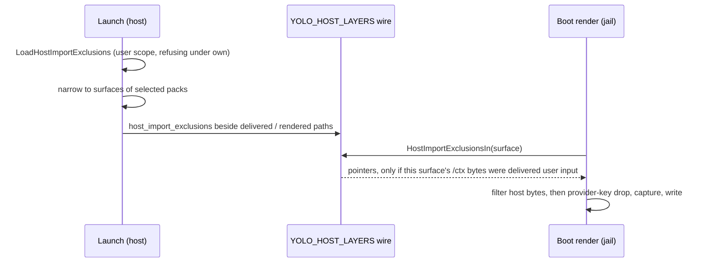

# Host import exclusions: exact members a jail does not import from the user's host config

**Status:** Verified 2026-11-06 against `56ace04dd`, by reading the code and its tests. No run of
the real-launch test (`TestHostImportExclusions` in `integration/`) was observed for this
verification.

A jail composes some agent config files from layers, and one of them, the **host layer**, is the
user's own copy of that file on the host, delivered into the jail
([the host layer](config-target-resolution.md)). **`host_import_exclusions`** lets the user leave
exact members of that file out of what the jail imports: a hook or a local preference that should
stay on the host, while the rest of the file still reaches the jail. It is a filter on that one
input, not a policy over the jail's final file. The host file is never written.

```toml
[host_import_exclusions]
"claude/settings" = ["/hooks", "/statusLine"]
```

| Component | Lives in |
| :--- | :--- |
| The exact-member filter | `internal/agentcfg` (`FilterHostImportExclusions`) |
| Validation, normalization, the user-scope read | `internal/config` (`LoadHostImportExclusions`, `ValidateConfig`) |
| Inheritance into a jail's and a nested launcher's user snapshot | `internal/config` (`FilterInheritErr`) |
| Launch: load, narrow to selected surfaces, put on the host-layer wire | `internal/cli/run` (`selectedHostImportExclusions`, `hostLayerEnv`); macos-user through `internal/macosuser` (`hostLayerWire`) |
| The wire and its per-surface lookup | `internal/entrypoint` (`HostLayerWire`, `HostImportExclusionsIn`) |
| Where the boot render applies it | `internal/entrypoint` (`renderPlannedSurface`) |
| Where the preview applies it | `internal/cli` (`hostLayerFor`, the `yolo config` preview's host-layer read) |

**Reads with:** [`config-target-resolution.md`](config-target-resolution.md) (the host layer, the
delivery report and the render baseline), [`config-ownership.md`](config-ownership.md)
(`host_management`), [`pack-system.md`](pack-system.md#config-surfaces-and-the-compose-engine)
(surface composition).

---

## The boundary

**The filter changes only the user's own host bytes on their way into a jail render.** It runs on
the host layer alone. A default, a pack contribution, a computed value, a managed value or a
captured in-jail edit at the same pointer is untouched, so an excluded member can still appear in
the jail's file when another layer supplies it. There is no deny list over the composed output.

## Invariants

- **Absent is today's import.** No key, an empty map, or an empty pointer list changes nothing,
  and the filter returns the original bytes unread.
- **User scope only.** The policy is read directly from user scope (its includes and an inherited
  user snapshot included), never from the merged config. A workspace declaration is a validation
  error naming the user config file. A jail passes the policy to a nested launcher through the
  inherited user snapshot, and a workspace snapshot is never its source.
- **Only effective `host_management: none` permits a non-empty policy.** Unset is `none`. Under
  `own`, the launch and `yolo host apply` refuse before reading any host bytes, naming each
  surface and its pointers and the fix: configure host-owned values through the pack
  contribution's host-versus-jail targeting, or remove the exclusions. Ownership is never
  inferred from the backend.
- **Only the user's bytes are filtered.** A host file the delivery report labels as yolo's own
  render is a baseline, not a layer, and is never filtered; neither is unknown or unsupported
  delivery, nor in-jail session-home bytes. Capture and provenance marks are not cleared.
- **The host source is read-only input.** Filtering never writes the original file or copies
  filtered bytes back.
- **An invalid or failing policy never degrades to an unfiltered import.** A malformed declaration
  refuses validation; a host file that, with exclusions active, cannot be decoded as an object or
  re-encoded after removal fails that surface's render (or preview), rather than passing the
  original bytes through.
- **Core knows no vendor setting names.** A pointer is the user's choice; `/hooks` means nothing
  special to core.

## The declaration

A map from a **surface address**, `<agent>/<name>` as in `claude/settings`, to a list of
[RFC 6901](https://www.rfc-editor.org/rfc/rfc6901) JSON Pointer strings. Pointers are parsed by
`internal/jsonptr`, so `~0` and `~1` escapes apply and `/` names the empty-string key. The empty
root pointer is refused: the control removes members, not whole documents. Each list is sorted
and deduplicated when it is normalized.

**Targets are checked against every surface yolo ships,** core's own and every embedded pack's,
whether or not its pack is selected:

- An address that names no shipped surface is a configuration error.
- A shipped surface that cannot receive an object host layer (it declares no `readsHost`, or its
  codec is not an object codec) is a configuration error: a `lines` or `raw` file has no members.
- A known, capable surface whose pack is not selected is **dormant**: kept, valid, and without
  effect until the pack is selected. The launch passes on only the addresses its selected packs
  declare. A target is never applied to a similarly named surface.

A surface a third-party pack declares is not in that shipped set, so it cannot be targeted.

## The filter

`FilterHostImportExclusions` decodes the host bytes with the surface's codec and, for each
pointer, walks **objects only**:

- A numeric token is an ordinary object key; array indices and `-` are never traversed.
- The final member is removed with its whole value, whatever its type. A parent left empty stays
  as an empty object.
- A missing member, or an intermediate that is not an object, is a **quiet no-op**: no warning,
  no summary, no substitute path ([`OQ-IH3`](#why-its-this-way)).
- Duplicate pointers are one request, and a descendant of a removed ancestor is a no-op, so
  declaration order never changes the result.
- When nothing was removed, the original bytes are returned unchanged rather than re-encoded.

An absent host file is the ordinary no-layer case: not an error, and no other path is probed.

> [!WARNING]
> **Do not reuse `agentcfg.DropHostProviderKeys` for this, or this for it.** The provider-key drop
> is adjacent and runs right after this filter on the same bytes, but its ownership,
> matching, pruning and failure rules differ. Only the pointer grammar is shared.

## Launch and boot



1. **The launch loads the policy before either backend stages or reads host bytes.** An invalid
   policy, or a non-empty one under `own`, refuses the launch, naming the user config file.
2. **The launch narrows the policy to the surfaces its selected packs declare** and carries it on
   the same host-layer delivery report that says which `/ctx` copies were delivered and which are
   yolo's render. Container backends and macos-user put it on that one wire; the jail never
   derives provenance itself, and `host_management` is never passed into the jail.
3. **The boot render applies it only to bytes that wire calls delivered user input,** after the
   host layer is read and before the provider-key drop, session-home capture and the writer.
   A `rmw` surface folds no host layer and is not filtered.

**The `yolo config` preview filters the same staged bytes with the same policy,** after it has
already declined a host destination, another workspace's staged copy, and a render baseline. A
preview with no staged copy for this jail stays unavailable; it never reads another source to
look complete. With exclusions active, a delivered staged copy that cannot be read is an error,
not a silent omission.

## Existing homes and capture

This is a **future-import filter**, not a purge:

- On the next launch the excluded member is absent from the host layer. On an established home,
  an unchanged value from the previous render falls out under the existing last-render
  comparison; a genuine captured in-jail edit stays in its capture layer and can still produce
  the member.
- First adoption and migration keep their archive and capture behavior; the filter neither
  erases captured residue nor claims an unbaselined value came from the host.
- Removing an exclusion restores future imports. Nothing on the host changed, so nothing needs
  recovering.
- **The policy takes effect on a launch that stages and renders it.** An attach does not restage a
  running jail's pack tree, and the key is classed as taking effect at the next restart.

## What this does not do

No change to the default import; no workspace declaration; no vendor-specific schema; no host
writes; no guarantee a pointer is absent from the final file; no new host path or credential
grant; no attach-time reconfiguration; no filtering of `yolo host apply`'s render, which
validates the policy and filters nothing; no hook-shell parsing, implicit reads, crawling, regex,
wildcard, recursive rule, value match or array-index selector.

> [!WARNING]
> **Do not reach for the obvious alternatives.** Filtering the final composed file would suppress
> pack, default, computed, managed and captured values and turn an input control into a
> vendor-key policy. A null or tombstone crosses layers and can suppress a pack's value. Writing
> the host file makes a jail-only choice into a host edit. Automatic regex dropping of hook
> commands was assessed and rejected: it removed working `printf` text and a quoted script path
> with a space.

Copying hook bodies into a jail is a separate capability with a different file-read boundary, and
is not part of this filter.

## Why it's this way

| ID | Ruling | Why it holds |
| :--- | :--- | :--- |
| OQ-IH1 | User config only: a workspace cannot declare, replace or extend exclusions, and the host-management gate stays a direct read of user scope | A workspace is writable by the jailed agent and travels with the repository; reading the merged config would let it change what crosses from the user's host files. |
| OQ-IH2 | Keep it dormant: targets are validated against shipped capable surfaces, a known target for an unselected pack is kept without effect, and unknown or incapable targets stay errors | One user policy serves every workspace, whatever each selects; a typo is still caught everywhere. |
| OQ-IH3 | Quietly do nothing: a valid pointer that misses a member or crosses a non-object changes nothing and says nothing | The owner: *"These are just filters acting like filters. If the thing to be filtered out doesn't exist, it won't get filtered out because it's not there anyway."* A warning would turn a filter into a schema assertion. |

## Current values

Verified at `56ace04dd`. The prose above explains what each is for; this table is the only place
the exact values are stated.

| Value | Setting | Defined in |
| :--- | :--- | :--- |
| Config key | `host_import_exclusions`, user scope only | `config.hostImportExclusionsKey`, `config.WorkspaceUserScopeOnlyKey` |
| Wire | the `host_import_exclusions` field of the `YOLO_HOST_LAYERS` report | `entrypoint.HostLayerWire`, `packload.HostLayerEnvVar` |
| Inheritance | carried into both the preflight and the nested user snapshot | `config` inherit census |
| When a change takes effect | at the next restart | `changetiming` |
| Real-launch test | `TestHostImportExclusions` | `integration/hostimportexclusions_test.go` |
