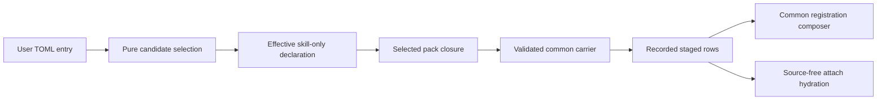

# Direct user TOML scoped pack imports

Yolo manages a workspace's coding environment, including selected skills and the supporting
files they read. A jail is the default delivery environment; host apply uses the same selection.
A user TOML pack entry can select skills for every workspace without creating a wrapper pack.

**Status:** Core runtime mechanisms verified against `35055d92094c248c1cde87dfe3273fc3a5255e29`;
reviewed refusal repairs are in `f7ac0336cfed659cf25bbae1d81470167d9db004`.
MEASURED: synthetic Linux nested Podman delivery, including a user fragment across workspaces,
typed markerless folders and local Git sourced rows. UNMEASURED: native macOS, rootless-only
behavior, real agent discovery and provider integration. These observations do not establish
the primary-tree landing or full launch-suite gates. The accepted design and plan remain live
until [remaining presentation and verification](../../design/toml-scoped-pack-imports-plan.md#remaining-presentation-and-verification)
are closed.

## Selection before activation

A **scoped import** is a pack entry whose nonempty `skills` table requests selected registrations.
A **projection** is its effective selection record and resolved rows, not a filtered checkout.
The projection replaces the original declaration before dependency closure or delivery.

A **typed candidate** comes from a governed ordinary skill directory or a manifest sourced row.
A **raw candidate** comes from an explicit marker-bearing directory treated as data.
A **registration** is the selected row's named private directory in an agent's skills destination.
A **carrier** is the supporting payload or selected-directory copy the registration reads.
A carrier is not a selected pack, plugin, program or capability.

Without `skills`, `subdir` alone relocates a whole pack and preserves all ordinary effects.
With `skills`, only selected registrations participate. Supporting bytes cannot reintroduce
programs, needs, hooks, briefing, native plugins, MCP services or host grants.

## Reader map

| Reader question | Reference |
| :--- | :--- |
| How are modes, roots, selectors and identities interpreted? | [Inputs and selection](selection.md) |
| How do carriers, markers, licenses, refresh and replay work? | [Recorded delivery](delivery.md) |
| What can inspection prove, and which callers test the contract? | [Inspection and verification](inspection.md) |

For the complete key schema use `yolo config-ref`; for editing flags use `yolo pack --help`.
The [user guide](../../../userguide/guides/packs-and-skills.md#select-only-skills-from-a-pack)
starts with the host commands. The [pack system](../pack-system.md) owns whole-pack behavior.

## Four distinct input channels

| Channel | Authority and selection |
| :--- | :--- |
| Direct scoped user TOML `packs` entry | User-only roots and candidate-name selectors; no wrapper required |
| Manifest sourced `[[skills]]` row | A selected pack registers an explicit non-root Git marker with optional alias/license/audience |
| Workspace `skill_imports` | Workspace-approved Git access and the confined workspace-skill reader; not pack selection |
| Legacy JSONC `only`/`exclude` | Existing file-glob filtering and sourced-row withholding, unchanged |

A workspace cannot select a pack. A fragment of the user config can. No import channel gains
another channel's permissions by sharing payload bytes. See [workspace Git skills](../workspace-git-skills/README.md)
and [manifest sourced registrations](../git-sourced-skills.md).

## Invariants

1. Normal TOML entries retain baseline behavior.
2. Scoped delivery never loads original sources as packs/plugins.
3. No refusal falls back to whole pack or a partial subset.
4. No pure reader transports; no shared object depends on selection.
5. Legacy reader, wire filters and withholding are unchanged.
6. Generic core has no source/framework/agent switch.
7. Directory kind is resolver-produced only, with no authored or entry-wire knob.
8. No synthesized marker. Inspection labels markerless rows as folders; host-apply counting
   and invocation reporting still have the limitation below.
9. Failed advanced-pin projection never publishes, widens or reuses prior selection.
10. Author-directory lint and footprint are unchanged and never resolve configured scope.
11. Explain never reports fewer import tuples than the handle has, and no surface prints counts it did not read.
12. Scoped inspection and explain write nothing; check's whole-entry readiness pass is unchanged and is the only pack-entry staging check performs.

## Boundaries that supporting files do not cross

A selected script may read repository siblings through its payload-backed path. This is a
content reachability observation, not a workspace installation or dependency guarantee.
A private rewritten marker's relative parent reference need not resolve the same way.

Native plugin wrappers are not skill candidates. An inert support file named like plugin,
hook or server metadata does not activate its contents. A whole-pack import still has its
ordinary plugin and program behavior; narrowing is an affirmative selection, not a whole
pack whose effects happen to be hidden by filename filters.

Host apply and jail composition share the resolver and registration machinery. Backend path
mapping differs; the selection, naming, licenses and recorded row constraints do not.
Linux fixtures cannot prove native Mac path delivery or rootless host network/ID mapping.

## Known limitations

The [tracked remaining work](../../design/toml-scoped-pack-imports-plan.md#remaining-presentation-and-verification)
owns three deferred presentation defects: host apply still counts markerless folders and advertises
invocation; unpublished manifest-sourced inspection can attribute the enclosing pack's commit;
and scoped inspection omits the retained audience. These are defects against the accepted contract,
not permission to change selection or discovery. The reference does not claim those paths already
satisfy every reporting invariant.

## Ownership

`PackEntry` in `internal/config` owns modern authored selection and tuple identity.
`SkillProjection` in `internal/packload` owns resolved rows and effective declaration.
The shared payload/registration machinery in `internal/packsrc` and `internal/hostskills`
owns validated carrier content and private registration writes.
The run pipeline and entrypoint consume the same versioned staged record for replay.
