# Workspace Git skill imports

**Status:** Verified 2026-11-16 against `6b8879611`. MEASURED: focused public
skills commands, store/projection and lock-handoff regressions passed on the combined
A/B tree. Native macOS execution is not established by these Linux checks.

Yolo describes a coding environment per workspace and renders it where the agent runs.
Workspace Git imports add selected instruction files to that environment's jail skill
layer. They do not select packs, install programs or grant access to host credentials.
A skill can influence an agent that reads it, but import itself activates no effect.

## Vocabulary

These terms describe the skill-import system, not the pack system:

| Term | Meaning and exclusion |
| :--- | :--- |
| Import | One workspace declaration choosing a Git source, commit/ref, directory and optional name filter; not a pack selection |
| Handle | The declaration's key used by commands and messages; not a namespace prefix for delivered skills |
| Pin | A full commit object ID selecting fixed content; not a branch tip |
| Moving ref | A branch/tag name whose recorded target selects content; not reproducible identity by itself |
| Projection | Read-only object traversal selecting eligible skill directories; not manifest/plugin discovery |
| Skill directory | An immediate child beneath the selected path with a confined regular `SKILL.md` marker |
| Import store | Host-owned Git objects for one workspace; not a checkout or authority |
| Resolution record | Host-owned selected commit, source/ref, access class and timestamp for a handle; not an approval or repository lockfile |
| Access class | Whether content was fetched anonymously or with authenticated access; not a grant |

## The spine

```mermaid
flowchart LR
    D["Workspace declaration"] --> V["Offline validation"]
    V --> G["Existing config gate"]
    G --> A["Current Git access decision"]
    A --> R["Fresh-launch resolution"]
    R --> S["Host objects and record"]
    S --> P["Read-only projection"]
    P --> C["Confined skill staging"]
    C --> J["Jail skill destinations"]
    S --> I["Host list or attach reader"]
    I --> P
```



Host `add` and `update` enter resolution under last-approved authority narrowed by
current state; they do not run or write the config gate. Attach enters the reader path
only and never refreshes a record. `yolo host` receives no workspace-derived imports.

## Reader map

| Question | Owner |
| :--- | :--- |
| Which URLs and cached content may be used? | [Authority](authority.md) |
| Who writes records/config, and when are refs refreshed? | [Lifecycle and commands](lifecycle.md) |
| Which files arrive, in what order, with what bounds? | [Projection and observations](projection.md) |

[The workspace skill layer](../agent-briefings.md#the-workspace-layer) owns existing
workspace delivery and priority. [The Git broker](../git-broker.md) owns its access
filter; imports reuse that policy. [Pack selection](../pack-system.md#oq-pk1) remains
user-scope. The [workspace-pack proposal](../../design/workspace-packs.md) is separate.

## Declaration shape

```toml
[skill_imports.review]
git = "https://example.org/team/agent-skills"
ref = "main"
path = "skills"
only = ["review"]
```

Use `rev` for a pin; with both fields, `ref` is an update label, not launch selection.
Entries are workspace-only, including project/local files and includes. User scope
has a scalar veto, not another import list. Validation is offline: a legal URL is not
permission to fetch it. List merge follows ordinary config union semantics; an empty
higher-layer filter cannot erase names supplied by a lower layer.

The complete schema lives in `yolo config-ref`, and command flags in `yolo skills --help`.
Use `yolo skills add <url>` on the host to add a pin, `--track` for a moving ref,
and `yolo skills list` for the on-demand configuration/state/delivery view.

## Boundaries

- No pack manifest, `needs`, plugin registration, unconditional briefing or program
  activation crosses this key. Bundled scripts arrive only as files.
- No new broker operation, grant, remote scope entry, credential or host write RPC.
- No workspace-selected packs, user-scope imports, audiences, renaming or exclusion filters.
- No host workspace-skill delivery and no cleanup/GC policy for stored objects.
- Old builds that do not know the key refuse it as unknown, rather than silently importing.

## Where the code lives

| Responsibility | Anchor |
| :--- | :--- |
| Scope, validation and stable entry order | `SkillImport`, `SkillImports` in `internal/config` |
| Commands and config transactions | `skillsMain` in `internal/cli` |
| Post-gate resolution and reader staging | `resolveFreshSkillImports`, `projectSkillImports` in `internal/cli/run` |
| Objects, records and projection | `Store`, `Resolution`, `Projection` in `internal/skillimports` |
| Filtered fetch and cached executable placement | `FetchImport`, `TrustedImportGit` in `internal/gitbroker` |

## Why it's this way

| ID | Constraint |
| :--- | :--- |
| WGS-R1 | Workspace-selected instruction files are allowed, but pack effect authority is not. |
| OQ-WGS1 | Both full commit pins and moving refs are supported; pin-only is not the contract. |
| OQ-WGS2 | Imports must use the workspace's existing Git filter, never unfettered host credentials. |
